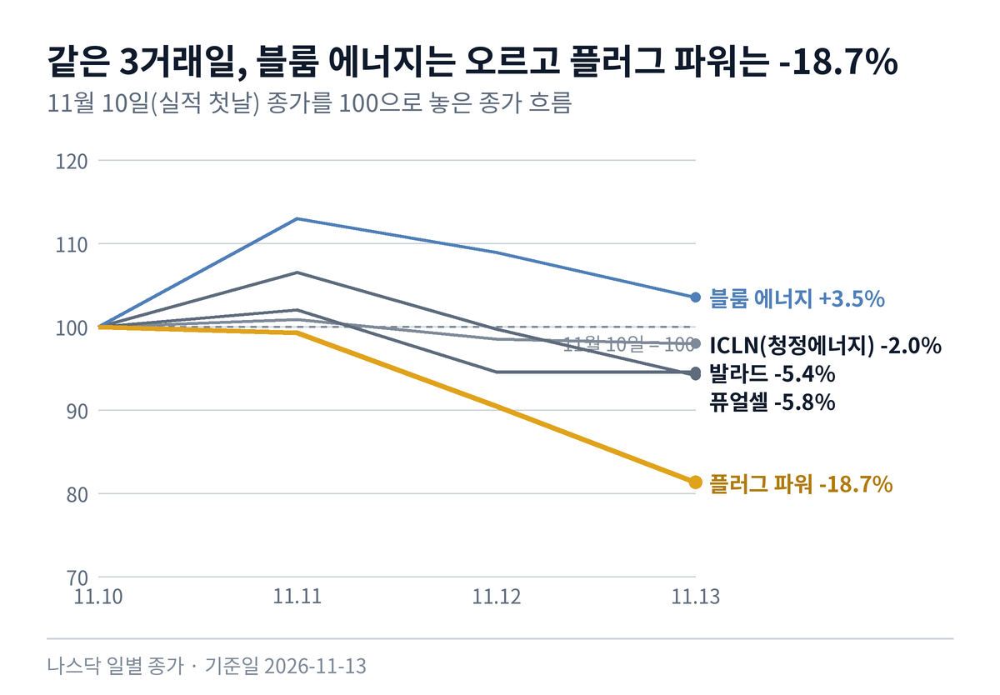
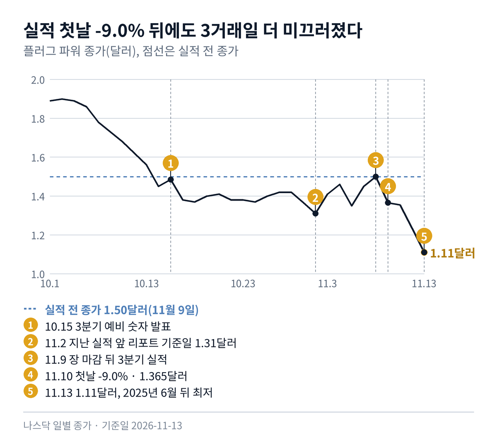
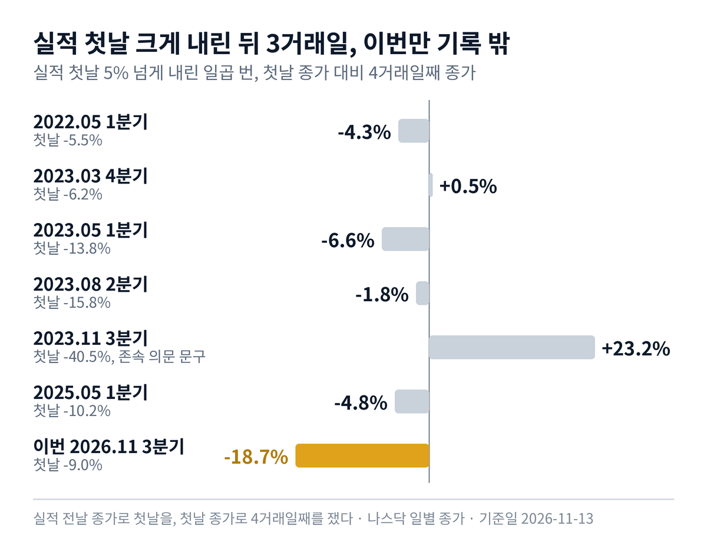
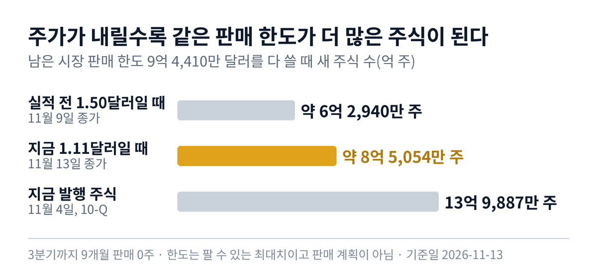
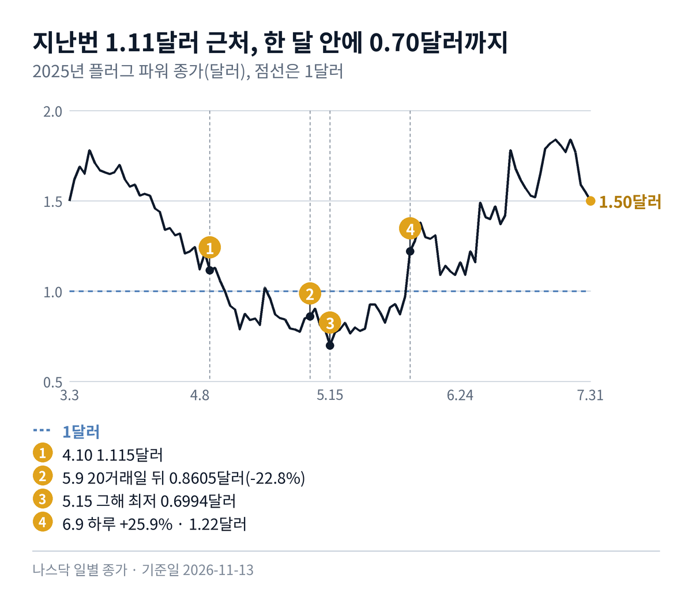
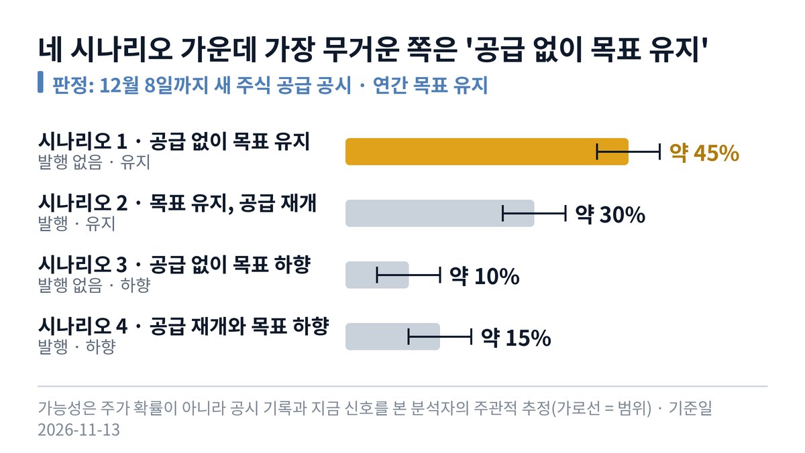

실적 다음 날 9.0% 내린 플러그 파워는 그 뒤로도 멈추지 않았습니다. 11월 11일부터 13일까지 3거래일 동안 18.7%가 더 빠져, 13일 종가는 1.11달러였습니다. 2025년 6월 이후 가장 낮은 종가입니다. 그 3거래일 동안 회사가 SEC에 낸 서류는 한 장도 없었습니다. 같은 3거래일, 같은 연료전지 회사인 블룸 에너지는 3.5% 올랐습니다. 새 소식이 없었는데, 주가는 무엇에 밀려 내려갔을까요?

> **유의사항** 저자는 금융·투자 자문가가 아닙니다. 이 글은 공개 공시와 시세를 정리한 교육용 분석이며 특정 종목의 매수·매도를 권하지 않습니다. 과거 패턴은 미래 수익을 보장하지 않고, 플러그 파워는 실적 날 하루에 40% 넘게 내린 적이 있는 종목입니다. 실제 투자 전에는 최신 공시를 직접 확인하세요.

이 글은 실적 다음 날 낸 [11월 10일 기준 리포트](/r/plug-2026-11-2/)의 후속편입니다. 그 리포트는 실적 첫날 5% 넘게 내린 과거 여섯 번을 모아, 여섯 번 모두 5거래일째에는 실적 전 가격보다 낮았다고 적었습니다. 첫 주에는 대개 더 밀린다는 기록이었습니다. 지난 예측 성적은 적중 하나, 빗나감 없음, 진행 중 셋입니다.

맞은 것이 그 첫 주입니다. 4거래일째인 11월 13일 종가는 실적 전 1.50달러보다 26.0% 낮습니다. 5거래일째인 11월 16일 종가가 실적 전 가격을 되찾으려면 하루에 35% 넘게 올라야 합니다. 나머지 셋은 12월 8일에 판정합니다. 그중 하나는 불리하게 가고 있습니다. 지난 리포트는 12월 8일 종가가 첫날 종가 1.365달러 위일 가능성을 절반을 조금 넘게 봤는데, 지금은 그보다 18.7% 아래입니다.

플러그 파워는 수소를 만드는 장비와 쓰는 장비를 함께 파는 회사입니다. 돈을 버는 방식은 세 가지입니다. 물류창고 지게차용 연료전지를 팔고, 물을 전기로 갈라 수소를 만드는 전해조를 팔고, 수소 연료를 팝니다. 3분기 매출은 2억 60만 달러였습니다. 1년 전보다 13.3% 늘어난 숫자입니다. 다만 아직 원가가 매출보다 큽니다. 그래서 이 회사 주가는 매출보다 현금과 주식 수에 더 민감하게 움직여 왔습니다.

11월 11일은 0.7% 내려 거의 제자리였습니다. 12일에 8.9%, 13일에 10.1%가 빠졌습니다. 하락은 뒤로 갈수록 커졌습니다. 그런데 거래량은 반대였습니다. 3거래일 평균 약 3,706만 주로, 실적 전 20거래일 평균 약 5,771만 주의 64% 정도였습니다. 많이 던져서 내려간 것이 아니라, 사려는 쪽이 줄어든 상태에서 값이 미끄러진 모양입니다.

지난 리포트는 플러그 파워의 흐름을 세 국면으로 나눴습니다. 파산 걱정 뒤 급반등하는 국면 A, 급등 뒤 새 주식 공급이 따라오는 국면 B, 그리고 하루 큰 소식 없이 한 달에 20~30%씩 내려가는 국면 C입니다. 지금은 국면 C, 곧 매수세가 서서히 사라지는 단계로 봤습니다. 거래량이 줄어든 채 내리는 이번 3거래일은 그 설명에 맞습니다. 다만 속도가 다릅니다. 한 달에 걸릴 폭을 4거래일에 내려갔습니다.

업종을 나란히 놓으면 무엇이 빠졌는지가 보입니다. 같은 11월 10일 종가 대비 13일까지 퓨얼셀 에너지는 5.8%, 발라드 파워는 5.4% 내렸습니다. 청정에너지 상장지수펀드(ICLN)는 2.0%, 소형주 펀드(IWM)는 1.1% 내렸습니다. 반면 블룸 에너지는 3.5% 올랐고, 나스닥 100 펀드(QQQ)도 0.8% 올랐습니다. 덩치가 큰 블룸 에너지는 버텼고, 적자를 내는 작은 연료전지 회사들이 함께 약했습니다. 플러그 파워의 낙폭은 그 무리의 세 배를 넘습니다.

실적 반응이 길게 이어졌을 뿐이라면 과거에도 비슷한 뒤끝이 있었어야 합니다. 그래서 지난 리포트의 여섯 번을 다시 꺼내, 첫날 종가에서 4거래일째 종가까지만 쟀습니다. 네 번은 더 내렸지만 폭은 1.8%에서 6.6% 사이였습니다. 한 번은 거의 제자리였고, 존속 의문 문구가 나와 첫날 40.5% 빠졌던 2023년 11월은 오히려 23.2% 되올랐습니다. 이번 -18.7%는 가장 깊었던 기록의 세 배 가까이 됩니다. 과거와 비교하면 이례적인 낙폭이고, 이유는 공시로 확인되지 않습니다.

남는 것은 주가 자체가 만드는 산수입니다. 10-Q를 보면 회사는 3분기까지 9개월 동안 시장에서 새 주식을 한 주도 팔지 않았습니다. 대신 앞으로 팔 수 있는 판매 한도가 9억 4,410만 달러 남아 있습니다. 시장 판매는 회사가 증권사에 맡겨 증시에서 새 주식을 조금씩 나눠 파는 방식입니다. 이 한도는 주식 수가 아니라 금액이라, 주가가 낮을수록 같은 돈에 더 많은 주식이 필요합니다.

숫자로 옮기면 이렇습니다. 1.11달러에서 한도를 다 쓰면 새 주식은 약 8억 5,054만 주입니다. 지금 주식의 약 61%입니다. 실적 전 1.50달러였다면 약 6억 2,940만 주였을 숫자입니다. 주가가 26% 내리는 동안, 같은 한도가 뜻하는 주식 수는 35% 늘었습니다. 회사는 이와 별도로 요크빌이라는 투자사에 주식을 팔 수 있는 약정도 갖고 있습니다. 올해 2월에는 발행할 수 있는 주식 수의 상한도 두 배로 늘렸습니다. 금액과 날짜는 끝의 '주가와 판매 한도로 본 지금' 표에 있습니다.

이 산수가 3거래일 하락의 원인이라고 확인해 주는 자료는 없습니다. 회사는 판매를 시작한다고 밝히지 않았고, 9개월 동안 판 적도 없습니다. 다만 주식을 사려는 쪽에서 이 한도를 미리 계산에 넣었을 가능성은 있습니다. 가능한 배경 하나로만 봅니다. 쓸 수 있는 현금은 9월 말 1억 3,413만 달러이고, 3분기에는 2,800만 달러를 썼습니다. 주가가 낮아질수록 같은 판매가 기존 주주의 지분 비율을 더 크게 줄입니다. 이것을 희석이라고 합니다.

과거에 이 가격대에서 무슨 일이 있었는지가 숨은 기록입니다. 플러그 파워가 마지막으로 1.11달러 근처에 있었던 것은 2025년 4월입니다. 4월 10일 종가 1.115달러에서 20거래일 뒤 5월 9일 종가는 0.8605달러로 22.8% 낮았습니다. 그 사이 5월 15일에는 0.6994달러까지 내려갔습니다. 2025년 4월 16일부터 6월 6일까지 종가가 1달러 아래였던 날은 35거래일이었습니다.

1달러에는 이유가 있습니다. 나스닥은 호가가 30영업일 연속 1달러 아래면 회사에 통지하고, 보통 180일의 회복 기간을 줍니다. 2025년에는 그 기준에 조금 못 미친 채로, 6월 9일 하루 25.9% 오르며 1달러 아래 흐름이 끊겼습니다. 지금 1.11달러는 1달러선까지 약 10% 남은 자리입니다.

그때와 지금이 같지는 않습니다. 2025년 5월에는 1분기 실적 첫날 10.2% 내린 뒤 4거래일째부터 20거래일째까지 65.7% 올랐습니다. 같은 기록 안에 가장 큰 반등도 있었다는 뜻입니다. 실적 첫날 크게 내린 여섯 번을 4거래일째부터 다시 세면 세 번은 20거래일째에 더 높았고, 세 번은 더 낮았습니다. 이 기록만으로는 방향을 말할 수 없습니다.

11월 13일 종가 1.11달러는 실적 전보다 26.0%, 실적 첫날보다 18.7% 낮습니다. 국면 C는 그대로이고, 국면을 바꿀 신호인 하루 20% 넘는 상승과 거래량 급증은 아직 없습니다. 판을 바꿀 소식은 두 갈래입니다. 하나는 새 주식 공급 공시이고, 다른 하나는 11월 19일 온라인 심포지엄에서 회사가 연간 목표를 지키는지입니다. 회사는 올해 매출을 작년보다 15~16% 늘리고, 4분기 조정 이익(EBITDAS)을 흑자로 만들겠다고 했습니다. EBITDAS는 이자·세금·감가상각·주식 보상 비용을 빼기 전 이익입니다.

시나리오는 두 질문으로 나눈 네 가지입니다. 공급 없이 목표를 지키는 경우와 목표는 지키되 공급이 다시 시작되는 경우가 있습니다. 반대로 공급 없이 목표를 낮추는 경우와 공급·목표 하향이 함께 오는 경우도 있습니다. 네 시나리오의 가능성은 지난 리포트의 추정을 그대로 둡니다. 3거래일 하락은 주가를 바꿨지만, 시나리오를 가르는 두 사실은 바꾸지 않았기 때문입니다. 11월 13일까지 새 주식 공급 공시는 없었고, 회사가 목표를 고쳤다는 공시도 없었습니다. 실적 첫날 크게 내린 과거 여섯 번에서도 20거래일 안에 새 주식 판매 공시가 나온 것은 6번 중 0번이었습니다. 다만 표본이 여섯 번뿐이고, 아래처럼 2025년 11월에는 실적 9일 뒤 전환사채가 나왔습니다. '공급 없이 목표 유지'가 약 45%로 가장 크고, '목표는 유지하되 공급 재개'가 약 30%입니다. 목표를 낮추는 두 시나리오는 합쳐 약 25%입니다. 조심할 날짜도 하나 있습니다. 2025년에는 11월 실적 9일 뒤인 11월 19일에 전환사채 발행이 나왔고, 그날 주가는 11.2% 내렸습니다. 올해 심포지엄도 11월 19일입니다. 이 숫자들은 주가가 오를 확률이 아니라 공시 기록과 지금 신호를 보고 분석자가 주관적으로 매긴 추정입니다.

주가 쪽 질문은 따로 하나 더 둡니다. 12월 8일 종가가 4거래일째 종가 1.11달러 위인지입니다. 과거 기록은 반반이었고, 2025년 같은 가격대의 기억은 아래쪽이었습니다. 그래서 위일 가능성을 절반보다 조금 낮게 봅니다. 근거가 여섯 번과 2025년 한 번뿐이라, 분석자의 주관적 판단입니다.

이 분석에는 한계가 있습니다. 비교한 실적 기록은 여섯 번뿐이고, 3거래일 하락의 이유는 공시로도 보도로도 확인하지 못했습니다. 자금 조달은 가장 빨리 판을 바꿀 수 있습니다. 판매가 시작되면 지금의 하락보다 그 공시가 더 큰 신호가 됩니다. 사업 쪽에서는 4분기 매출이 3분기의 약 1.4배가 돼야 연간 목표를 맞춥니다. 덴마크와 호주의 전해조 주문이 4분기 매출에 얼마나 잡히는지는 아직 공개되지 않았습니다.

3분기 현금 숫자는 10월 15일 예비 발표와 같았고, 회사는 아홉 달 동안 시장 판매로 새 주식을 팔지 않았습니다. 그런데도 주가는 실적 뒤 4거래일 만에 실적 전 종가 대비 26.0% 내려 1달러선 가까이 왔습니다. 적자 연료전지 업종이 함께 약했고, 가격이 낮아질수록 남은 판매 한도가 더 무거워지는 산수가 겹쳤습니다. 다음 갱신은 11월 19일 심포지엄과 12월 8일 20거래일째 종가를 본 뒤에 하고, 그 전에 새 주식 공급 공시가 나오면 앞당깁니다.

## 숫자로 다시 보기

### 실적 앞뒤 5거래일

| 날짜 · 장면 | 플러그 파워 종가 | 실적 전 종가 대비 |
| --- | --- | --- |
| **11.09 장 마감 뒤 3분기 실적** | **1.50달러** | 기준 |
| 11.10 첫날 | 1.365달러 | -9.0% |
| 11.11 | 1.355달러 | -9.7% |
| 11.12 | 1.235달러 | -17.7% |
| **11.13 2025년 6월 뒤 최저 종가** | **1.11달러** | **-26.0%** |

| 같은 3거래일(11.10 → 11.13) | 변화 |
| --- | --- |
| **플러그 파워** | **-18.7%** |
| 블룸 에너지 | +3.5% |
| 퓨얼셀 에너지 · 발라드 파워 | -5.8% · -5.4% |
| ICLN · IWM · QQQ | -2.0% · -1.1% · +0.8% |

11월 11~13일 평균 거래량은 약 3,706만 주로, 실적 전 20거래일(10월 13일~11월 9일) 평균 약 5,771만 주보다 적었습니다.

### 실적 첫날 5% 넘게 내린 일곱 번 기록표

모두 실적 전날 종가와 첫날 종가를 기준으로 쟀습니다. '4거래일째'는 첫날을 1로 센 넷째 거래일, '20거래일째'는 스무째 거래일입니다.

| 첫날 · 실적 · 첫날 변화 | 첫날 → 4거래일째 | 4거래일째 → 20거래일째 |
| --- | --- | --- |
| 2022.05.10 1분기 · -5.5% | -4.3% | +25.4% |
| 2023.03.02 4분기 · -6.2% | +0.5% | -17.7% |
| 2023.05.09 1분기 · -13.8% | -6.6% | +20.9% |
| 2023.08.10 2분기 · -15.8% | -1.8% | -7.0% |
| 2023.11.10 3분기 · -40.5% 존속 의문 문구 | +23.2% | -7.8% |
| 2025.05.13 1분기 · -10.2% | -4.8% | +65.7% |
| **이번 2026.11.10 3분기 · -9.0%** | **-18.7%** | 12월 8일 판정 |

### 주가와 판매 한도로 본 지금(11월 13일 기준)

| 항목 | 값 · 근거 |
| --- | --- |
| 시가총액 | **약 15억 5,275만 달러** 1.11달러 × 13억 9,887만 주(11월 4일) |
| 현금 | **1억 3,413만 달러** 9월 30일, 쓰임 제한 없음 |
| 3분기 현금 사용 | **2,800만 달러** 4분기도 비슷할 수 있다는 회사 설명 |
| 남은 시장 판매 한도 | **9억 4,410만 달러** 9개월 판매 0주 |
| 한도를 다 쓸 때 새 주식 | **약 8억 5,054만 주** 1.11달러 기준, 지금 주식의 약 61%(1.50달러면 약 6억 2,940만 주) |
| 요크빌 주식 매입 약정 | **최대 10억 달러** 2027년 2월 10일까지, 하루 1,000만 달러 한도 |
| 발행 가능 주식 상한 | **30억 주** 2026년 2월 12일 15억 주에서 늘림 |

판매 한도와 약정은 앞으로 새 주식을 팔면 들어올 수 있는 최대치이고, 가진 돈이 아닙니다. 서로 더하지 않았습니다.

### 2025년 같은 가격대 이후

| 날짜 · 장면 | 종가 | 비교 |
| --- | --- | --- |
| 2025.04.10 1.115달러 | 1.115달러 | 기준 |
| 2025.05.09 20거래일 뒤 | 0.8605달러 | -22.8% |
| 2025.05.15 그해 최저 | 0.6994달러 | -37.3% |
| 2025.06.09 하루 +25.9% | 1.22달러 | 1달러 아래 흐름 끝 |

2025년 4월 16일부터 6월 6일까지 종가가 1달러 아래였던 날은 35거래일이고, 가장 길게 이어진 것은 28거래일이었습니다. 나스닥 통지 기준(30영업일 연속)에는 2거래일 모자랐습니다.

### 지난 예측 채점표

| 지난 점검 항목 · 당시 기준 | 판정과 실제 결과(11월 13일) |
| --- | --- |
| **첫 주에는 더 밀린다** 여섯 번 모두 5거래일째 실적 전보다 낮음 | **[적중]** 4거래일째 1.11달러, 실적 전 대비 -26.0%(5거래일째 11월 16일 종가로 확정) |
| **12월 8일 첫날 종가 1.365달러 위** 절반을 조금 넘게 | **[진행 중]** 지금 1.11달러, 첫날보다 -18.7% |
| **12월 8일까지 새 주식 공급 공시 0건** 시나리오 1·3 합 약 55% | **[진행 중]** 11월 13일까지 0건 |
| **연간 목표 유지** 시나리오 1·2 합 약 75% | **[진행 중]** 11월 19일 심포지엄 확인 |

### 앞으로 일어날 수 있는 일

과거 기록: 실적 첫날 5% 넘게 내린 여섯 번 가운데 20거래일 안에 새 주식 판매 공시가 나온 것은 6번 중 0번이었습니다. 2025년에는 11월 실적 9일 뒤에 전환사채가 나왔습니다.

아래 가능성은 주가 상승·하락 확률이 아니라, 12월 8일까지 새 주식 공급과 연간 목표 유지 여부에 대한 분석자의 주관적 추정입니다. 네 시나리오는 겹치지 않아 더하면 100%이고, 괄호 안 범위는 더하지 않습니다.

| 시나리오(판정 12월 8일) | 공급 · 목표 | 가능성(추정) |
| --- | --- | --- |
| **시나리오 1 · 공급 없이 목표 유지** | 발행 없음 · 유지 | 높음 약 45% (40~50%) |
| 시나리오 2 · 목표는 유지, 공급 재개 | 발행 · 유지 | 중간 약 30% (25~35%) |
| 시나리오 3 · 공급은 없지만 목표 하향 | 발행 없음 · 하향 | 낮음 약 10% (5~15%) |
| 시나리오 4 · 공급 재개와 목표 하향 | 발행 · 하향 | 낮음 약 15% (10~20%) |

'공급'은 11월 10일부터 12월 8일까지 시장 판매·공모·전환사채·요크빌 약정 사용 공시 가운데 하나가 나오는 경우입니다. '목표 유지'는 연간 매출 15~16% 성장과 4분기 EBITDAS 흑자 목표를 낮추지 않는 경우입니다. 주가 쪽 질문인 '12월 8일 종가가 1.11달러 위'는 절반보다 조금 낮게 봅니다.

### 핵심 확인 세 가지

| 순위 · 확인할 것 | 판정 날짜 |
| --- | --- |
| **1순위** 새 주식 공급 공시가 0건인가 | 12월 8일까지 |
| **2순위** 연간 매출 15~16% 성장·4분기 흑자 목표를 유지하나 | 11월 19일 심포지엄 |
| **3순위** 종가가 4거래일째 1.11달러 위인가 | 12월 8일 |
