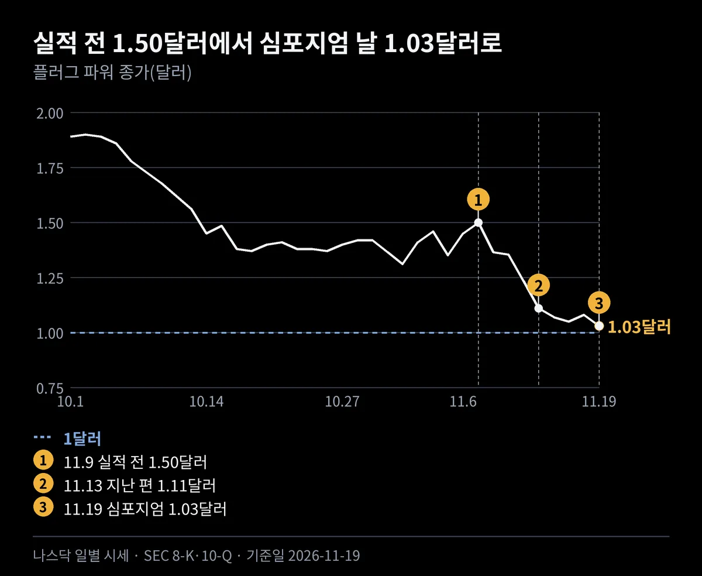
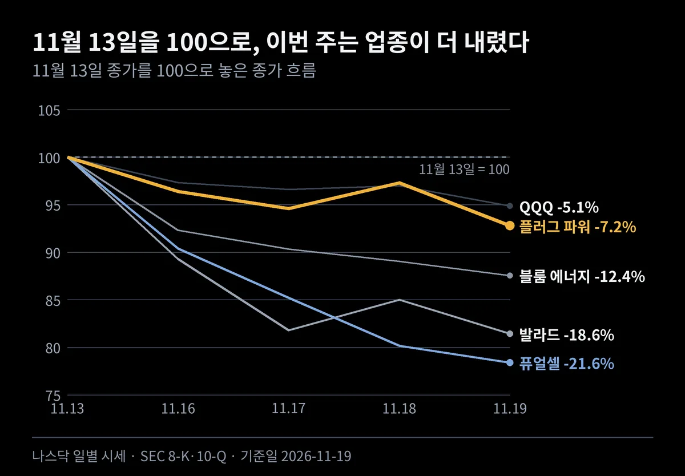
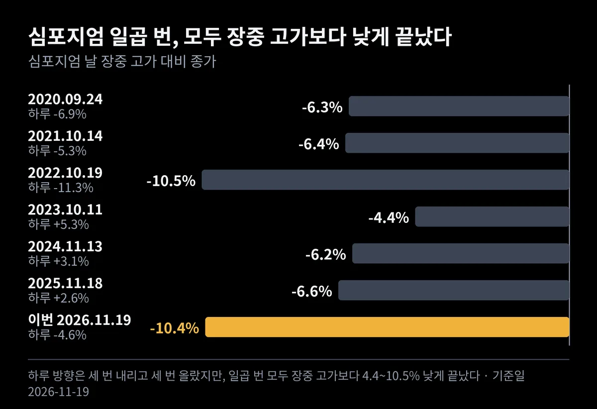
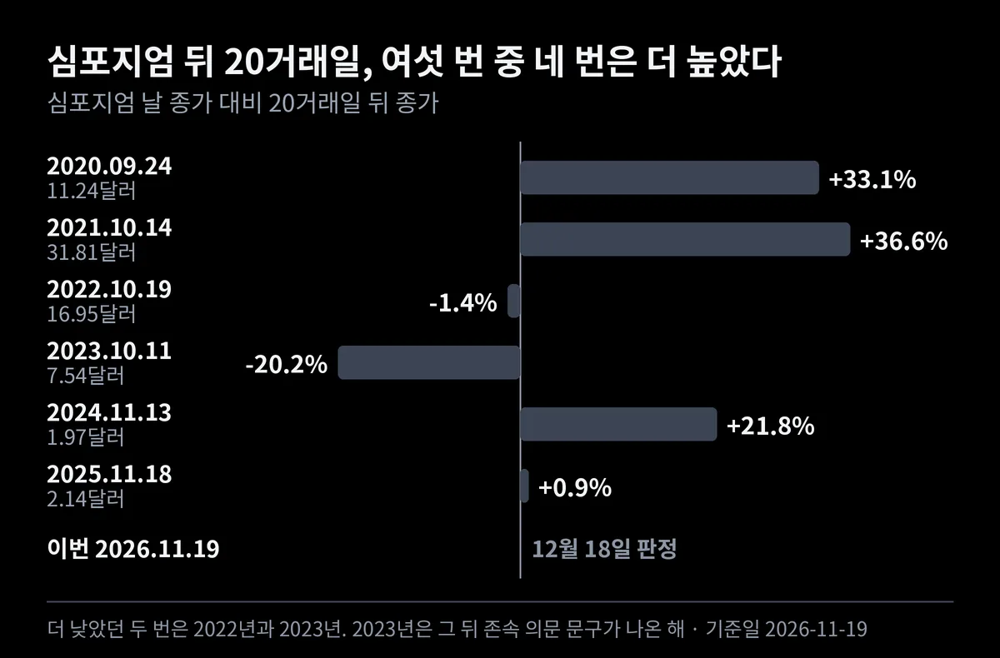
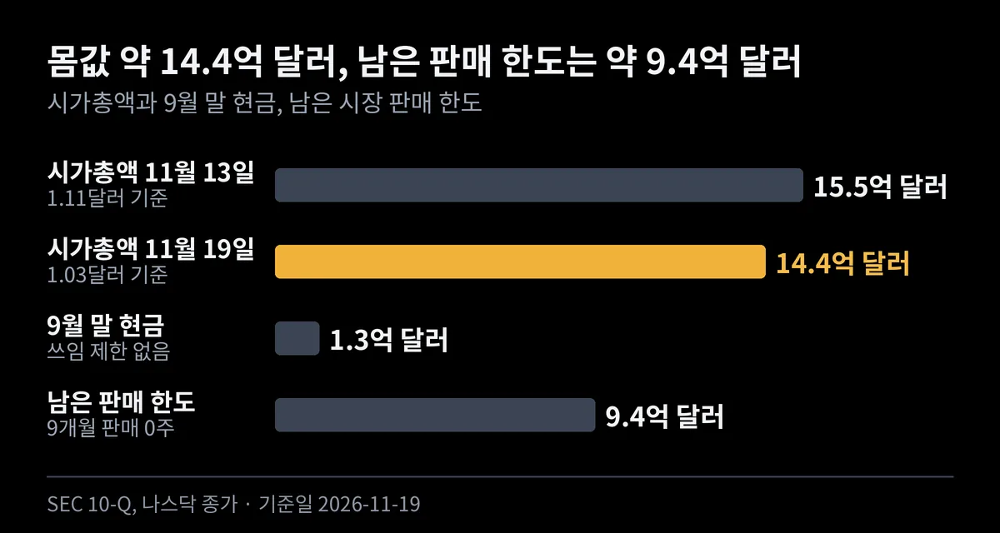
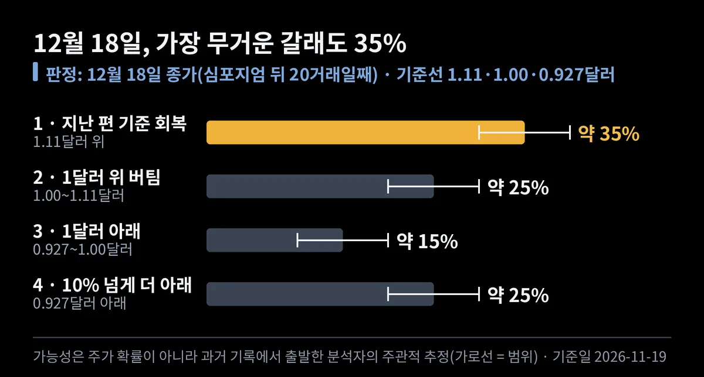

11월 19일 아침, 플러그 파워는 여덟 번째 연례 심포지엄을 열었습니다. 회사는 올해 4분기 조정 이익(일부 비용을 빼기 전 이익) 흑자와 2027년 영업이익 흑자, 2028년 순이익까지 흑자라는 목표를 다시 말했습니다. 주가는 장중 1.15달러까지 올랐습니다. 그런데 종가는 1.03달러였습니다. 2025년 6월 6일 뒤 가장 낮은 종가이고, 1달러까지는 3%가 남았습니다. 목표를 낮춘다는 말도, 새 주식을 판다는 발표도 없었습니다. 회사가 밝힌 하락 이유는 없습니다. 대신 이 회사의 지난 심포지엄 날 기록을 모두 꺼내 봤습니다.

> **유의사항** 저자는 금융·투자 자문가가 아닙니다. 이 글은 공개 공시와 시세를 정리한 교육용 분석이며 특정 종목의 매수·매도를 권하지 않습니다. 과거 패턴은 미래 수익을 보장하지 않고, 플러그 파워는 하루에 40% 넘게 내린 적이 있는 종목입니다. 실제 투자 전에는 최신 공시를 직접 확인하세요.

이 글은 [11월 16일 리포트](/r/plug-2026-11-3/)를 잇는 후속편입니다. 그 리포트는 실적 첫날 종가 1.365달러 대비 3거래일 만에 공시 없이 18.7%가 빠진 장면을 다뤘습니다. 확인할 것으로는 11월 19일 심포지엄의 연간 목표 유지와, 12월 8일까지의 새 주식 공급 공시를 꼽았습니다.

판정일은 예측이 맞았는지 종가로 채점하기로 정해 둔 날이고, 지난 편 기준은 11월 13일 종가 1.11달러입니다. 지난 예측 성적은 적중 1, 빗나감 0, 진행 중 6입니다.

맞은 것은 목표 유지입니다. 11월 19일 공시된 발표 자료에서 회사는 4분기 EBITDAS(이자와 세금, 감가상각, 주식 보상 비용을 빼기 전 이익) 흑자 목표를 그대로 두었습니다. 연간 매출 숫자를 다시 말하지는 않았지만, 낮춘다는 말도 없었습니다. 새 주식 공급 공시는 19일까지 0건입니다. 반대로 '12월 8일 종가 1.11달러 위'는 지금 1.03달러라 불리하게 가고 있습니다.

플러그 파워는 수소를 만드는 장비와 쓰는 장비를 함께 파는 미국 회사입니다. 돈을 버는 방식은 세 가지입니다. 물류창고 지게차용 연료전지를 팔고, 물을 전기로 갈라 수소를 만드는 전해조를 팔고, 수소 연료를 팝니다. 3분기 매출은 2억 60만 달러였습니다. 1년 전보다 13.3% 늘어난 숫자입니다. 다만 아직 원가가 매출보다 큽니다. 모자란 돈은 새 주식을 팔 수 있는 한도에 기대고 있어, 주가는 매출보다 현금과 주식 수에 민감하게 움직여 왔습니다.

11월 19일 주가는 전날보다 2.8% 높은 1.11달러에서 출발했습니다. 장중 한때 1.15달러로 전날보다 6.5% 높았습니다. 그 뒤 계속 밀려 1.03달러로 끝났습니다. 장중 고가보다 10.4% 낮은 마감입니다. 거래량은 약 6,085만 주로, 직전 20거래일 평균의 1.12배였습니다. 거래량이 평균과 비슷했으니, 평소 수준의 거래 속에서 오른 값을 지키지 못한 날로 보입니다.

발표 자료에 새 숫자는 많지 않았습니다. 3분기에 지게차용 연료전지를 1,100대 넘게 설치해 1년 전의 두 배를 넘었다는 내용이 있었습니다. 전해조는 지금까지 320메가와트 넘게 인도했다고 했습니다. 대형 수소 생산용 전해조 상품의 출시도 알렸습니다. 다만 4분기 매출이나 현금 전망을 새로 내놓지는 않았습니다. 목표는 그대로였지만, 그 목표에 닿을 새 숫자도 많지 않았습니다.

같은 날 시장 전체도 약했습니다. 나스닥 100 펀드(QQQ)와 소형주 펀드(IWM)가 각각 2.2% 내렸고, 연료전지 회사 발라드 파워도 4.2% 내렸습니다.

지난 편 기준일인 11월 13일부터 재면 장면이 뒤집힙니다. 그사이 플러그 파워는 7.2% 내렸는데, 퓨얼셀 에너지는 21.6%, 발라드는 18.6%, 블룸 에너지는 12.4% 내렸습니다. 지난주(11월 10~13일)에는 플러그 파워가 18.7% 내릴 때 퓨얼셀은 5.8%, 발라드는 5.4% 내렸습니다. 이번 주에는 업종이 더 많이 빠졌습니다.

이번 장면에 '발표 날 윗꼬리'라는 이름을 붙이겠습니다. 장중에 올랐다가 고가보다 한참 낮게 끝나는 날을 말합니다. 하루 가격을 막대로 그리면 위로 꼬리가 길게 남아서 붙은 말입니다. 플러그 파워가 8-K로 심포지엄을 알린 해는 2020년부터 올해까지 일곱 번입니다. 그 일곱 번의 그날 시세를 다시 꺼냈습니다.

일곱 번 모두 종가가 장중 고가보다 4.4%에서 10.5% 낮았습니다. 하루 방향은 갈렸습니다. 2020년부터 2022년까지는 세 번 모두 내렸고, 2023년부터 2025년까지는 세 번 모두 올랐습니다. 오른 세 해에도 장중에는 10% 안팎 올랐다가 그 상당 부분을 돌려줬습니다. 올해 -10.4%는 2022년 -10.5% 다음으로 깊습니다. 방향은 갈렸어도, 일곱 번 모두 종가가 장중 고가보다 낮았다는 점은 같았습니다.

그 다음 한 달은 달랐습니다. 심포지엄 날 종가에서 20거래일 뒤를 재면, 여섯 번 중 네 번이 더 높았습니다. 2020년과 2021년은 30% 넘게, 2024년은 21.8% 올랐습니다. 2025년은 0.9%로 거의 제자리였습니다. 더 낮았던 두 번은 2022년 -1.4%와 2023년 -20.2%입니다. 2023년은 그 다음 달 실적에서 회사가 계속 사업을 할 수 있을지 의문이라는 문구가 나온 해입니다.

윗꼬리는 그날의 기록이었고, 한 달 뒤 방향까지 정해 주지는 않았습니다. 다만 표본은 여섯 번뿐이고, 그때 주가는 대부분 지금보다 몇 배 높았습니다. 2020년과 2021년 심포지엄 날 종가는 각각 11.24달러와 31.81달러였습니다.

다른 핵심 종목에도 같은 모양이 있었습니다. 양자 보안 반도체 회사 실스크는 11월 13일 뮌헨 박람회 기조연설 날 5.3% 내려 1.25달러로 마감했습니다([실스크 기조연설 리포트](/r/laes-2026-11-3/)). 그 뒤 11월 17일 1.085달러까지 내려갔다가, 다음 날 인수 의향서 발표로 1.20달러가 됐습니다. 방향을 바꾼 것은 발표 날의 말이 아니라 새 거래 소식이었습니다.

김박사 월드가 11월 핵심 종목에 그어 둔 가격 기준선 기록도 참고할 만합니다. '아래로 깬다' 쪽 예측은 네 번 모두 맞았고, '지킨다' 쪽은 네 번 모두 빗나갔습니다. 아주 작은 표본이라 플러그 파워의 앞날을 정하는 근거라기보다 함께 놓고 보는 참고입니다. 김박사 월드는 종목마다 따로 보지 않고, 이렇게 반복되는 모양을 모아 함께 셉니다. 다만 표본이 아직 작아 통계라기보다 관찰입니다.

지금 주가에 돈을 대 보면 이렇습니다. 11월 19일 종가로 시가총액은 약 14억 4,084만 달러입니다. 9월 말 쓸 수 있는 현금 1억 3,413만 달러는 그 약 9.3%입니다. 반대쪽에는 남은 시장 판매 한도 9억 4,410만 달러가 있습니다. 시장 판매는 회사가 증권사에 맡겨 증시에서 새 주식을 조금씩 나눠 파는 방식입니다.

이 한도는 주식 수가 아니라 금액입니다. 그래서 주가가 낮을수록 같은 돈에 더 많은 주식이 필요합니다. 1.03달러에 한도를 모두 쓴다고 가정하면 새 주식은 약 9억 1,660만 주입니다. 주가가 움직이면 달라지는 최대치 계산일 뿐, 회사가 그렇게 판다는 뜻은 아닙니다. 발행주식의 약 65.5%로, 1.11달러 때의 약 61%보다 커졌습니다. 회사는 3분기까지 9개월 동안 이 한도로 판 주식이 없고, 판다는 발표도 하지 않았습니다.

1달러에는 규칙이 걸려 있습니다. 나스닥은 호가가 30영업일 연속 1달러 아래면 회사에 통지하고, 보통 180일의 회복 기간을 줍니다. 통지가 곧 상장 폐지는 아닙니다. 플러그 파워는 2025년 4월 16일부터 6월 6일까지 종가 기준 35거래일을 1달러 아래에서 보냈습니다. 가장 길게 이어진 것은 28거래일이었고, 6월 9일 하루 25.9% 오르며 그 흐름이 끝났습니다.

기록을 하나 더 셌습니다. 직전 1년의 가장 낮은 종가를 깬 날입니다. 같은 흐름이 겹치지 않게 20거래일 넘게 떨어진 경우만 세니, 2022년부터 17번이었습니다. 20거래일 뒤 9번은 더 높았고 8번은 더 낮았습니다. 거의 반반입니다. 이번에는 11월 12일부터 1년 최저 종가를 다섯 번 새로 썼습니다.

판정일은 심포지엄 날에서 20거래일째인 12월 18일입니다. 판정일은 예측이 맞았는지 종가로 채점하기로 정해 둔 날입니다. 그날 종가로 네 갈래를 나눴습니다. 기준선은 지난 편 기준 1.11달러와 1달러, 그리고 지금보다 10% 낮은 0.927달러입니다.

출발점은 두 기록을 합친 23번입니다. 각 기록의 20거래일 뒤 변화율을 지금 종가에 곱해 네 칸에 나눠 넣었습니다. 23번 중 10번이 가장 위 칸에, 8번이 가장 아래 칸에 들어갔습니다. 기록이 크게 오르거나 크게 내리는 쪽으로 갈렸다는 뜻입니다. 칸별 개수는 끝의 갈래 표 위에 있습니다.

여기에 지금 사정을 15%포인트 안에서 얹었습니다. 가장 위 칸은 약 35%로 낮췄습니다. 판매 한도가 주식 수에 비해 지금보다 훨씬 작던 시절의 반등이 많기 때문입니다. 가장 아래 칸도 약 25%로 낮췄습니다. 표본에서 가장 크게 내린 2023년 10월은 존속 의문 문구가 나온 실적과 겹쳤습니다. 이번 주는 업종보다 덜 내렸다는 점도 봤습니다. 대신 가운데 두 칸을 올렸습니다.

이 숫자는 주가가 오를 확률이 아니라, 과거 빈도에서 출발해 분석자가 주관적으로 매긴 추정입니다. 1달러 아래 두 칸을 합치면 약 40%입니다. 새 주식 공급 공시는 갈래에 섞지 않고, 지난 편대로 12월 8일까지 따로 확인합니다. 한도가 남아 있다는 것은 팔 수 있다는 뜻이지, 판다는 뜻은 아니기 때문입니다.

이 추정이 틀릴 이유도 적어 둡니다. 11월 핵심 종목에서 기준선을 지킨다는 쪽 예측은 아직 한 번도 맞지 않았습니다. 기저율 속 반등 가운데 여럿은 주가가 지금보다 몇 배 높던 해의 일입니다. 업종이 더 내려가면 작은 회사는 함께 내리는 경우가 많았습니다. 그래서 가장 무거운 칸도 40% 아래에 묶었습니다.

위험도 짚겠습니다. 가장 큰 한계는 표본입니다. 심포지엄 기록은 여섯 번뿐이고, 1년 최저 기록은 반반으로 갈렸습니다. 심포지엄 날 하락의 이유를 밝힌 회사 자료나 보도는 찾지 못했습니다. 자금 조달은 가장 빨리 판을 바꿀 수 있습니다. 시장 판매가 시작되면 지금 하락보다 그 공시가 더 큰 신호가 됩니다. 사업 쪽에서는 4분기 매출이 3분기의 약 1.4배가 돼야 연간 목표를 맞춥니다.

정리하면 회사의 말은 바뀌지 않았고, 바뀐 것은 가격입니다. 목표를 지킨 날에도 주가는 장중 고가에서 10.4% 밀렸고, 그 모양은 일곱 번의 심포지엄 내내 같았습니다. 다만 그 뒤 한 달은 여섯 번 중 네 번 반대로 움직였습니다. 다음 갱신은 12월 8일과 12월 18일 종가를 본 뒤에 하고, 그 전에 새 주식 공급 공시나 1달러 아래 마감이 나오면 앞당깁니다.

## 숫자로 다시 보기

### 지난 리포트 기준부터 11월 19일까지

| 날짜 · 장면 | 플러그 파워 종가 | 실적 전 종가 대비 |
| --- | --- | --- |
| **11.09 장 마감 뒤 3분기 실적** | **1.50달러** | 기준 |
| 11.10 실적 첫날 | 1.365달러 | -9.0% |
| **11.13 지난 리포트 기준** | **1.11달러** | -26.0% |
| 11.16 | 1.07달러 | -28.7% |
| 11.17 | 1.05달러 | -30.0% |
| 11.18 | 1.08달러 | -28.0% |
| **11.19 심포지엄 날** | **1.03달러** | **-31.3%** |

11월 19일은 시가 1.11달러, 고가 1.15달러, 저가 1.02달러였습니다. 종가 1.03달러는 2025년 6월 6일(0.9692달러) 뒤 가장 낮은 종가이고, 실적 첫날 종가 1.365달러보다 24.5%, 지난 리포트 기준 1.11달러보다 7.2% 낮습니다.

### 심포지엄 일곱 번

개최 날짜는 각 해 8-K 원문 기준입니다. '20거래일 뒤'는 심포지엄 날 종가 대비입니다.

| 날짜 · 그날 종가 | 하루 · 고가 대비 | 20거래일 뒤 |
| --- | --- | --- |
| 2020.09.24 11.24달러 | -6.9% -6.3% | +33.1% |
| 2021.10.14 31.81달러 | -5.3% -6.4% | +36.6% |
| 2022.10.19 16.95달러 | -11.3% -10.5% | -1.4% |
| 2023.10.11 7.54달러 | +5.3% -4.4% | -20.2% |
| 2024.11.13 1.97달러 | +3.1% -6.2% | +21.8% |
| 2025.11.18 2.14달러 | +2.6% -6.6% | +0.9% |
| **2026.11.19 1.03달러** | **-4.6% -10.4%** | **12월 18일 판정** |

일곱 번 모두 종가가 장중 고가보다 낮았고, 20거래일 뒤는 여섯 번 중 네 번 더 높았습니다.

### 같은 기간 업종 성적

| 종목 · 11.13→11.19 | 11.19 하루 |
| --- | --- |
| **플러그 파워(PLUG) -7.2%** | **-4.6%** |
| 퓨얼셀 에너지(FCEL) -21.6% | -2.2% |
| 발라드 파워(BLDP) -18.6% | -4.2% |
| 블룸 에너지(BE) -12.4% | -1.7% |
| 청정에너지 펀드(ICLN) -8.3% | -1.6% |
| IWM · QQQ -4.8% · -5.1% | -2.2% · -2.2% |

### 돈과 주식으로 본 지금(11월 19일 기준)

| 항목 | 값 · 근거 |
| --- | --- |
| 시가총액 | **약 14억 4,084만 달러** 1.03달러 × 13억 9,887만 주(11월 4일) |
| 현금 | **1억 3,413만 달러** 9월 30일, 쓰임 제한 없음 · 시가총액의 약 9.3% |
| 남은 시장 판매 한도 | **9억 4,410만 달러** 9개월 판매 0주 |
| 한도를 지금 주가에 다 쓰면 | **약 9억 1,660만 주** 발행주식의 약 65.5%(1.11달러 때 약 61%) |

판매 한도는 앞으로 새 주식을 팔면 들어올 수 있는 최대치이고, 가진 돈이 아닙니다. 그림에서는 억 달러로 줄여 11월 13일 시가총액을 약 15.5억 달러, 현금을 약 1.3억 달러로 적었습니다.

### 1년 최저를 새로 쓴 17번

직전 252거래일의 가장 낮은 종가를 깬 날이며, 같은 흐름이 겹치지 않게 20거래일 넘게 떨어진 경우만 셌습니다. 숫자는 그날 종가 대비 20거래일 뒤 변화입니다.

| 해 | 20거래일 뒤 |
| --- | --- |
| 2022년 3번 | +0.4% · +13.3% · +11.9% |
| 2023년 5번 | -15.0% · -16.3% · -17.9% · -34.2% · +39.8% |
| 2024년 5번 | +37.2% · +41.5% · +5.3% · -13.0% · +17.7% |
| 2025년 3번 | -3.1% · -41.9% · +17.9% |
| 2026년 1번 | -18.0% |
| **합계 17번** | **더 높음 9 · 더 낮음 8** |

이번 흐름에서는 11월 12일, 13일, 16일, 17일, 19일에 1년 최저 종가를 새로 썼습니다.

### 지난 예측 채점표

| 지난 점검 항목 · 당시 기준 | 판정과 지금 자리(11월 19일) |
| --- | --- |
| **연간 목표 유지** 11월 19일 심포지엄 | **[적중]** 4분기 EBITDAS 흑자 목표 반복, 하향 없음 |
| **12월 8일까지 새 주식 공급 공시 0건** | **[진행 중]** 11월 19일까지 0건 |
| **12월 8일 종가 1.11달러 위** 절반보다 조금 낮게 | **[진행 중]** 지금 1.03달러 |
| 12월 8일 네 시나리오 가장 무겁게 본 '공급 없이 목표 유지' 약 45% | **[진행 중]** 지금까지 공급 없음 · 목표 유지 |

지난 예측 성적은 적중 1 · 빗나감 0 · 진행 중 6입니다.

### 앞으로 일어날 수 있는 일

출발점은 두 기록의 20거래일 뒤 변화율을 지금 종가에 곱한 값입니다. 칸별 과거 횟수는 아래 표의 판정 조건 칸에 적었습니다. 아래 가능성은 분석자가 주관적으로 매긴 추정이며, 주가가 오를 확률이 아닙니다. 네 갈래는 겹치지 않아 더하면 100%입니다.

| 갈래(판정 12월 18일) | 판정 조건 | 가능성(추정) |
| --- | --- | --- |
| **1 · 지난 편 기준 회복** | 12월 18일 종가 1.11달러 위 과거 23번 중 10번 | 중간 약 35% (30~40%) |
| 2 · 1달러 위 버팀 | 12월 18일 종가 1.00~1.11달러 과거 23번 중 4번 | 중간 약 25% (20~30%) |
| 3 · 1달러 아래 | 12월 18일 종가 0.927~1.00달러 과거 23번 중 1번 | 낮음 약 15% (10~20%) |
| 4 · 10% 넘게 더 아래 | 12월 18일 종가 0.927달러 아래 과거 23번 중 8번 | 중간 약 25% (20~30%) |

### 핵심 확인 세 가지

| 순위 · 확인할 것 | 판정 날짜 |
| --- | --- |
| **1순위** 새 주식 공급 공시가 0건인가(지난 리포트 판정) | 12월 8일까지 |
| **2순위** 종가가 1.11달러 위로 돌아왔는가 | 12월 18일 |
| **3순위** 종가가 1달러 아래로 내려간 날이 있는가 | 12월 18일까지 |

공시는 [플러그 파워 SEC 공시 목록](https://www.sec.gov/cgi-bin/browse-edgar?action=getcompany&CIK=0001093691&type=&dateb=&owner=include&count=40)에서 확인할 수 있습니다.

## 함께 읽기

- [실스크 기조연설 날 리포트](/r/laes-2026-11-3/) · [영상](https://youtu.be/fNZTziudMlY): 11월 13일 뮌헨 기조연설 날 5.3% 내린 같은 모양의 장면(11월 13일 기준).
- [조비 4달러 리포트](/r/joby-2026-11-4/) · [영상](https://youtu.be/m2eALHEvv8c): 같은 주 회사 소식 없이 3년 반 만에 4달러 아래로 내려간 에어택시 회사(11월 19일 기준).
- [플러그 파워 지난 리포트](/r/plug-2026-11-3/) · [영상](https://youtu.be/YvS65sXXHrk): 실적 뒤 3거래일 공시 없이 18.7% 빠진 장면(11월 13일 기준).
