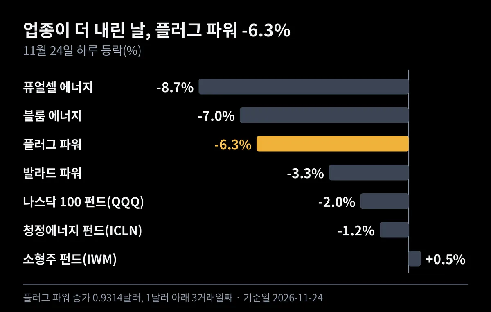
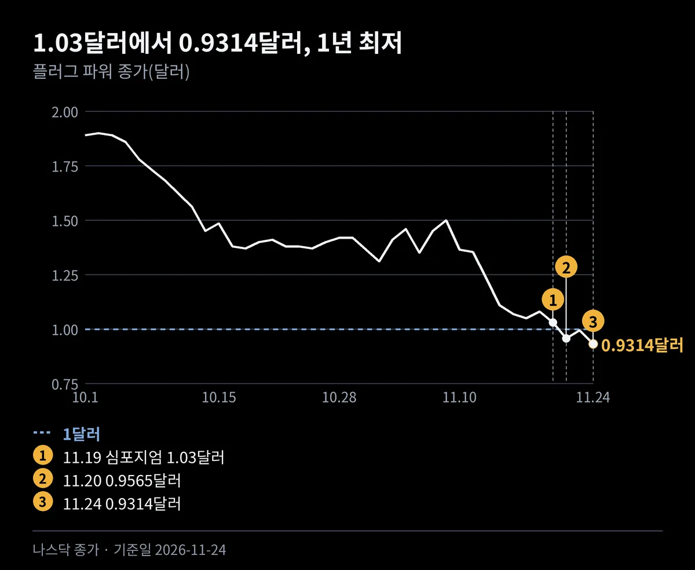
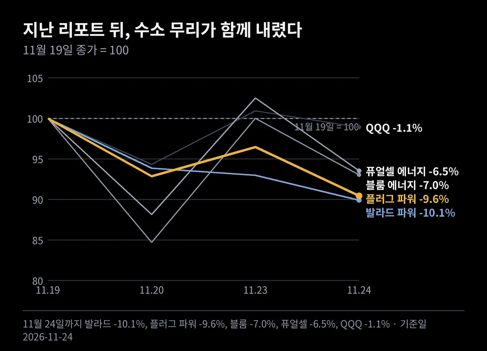
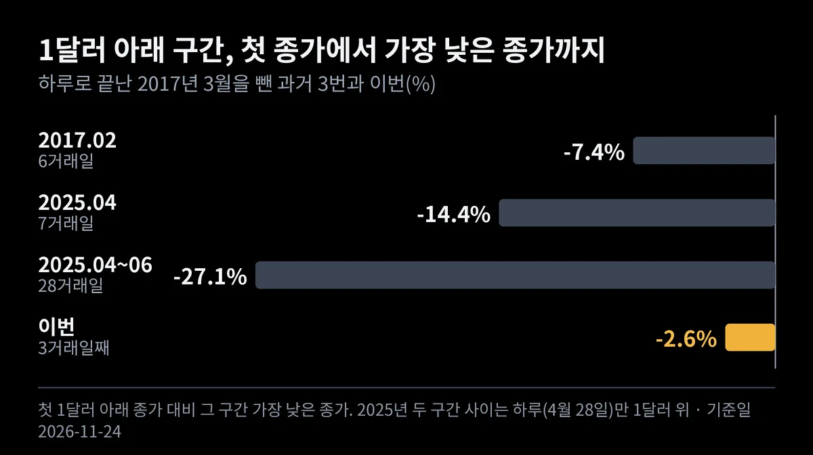
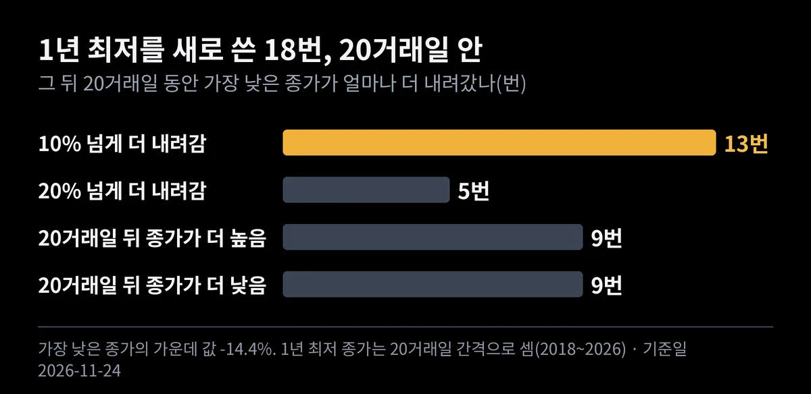
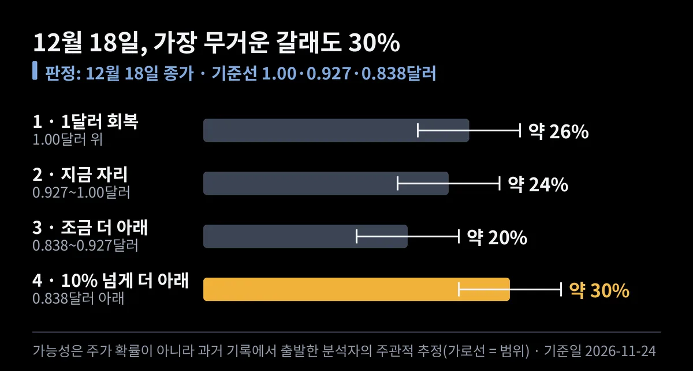

11월 24일 플러그 파워 주가는 하루에 6.3% 내려 0.9314달러로 마감했습니다. 11월 20일에 기록한 0.9565달러보다 낮은, 1년 사이 가장 낮은 종가입니다. 2025년 6월 5일 0.8715달러 뒤로는 가장 낮습니다. 종가가 1달러 아래인 날은 11월 20일부터 3거래일째 이어졌습니다. 지난 리포트를 낸 11월 19일 1.03달러보다는 9.6% 낮습니다. 이 주식을 지켜보는 사람이라면 질문은 하나입니다. 어디까지 떨어질 수 있을까요?

> **유의사항** 저자는 금융·투자 자문가가 아닙니다. 이 글은 공개 공시와 시세를 정리한 교육용 분석이며 특정 종목의 매수·매도를 권하지 않습니다. 과거 기록이 그대로 반복된다는 보장은 없고, 플러그 파워는 하루 5% 넘게 움직이는 날이 잦은 종목입니다. 실제 투자 전에는 최신 가격과 공시를 직접 확인하세요.

그림처럼 같은 날 퓨얼셀 에너지는 8.7%, 블룸 에너지는 7.0% 내렸습니다. 나스닥 100 지수를 따르는 펀드(QQQ)는 2.0% 내렸고, 미국 소형주 펀드(IWM)는 0.5% 올랐습니다. 이날 하락은 플러그 파워 혼자의 일이 아니라, 수소·연료전지 무리가 함께 내린 날의 숫자입니다.

이 글은 [11월 20일 리포트](/r/plug-2026-11-4/)의 후속편입니다. 그 리포트는 12월 18일 종가를 네 칸으로 나눴고, 칸의 경계는 끝 부록 채점표에 있습니다. 처음으로 위쪽 칸인 '1.11달러 위'를 약 35%로 가장 무겁게 봤습니다.

판정일이 오지 않아 지난 예측 성적은 적중 0, 빗나감 0, 진행 중 7입니다. 다만 그 리포트를 낸 다음 거래일인 11월 20일, 종가가 1달러 아래로 내려갔습니다. 지금 0.9314달러는 세 번째 칸(0.927~1.00달러) 안이고, 네 번째 칸의 경계보다 약 0.5% 위에 있습니다.

그 리포트는 "1달러 아래 마감이 나오면 다시 보겠다"고 적었습니다. 이 글이 그 약속입니다.

플러그 파워(Plug Power)는 미국 뉴욕주에 본사를 둔 수소 회사입니다. 돈을 버는 방식은 수소 장비와 연료 판매입니다. 물류 창고 지게차에 들어가는 수소 연료전지, 물을 전기로 갈라 수소를 만드는 장치(전해조), 액화 수소를 팝니다. 11월 19일 연례 행사(심포지엄)에서는 올해 4분기에 조정 이익(EBITDAS) 흑자를 내겠다는 목표를 다시 말했습니다.

돈의 크기도 보겠습니다. 9월 말 쓸 수 있는 현금은 1억 3,413만 달러였습니다. 회사는 시장에 새 주식을 조금씩 팔 수 있는 프로그램을 갖고 있고, 남은 한도는 9억 4,410만 달러입니다. 올해 9개월 동안은 이 통로로 판 주식이 0주였습니다.

이 한도를 0.9314달러에 다 쓴다고 가정하면 새 주식은 약 10억 1,400만 주입니다. 11월 4일 발행 주식 13억 9,887만 주의 약 72%입니다. 한도는 "팔 수 있다"는 뜻이지 "팔았다"는 뜻은 아닙니다. 그래도 주가가 낮을수록 같은 돈을 구하는 데 더 많은 주식이 필요하다는 점은 달라지지 않습니다.

지난 리포트 뒤 4거래일을 차례로 보겠습니다. 11월 19일 심포지엄 날 종가는 1.03달러였습니다. 다음 날인 20일, 주가는 7.1% 내려 0.9565달러가 됐습니다. 2025년 6월 뒤 처음으로 1달러 아래에서 끝난 날입니다. 같은 날 QQQ도 5.7% 내렸습니다.

11월 23일에는 QQQ가 하루 7.0% 오른 날, 플러그 파워는 3.9% 올라 0.9936달러가 됐습니다. 1달러를 되찾지 못했습니다. 그리고 24일, 6.3% 내려 0.9314달러로 마감했습니다.

같은 기간 회사가 낸 서류는 하나였습니다. 11월 24일 최고재무책임자 폴 미들턴이 주식 판매 예정 신고(Form 144)를 냈습니다. 약 7만 주, 금액으로 약 6만 6천 달러입니다. 신고서에는 세금 납부만을 위해 파는 주식이라고 적혀 있습니다. 발행 주식에 비하면 아주 작은 양이고, 새 주식을 파는 서류는 없었습니다.

그럼 24일의 6.3%는 시장에 비해 얼마나 컸을까요? 평소 민감도로 재 봤습니다. 시장이 1% 움직일 때 이 종목이 평균 몇 % 움직였는지를 말합니다. 플러그 파워는 QQQ 기준 약 1.55배였습니다.

그대로라면 24일 예상은 약 -3.1%였습니다. 실제는 -6.3%로, 차이는 -3.2%포인트입니다. 평소 하루 흔들림(±4.5%포인트) 안이라, 시장과 업종이 함께 내린 날의 범위로 읽힙니다.

지난 리포트 뒤로 넓혀도 그림은 같습니다. 11월 19일 대비 24일까지 플러그 파워는 9.6% 내렸습니다. 발라드 파워·퓨얼셀·블룸 에너지도 6~10% 내렸고, QQQ는 1.1% 내렸습니다. 수소 무리 전체가 시장보다 크게 내렸고, 플러그 파워는 발라드 파워 다음으로 많이 내렸지만 차이는 크지 않았습니다.

이제 1달러라는 숫자가 왜 중요한지 보겠습니다. 나스닥 규칙은 호가가 30영업일 연속 1달러 아래면 회사에 통지합니다. 통지를 받아도 바로 상장 폐지되지 않고, 보통 180일의 회복 기간을 줍니다.

11월 20일부터 매일 1달러 아래로 마감한다고 가정하면, 30번째 거래일은 2027년 1월 5일입니다. 지금은 3거래일째입니다. 2025년에는 4월부터 6월까지 가장 길게 28거래일 연속 1달러 아래였고, 통지 없이 6월 9일 하루 25.9% 올라 끝났습니다.

1달러 규칙에서 회사가 흔히 쓰는 해법은 주식 병합입니다. 여러 주를 한 주로 합쳐 한 주의 가격을 올리는 방법입니다. 플러그 파워 주주들은 이미 한 번 그 권한을 줬습니다. 2025년 7월 3일 주총이 1대5에서 1대200 사이의 병합을 승인했습니다.

그런데 그 권한은 쓰이지 않았습니다. 2025년 위임장은 승인 뒤 1년 안에 실행하지 않으면 권한이 사라진다고 적었습니다. 2026년 7월 3일이 지났고, 실행 기록은 없습니다. 2026년 6월 11일 정기 주총의 안건 4개에도 병합은 없었습니다.

회사는 다른 길을 골랐습니다. 2025년 12월 위임장에는 병합으로 주식 수 문제를 풀려는 데 주주 우려가 있었다고 적혀 있습니다. 그리고 2026년 2월 12일 임시 주총에서 회사가 발행할 수 있는 주식의 상한(수권 주식)을 15억 주에서 30억 주로 늘렸습니다.

정리하면, 지금 병합을 하려면 주주 투표를 다시 거쳐야 합니다. 1달러 아래가 30거래일 이어져 통지를 받아도 180일이 더 있으니, 투표까지 시간은 있습니다. 다만 그 투표가 열릴지, 언제 열릴지는 아직 서류로 나오지 않았습니다.

이제 질문으로 돌아가겠습니다. 어디까지 떨어질 수 있을까요? 정답을 아는 사람은 없습니다. 대신 이 종목이 비슷한 자리에 섰던 과거 기록을 셀 수는 있습니다. 먼저 1달러 아래 구간입니다.

2016년 11월 뒤 나스닥 종가로 1달러 아래 구간은 이번을 빼고 네 번이었습니다. 2017년 3월은 하루로 끝났습니다. 2017년 2월은 2월 2일 종가 대비 6거래일 동안 최대 7.4% 더 내려갔습니다. 2025년 4월 중순은 4월 16일 종가 대비 7거래일 동안 최대 14.4% 더 내려갔습니다.

가장 길었던 2025년 4월 말부터 6월 초까지는 28거래일이었고, 첫 종가보다 27.1% 더 내려가 0.6994달러까지 갔습니다. 이번은 3거래일째이고, 첫 종가 0.9565달러보다 2.6% 아래입니다. 구간이 길게 이어질수록 더 깊었다는 점이 눈에 띕니다.

두 번째 기록은 1년 최저 종가를 새로 쓴 날입니다. 2018년부터 한 번 센 뒤 20거래일은 건너뛰는 방식으로 18번을 셌습니다. 그리고 그 뒤 20거래일 동안 가장 낮은 종가가 얼마나 더 내려갔는지 봤습니다.

18번 가운데 13번은 20거래일 안에 10% 넘게 더 내려갔습니다. 더 내려간 폭의 가운데 값(중앙값)은 14.4%였습니다. 이 폭을 지금 0.9314달러에 대면 약 0.80달러입니다. 20% 넘게 더 내려간 경우도 5번 있었습니다.

하지만 같은 18번에서 20거래일 뒤 종가는 9번 더 높았고 9번 더 낮았습니다. 중간에 더 내려가는 일은 흔했지만, 한 달 뒤 자리는 반반이었다는 뜻입니다. 그래서 이 기록은 "얼마나 흔들릴 수 있나"에는 답하지만, "결국 어디서 끝나나"에는 답하지 못합니다.

김박사 월드는 이런 장면을 '1년 최저 경신'이라는 이름으로 여러 종목에서 모아 세고 있습니다. 11월 핵심 종목 예측에서 판정선 이탈 쪽은 4번 모두 맞았고, '지킨다' 쪽은 4번 모두 빗나갔습니다. 가격의 높낮이는 생각보다 오래 이어졌다는 기록입니다.

그럼 근거를 양쪽으로 나눠 보겠습니다. 더 내려갈 쪽부터 봅니다. 가장 먼저 업종입니다. 지난 리포트 뒤 수소 무리가 함께 6~10% 내렸고, 소형주는 업종이 내릴 때는 같이 내리고 오를 때는 덜 따라간 기록이 있습니다. 11월 23일 시장이 크게 반등한 날 플러그 파워가 3.9%에 그친 것도 같은 모습입니다.

주식 수도 더 내려갈 쪽 근거입니다. 남은 판매 한도는 지금 가격으로 발행 주식의 약 72%입니다. 9개월 동안 쓰지 않았지만, 쓸 수 있는 통로가 열려 있다는 사실은 남아 있습니다.

과거 기록도 이쪽에 있습니다. 1년 최저 기록에서 대부분은 20거래일 안에 10% 넘게 더 내려갔습니다. 1달러 아래 구간이 길었던 2025년에는 첫 종가보다 27.1% 더 내려갔습니다.

멈출 쪽 근거도 셋입니다. 가장 먼저 회사 고유의 새 악재가 확인되지 않았습니다. 11월 19일 발표는 기존 목표를 반복했고, 그 뒤 서류는 세금 납부용 Form 144 하나였습니다.

24일 하락의 크기도 이쪽 근거입니다. 평소 민감도로 예상한 -3.1%와 실제 -6.3%의 차이는 평소 흔들림 안이었습니다. 같은 날 퓨얼셀과 블룸 에너지는 더 내렸습니다.

마지막은 한 달 뒤 기록입니다. 1년 최저 기록에서 절반은 20거래일 뒤 종가가 더 높았습니다. 2025년의 1달러 아래 구간도 통지 없이 끝났습니다. 중간의 깊이와 끝의 자리는 다른 질문이라는 점을 기억해야 합니다.

다음 판정은 날짜로 정해져 있습니다. 12월 8일에는 그 전 리포트의 새 주식 공급 항목을 봅니다. 12월 9일에는 연준 금리 회의(FOMC)가 있습니다. 12월 18일에는 지난 리포트의 네 칸과 이번 예측을 함께 채점합니다.

새 예측도 지난 리포트와 같은 날, 12월 18일 종가로 걸었습니다. 이번 질문이 '어디까지'라서 칸은 아래쪽으로 옮겼습니다. 1.00달러 위, 0.927~1.00달러, 0.838~0.927달러, 0.838달러 아래입니다. 0.838달러는 24일 종가보다 10% 낮은 값입니다.

출발점은 앞의 두 기록을 합친 22번의 20거래일 뒤 자리입니다. 맨 위 칸과 맨 아래 칸이 9번씩으로 같았고, 가운데 두 칸은 좁아서 2번씩이었습니다. 칸별 숫자는 끝 부록에 있습니다.

여기서 조정했습니다. 판정선을 되찾는다는 쪽은 11월 핵심 종목에서 4번 모두 빗나갔고, 남은 판매 한도도 커서 1.00달러 위는 26%로 낮췄습니다. 가격의 높낮이는 이어지는 편이라 지금 자리(0.927~1.00달러)는 24%로 올렸습니다. 0.838~0.927달러는 20%입니다.

가장 무거운 칸은 0.838달러 아래로 약 30%입니다. 이미 알려진 한도와 병합 권한 소멸은 가격에 들어 있다고 보고, 출발점 41%에서 낮췄습니다. 이 숫자들은 주가가 오를 확률이 아니라, 과거 빈도에서 출발해 분석자가 주관적으로 매긴 추정입니다.

이 추정이 틀릴 이유도 적어 둡니다. 지난 리포트는 처음으로 위쪽 칸을 가장 무겁게 봤고, 다음 거래일에 1달러가 깨졌습니다. 이번에는 아래쪽을 무겁게 봤지만, 12월 9일 뒤 시장이 크게 오르면 약 1.55배로 따라 올라 이 칸에서 멀어질 수 있습니다. 그래서 가장 무거운 칸도 30%에 묶었습니다.

위험도 짚겠습니다. 가장 큰 한계는 표본입니다. 1달러 아래 구간은 네 번뿐이고, 1년 최저 18번의 상당수는 주가가 지금보다 몇 배 높던 때입니다. 남은 판매 한도를 실제로 쓰거나 병합 투표를 부르는 서류가 나오면, 이 기록과 다른 길이 열릴 수 있습니다.

플러그 파워는 1달러 아래 3거래일째이고, 병합 권한은 이미 끝났으며, 판매 한도는 열려 있는 회사입니다. 그래서 지금 가장 중요한 숫자는 하루 등락이 아니라, 1달러 아래가 몇 거래일 이어지는지와 새 주식 서류가 나오는지입니다. 12월 18일 종가가 1달러 위로 돌아오면 멈출 쪽 근거가, 0.838달러 아래로 내려가면 더 내려갈 쪽 근거가 강해집니다. 결정은 각자의 몫이며, 이 글은 판단 근거를 정리한 교육용 자료입니다. 다음 갱신은 12월 18일 종가를 본 뒤에 하고, 그 전에 새 주식 서류나 병합 주총 서류가 나오면 앞당깁니다.

## 숫자로 다시 보기

### 11월 19일부터 24일까지

| 날짜 · 장면 | 플러그 파워 종가 | 하루 등락 |
| --- | --- | --- |
| 11.19 심포지엄, 목표 반복 | 1.03달러 | -4.6% |
| **11.20 2025년 6월 뒤 첫 1달러 아래 마감** | **0.9565달러** | **-7.1%** |
| 11.23 QQQ +7.0% 날 | 0.9936달러 | +3.9% |
| **11.24 1년 최저 1달러 아래 3거래일째** | **0.9314달러** | **-6.3%** |

11월 24일 종가는 11월 19일보다 9.6% 낮고, 2025년 6월 5일 0.8715달러보다 6.9% 높습니다.

### 11월 24일 하루와 지난 리포트 뒤

| 종목 | 11월 24일 하루 | 11월 19일 대비 |
| --- | --- | --- |
| 퓨얼셀 에너지 | -8.7% | -6.5% |
| 블룸 에너지 | -7.0% | -7.0% |
| **플러그 파워** | **-6.3%** | **-9.6%** |
| 발라드 파워 | -3.3% | -10.1% |
| QQQ | -2.0% | -1.1% |
| 청정에너지 펀드(ICLN) | -1.2% | -3.0% |
| IWM(미국 소형주) | +0.5% | +1.1% |

### 1달러 아래 구간(종가 기준)

| 구간 · 길이 | 첫 종가 → 가장 낮은 종가 |
| --- | --- |
| 2017.02.02~02.09 6거래일 | 0.9184 → 0.85달러 -7.4% |
| 2017.03.09 1거래일 | 0.95달러 하루로 끝남 |
| 2025.04.16~04.25 7거래일 | 0.9211 → 0.7886달러 -14.4% |
| 2025.04.29~06.06 28거래일 | 0.9592 → 0.6994달러 -27.1% |
| **2026.11.20~ 3거래일째** | **0.9565 → 0.9314달러** **-2.6%(진행 중)** |

**한눈에:** 가장 긴 구간 **28거래일** · 가장 깊은 하락 **-27.1%** · 2025년은 6월 9일 **+25.9%**로 통지 없이 끝남.

### 1년 최저를 새로 쓴 18번(2018~2026)

한 번 센 뒤 20거래일은 건너뛰고 셌습니다. 2026년 11월 12일 1.235달러부터의 이번 흐름은 진행 중이라 빠졌습니다.

| 그 뒤 20거래일 | 횟수 |
| --- | --- |
| 가장 낮은 종가가 10% 넘게 더 아래 | 13번 |
| 가장 낮은 종가가 20% 넘게 더 아래 | 5번 |
| 20거래일 뒤 종가가 더 높음 | 9번 |
| 20거래일 뒤 종가가 더 낮음 | 9번 |

**한눈에:** 10% 넘게 더 내려감 **13/18** · 더 내려간 폭 가운데 값 **-14.4%** · 한 달 뒤 더 높음 **9/18**.

### 더 내려갈 쪽과 멈출 쪽 근거

| 쪽 · 근거 | 숫자와 출처 |
| --- | --- |
| **더 내려갈 쪽** 업종이 함께 내림 | 11월 19일 대비 수소 무리 -6.5%에서 -10.1% 사이 11월 23일 QQQ +7.0% 날 +3.9% |
| **더 내려갈 쪽** 열린 판매 한도 | 남은 9억 4,410만 달러 0.9314달러면 발행 주식의 약 72% |
| **더 내려갈 쪽** 과거 기록 | 1년 최저 18번 중 13번 10% 넘게 더 아래 2025년 1달러 아래 -27.1% |
| **멈출 쪽** 회사 고유 새 악재 없음 | 11월 19일 8-K 뒤 Form 144 하나 세금 납부용 7만 241주 |
| **멈출 쪽** 시장 범위 안의 하락 | 11월 24일 예상 -3.1%, 실제 -6.3% 차이 평소 흔들림 안 |
| **멈출 쪽** 한 달 뒤 자리는 반반 | 1년 최저 18번 중 9번 20거래일 뒤 더 높음 2025년 구간은 통지 없이 끝남 |

### 시장·거시·정책 배경

| 항목 | 값 · 기준 |
| --- | --- |
| QQQ 하루 | **-2.0%** 11월 24일 |
| 평소 민감도(QQQ 기준) | **약 1.55배** 앞선 250거래일 하루 수익률 회귀 |
| 플러그 파워 예상 vs 실제 | **약 -3.1% vs -6.3%** 차이 -3.2%포인트, 평소 하루 흔들림 ±4.5%포인트 안 |
| 다음 거시 일정 | **11월 25일 PCE 물가 · 12월 9일 FOMC** 미 상무부·연준 공식 일정 |

같은 날 1달러 근처에서 시장을 함께 맞은 핵심 종목 이야기는 [실스크](/r/laes-2026-11-6/) 리포트에 있습니다. 김박사 월드 장부에서 판정선 이탈 쪽 예측은 4번 모두 맞았고, '지킨다' 쪽은 4번 모두 빗나갔습니다.

정책: 직접 연결 확인 안 됨(플러그 파워 연차 보고서 위험 요인과 이어지는 11월 정책 발표를 찾지 못함).

### 판단 전에 확인할 것

| 순서 · 확인할 것 | 볼 곳 |
| --- | --- |
| **1** 1달러 아래 종가가 몇 거래일째인가(30번째는 2027년 1월 5일) | 나스닥 종가 |
| **2** 새 주식 판매 서류(424B)나 판매 재개 기록이 나오나 | SEC 제출 목록 |
| **3** 주식 병합 주총 서류(위임장)가 나오나 | SEC 제출 목록 |
| **4** 12월 9일 FOMC 뒤 시장이 오를 때 따라가나 | 플러그 파워·QQQ 종가 |
| **5** 시장이 흔들릴 때 약 1.55배 흔들림을 감당할 수 있나 | 평소 민감도 |

### 지금의 크기(11월 24일 기준)

| 항목 | 값 · 근거 |
| --- | --- |
| 종가 | **0.9314달러** 1년 최저, 1달러 아래 3거래일째 |
| 시가총액 | **약 13억 300만 달러** 0.9314달러 × 11월 4일 13억 9,887만 주 |
| 9월 말 현금 | **1억 3,413만 달러** 쓸 수 있는 현금, 제한 현금 제외 |
| 남은 시장 판매 한도 | **9억 4,410만 달러** 2027년 8월 15일 종료, 9개월 판매 0주 |
| 수권 주식 | **30억 주** 2026년 2월 12일 임시 주총 승인 |

### 지난 예측 채점표

| 지난 점검 항목 · 당시 기준 | 판정과 지금 자리(11월 24일) |
| --- | --- |
| **12월 18일 1.11달러 위(약 35%)** 11월 20일 리포트 가장 무거운 갈래 | **[진행 중]** 지금 16.1% 아래 |
| **12월 18일 1.00~1.11달러(약 25%)** | **[진행 중]** 지금 6.9% 아래 |
| **12월 18일 0.927~1.00달러(약 15%)** | **[진행 중]** 지금 이 칸 |
| **12월 18일 0.927달러 아래(약 25%)** | **[진행 중]** 지금 0.5% 위 |
| **종가가 1달러 아래로 내려간 날이 있는가** | **[진행 중]** 11월 20일 일어남, 판정은 12월 18일 |
| **새 주식 공급 공시 0건(12월 8일)** | **[진행 중]** 11월 24일까지 0건 |

지난 예측 성적은 적중 0 · 빗나감 0 · 진행 중 7입니다.

### 앞으로 일어날 수 있는 일

1년 최저 18번과 1달러 아래 첫 종가 4번, 모두 22번의 20거래일 뒤 자리에서 출발했습니다. 아래 가능성은 그 기록에서 출발해 분석자가 주관적으로 매긴 추정이며, 주가가 오를 확률이 아닙니다. 네 갈래는 겹치지 않아 더하면 100%입니다.

| 갈래(판정 12월 18일) | 판정 조건 | 가능성(추정) |
| --- | --- | --- |
| 1 · 1달러 회복 | 12월 18일 종가 1.00달러 위 | 낮음 약 26% (21~31%) |
| 2 · 지금 자리 | 12월 18일 종가 0.927~1.00달러 | 낮음 약 24% (19~29%) |
| 3 · 조금 더 아래 | 12월 18일 종가 0.838~0.927달러 | 낮음 약 20% (15~25%) |
| **4 · 10% 넘게 더 아래** | 12월 18일 종가 0.838달러 아래 | 중간 약 30% (25~35%) |

### 핵심 확인 세 가지

| 순위 · 확인할 것 | 판정 날짜 |
| --- | --- |
| **1순위** 종가가 1.00달러·0.927달러·0.838달러 가운데 어디인가 | 12월 18일 |
| **2순위** 424B 같은 새 주식 판매 서류가 나오는가 | 12월 18일 |
| **3순위** 주식 병합을 위한 주총 서류가 나오는가 | 2027년 1월 5일 |

공시는 [플러그 파워 SEC 공시 목록](https://www.sec.gov/cgi-bin/browse-edgar?action=getcompany&CIK=0001093691&type=&dateb=&owner=include&count=40)에서 확인할 수 있습니다.

## 함께 읽기

- [플러그 파워 지난 리포트](/r/plug-2026-11-4/) · [영상](https://youtu.be/G4LwNPV5bB8): 심포지엄 날 1.03달러와 일곱 번의 심포지엄 기록(11월 19일 기준).
- [실스크 리포트](/r/laes-2026-11-6/) · [영상](https://youtu.be/zbq6gLjyeVI): 같은 날 1달러 근처에서 다룬 '판정일까지 버텨야 할까?'(11월 23일 기준).
- [블룸 에너지 리포트](/r/be-2026-11/) · [영상](https://youtu.be/VdSWc4jMjzI): 같은 연료전지 무리, 11월 24일 7.0% 내린 회사(11월 20일 기준).
