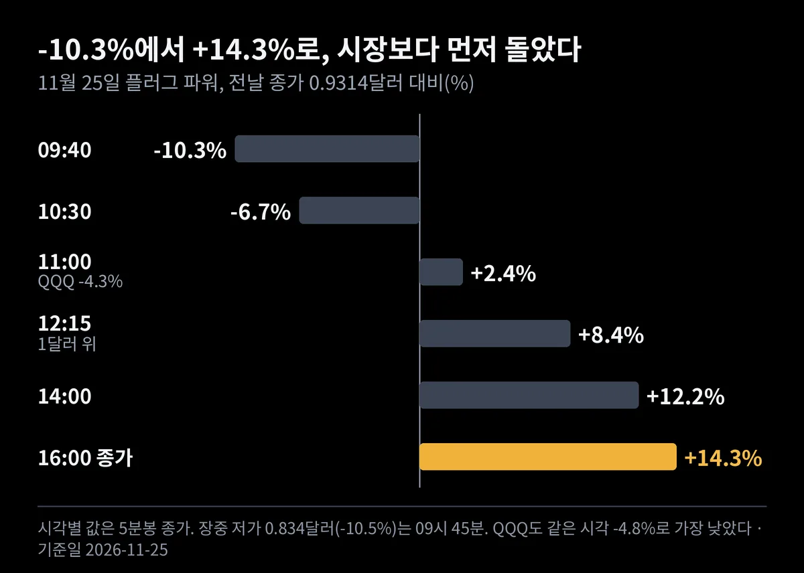
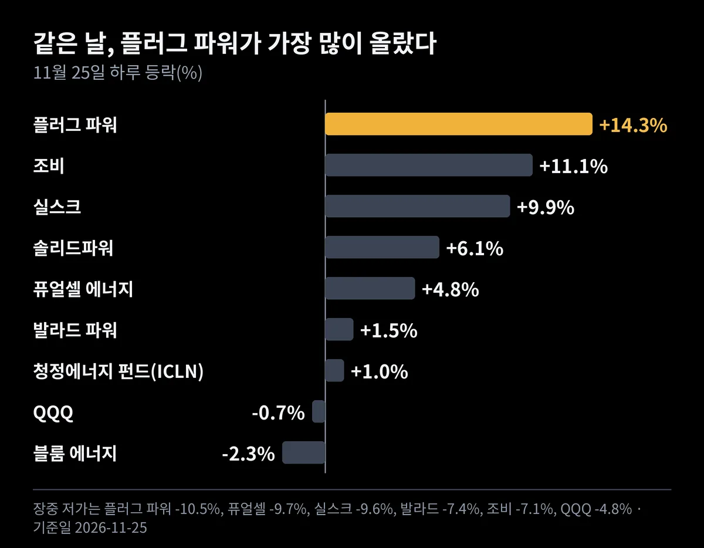
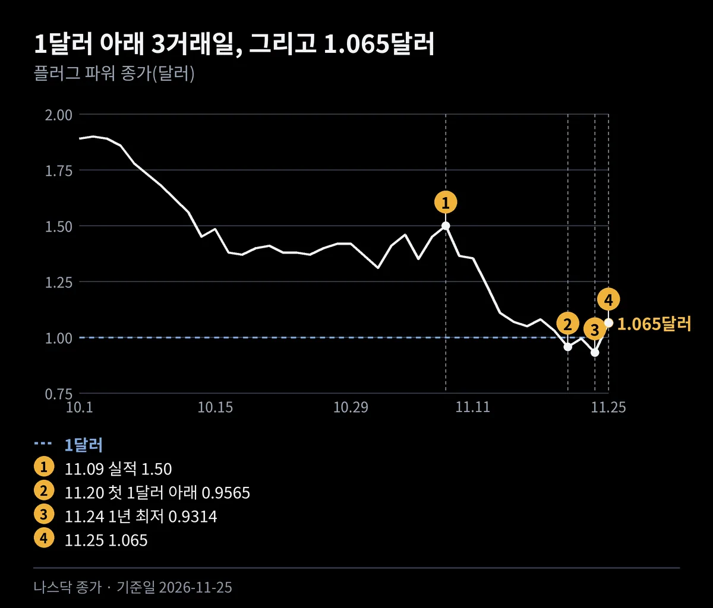
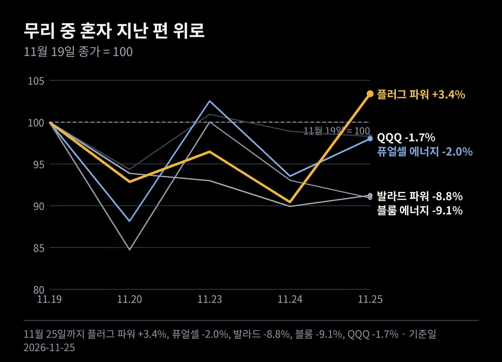
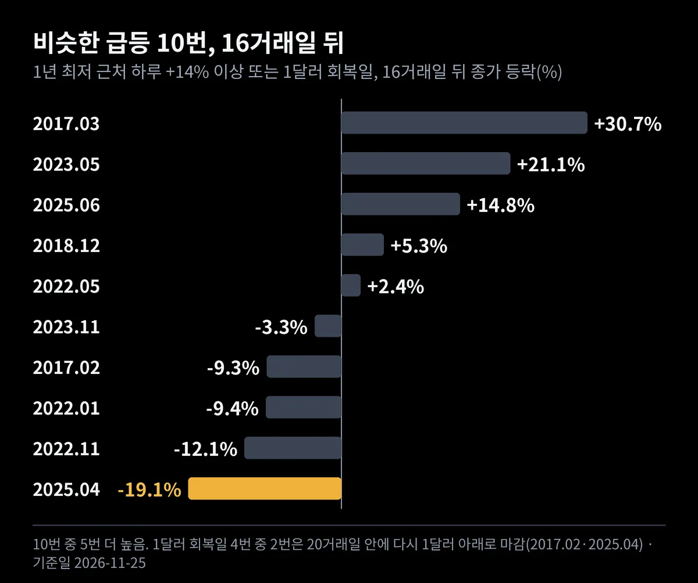
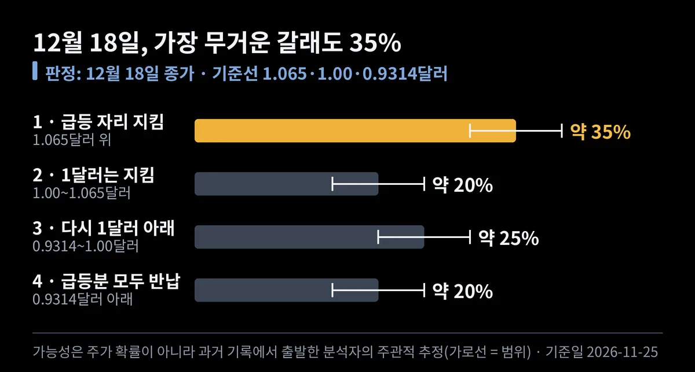

11월 25일 아침 9시 45분, 플러그 파워 주가는 0.834달러였습니다. 전날 종가보다 10.5% 낮은, 1년 사이 가장 낮은 가격이었습니다. 그런데 장이 끝났을 때 종가는 1.065달러였습니다. 하루에 14.3% 올랐고, 11월 20일부터 이어진 1달러 아래 마감도 3거래일 만에 끝났습니다. 이날 회사는 공시도, 보도자료도 내지 않았습니다. 그래서 이 주식을 가진 사람이라면 이런 질문이 생깁니다. 오른 지금 반만 팔까요?

> **유의사항** 저자는 금융·투자 자문가가 아닙니다. 이 글은 공개 공시와 시세를 정리한 교육용 분석이며 특정 종목의 매수·매도를 권하지 않습니다. 과거 기록이 그대로 반복된다는 보장은 없고, 플러그 파워는 하루 10% 넘게 움직이는 날이 잦은 종목입니다. 실제 투자 전에는 최신 가격과 공시를 직접 확인하세요.

여기서 '반만 판다'는 가진 주식의 절반만 팔고 나머지는 그대로 두는 것을 말합니다. 맞고 틀림을 반씩 나눠 갖는 선택입니다. 이 글은 누구에게 팔라거나 들고 있으라고 말하지 않습니다. 대신 오른 쪽 근거와 다시 내릴 쪽 근거를 셋씩 놓고, 비슷한 과거 급등이 어떻게 끝났는지 셉니다.

그림처럼 이날의 움직임은 두 단계였습니다. 장이 열리고 15분 동안은 계속 내렸습니다. 그런데 한 시간 남짓 뒤인 오전 11시에는 이미 전날 종가 위에 있었습니다. 점심 무렵 1달러를 넘었고, 오후 내내 마감 가격 근처에 머물렀습니다.

이상한 점은 시장과의 순서입니다. 나스닥 100 지수를 따르는 펀드(QQQ)도 같은 시각에 장중 4.8% 아래로 가장 낮았습니다. 하지만 오전 11시 QQQ는 여전히 4.3% 아래였습니다. 플러그 파워가 전날 종가를 넘었을 때, 시장은 아직 바닥 근처에 있었다는 뜻입니다. QQQ는 결국 0.7% 하락으로 마감했습니다.

이 글은 [11월 24일 리포트](/r/plug-2026-11-5/)의 후속편입니다. 그 리포트는 '어디까지 떨어질 수 있을까'를 물었습니다. 그리고 예측을 채점하는 날(판정일)인 12월 18일 종가가 어느 가격대에 있을지 네 구간(칸)으로 나누고, 칸마다 가능성을 매겼습니다. 경계는 1.00달러, 0.927달러, 0.838달러였습니다. 가능성을 가장 높게 본 칸은 맨 아래 칸으로, 약 30%였습니다.

판정일이 오지 않아 지난 예측 성적은 적중 0, 빗나감 0, 진행 중 7입니다. 일곱 개는 네 칸과 확인 항목 셋이고, 부록 채점표에 모두 있습니다. 다만 그 리포트를 낸 다음 거래일에 종가가 1달러 위로 돌아왔습니다. 지금 1.065달러는 맨 위 칸(1.00달러 위) 안이고, 가능성을 가장 높게 본 칸에서는 멀어졌습니다.

플러그 파워(Plug Power)는 미국 뉴욕주에 본사를 둔 수소 회사입니다. 돈을 버는 방식은 수소 장비와 연료 판매입니다. 물류 창고 지게차에 들어가는 수소 연료전지, 물을 전기로 갈라 수소를 만드는 장치(전해조), 액화 수소를 팝니다. 11월 19일 연례 행사(심포지엄)에서는 올해 4분기 조정 이익 흑자 목표를 다시 말했습니다. 조정 이익(EBITDAS)은 이자·세금·감가상각과 주식 보상 비용을 빼기 전의 이익입니다.

돈의 크기도 다시 보겠습니다. 9월 말 쓸 수 있는 현금은 1억 3,413만 달러였습니다. 회사는 시장에 새 주식을 조금씩 팔 수 있는 프로그램을 갖고 있고, 남은 한도는 9억 4,410만 달러입니다. 올해 9개월 동안 이 통로로 판 주식은 0주였습니다.

1.065달러에서 이 한도를 다 쓴다고 가정하면 새 주식은 약 8억 8,650만 주입니다. 판매 가격이 바뀌면 주식 수도 달라지는 단순 계산이고, 수수료 같은 판매 조건은 10-Q 원문에 따릅니다. 11월 4일 발행 주식 13억 9,887만 주의 약 63%입니다. 지난 리포트의 약 72%보다 작아진 것은 주가가 올라서입니다. 한도는 "팔 수 있다"는 뜻이지 "팔았다"는 뜻은 아닙니다.

이제 25일 하루를 차례로 보겠습니다. 시작 가격은 0.8955달러로, 전날보다 3.9% 낮았습니다. 첫 15분 동안 더 내려 0.834달러에 닿았습니다. 그 뒤 오전 내내 올라왔고, 낮 12시 15분 1달러를 넘었습니다.

같은 날 다른 종목도 비슷한 모양이었습니다. 연료전지 회사 퓨얼셀 에너지는 장중 9.7% 내렸다가 4.8% 올라 마감했습니다. 에어택시 회사 조비는 11.1%, 보안 반도체 회사 실스크는 9.9% 올랐습니다. 청정에너지 펀드(ICLN)는 1.0% 올랐고, 같은 연료전지 무리인 블룸 에너지는 2.3% 내렸습니다.

김박사 월드는 이런 하루를 '장중 뒤집기'라고 부릅니다. 장중에 전날보다 크게 내렸다가, 크게 올라 마감하는 날입니다. 같은 날 [실스크 리포트](/r/laes-2026-11-7/)가 이 이름을 처음 썼습니다. 실스크는 오전 회사 소식이 있었지만, 소식 뒤 90분 동안 주가는 제자리였습니다. 주가가 오른 시간은 시장이 함께 회복한 시간이었습니다.

플러그 파워는 회사 소식조차 없었는데, 시장보다 먼저 돌아 훨씬 많이 올랐습니다. 장중 가장 낮은 가격에서 종가까지 오른 폭은 약 27.7%입니다. 같은 구간 QQQ는 약 4.3% 올랐습니다.

그럼 시장에 비해 얼마나 컸을까요? 평소 민감도로 재 봤습니다. 시장이 1% 움직일 때 이 종목이 평균 몇 % 움직였는지를 말합니다. 플러그 파워는 QQQ 기준 약 1.5배였습니다.

그대로라면 25일 예상은 약 -1.0%였습니다. 실제는 +14.3%로, 차이는 +15.3%포인트입니다. 평소 하루 흔들림(±4.5%포인트)의 세 배를 넘습니다. 청정에너지 펀드 기준으로 봐도 차이는 +12.9%포인트였습니다. 시장·업종 움직임으로는 설명되지 않는 부분이 컸던 날입니다. 그 부분이 회사 때문인지, 사고파는 쪽의 사정 때문인지는 이 자료로 알 수 없습니다.

거래량도 평소와 달랐습니다. 25일 거래량은 1억 2,582만 주였습니다. 앞선 20거래일 평균 6,704만 주의 약 1.88배입니다. 많이 사고판 날이었다는 사실은 기록에 남지만, 누가 왜 샀는지는 시세표가 말해 주지 않습니다.

회사 쪽 서류를 다시 확인했습니다. SEC 제출 목록에서 마지막 서류는 11월 24일 최고재무책임자의 주식 판매 예정 신고(Form 144)입니다. 약 7만 주를 세금 납부용으로 판다는 내용으로, 지난 리포트가 이미 다뤘습니다. 회사 보도자료는 11월 19일 심포지엄 날이 마지막입니다.

25일의 급등은 이유가 적힌 서류 없이 일어났습니다. 이유를 모르는 급등은 오래갈지 짧게 끝날지 가늠할 단서가 적습니다. 과거 기록을 세는 일이 더 중요해지는 까닭입니다.

그 전에 1달러라는 숫자부터 짚겠습니다. 나스닥 규칙은 호가가 30영업일 연속 1달러 아래면 회사에 통지합니다. 통지를 받아도 바로 상장 폐지되지 않고, 보통 180일의 회복 기간을 줍니다. 25일 1달러 위 마감으로, 11월 20일부터 센 연속 기록은 3거래일에서 끊겼습니다. 다시 1달러 아래로 내려가면 그날부터 새로 셉니다.

범위를 넓혀 지난 리포트의 바탕인 11월 19일부터 보겠습니다. 25일까지 플러그 파워는 3.4% 올랐습니다. 같은 기간 퓨얼셀 에너지는 2.0%, 발라드 파워는 8.8%, 블룸 에너지는 9.1% 내렸습니다. 11월 24일까지는 수소 무리가 함께 내렸는데, 25일 하루로 플러그 파워만 다른 자리에 섰습니다.

이제 과거 기록을 보겠습니다. 두 종류를 함께 셌습니다. 하나는 1년 최저 종가의 10% 안에서 하루 14% 넘게 오른 날입니다. 다른 하나는 1달러 아래 마감 뒤 1달러를 되찾은 날입니다. 2016년 11월 뒤 나스닥 종가로 겹치는 것을 빼고 10번이었습니다.

16거래일을 본 이유는 판정일인 12월 18일이 25일 뒤 16거래일째이기 때문입니다. 10번 가운데 5번은 16거래일 뒤 종가가 급등일보다 높았습니다. 나머지 5번은 낮았습니다. 가장 좋았던 2017년 3월은 30.7% 더 올랐고, 가장 나빴던 2025년 4월은 19.1% 내렸습니다.

1달러를 되찾은 날만 따로 보면 4번이고, 그중 2번은 20거래일 안에 다시 1달러 아래로 마감했습니다. 2025년 4월 28일이 가장 짧았습니다. 하루에 크게 올라 1달러를 넘었지만, 바로 다음 거래일 다시 1달러 아래로 내려갔습니다. 반대로 2025년 6월 9일 급등은 20거래일 뒤 45.9% 더 높은 자리로 이어졌습니다.

범위를 더 넓히면 2017년 뒤 플러그 파워가 하루 14% 넘게 오른 날은 50번입니다. 그중 28번은 20거래일 뒤 더 높았습니다. 급등 전날 종가 아래로 다시 내려간 날이 20거래일 안에 나온 경우는 16번이었습니다. 이 기록을 김박사 월드는 '급등분 반납'이라고 부릅니다.

다른 종목의 같은 장면도 참고가 됩니다. 김박사 월드는 리포트마다 걸어 둔 예측을 판정일에 채점해 장부로 모읍니다. 그 장부에서 급등을 다 돌려주고 출발 종가 아래로 내려간 뒤, 20거래일째가 그날보다 더 낮았던 경우는 21번 중 13번이었습니다. 실스크·뉴스케일 파워·조비의 기록을 합친 숫자입니다. 첫날 상승분이 2~5거래일 안에 사라진 일도 솔리드파워·루시드·리커전에서 나왔습니다.

그럼 근거를 양쪽으로 나눠 보겠습니다. 먼저 오른 자리가 이어질 쪽입니다. 첫째, 크기와 순서입니다. 시장보다 먼저 돌았고, 평소 흔들림의 세 배가 넘는 회사 고유 움직임이었습니다. 거래량도 평소의 약 1.88배였습니다.

둘째, 1달러 문제의 시계가 멈췄습니다. 30영업일 연속 기록이 3거래일에서 끊겼습니다. 남은 판매 한도로 만들 수 있는 새 주식 비율도 약 63%로 줄었습니다. 셋째, 과거 비슷한 급등 10번 중 5번은 16거래일 뒤 더 높았고, 2025년 6월처럼 크게 이어진 경우도 있었습니다.

다음은 다시 내릴 쪽 근거입니다. 첫째, 이유가 적힌 서류가 없습니다. 실적·계약·공시 같은 새 사건이 없는 급등은 다음 날 붙잡을 근거도 적습니다. 둘째, 1년 동안의 흐름입니다. 25일 종가는 1년 전보다 45.7% 낮고, 20거래일 전 1.42달러보다 25.0% 낮습니다.

셋째, 반납 기록입니다. 1달러를 되찾은 날의 절반은 한 달 안에 다시 1달러 아래로 갔습니다. 장부에서도 리커전은 하루 급등 뒤 20거래일째 더 낮았던 경우가 14번 중 12번이었습니다. 한 종목의 작은 표본이라 다른 종목에 그대로 대기는 어렵습니다.

이 두 쪽을 놓고 보면 '반만 팔까'라는 질문이 왜 나오는지 보입니다. 근거가 한쪽으로 기울지 않을 때, 사람들은 나눠서 결정하는 방법을 떠올립니다. 숫자로 예를 들어 보겠습니다. 어디까지나 계산을 보여 주기 위한 가상 예시입니다.

1,000주를 가진 사람이 500주를 1.065달러에 판다고 가정합니다. 12월 18일 종가가 급등 전날인 0.9314달러로 돌아가면, 남은 500주만 그 하락을 받습니다. 반대로 1.20달러로 오르면, 그 상승도 500주만 받습니다. 나눠 파는 것은 정답을 고르는 일이 아니라, 맞고 틀림의 크기를 반으로 줄이는 일입니다. 이것이 누구에게 맞는지는 처음 산 이유와 그 사람의 사정에 달렸습니다.

시장 쪽 숫자도 함께 봐야 합니다. 변동성 지수(VIX)는 앞으로 한 달 동안 미국 대형주가 얼마나 흔들릴지 시장이 매기는 값입니다. 25일 28.29로, 20거래일 전보다 11.38포인트 높았습니다. 한 달 사이 시장의 흔들림 예상이 커졌다는 뜻입니다. 미 국채 10년 금리는 4.85%로 5거래일 전보다 0.22%포인트 내렸습니다. 같은 날 금리와 소형주가 함께 움직였지만, 이것이 플러그 파워 급등의 원인이라는 자료는 없습니다.

다음 신호는 날짜로 정해져 있습니다. 12월 8일에는 그 전 리포트가 걸어 둔 새 주식 공급 예측을 채점합니다. 12월 9일에는 연준 금리 회의(FOMC)가 결과를 발표합니다. 12월 18일에는 지난 리포트의 네 칸과 이번 예측을 함께 채점합니다.

새 예측도 12월 18일 종가로 걸었습니다. 이번 질문이 '오른 뒤'라서 칸을 급등일 기준으로 옮겼습니다. 1.065달러 위, 1.00~1.065달러, 0.9314~1.00달러, 0.9314달러 아래입니다. 0.9314달러는 급등 전날 종가라, 이 아래면 급등분을 모두 돌려준 것입니다.

출발점은 앞의 과거 급등 10번입니다. 16거래일 뒤 자리를 이번 칸에 대 본 횟수는 부록에 있습니다. 여기서 조정했습니다. 급등 뒤 20거래일째 더 낮았던 장부 기록과 회사 소식이 없다는 점을 반영해, 맨 위 칸은 50%에서 35%로 낮췄습니다.

1.00~1.065달러 칸은 좁아서 표본에서 1번뿐이었습니다. 장부에서 11월 핵심 종목의 '판정선을 지킨다' 쪽 예측이 4번 모두 빗나간 기록(가격이 한번 간 자리에 머무는 편)을 반영해 10%포인트 올려 20%로 뒀습니다. 표본이 작아 이 칸의 근거는 약한 편입니다. 다시 1달러 아래 칸은 25%입니다. 급등분을 모두 돌려주는 칸은 반납 기록을 반영해 10%에서 20%로 올렸습니다. 이 숫자들은 주가가 오를 확률이 아니라, 과거 빈도에서 출발해 분석자가 주관적으로 매긴 추정입니다.

이 추정이 틀릴 이유도 적어 둡니다. 맨 위 칸을 가장 무겁게 뒀지만, 이유 없는 급등은 서류 하나로 방향이 바뀝니다. 남은 판매 한도를 쓰는 서류가 나오면 아래 칸이 무거워집니다. 거꾸로 시장이 12월 9일 뒤 크게 오르면 약 1.5배로 따라 올라 맨 위 칸이 더 단단해질 수 있습니다. 그래서 가장 무거운 칸도 35%에 묶었습니다.

위험도 짚겠습니다. 가장 큰 한계는 표본입니다. 비슷한 급등은 10번뿐이고, 그중 상당수는 주가가 지금보다 몇 배 높던 때입니다. 이번 급등의 이유를 설명하는 자료가 나오면 이 기록과 다른 길이 열릴 수 있습니다. 하루 10% 넘게 흔들리는 날이 잦은 종목이라, 판정일까지 중간 가격은 어느 칸이든 지나갈 수 있습니다.

플러그 파워는 이유가 적힌 서류 없이, 시장보다 먼저, 1달러를 되찾았습니다. 그래서 지금 가장 중요한 숫자는 25일의 14.3%가 아니라, 1달러 아래 마감이 다시 나오는지와 급등 전날 종가 0.9314달러가 지켜지는지입니다. 12월 18일 종가가 1.065달러 위에 있으면 오른 쪽 근거가, 0.9314달러 아래로 내려가면 반납 쪽 근거가 강해집니다. 결정은 각자의 몫이며, 이 영상과 리포트는 판단 근거를 정리한 교육용 자료입니다. 다음 갱신은 12월 18일 종가를 본 뒤에 하고, 그 전에 새 주식 서류가 나오거나 다시 1달러 아래로 마감하면 앞당깁니다.

## 숫자로 다시 보기

### 11월 25일 하루

| 시각 · 장면 | 플러그 파워 가격 | 전날 종가 대비 |
| --- | --- | --- |
| 09:30 시작 가격 | 0.8955달러 | -3.9% |
| **09:45 장중 저가(1년 최저 가격)** | **0.834달러** | **-10.5%** |
| 09:40 계속 내림 | 0.8351달러 | -10.3% |
| 10:30 첫 반등 뒤 다시 내림 | 0.8692달러 | -6.7% |
| 11:00 QQQ는 아직 -4.3% | 0.9542달러 | +2.4% |
| 12:15 1달러 위 | 1.0092달러 | +8.4% |
| 14:00 QQQ는 -0.8% | 1.045달러 | +12.2% |
| **16:00 종가** | **1.065달러** | **+14.3%** |

시각별 값은 5분봉 종가입니다. 장중 저가에서 종가까지 약 27.7%, 같은 구간 QQQ는 약 4.3% 올랐습니다.

### 11월 25일 하루와 지난 리포트 뒤

| 종목 | 11월 25일 하루 | 11월 19일 대비 |
| --- | --- | --- |
| **플러그 파워** | **+14.3%** | **+3.4%** |
| 퓨얼셀 에너지 | +4.8% | -2.0% |
| 발라드 파워 | +1.5% | -8.8% |
| 청정에너지 펀드(ICLN) | +1.0% | -2.0% |
| QQQ | -0.7% | -1.7% |
| 블룸 에너지 | -2.3% | -9.1% |

같은 날 장중 저가는 플러그 파워 -10.5%, 퓨얼셀 -9.7%, 발라드 -7.4%, QQQ -4.8%였습니다. 다른 핵심 종목은 조비 +11.1%, 실스크 +9.9%, 솔리드파워 +6.1%로 마감했습니다.

### 11월 19일부터 25일까지

| 날짜 · 장면 | 플러그 파워 종가 | 하루 등락 |
| --- | --- | --- |
| 11.19 심포지엄 목표 반복 | 1.03달러 | -4.6% |
| 11.20 2025년 6월 뒤 첫 1달러 아래 마감 | 0.9565달러 | -7.1% |
| 11.23 QQQ +7.0% 날 | 0.9936달러 | +3.9% |
| 11.24 1년 최저 1달러 아래 3거래일째 | 0.9314달러 | -6.3% |
| **11.25 장중 뒤집기 1달러 회복** | **1.065달러** | **+14.3%** |

**한눈에:** 하루 **+14.3%** · 거래량 20거래일 평균의 **1.88배** · 시장 예상과 차이 **+15.3%포인트**.

### 비슷한 급등 10번(2016년 11월 뒤)

1년 최저 종가의 10% 안에서 하루 14% 넘게 오른 날과 1달러 아래 마감 뒤 1달러를 되찾은 날입니다. 겹치는 날은 한 번만 셌습니다.

| 날짜 | 그날 하루 | 16거래일 뒤 종가 |
| --- | --- | --- |
| 2017.02.10 1달러 회복 | +38.8% | -9.3% |
| 2017.03.10 1달러 회복 | +6.3% | +30.7% |
| 2018.12.26 | +28.4% | +5.3% |
| 2022.01.31 | +16.6% | -9.4% |
| 2022.05.17 | +14.0% | +2.4% |
| 2022.11.10 | +16.4% | -12.1% |
| 2023.05.22 | +14.2% | +21.1% |
| 2023.11.14 | +21.9% | -3.3% |
| 2025.04.28 1달러 회복 | +25.7% | -19.1% |
| 2025.06.09 1달러 회복 | +25.9% | +14.8% |

**한눈에:** 16거래일 뒤 더 높음 **5/10** · 다시 1달러 아래 **2/4** · 하루 +14% 이상 뒤 더 높음 **28/50**.

### 오른 쪽과 다시 내릴 쪽 근거

| 쪽 · 근거 | 숫자와 출처 |
| --- | --- |
| **오른 쪽** 크기와 순서 | 시장 예상 -1.0%, 실제 +14.3% 오전 11시 QQQ -4.3%일 때 +2.4% |
| **오른 쪽** 1달러 시계가 멈춤 | 30영업일 연속 기록 3거래일에서 끊김 판매 한도 비율 약 72%에서 63% |
| **오른 쪽** 과거 기록 | 비슷한 급등 10번 중 5번 16거래일 뒤 더 높음 2025년 6월 9일 뒤 20거래일 +45.9% |
| **다시 내릴 쪽** 이유가 적힌 서류 없음 | 11월 24일 Form 144 뒤 SEC 제출 0건 보도자료 11월 19일이 마지막 |
| **다시 내릴 쪽** 긴 흐름 | 1년 전보다 -45.7% 20거래일 전 1.42달러보다 -25.0% |
| **다시 내릴 쪽** 반납 기록 | 1달러 회복 4번 중 2번 다시 1달러 아래 장부 급등분 반납 뒤 20거래일째 더 낮음 13/21 |

### 시장·거시·정책 배경

| 항목 | 값 · 기준 |
| --- | --- |
| QQQ 하루 | **-0.7%** 11월 25일, 장중 저가 -4.8% |
| 평소 민감도(QQQ 기준) | **약 1.5배** 앞선 250거래일 하루 수익률 회귀 |
| 플러그 파워 예상 vs 실제 | **약 -1.0% vs +14.3%** 차이 +15.3%포인트, 평소 하루 흔들림 ±4.5%포인트 밖 |
| 청정에너지 펀드 기준 | **예상 +1.4% vs +14.3%** 차이 +12.9%포인트 |
| 변동성 지수(VIX) | **28.29** 11월 25일, 20거래일 전보다 +11.38 |
| 미 국채 10년 금리 | **4.85%** 11월 25일, 5거래일 전보다 -0.22%포인트 |
| 다음 거시 일정 | **12월 9일 FOMC · 12월 23일 PCE 물가** 연준·미 상무부 공식 일정 |

같은 날 장중 뒤집기를 겪은 핵심 종목 이야기는 [실스크](/r/laes-2026-11-7/) 리포트에 있습니다. 김박사 월드 장부에서 급등분을 반납한 뒤 20거래일째가 더 낮았던 경우는 21번 중 13번이었습니다.

정책: 직접 연결 확인 안 됨(플러그 파워 연차 보고서 위험 요인과 이어지는 11월 정책 발표를 찾지 못함).

### 판단 전에 확인할 것

| 순서 · 확인할 것 | 볼 곳 |
| --- | --- |
| **1** 처음 산 이유가 아직 맞는가(4분기 조정 이익 흑자 목표, 결과는 2027년 초 실적) | 회사 실적 발표 |
| **2** 종가가 다시 1달러 아래로 내려가는가 | 나스닥 종가 |
| **3** 급등 전날 종가 0.9314달러가 지켜지는가 | 나스닥 종가 |
| **4** 새 주식 판매 서류(424B)나 판매 재개 기록이 나오나 | SEC 제출 목록 |
| **5** 12월 9일 FOMC 뒤 시장이 흔들릴 때 약 1.5배 흔들림을 감당할 수 있나 | 플러그 파워·QQQ 종가 |
| **6** 한 종목 비중이 지나치지 않은가(일반 원칙) | 각자의 계좌 |

### 지금의 크기(11월 25일 기준)

| 항목 | 값 · 근거 |
| --- | --- |
| 종가 | **1.065달러** 1달러 아래 3거래일 뒤 회복 |
| 시가총액 | **약 14억 9,000만 달러** 1.065달러 × 11월 4일 13억 9,887만 주 |
| 9월 말 현금 | **1억 3,413만 달러** 쓸 수 있는 현금, 제한 현금 제외 |
| 남은 시장 판매 한도 | **9억 4,410만 달러** 1.065달러면 발행 주식의 약 63%, 9개월 판매 0주 |
| 거래량 | **1억 2,582만 주** 20거래일 평균 6,704만 주의 약 1.88배 |

### 지난 예측 채점표

| 지난 점검 항목 · 당시 기준 | 판정과 지금 자리(11월 25일) |
| --- | --- |
| **12월 18일 1.00달러 위(약 26%)** 11월 24일 리포트 갈래 1 | **[진행 중]** 지금 이 칸, 6.5% 위 |
| **12월 18일 0.927~1.00달러(약 24%)** | **[진행 중]** 지금 6.5% 위 |
| **12월 18일 0.838~0.927달러(약 20%)** | **[진행 중]** 지금 14.9% 위 |
| **12월 18일 0.838달러 아래(약 30%)** 가장 무거운 갈래 | **[진행 중]** 지금 27.1% 위 |
| **종가가 1.00달러·0.927달러·0.838달러 가운데 어디인가** | **[진행 중]** 12월 18일 |
| **424B 같은 새 주식 판매 서류가 나오는가** | **[진행 중]** 11월 25일까지 0건 |
| **주식 병합을 위한 주총 서류가 나오는가** | **[진행 중]** 2027년 1월 5일까지, 지금 0건 |

지난 예측 성적은 적중 0 · 빗나감 0 · 진행 중 7입니다.

### 앞으로 일어날 수 있는 일

비슷한 급등 10번의 16거래일 뒤 자리에서 출발했습니다. 아래 가능성은 그 기록에서 출발해 분석자가 주관적으로 매긴 추정이며, 주가가 오를 확률이 아닙니다. 네 갈래는 겹치지 않아 더하면 100%입니다.

| 갈래(판정 12월 18일) | 판정 조건 | 가능성(추정) |
| --- | --- | --- |
| **1 · 급등 자리 지킴** | 12월 18일 종가 1.065달러 위 | 중간 약 35% (30~40%) |
| 2 · 1달러는 지킴 | 12월 18일 종가 1.00~1.065달러 | 낮음 약 20% (15~25%) |
| 3 · 다시 1달러 아래 | 12월 18일 종가 0.9314~1.00달러 | 낮음 약 25% (20~30%) |
| 4 · 급등분 모두 반납 | 12월 18일 종가 0.9314달러 아래 | 낮음 약 20% (15~25%) |

### 핵심 확인 세 가지

| 순위 · 확인할 것 | 판정 날짜 |
| --- | --- |
| **1순위** 종가가 1.065달러·1.00달러·0.9314달러 가운데 어디인가 | 12월 18일 |
| **2순위** 종가가 다시 1달러 아래로 내려간 날이 있는가 | 12월 18일 |
| **3순위** 424B 같은 새 주식 판매 서류가 나오는가 | 12월 18일 |

공시는 [플러그 파워 SEC 공시 목록](https://www.sec.gov/cgi-bin/browse-edgar?action=getcompany&CIK=0001093691&type=&dateb=&owner=include&count=40)에서 확인할 수 있습니다.

## 함께 읽기

- [플러그 파워 지난 리포트](/r/plug-2026-11-5/) · [영상](https://youtu.be/vO2GZt0GbnE): 1달러 아래 3거래일째와 끝난 병합 권한(11월 24일 기준).
- [실스크 리포트](/r/laes-2026-11-7/) · [영상](https://youtu.be/Y9LNWkLxV3Y): 같은 날 장중 -9.6%에서 +9.9%로 뒤집힌 '반등 신호일까?'(11월 25일 기준).
- [조비 리포트](/r/joby-2026-11-5/) · [영상](https://youtu.be/thqMQOjwjTQ): 같은 날 11.1% 오른 핵심 종목의 임원 매도 신고(11월 24일 기준).
