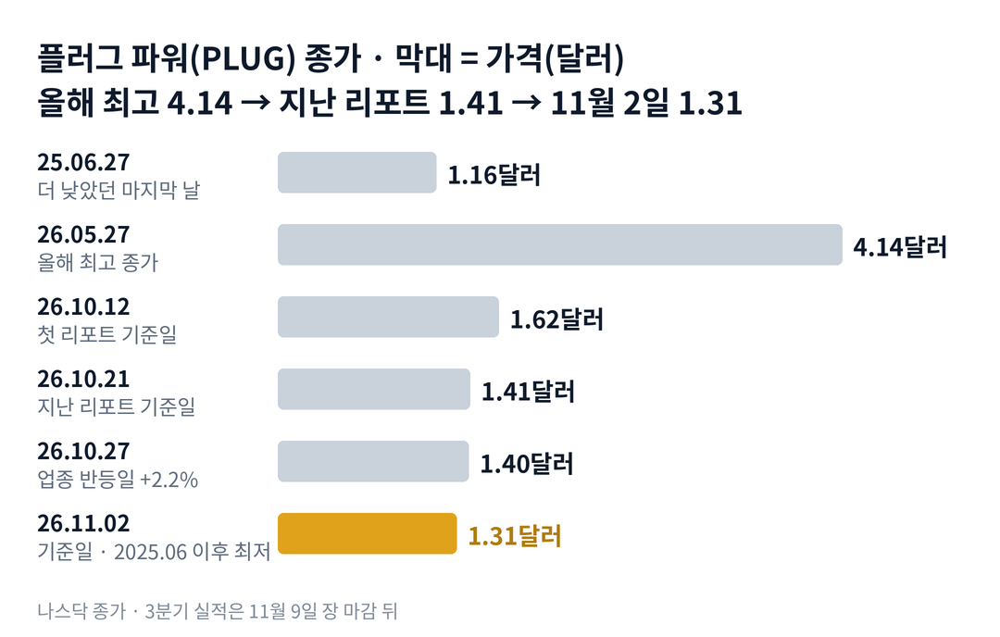

## 짧은 답

> **핵심:** 지난 2주의 하락은 회사 소식이 아니라 업종 매도의 끝자락이었고, 이번에는 업종보다 덜 빠졌지만 이미 낮던 가격이 한 번 더 내려와 새 저점이 됐습니다.

10월 21일 뒤 플러그 파워는 SEC에 서류를 한 건도 내지 않았습니다. 업종 대표 블룸 에너지가 실적 뒤 크게 흔들린 2주였지만, 이번에는 플러그 파워가 함께 무너지지 않았습니다. 지난주와 달라진 점은 바로 이것입니다. 대신 업종이 다시 오른 날에도 거의 따라 오르지 못했습니다.

> **국면 정의(플러그 파워 시리즈 공통):** 국면 A · 생존 반등 — 1~2달러에서 파산 걱정이 가격에 들어간 뒤 자금 조달·정책 소식에 하루 20% 넘게 오르는 때. 국면 B · 공급이 따라오는 때 — 급등 직후 공모·전환사채·판매 계약이 나오는 때. 국면 C · 조용한 소진 — 하루 큰 하락 없이 한 달에 20~30%씩 내려가는 때.

**11월 2일 진단: 국면 C가 실적 앞까지 이어지고 있습니다.** 근거는 5부에 있습니다. 그렇다면 지금처럼 이미 15% 넘게 빠진 채 11월 실적을 맞은 해에는, 그 뒤 20거래일이 어땠을까요? 답은 3부 '11월 실적 다섯 번, 그날 나온 내용과 20거래일 뒤' 표에 있습니다.

> **유의사항** 저자는 금융·투자 자문가가 아닙니다. 이 글은 공개 공시와 시세를 정리한 교육용 분석이며 특정 매매를 권하지 않습니다. 과거의 주가 반응이 미래에 반복된다는 보장은 없고, 플러그 파워는 하루 40% 넘게 움직인 적이 있는 변동성이 큰 종목입니다. 실제 투자 전에는 최신 가격과 공시를 직접 확인하세요.

## 지난 리포트 이후

[지난 리포트](/r/plug-2026-10-2/)는 10월 21일 종가 1.41달러를 기준으로 나왔습니다. 지금을 국면 C로 진단했고, 수소 회사들이 같은 날 함께 빠지는 '업종 동반 매도'를 새 패턴으로 꼽았습니다. 지난 예측 성적: 5개 중 적중 1 · 빗나감 2 · 확인 전 2입니다.

| 지난 점검 항목 · 당시 기준 | 실제 결과(11월 2일) | 판정 |
| --- | --- | --- |
| 진단: 국면 C 지속 하루 큰 하락 없이 한 달 20~30% 하락 | 20거래일 -30.7%, 8% 넘는 하루 하락 0번 | 적중 |
| 새 패턴: 업종 동반 매도 수소 회사들이 같은 날 함께 빠진다 | 10.22 퓨얼셀 -12.3% · 플러그 -2.1% | 빗나감 |
| 시나리오 3 · 업종 반등에 함께 오른다 업종 반등일에 비슷한 크기 | 10.27 발라드 +8.4% · 플러그 +2.2% | 빗나감 |
| 시나리오 1 · 보고서가 예비 숫자 확인 시장 판매 0, 현금 약 1억 3,400만 달러 | 11월 9일 발표 전 | 진행 중(11월 9일 판정) |
| 시나리오 2 · 판매 계약 재가동 판매 공시 또는 현금 1억 달러 아래 | 11월 2일까지 판매·증자 공시 없음 | 진행 중(12월 8일 판정) |

빗나간 두 줄은 같은 이야기입니다. 이번 2주의 플러그 파워는 업종이 빠질 때 덜 빠지고, 오를 때 덜 올랐습니다. 지난 리포트의 시나리오 4(뉴욕주 부지 1억 4,200만 달러 매각 마감)도 마감 공시가 없어 진행 중입니다.

이번 회차가 새로 답하는 질문은 하나입니다. 실적을 일주일 앞두고 이미 30% 넘게 빠진 지금, 과거 11월 실적은 첫날과 그 뒤 20거래일에 어떻게 움직였을까요?

## 1부. 플러그 파워는 어떤 회사인가

> **핵심:** 물류 창고 지게차용 수소 연료전지로 시작해 전해조(물을 전기로 분해해 수소를 만드는 장치)와 수소 공급까지 넓힌 회사로, 아직 손실을 내며 현금과 주식 발행으로 버텨 왔습니다.

플러그 파워는 미국 뉴욕주 슬링어랜즈에 본사를 둔 수소 회사입니다. 지게차용 연료전지, 수소 연료 판매, 전해조 장비가 세 기둥입니다. 회사는 10월 15일 3분기 매출이 1년 전보다 10% 넘게 늘었을 것으로 보고, 올해 매출 성장 전망 15~16%를 유지했습니다.

주가의 큰 줄기는 희석과 생존의 역사입니다. 2021년 1월 26일 종가 73.18달러가 사상 최고였고, 그 뒤 손실과 새 주식 발행이 이어졌습니다. 2025년 5월 15일에는 약 0.70달러까지 내려갔다가, 같은 해 10월 6일 4.13달러까지 약 5.9배로 올랐습니다. 올해는 5월 27일 4.14달러로 그 높이를 다시 찍은 뒤 지금까지 내려왔습니다.

그날 회사는 3분기 순현금 사용이 약 2,800만 달러였다고 밝혔습니다. 석 달 동안 시장 판매 계약(ATM, 시장에서 조금씩 새 주식을 파는 것)으로 판 주식은 없었고, 다른 주식·채권 조달도 없었습니다. 그 뒤 회사의 새 발표는 없었습니다. 9월 23일에 미리 알린 최고운영책임자(COO) 딘 풀러턴의 사임이 10월 23일 발효됐을 뿐입니다.

### 숫자로 본 지금의 크기(11월 2일 기준)

| 항목 | 값 · 근거 |
| --- | --- |
| 종가 | **1.31달러** 2025년 6월 27일(1.16달러) 이후 최저 종가 |
| 시가총액 | **약 18억 3,000만 달러** 발행 주식 13억 9,720만 주(8월 6일) 기준 |
| 9월 말 현금 | **약 1억 3,400만 달러** 10월 15일 예비 발표, 제한 현금 제외 |
| 3분기 현금 사용 | **약 2,800만 달러** 예비 발표, 시장 판매 0 |
| 시장 판매 계약 잔여 | **9억 4,410만 달러** 10억 달러 한도, 2027년 8월 15일까지 |
| 올해 최고 종가 대비 | **-68.4%** 5월 27일 4.14달러 |

시장 판매 계약의 잔여를 모두 쓴다고 가정하면 지금 가격으로 약 7억 2,070만 주가 새로 생깁니다. 이는 발행 주식의 약 51.6%입니다. 유통주식(거래되는 주식)도 발행 주식과 비슷하다고 보면 비율은 거의 같고, 직전 20거래일 평균 거래량(약 4,908만 주) 기준으로는 약 14.7거래일치입니다. 이 말은 곧 주가가 내려올수록 같은 금액이 더 많은 새 주식을 만든다는 뜻입니다.

위 그림처럼 5월 27일 4.14달러가 올해의 꼭대기였습니다. 10월 두 리포트의 기준일(1.62달러, 1.41달러)을 지나 11월 2일 1.31달러까지 내려왔습니다. 이보다 낮은 종가는 2025년 6월 27일 1.16달러가 마지막입니다.

## 2부. 공시 없는 2주, 업종은 더 크게 흔들렸다

> **핵심:** 10월 22일부터 11월 2일까지 수소 업종 대표들이 실적과 함께 크게 흔들렸지만, 플러그 파워는 회사 발표 없이 업종보다 작게, 그러나 꾸준히 내려왔습니다.

10월 22일 장 마감 뒤 블룸 에너지가 3분기 실적을 냈습니다. 그날 블룸은 발표 전에 이미 8.7% 내렸고, 다음 날인 23일에는 11.2% 더 빠졌습니다. 보도에 따르면 매출은 기록을 세우고 올해 전망도 올렸지만, 현금 흐름이 약했던 점이 문제로 꼽혔습니다. 같은 2거래일 동안 퓨얼셀 에너지는 12.3%, 4.1% 빠졌습니다.

그런데 플러그 파워는 22일 2.1% 내리고 23일에는 제자리였습니다. 지난 리포트가 새 패턴으로 꼽은 '같은 날 함께 빠지기'가 이번에는 나타나지 않았습니다. 반대로 10월 27일 업종이 함께 오른 날, 발라드 파워는 8.4%, 블룸은 7.1% 올랐지만 플러그 파워는 2.2% 오르는 데 그쳤습니다.

마지막 두 거래일이 새 저점을 만들었습니다. 10월 30일 3.9%, 11월 2일 4.0% 내렸습니다. 11월 2일에는 청정에너지 상장지수펀드(ETF)인 ICLN(아이셰어즈 글로벌 청정에너지)이 2.7% 올랐는데도 플러그 파워는 내렸습니다. 이날 거래량은 약 4,405만 주로 직전 5거래일 평균(약 4,397만 주)과 거의 같았습니다.

지난 리포트가 다룬 10월 15일 예비 발표의 흐름도 짧게 되짚겠습니다. 발표 당일 주가는 2.4% 올랐지만 다음 날 7.1% 빠졌고, 10월 19일 1.37달러로 내려왔습니다. 그때는 업종 매도가 상승분을 지웠습니다. 이번 2주는 업종 매도를 피했는데도 가격이 더 낮아졌다는 점이 다릅니다.

### 같은 2주, 수소·청정에너지 성적

| 종목 · 성격 | 10.21 → 11.02 | 가장 큰 날 |
| --- | --- | --- |
| 퓨얼셀 에너지(FCEL) · 발전용 연료전지 | -20.5% | -12.3% |
| 블룸 에너지(BE) · 데이터센터 연료전지 | -17.7% | -11.2% |
| **플러그 파워(PLUG)** · 수소·전해조 | -7.1% | -4.0% |
| 청정에너지 ETF(ICLN) · 다른 무리 | -4.7% | -2.9% |
| 발라드 파워(BLDP) · 수송용 연료전지 | -1.3% | +8.4% |

이 말은 곧 업종이 주가를 끌어내린 지난 리포트 때와 달리, 이번 2주의 플러그 파워는 업종과 다른 길을 걸었다는 뜻입니다. 크게 빠진 날을 피한 대신 작은 하락이 쌓였습니다. 8거래일 가운데 내린 날은 4번, 오른 날은 2번이었습니다. 오른 날의 폭이 작아 내린 만큼을 되돌리지 못했습니다.

## 3부. 11월 실적 다섯 번의 기록

> **핵심:** 2021년부터 2025년까지 11월 실적 5번은 모두 첫 반응일에 내렸고, 지금처럼 실적 전 20거래일에 15% 넘게 빠진 채 맞은 해가 세 번 있었습니다.

2021년부터 2025년까지 3분기 실적 발표를 모두 모았습니다. 8-K 접수 시각으로 발표 시점을 가렸습니다. 장 마감 뒤 발표는 다음 거래일을, 장 전 발표(2024년)는 그날을 첫 반응일로 잡았습니다. '당일'은 첫 반응일 종가를 전날 종가와 비교했고, '20거래일 뒤'는 첫 반응일을 첫날로 센 20번째 거래일 종가를 실적 전 종가와 비교했습니다.

### 11월 실적 다섯 번, 그날 나온 내용과 20거래일 뒤

| 이벤트일 · 그날 나온 내용 | 당일 | 20거래일 뒤 |
| --- | --- | --- |
| **2021.11.10** 분기 매출 기록 1억 4,400만 달러, 2022년 전망 상향 · 실적 전 20거래일 +36.7% | -1.3% | -10.1% |
| **2022.11.09** 매출 1억 8,860만 달러, 2023년 목표 14억 달러 · 실적 전 20거래일 -25.2% | -1.4% | -7.6% |
| **2023.11.10** 수소 공급 차질, 10-Q에 계속기업 의문 문구 · 실적 전 20거래일 -20.0% | -40.5% | -32.4% |
| **2024.11.12** 매출 1억 7,370만 달러, 장 전 발표 · 실적 전 20거래일 -4.3% | -4.0% | +26.1% |
| **2025.11.11** 매출 1억 7,700만 달러, 신주인수권 행사 약 3억 7,000만 달러 · 실적 전 20거래일 -34.4% | -1.2% | -13.7% |

이 말은 곧 첫날만 보면 5번 중 5번 내렸다는 뜻입니다. 4번은 -1.2~-4.0%로 작았고, 2023년 한 번만 -40.5%로 컸습니다. 20거래일 뒤에 실적 전보다 높았던 해는 2024년 한 번(+26.1%)뿐이었습니다. 그해는 실적 전 20거래일 하락이 -4.3%로 가장 작았습니다. 반대로 2021년은 실적 전 20거래일에 36.7% 올라 있었는데도 첫날 내렸습니다. 오른 채 맞았든 빠진 채 맞았든 첫날의 방향은 같았습니다.

지금처럼 실적 전 20거래일에 15% 넘게 빠진 채 맞은 해는 2022·2023·2025년 3번입니다. 이 3번은 20거래일 뒤 모두 실적 전 종가보다 낮았습니다(-7.6%, -32.4%, -13.7%). 다만 2022년은 5거래일 뒤 +18.6%까지 올랐다가 다시 내려왔습니다. 11월 2일 종가는 20거래일 전(10월 5일 1.89달러)보다 30.7% 낮습니다.

## 4부. 되풀이된 이야기

> **핵심:** 플러그 파워의 주가는 실적 숫자 자체보다 '현금이 들어오나, 주식이 늘어나나'에 반응해 왔고, 3분기 실적 날은 그 질문에 좋은 답이 나온 적이 없었습니다.

첫째, 실적 날의 약세입니다. 2021년과 2022년처럼 매출이 기록을 세운 해에도 첫날은 내렸습니다. 시장은 매출보다 손실 규모와 현금 사용을 먼저 봤습니다. 2023년에는 회사가 1년을 버틸 수 있을지 의심된다는 계속기업 문구가 나와 하루에 40.5% 빠졌습니다.

둘째, 자금 사건의 힘입니다. 2025년 실적 날에는 신주인수권 행사로 약 3억 7,000만 달러가 들어왔다는 소식이 함께 나왔지만, 첫날은 1.2% 내렸습니다. 그 뒤 11월 19일 전환사채 발표가 이어지며 20거래일 뒤에는 13.7% 낮았습니다. 돈이 들어와도 주식이 늘어나는 방식이면 주가를 받치지 못했습니다.

셋째, 실적 전의 흐름입니다. 5번 가운데 3번은 실적 전 20거래일 동안 이미 15% 넘게 빠져 있었습니다. 실적을 앞두고 미리 내려온 가격이 실적 날의 하락을 막아 주지는 못했습니다. 이번 실적 전 20거래일 하락 -30.7%는 2025년(-34.4%) 다음으로 큽니다.

넷째, 이번 2주의 새 모습입니다. 지난 리포트 때는 업종과 같은 날 함께 빠졌지만, 이번에는 업종의 큰 하락을 피했습니다. 3분기에 주식을 팔지 않았다는 예비 발표가 공급 걱정을 덜어 준 것으로 볼 수 있습니다. 그래도 매수세가 들어온 신호(업종 반등일의 큰 상승, 거래량 증가)는 없었습니다.

## 5부. 지금 어느 단계이고, 무엇을 볼까

> **핵심:** 국면 C(조용한 소진)가 실적 앞까지 이어졌고, 11월 9일 보고서가 '판매 없이 버티는 회사'를 숫자로 확인하는지가 다음 국면을 가릅니다.

**2026년 11월 2일 진단: 국면 C 지속.** 근거는 세 가지입니다. 20거래일 동안 30.7% 내렸지만 하루 하락은 -7.1%(10월 16일)가 가장 컸습니다. 10월 21일 뒤로는 -4.0%가 가장 큰 하락이었습니다. 업종 반등일에도 2.2% 오르는 데 그쳤습니다. 임원의 장내 매수나 새 자금 소식은 없었습니다. 국면 A로 넘어가는 신호는 보고서에서 판매 0과 흑자 목표가 확인되고, 그 뒤 업종 반등일에 비슷한 크기로 오르는 것입니다.

### 앞으로 일어날 수 있는 일

과거 기록부터 보겠습니다. 11월 실적 5번 중 5번이 첫날 내렸고, 실적 전 15% 넘게 빠진 채 맞은 3번 중 3번이 20거래일 뒤에도 낮았습니다. 아래 가능성은 이 빈도와 지금 신호를 함께 본 추정입니다.

| 시나리오 · 예상 반응(판정 12월 8일) | 무증자·흑자목표 | 가능성(추정) |
| --- | --- | --- |
| **1 · 버티는 회사로 확인** 첫날 약세여도 12월 8일 종가가 11월 9일 종가 위 | ○ / ○ | 높음 (35~45%) |
| 2 · 숫자는 그대로, 목표가 흔들림 판매는 없지만 새 저점(1.30달러 아래) | ○ / × | 낮음 (10~20%) |
| 3 · 목표는 유지, 주식 판매 재개 11월 9일 종가 아래로 | × / ○ | 중간 (20~30%) |
| 4 · 둘 다 어긋남 2023년처럼 하루 큰 폭 하락 | × / × | 낮음 (10~20%) |

표의 '무증자'는 12월 8일까지 시장 판매·공모·전환사채 같은 새 주식 공급 공시가 없는 경우입니다. '흑자목표'는 11월 9일 회사가 하반기 조정 이익(이자·세금·감가상각·주식 보상 비용을 뺀 이익) 흑자 목표를 유지하는 경우입니다. 12월 8일은 첫 반응일(11월 10일)을 첫날로 센 20번째 거래일입니다.

시나리오 1을 가장 높게 본 이유는 두 가지입니다. 10월 15일 예비 발표에서 회사가 이미 판매 0과 현금 사용 감소를 밝혔고, 그 뒤 11월 2일까지 새 주식 공급 공시가 없었습니다. 다만 '확인'이 곧 상승을 뜻하지는 않습니다. 같은 조건의 3번이 모두 20거래일 뒤 낮았기 때문입니다.

시나리오 3의 근거는 2025년입니다. 실적 발표 일주일여 뒤인 11월 19일 전환사채가 나왔습니다. 지금은 남은 판매 한도 9억 4,410만 달러가 있고, 현금 1억 3,400만 달러는 분기 2,800만 달러씩 쓰면 약 4.8분기치입니다. 함께 볼 위험으로는 업종 대표의 다음 실적과 수소 정책 소식이 있습니다.

시나리오 2와 4를 낮게 본 이유도 적어 둡니다. 회사는 10월 15일 4분기에도 현금 사용이 더 줄 것이라고 밝혔고, 보고서는 그 발표 25일 뒤에 나옵니다. 그래서 목표가 흔들리는 경우를 낮음으로 두었습니다. 다만 2023년처럼 보고서에 회사의 존속을 의심하는 문구가 들어가면 하루 반응이 과거 범위를 크게 벗어날 수 있습니다. 2023년 그날의 -40.5%가 5번 가운데 가장 큰 폭이었습니다.

뉴욕주 부지 1억 4,200만 달러 매각은 이 표 밖의 변수입니다. 마감 시한은 2027년 3월 31일이고, 마감되면 9월 말 현금의 두 배가 넘는 돈이 들어옵니다. 마감 공시가 12월 8일 전에 나오면 네 시나리오의 전제가 모두 바뀌므로, 그때는 이 표를 새로 매깁니다.

## 6부. 조심할 점과 체크리스트

> **핵심:** 11월 실적 기록은 5번뿐인 작은 표본이고, 지금 쓰는 현금·판매 숫자는 감사 전 예비치라 11월 9일 보고서로 다시 확인해야 합니다.

3부 표는 '11월 실적은 반드시 내린다'는 규칙이 아닙니다. 5번은 작은 표본이고, 2023년의 생존 의심이나 2025년의 전환사채처럼 해마다 함께 나온 사건이 달랐습니다. 시가총액과 새 주식 계산은 8월 6일 발행 주식 수를 썼고, 9월 말 숫자는 보고서에서 바뀔 수 있습니다.

회사 자체의 위험도 세 가지를 짚습니다. 첫째, 운영을 맡던 최고운영책임자가 10월 23일 떠났고 후임은 발표되지 않았습니다. 회사는 업무를 부사장들에게 나눠 맡긴다고만 밝혔습니다. 둘째, 남은 판매 한도 9억 4,410만 달러는 언제든 쓸 수 있는 공급 수단입니다. 셋째, 전해조 수주는 프로젝트 일정이 밀리기 쉬워, 회사도 일정이 사업마다 다르다고 적었습니다.

블룸 에너지 하락 원인은 분석 사이트 보도이며 회사 설명이 아닙니다. 11월 2일 플러그 파워 하락을 설명한 기사는 확인하지 못했습니다.

이 체크리스트는 5부의 국면 진단과 함께 써야 합니다.

- ☐ 11월 9일 보고서의 3분기 시장 판매가 0주이고 9월 말 현금이 약 1억 3,400만 달러인가
- ☐ 11월 9일 하반기 조정 이익 흑자 목표가 유지되고 4분기 현금 사용이 2,800만 달러 아래로 제시되는가
- ☐ 11월 10일 첫 반응일 하락이 과거 범위(-1.2~-4.0%) 안인가, -40.5% 같은 큰 폭인가
- ☐ 11월 19일 심포지엄에서 금액이 붙은 전해조 수주가 나오는가
- ☐ 12월 8일까지 판매·공모·전환사채 공시가 0건인가
- ☐ 12월 8일 종가가 11월 9일 종가와 1.31달러 위인가

다음 갱신은 11월 9일 3분기 실적과 11월 10일 첫 반응을 본 뒤에 합니다.
