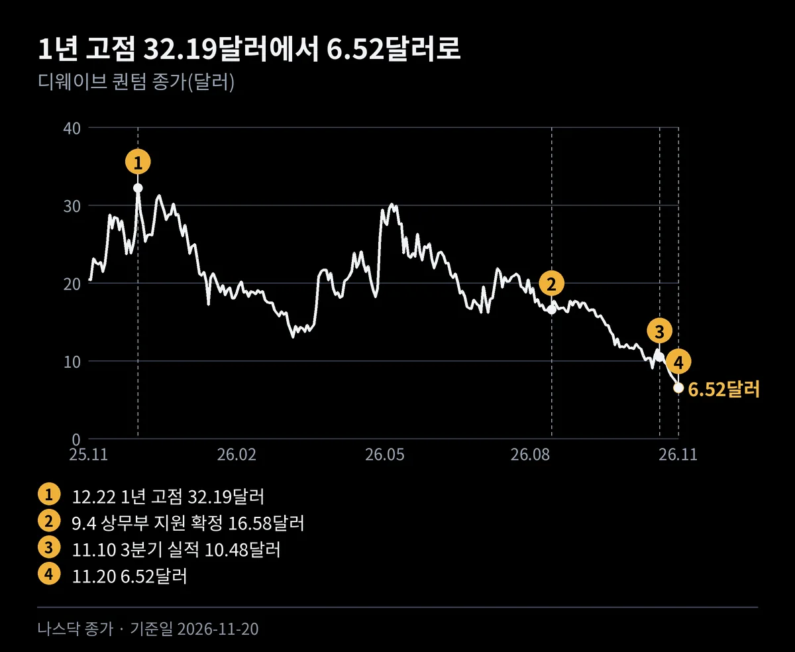
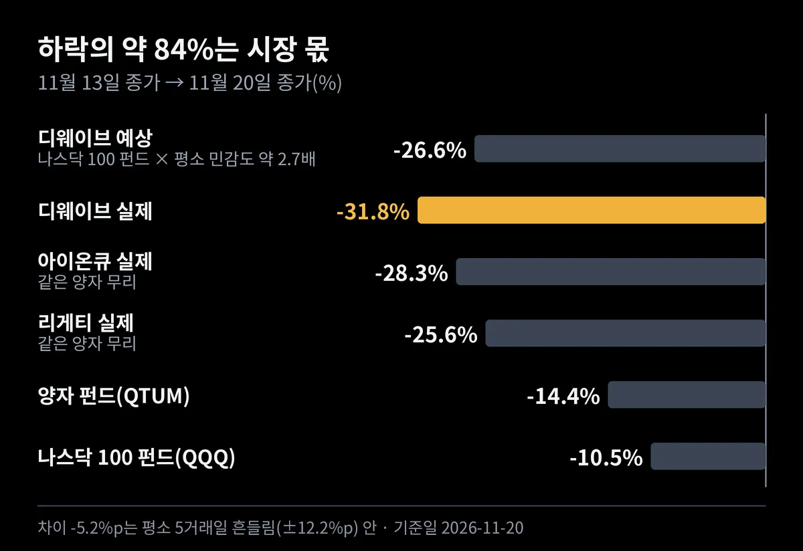
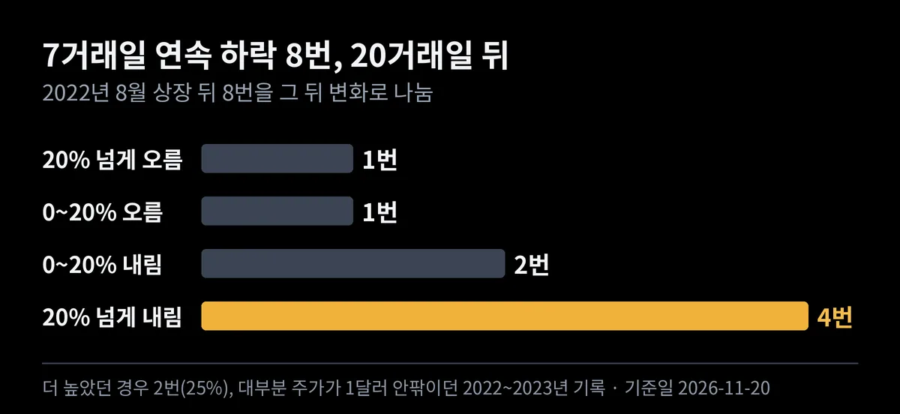
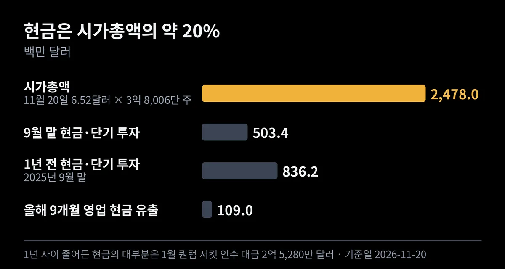
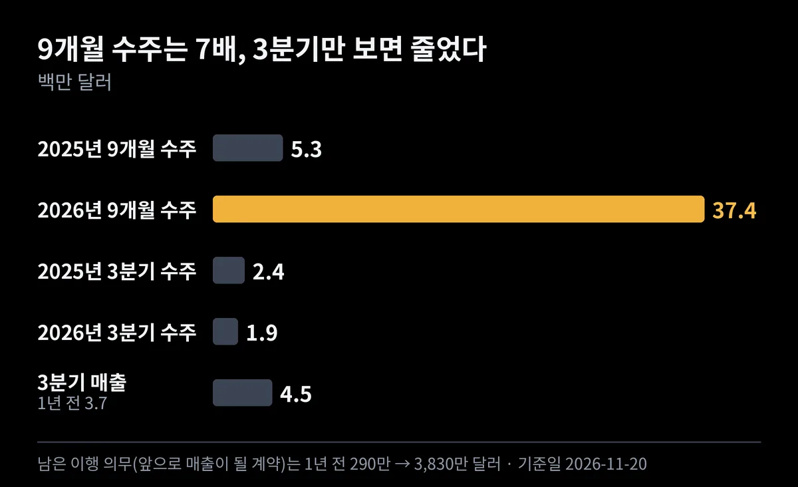
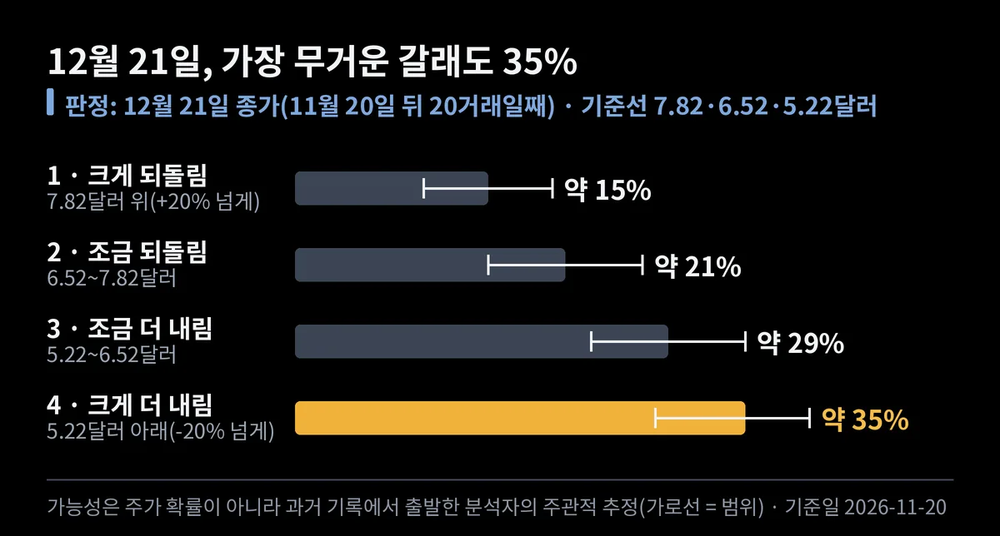

디웨이브 퀀텀 팔까, 버틸까? 11월 20일, 이 회사 주가는 6.52달러로 마감했습니다. 11월 11일 10.65달러 뒤 하루도 오르지 못하고 7거래일 연속 내려, 그 사이 38.8%가 빠졌습니다. 1년 고점 32.19달러와 비교하면 79.7% 아래입니다. 이미 많이 잃은 사람에게는 '사도 될까'보다 '팔까, 버틸까'가 더 급한 질문입니다. 답에 필요한 근거를 공시 숫자로 하나씩 꺼내 보겠습니다.

> **유의사항** 저자는 금융·투자 자문가가 아닙니다. 이 글은 공개 공시와 시세를 정리한 교육용 분석이며 특정 종목의 매수·매도를 권하지 않습니다. 과거 패턴은 미래 수익을 보장하지 않고, 디웨이브 퀀텀은 최근 20거래일 가운데 11일이 하루 5% 넘게 움직인 종목입니다. 실제 투자 전에는 최신 공시를 직접 확인하세요.

김박사 월드가 디웨이브를 다룬 것은 [10월 15일 리포트](/r/qbts-2026-10/) 뒤 두 번째입니다. 그때 종가 12.815달러보다 지금은 49.1% 낮습니다. 지난 예측 성적부터 적습니다. 그때 적은 갈래 하나가 '고점 뒤 다섯 번째 실적 하락'이었습니다. 계기로 본 '매출 제자리'는 빗나갔습니다. 3분기 매출은 1년 전보다 늘었습니다. 그런데 실적 뒤 하락은 그대로 나왔습니다. 11월 10일 종가 대비 5거래일 뒤 22.9% 내려, 그때 적은 과거 범위보다 조금 더 깊었습니다. 그때는 가능성을 숫자로 적지 않아 채점은 이 문장으로 대신합니다.

회사부터 보겠습니다. 디웨이브는 '어닐링'이라는 방식의 양자컴퓨터를 만듭니다. 여러 조합 가운데 가장 좋은 답을 찾는 문제, 예를 들어 배송 경로나 작업 일정 짜기에 특화된 방식입니다. 돈은 세 갈래로 법니다. 클라우드로 컴퓨터를 빌려주는 서비스, 고객과 함께 문제를 푸는 전문 서비스, 그리고 컴퓨터를 통째로 파는 시스템 판매입니다. 다른 회사들이 주로 만드는 '게이트 모델' 양자컴퓨터도 함께 개발합니다.

아직 돈을 버는 단계는 아닙니다. 3분기 매출은 451만 달러로 1년 전보다 20.7% 늘었습니다. 같은 분기 순손실은 4,820만 달러였습니다. 대신 9월 말 현금과 단기 투자가 5억 340만 달러 있습니다. 1년 전보다 줄었는데, 줄어든 돈의 대부분은 1월에 게이트 모델 회사 퀀텀 서킷을 사면서 낸 인수 대금이었습니다.

11월 10일 실적 발표에는 좋은 소식도 있었습니다. 올해 9개월 수주는 1년 전의 약 7배였습니다. 앞으로 매출이 될 계약인 남은 이행 의무도 크게 늘었습니다. 미국 상무부와는 최대 1억 달러를 단계별로 받는 계약을 확정했습니다. 9월 말까지 실제로 받은 돈은 없었습니다. 한국의 IT 서비스 회사 엘지씨엔에스와는 양자컴퓨팅 활용 양해각서를 맺었습니다. 그날 종가는 10.48달러, 하루 -8.6%였습니다.

그리고 7거래일 연속 하락이 이어졌습니다. 11월 11일 10.65달러에서 11월 20일 6.52달러까지 내렸습니다. 2025년 4월 22일(6.25달러) 뒤 약 1년 7개월 만의 최저 종가입니다. 마지막 날 거래량은 직전 20거래일 평균의 약 1.5배였고, 하루씩의 숫자는 부록 표에 있습니다.

이 기간 회사가 낸 새 서류는 있었을까요? 11월 16일 분기 보고서(10-Q)와 11월 17일 임원 세 명의 주식 처분 신고뿐입니다. 원문은 '제한조건부 주식이 지급될 때 생긴 세금을 내려고 회사가 떼어 간 주식'이라고 적었습니다. 세 사람 합계 33,976주, 9.56달러였습니다. 발행 주식 약 3억 8,006만 주의 약 0.009%입니다. 스스로 골라 판 매도가 아니라는 점은 짚어 둡니다.

그렇다면 이 하락에서 시장이 함께 움직인 부분은 얼마일까요? 이것을 재는 방법이 평소 민감도입니다. 시장이 1% 움직일 때 이 종목이 평균 몇 % 움직였는지를 지난 250거래일 기록으로 계산한 값입니다. 디웨이브는 나스닥 100 펀드 기준 약 2.7배였습니다. 시장이 1% 빠지면 평균 2.7% 빠지는 종목이라는 뜻입니다.

11월 13일부터 20일까지 디웨이브는 31.8% 내렸습니다. 같은 기간 나스닥 100 펀드(QQQ)는 10.5% 내렸으니, 평소 민감도대로라면 26.6%쯤 빠졌어야 합니다. 실제와의 차이는 5.2%p였고, 이 차이는 평소 5거래일 흔들림(±12.2%p) 안입니다. 평소 민감도로 예상한 낙폭이 실제 낙폭의 약 84%였다는 뜻입니다. 원인이 시장이라고 단정할 수는 없습니다.

같은 무리도 비슷했습니다. 같은 5거래일 아이온큐는 -28.3%, 리게티는 -25.6%였습니다. 양자 기업을 묶은 펀드(QTUM) 기준으로 계산해도 예상 -27.2%, 실제 -31.8%로 평소 흔들림 안이었습니다. 그래서 이 글은 11월 13~20일 구간에서는 시장 움직임이 대부분이었다고 봅니다. 실적 직후인 11월 10~13일 하락은 이 계산에 넣지 않았습니다. 시장이 크게 흔들릴 때 가장 크게 흔들리는 종목이 그 성질대로 움직였다는 쪽에 가깝습니다.

시장 쪽 배경도 적어 둡니다. 시장이 앞으로 크게 흔들릴 것으로 보는 정도를 나타내는 변동성 지수(VIX)는 11월 20일 35.89로, 5거래일 전보다 16.59포인트 높았습니다. 20 안팎인 평소보다 꽤 불안한 수준입니다. 같은 기간 미국 10년 국채 금리는 오히려 내렸습니다(부록 표). 다음 큰 일정은 11월 25일 개인소비지출(PCE) 물가 발표와 12월 9일 연준 금리 회의(FOMC)입니다. 정책 쪽은 상무부 지원 계약처럼 회사 보고서가 직접 적은 조건만 있고, 이번 하락과 직접 연결된 새 정책은 확인되지 않았습니다.

같은 5거래일, 김박사 월드 핵심 종목 8개 가운데 7개도 평소 시장 민감도로 예상한 범위 안에서 움직였습니다. 양자 무리인 [실스크](/r/laes-2026-11-5/)와 양자 보안 회사 [비티큐 테크놀로지스](/r/btq-2026-11-5/)도 그 안이었습니다.

같은 5거래일 소형주 펀드(IWM)도 7.5% 내렸습니다. 종목별 숫자는 부록 표에 있습니다.

이 질문의 첫 번째 열쇠는 과거 비슷한 순간입니다. 2022년 8월 상장 뒤 디웨이브가 7거래일 이상 연속으로 내린 때를 모두 찾았습니다. 20거래일 뒤 결과를 아는 경우는 8번이었습니다. 그 가운데 20거래일 뒤 더 높았던 경우는 2번, 25%였습니다. 가운데 값(중앙값)은 -18.7%였습니다.

다만 이 기록에는 큰 단서가 붙습니다. 대부분이 주가가 1달러 안팎이던 2024년 이전입니다. 그때 회사는 주식 판매 프로그램을 계속 돌렸고, 발행 주식은 2023년 3월 약 8,039만 주에서 지금 약 3억 8,006만 주가 됐습니다. 지금은 10-Q 기준 판매 프로그램이 모두 끝났습니다. 같은 이름의 기록이라도 그때와 지금의 회사는 사정이 다릅니다. 이제 버티는 쪽 근거와 파는 쪽 근거를 셋씩 나란히 놓겠습니다.

버티는 쪽 근거 첫째는 앞에서 본 하락의 성격입니다. 5거래일 하락의 대부분은 평소 민감도로 설명되는 시장 움직임이었습니다. 11월 20일 하루만 떼어 보면 예상 -15.2%, 실제 -10.8%로 오히려 덜 빠졌습니다. 회사가 낸 서류도 분기 보고서와 세금용 주식 처분 신고뿐이었습니다. 새로 낸 서류에서 확인한 나쁜 소식은 없었습니다. 다만 뒤에서 볼 3분기 수주는 줄었습니다.

두 번째로 볼 것은 시간입니다. 올해 영업 활동으로 나간 현금은 한 분기 평균 약 3,630만 달러입니다. 현금 5억 340만 달러를 이 속도로 단순히 나누면 약 14분기 치입니다. 이 글의 단순 계산이고, 설비 투자와 인수는 빠져 있습니다. 상무부 지원금 가운데 5,360만 달러는 9월 4일부터 쓸 수 있게 됐지만, 9월 말까지 실제로 받은 돈은 없었습니다.

버티는 쪽 마지막 근거는 쌓이는 계약입니다. 앞에서 본 수주와 남은 이행 의무는 1년 전과 비교하면 크게 늘었습니다. 일본 최대 이동통신사 도코모는 디웨이브 기술로 만든 두 번째 실서비스 프로그램을 쓰기 시작했습니다. 회사 발표로는 피크 시간 위치 등록 신호를 65% 줄였습니다. 이탈리아에는 어닐링 컴퓨터 한 대를 실어 보냈습니다.

이번엔 파는 쪽 근거입니다. 첫째는 앞의 기록입니다. 7거래일 연속 하락 8번 중 6번은 20거래일 뒤 더 낮았습니다. 그중 절반 넘게는 20% 넘게 더 빠졌습니다. 7거래일 전 종가 대비 35% 넘게 빠진 경우로 범위를 바꿔 봐도, 20거래일 뒤 더 높았던 경우는 한 번도 없었습니다. 표본이 작고 서로 겹친다는 한계는 있습니다.

둘째는 아직 무거운 몸값입니다. 지금 종가로 계산한 시가총액에서 현금은 약 20%입니다. 한 주당 현금으로 바꾸면 주가는 그 약 4.9배입니다. 시가총액은 올해 9개월 매출의 약 237배이기도 합니다. 그리고 9개월 수주의 대부분은 상반기에 들어왔습니다. 3분기만 보면 수주가 190만 달러로 1년 전보다 줄었습니다.

셋째는 이 종목의 성질 자체입니다. 평소 민감도 약 2.7배는 오를 때만이 아니라 내릴 때도 적용됩니다. 시장이 앞으로 5% 더 빠지면 평균 13%쯤 더 빠질 수 있는 종목이라는 뜻입니다. 지금 변동성 지수는 35.89로 높고, 최근 20거래일 가운데 11일이 하루 5% 넘게 움직였습니다. 회사 장부에는 다른 회사를 사며 쌓인 값(영업권)과 기술 같은 무형자산이 5억 5,100만 달러로, 현금·단기 투자보다 많습니다. 인수한 회사의 값이 기대만큼 나오지 않으면 줄어들 수 있는 자산입니다.

같은 모양은 다른 양자 종목에서도 보였습니다. [리게티](/r/rgti-2026-11/)도 상무부가 주식을 받은 회사인데, 11월 20일 종가가 상무부 매입가 12.92달러보다 44.6% 낮았습니다. 디웨이브는 상무부가 받은 값 14.093달러보다 53.7% 낮습니다. 정부가 주주라는 사실이 주가의 바닥을 받쳐 주지는 않았다는 점이 두 종목에서 같았습니다. 김박사 월드 예측 장부에서도 소형주는 업종이 내릴 때는 함께 내리고, 반등은 덜 따라간 기록(BTQ·실스크)이 있습니다.

그럼 무엇을 보면 판단이 바뀔까요? 신호와 날짜를 정해 두겠습니다. 첫 신호는 12월 9일 연준 금리 회의 뒤 시장의 방향입니다. 시장이 되돌릴 때 디웨이브가 평소 민감도만큼 따라 오르면, 이번 하락이 시장 움직임이었다는 해석에 힘이 실립니다. 따라 오르지 못하면 반대입니다. 둘째는 새 주식 판매 공시입니다. 지난 리포트에서 본 대로 회사는 일괄신고서를 갖고 있습니다. 미리 신고해 두면 새 주식을 빠르게 팔 수 있는 서류라, 새 판매 계약이 나오면 바로 확인해야 합니다.

기준 날짜는 12월 21일 종가로, 11월 20일 뒤 20번째 거래일입니다. 이날 11월 20일보다 20% 높은 7.82달러 위에 있으면 버티는 쪽 근거가 강해집니다. 20% 낮은 5.22달러 아래면 파는 쪽 근거가 강해집니다. 그 사이 상무부의 다음 단계 지원금 결정이나 게이트 모델 진척 발표가 나오는지도 함께 봅니다.

팔지 말지 정하기 전에 먼저 볼 것은 두 가지입니다. 하나는 처음 이 종목을 산 이유가 아직 살아 있는지입니다. 수주와 현금이 그 이유였다면 10-Q 숫자로 다시 확인해 볼 수 있습니다. 10-Q는 미국 상장사가 분기마다 SEC에 내는 보고서입니다. 다른 하나는 시장이 5% 더 빠질 때 13%쯤 더 빠지는 흔들림을 감당할 수 있는지입니다. 새 주식 판매 공시, 12월 9일 FOMC 뒤 흐름, 12월 21일 종가를 확인하는 날까지 다섯 가지 확인표는 글 끝 부록에 있습니다.

마지막으로 12월 21일 종가를 네 갈래로 나눴습니다. 출발점은 앞에서 본 두 기록을 평균한 값입니다. 여기서 크게 더 내리는 칸을 15%p 깎았습니다. 옛 기록 대부분이 주식 판매 프로그램이 돌던 때였기 때문입니다. 대신 이번 하락 대부분이 시장 움직임이었다는 점을 반영해 조금 되돌리는 칸을 올렸습니다.

5.22달러 아래로 크게 더 내리는 갈래를 약 35%로 가장 무겁게 봤습니다. 5.22~6.52달러로 조금 더 내리는 갈래는 약 29%입니다. 6.52~7.82달러로 조금 되돌리는 갈래는 약 21%입니다. 7.82달러 위로 크게 되돌리는 갈래는 약 15%입니다. 이 숫자는 주가가 오를 확률이 아니라, 과거 빈도에서 출발한 분석자의 주관적 추정입니다.

이 판단이 틀릴 수 있는 곳도 적어 둡니다. 평소 민감도가 약 2.7배라서, 시장이 12월 9일 뒤 7.5% 되돌리면 디웨이브는 약 20% 움직여 맨 위 칸으로 넘어갈 수 있습니다. 옛 기록이 지금 회사와 다른 사정에서 나왔다는 점도 한계입니다. 그래서 가장 무거운 갈래를 35%로 두고, 둘째 갈래와 6%p 차이로 좁혔습니다.

지금 디웨이브 퀀텀은 약 14분기 치 현금과 늘어난 계약을 가졌지만, 몸값은 아직 한 주당 현금의 약 4.9배이고 시장보다 약 2.7배 크게 흔들리는 회사입니다. 최근 하락의 대부분은 시장 움직임으로 설명되고, 같은 양자 무리도 함께 빠졌습니다. 12월 21일 종가가 7.82달러 위로 돌아오고 시장 반등을 평소만큼 따라간다면 버티는 쪽 근거가 강해집니다. 5.22달러 아래이거나 새 주식 판매가 나오면 파는 쪽 근거가 강해집니다. 결정은 각자의 몫이며, 이 영상과 리포트는 판단 근거를 정리한 교육용 자료입니다.

## 숫자로 다시 보기

### 최근 하루씩

| 날짜 · 종가 | 하루 변화 · 거래량 | 메모 |
| --- | --- | --- |
| **11월 9일** 11.47달러 | +7.4% · 약 1,991만 주 | 실적 전날 |
| **11월 10일** 10.48달러 | -8.6% · 약 2,661만 주 | 3분기 실적 |
| **11월 11일** 10.65달러 | +1.6% · 약 1,477만 주 | 연속 하락 직전 |
| **11월 13일** 9.56달러 | -2.8% · 약 1,125만 주 | 5거래일 비교 출발 |
| **11월 16일** 8.67달러 | -9.3% · 약 1,392만 주 | 장 마감 뒤 10-Q |
| **11월 17일** 8.08달러 | -6.8% · 약 1,810만 주 | 임원 세금 처분 신고 |
| **11월 18일** 7.69달러 | -4.8% · 약 1,500만 주 | - |
| **11월 19일** 7.31달러 | -4.9% · 약 1,882만 주 | - |
| **11월 20일** 6.52달러 | -10.8% · 약 2,328만 주 | 7거래일 연속 하락, 1년 7개월 최저 |

11월 20일 거래량은 직전 20거래일 평균의 약 1.5배입니다. 11월 9일 종가 대비로는 -43.2%입니다.

지난 리포트 기준일(10월 15일) 종가 12.815달러보다 49.1% 낮습니다. 상무부 지원이 확정된 9월 4일 종가는 16.58달러였습니다. 지난 리포트가 적은 '실적 뒤 5거래일' 과거 범위는 -21%에서 -3% 사이였습니다. 이번 3분기 실적 뒤 5거래일은 -22.9%였습니다.

### 버티는 쪽 근거와 파는 쪽 근거

| 버티는 쪽 · 숫자 | 파는 쪽 · 숫자 |
| --- | --- |
| **하락의 약 84%는 시장 움직임** 5거래일 예상 -26.6% · 실제 -31.8%, 11월 20일 하루는 예상 -15.2% · 실제 -10.8% | **7거래일 연속 하락 뒤 기록** 8번 중 6번 20거래일 뒤 더 낮음, 가운데 값 -18.7% |
| **약 14분기 치 현금** 9월 말 현금·단기 투자 5억 340만 달러, 9개월 영업 현금 유출 1억 902만 달러, 판매 프로그램 모두 끝남 | **아직 무거운 몸값** 한 주당 현금 약 1.32달러의 약 4.9배, 9개월 매출의 약 237배 |
| **쌓이는 계약** 9개월 수주 3,740만 달러(1년 전 530만), 남은 이행 의무 3,830만 달러(1년 전 290만) | **약 2.7배로 흔들리는 성질** VIX 35.89, 최근 20거래일 중 11일 하루 5% 넘게 움직임, 3분기 수주 190만 달러 |

### 7거래일 연속 하락, 20거래일 뒤

**한눈에:** 2022년 8월 8일 상장 뒤 7거래일 이상 연속 하락 중 20거래일 뒤를 아는 경우 **8번** · 더 높음 **2번(25%)** · 가운데 값 **-18.7%**

| 20거래일 뒤 칸 | 7거래일 연속 하락(8번) | 7거래일 -35% 넘는 하락(6번) |
| --- | --- | --- |
| 20% 넘게 오름(7.82달러 위에 해당) | 1번 | 0번 |
| 0~20% 오름 | 1번 | 0번 |
| 0~20% 내림 | 2번 | 3번 |
| 20% 넘게 내림(5.22달러 아래에 해당) | 4번 | 3번 |

두 기록은 날짜가 일부 겹칩니다. 두 기록 대부분은 주가가 1달러 안팎이던 2022~2024년입니다.

| 7거래일 연속 하락 날 · 종가 | 20거래일 뒤 |
| --- | --- |
| **2022년 8월 18일** 10.07달러 | -34.1% |
| **2022년 10월 18일** 5.23달러 | -49.7% |
| **2023년 1월 25일** 1.21달러 | -32.7% |
| **2023년 3월 1일** 0.67달러 | -18.7% |
| **2023년 3월 15일** 0.55달러 | +18.5% |
| **2023년 8월 10일** 1.48달러 | -38.4% |
| **2024년 1월 18일** 0.7063달러 | +180.3% |
| **2024년 6월 7일** 1.16달러 | -3.4% |
| **이번 11월 20일** 6.52달러 | 12월 21일 판정 |

### 시장·거시·정책 배경

| 대상 · 11월 20일 종가 | 하루 | 11월 13일 → 20일 |
| --- | --- | --- |
| **디웨이브 퀀텀** 6.52달러 | -10.8% | -31.8% |
| **아이온큐** 20.72달러 | -8.8% | -28.3% |
| **리게티 컴퓨팅** 7.16달러 | -11.2% | -25.6% |
| **양자 펀드(QTUM)** 111.43달러 | -6.9% | -14.4% |
| **나스닥 100 펀드(QQQ)** 608.45달러 | -5.7% | -10.5% |
| **소형주 펀드(IWM)** 256.61달러 | -2.9% | -7.5% |
| **S&P 500 펀드(SPY)** 689.81달러 | -3.6% | -8.6% |

| 기준 · 평소 민감도 | 예상 · 실제 | 판정 |
| --- | --- | --- |
| **QQQ 기준** 11월 13일 → 20일 약 2.7배 | -26.6% · -31.8% | 차이 -5.2%p, 평소 흔들림(±12.2%p) 안 |
| **QTUM 기준** 11월 13일 → 20일 약 2.0배 | -27.2% · -31.8% | 차이 -4.6%p, 평소 흔들림(±10.9%p) 안 |
| **QQQ 기준** 11월 20일 하루 약 2.7배 | -15.2% · -10.8% | 평소 흔들림(±5.5%p) 안 |

평소 민감도는 11월 13일 전 250거래일의 하루 수익률을 회귀해 구했습니다(나스닥 종가). 시장 움직임으로 설명되는 약 84%는 예상 -26.6%를 실제 -31.8%로 나눈 값입니다.

| 지표 | 값(날짜) | 출처 |
| --- | --- | --- |
| 변동성 지수(VIX) | 35.89(11월 20일), 5거래일 전보다 +16.59포인트 | Cboe |
| 미국 10년 국채 금리 | 4.92%(11월 20일), 5회 전보다 -0.23%포인트 | 미 재무부 |
| 미국 2년 국채 금리 | 4.63%(11월 20일) | 미 재무부 |

| 다음 거시 일정 | 날짜 |
| --- | --- |
| 개인소비지출(PCE) 물가, 10월분 | 11월 25일 |
| 연준 금리 회의(FOMC) 결정 | 12월 9일 |
| 개인소비지출(PCE) 물가, 11월분 | 12월 23일 |
| 소비자물가(CPI)·고용 보고서 | 확인 안 됨(공식 일정 페이지 접근 막힘) |

정책 연결: 직접 연결 확인 안 됨. 10-K 위험 요인은 관세와 수출 통제를 사업 조건으로 적었고, 10-Q는 상무부 최대 1억 달러 단계 지원(상무부가 주식 7,095,721주를 받음)을 적었습니다. 11월 13~20일 하락과 직접 연결된 새 규칙이나 발표는 확인되지 않았습니다.

같은 5거래일 핵심 종목 8개 가운데 7개가 평소 시장 민감도로 예상한 범위 안에서 움직였습니다.

| 핵심 종목 | 실제 | 평소 민감도로 예상 |
| --- | --- | --- |
| 실스크 | -23.0% | -21.6% |
| BTQ | -28.0% | -24.0% |
| 아이렌 | -34.9% | -28.8% |

리포트: [실스크](/r/laes-2026-11-5/) · [BTQ](/r/btq-2026-11-5/) · [리게티 컴퓨팅](/r/rgti-2026-11/)

### 지금의 크기(11월 20일 기준)

| 항목 | 값 · 근거 |
| --- | --- |
| 종가 | **6.52달러** 하루 -10.8%, 7거래일 연속 하락 |
| 1년 고점 대비 | **-79.7%** 2025년 12월 22일 32.19달러 |
| 상장 뒤 최고가 대비 | **-85.4%** 2025년 10월 15일 44.78달러 |
| 시가총액 | **약 24억 7,800만 달러** 발행 주식 3억 7,688만 6,897주 + 교환 주식 317만 6,096주(11월 13일) 기준 |
| 9월 말 현금·단기 투자 | **5억 340만 달러** 1년 전 8억 3,620만 달러 |
| 한 주당 현금 | **약 1.32달러** 주가는 그 약 4.9배 |
| 3분기 매출 · 순손실 | **451만 달러 · 4,820만 달러** 매출 1년 전 374만 달러 |
| 9개월 영업 현금 유출 | **1억 902만 달러** 한 분기 평균 약 3,630만 달러 |
| 퀀텀 서킷 인수 | **현금 2억 5,280만 달러** 주식 1,043만 444주 별도 |
| 9개월 수주 · 남은 이행 의무 | **3,740만 달러 · 3,830만 달러** 1년 전 530만 · 290만 달러 |
| 3분기 수주 | **190만 달러** 1년 전 240만 달러 |
| 발행 주식 1년 증가 | **+9.7%** 3억 4,597만 1,195주 → 3억 7,968만 1,691주(9월 말) |
| 영업권·무형자산 | **5억 5,100만 달러** 9월 말 |
| 상무부 보유 주식 | **7,095,721주 · 14.093달러에 받음** 11월 20일 가치 약 4,630만 달러 |
| 그림용 숫자 | 시가총액 2,478.0 · 현금·단기 투자 503.4 · 1년 전 836.2 · 9개월 영업 현금 유출 109.0(백만 달러) 9개월 수주 5.3 → 37.4 · 3분기 수주 2.4 → 1.9 · 3분기 매출 3.7 → 4.5(백만 달러) |
| 평소 민감도 | **약 2.7배** 나스닥 100 펀드 기준 |

### 팔기 전에 확인할 것

| 확인할 것 | 어디서 · 언제 |
| --- | --- |
| **처음 산 이유가 아직 유효한가** 수주 3,740만 달러 · 현금 5억 340만 달러 | 10-Q · 다음 분기 보고서 |
| **새 주식 판매 계약이 나오는가** 일괄신고서 효력 중 | 8-K·424B · 수시 |
| **12월 9일 FOMC 뒤 시장을 평소만큼 따라가는지** 평소 민감도 약 2.7배 | 나스닥 종가 · 12월 9~10일 |
| **시장이 5% 더 빠질 때의 흔들림을 감당할 수 있는가** 평균 약 13% | 내 계좌 · 지금 |
| **판정 날짜 메모** 7.82 · 5.22달러 | 12월 21일 |

### 앞으로 일어날 수 있는 일

과거 빈도는 위 '7거래일 연속 하락' 표와 같습니다. 두 기록 모두 '20% 넘게 내림' 칸이 가장 많거나 공동 1위였습니다.

아래 가능성은 주가 상승·하락 확률이 아니라, 12월 21일 종가의 자리에 대한 분석자의 주관적 추정입니다. 네 갈래는 겹치지 않아 더하면 100%이고, 괄호 안 범위는 더하지 않습니다.

| 시나리오(판정 12월 21일) | 종가 | 가능성(추정) |
| --- | --- | --- |
| 1 · 크게 되돌림 | 7.82달러 위 | 낮음 약 15% (10~20%) |
| 2 · 조금 되돌림 | 6.52~7.82달러 | 낮음 약 21% (15~27%) |
| 3 · 조금 더 내림 | 5.22~6.52달러 | 중간 약 29% (23~35%) |
| **4 · 크게 더 내림** | 5.22달러 아래 | 중간 약 35% (28~40%) |

### 핵심 확인 세 가지

| 순위 · 확인할 것 | 판정 날짜 |
| --- | --- |
| **1순위** 12월 21일 종가가 7.82달러 위인가, 5.22달러 아래인가 | 12월 21일 |
| **2순위** 12월 9일 FOMC 뒤 시장 반등을 평소 민감도만큼 따라가는가 | 12월 10일 |
| **3순위** 새 주식 판매 계약 공시 | 12월 21일까지 |

공시는 [디웨이브 퀀텀 SEC 공시 목록](https://www.sec.gov/cgi-bin/browse-edgar?action=getcompany&CIK=0001907982&type=&dateb=&owner=include&count=40)에서 직접 확인할 수 있습니다.

## 함께 읽기

- [디웨이브 퀀텀 지난 리포트](/r/qbts-2026-10/) · [영상](https://youtu.be/MBDknI3-ics): 사상 최대 수주에 정부까지 주주인데 1년 새 71% 빠진 이유(10월 15일 기준).
- [리게티 컴퓨팅 리포트](/r/rgti-2026-11/) · [영상](https://youtu.be/c-8RHgUfHv8): 같은 양자 무리, 상무부 매입가보다 44.6% 아래(11월 20일 기준).
- [실스크 리포트](/r/laes-2026-11-5/) · [영상](https://youtu.be/2LuMR4kBlmA): 양자 보안 반도체, 현금 대비 싼 종목(11월 18일 기준).
- [BTQ 리포트](/r/btq-2026-11-5/) · [영상](https://youtu.be/oIrfim1wfyY): 같은 양자 무리, 1년 최저(11월 20일 기준).
