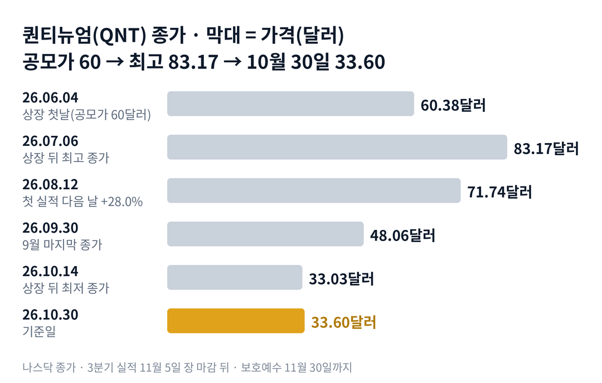

## 짧은 답

> **핵심:** 공모가보다 44% 낮아졌어도 시가총액은 아직 매출의 수백 배이고, 그 몸값을 받쳐 주는 것은 지금 매출이 아니라 2029년 목표의 기술 로드맵과 21억 달러의 현금입니다.

퀀티뉴엄은 6월 4일 나스닥에 상장했습니다. 주가는 한 달 만에 공모가보다 크게 올랐다가, 지금은 공모가의 절반 남짓입니다. 그런데 이 가격에서도 시가총액은 최근 1년 매출의 약 385배입니다.

이 리포트는 시청자 요청 종목입니다. **지금 진단: 상장 뒤 기대가 빠지는 단계에서, 실적과 보호예수 만료라는 두 시험을 앞둔 자리입니다.** 근거와 시나리오는 5부에, 급등 뒤 스무 거래일의 기록은 3부 표에 있습니다.

> **유의사항** 저자는 금융·투자 자문가가 아닙니다. 이 글은 공개 공시와 시세를 정리한 교육용 분석이며 특정 종목의 매수·매도를 권하지 않습니다. 과거 패턴은 미래 수익을 보장하지 않습니다. 실제 투자 전에는 최신 공시를 직접 확인하세요.

## 1부. 퀀티뉴엄은 어떤 회사인가

> **핵심:** 하니웰의 양자 하드웨어와 케임브리지 퀀텀의 소프트웨어가 합쳐진 이온트랩 양자컴퓨터 회사로, 매출은 아직 작고 현금은 많습니다.

퀀티뉴엄은 2021년 11월 하니웰의 양자 사업부와 영국 케임브리지 퀀텀이 합쳐 생겼습니다. 이온트랩 방식 양자컴퓨터를 만듭니다. 이온트랩은 전기장으로 원자 하나하나를 붙잡아 계산에 쓰는 방식입니다.

회사의 주력 기기는 헬리오스입니다. 다음 기기 솔은 2027년, 오류를 스스로 고치는 아폴로는 2029년이 목표입니다. 고객과 협력사로는 미국 은행 제이피모건(JPMorgan), 암젠, 미쓰이, 오라클 등이 있습니다. 최고경영자 라지브 하즈라는 2023년 2월부터 회사를 이끌고 있습니다.

### 숫자로 본 지금의 크기(10월 30일 기준)

| 항목 | 값 · 근거 |
| --- | --- |
| 시가총액 | **약 88억 5,000만 달러** 33.60달러 × A·B주 약 2억 6,331만 주(8월 13일) |
| 최근 1년 매출 | **약 2,300만 달러** 2026년 6월 말까지 4개 분기 |
| 2026년 매출 전망 | **2,800만~3,200만 달러** 8월 11일 회사 발표 |
| 현금(6월 말) | **약 21억 700만 달러** 공모로 약 16억 2,900만 달러 순유입 |
| 상반기 현금 유출 | **약 1억 6,800만 달러** 영업 1억 2,910만 + 설비 3,920만 달러 |
| 남은 계약 매출 | **약 7,420만 달러** 6월 말, 39.6%는 12개월 안 |

이 말은 곧 몸값이 매출의 약 385배라는 뜻입니다. 같은 날 아이온큐는 약 46배, 리게티는 약 281배, 디웨이브는 약 317배였습니다. 대신 현금은 반기 유출액의 열두 배가 넘습니다.

위 그림처럼 주가는 상장 한 달 만에 공모가보다 39% 높아졌다가, 그 뒤 넉 달 동안 고점의 절반 아래로 내려왔습니다.

## 2부. 상장 다섯 달 동안 생긴 일

> **핵심:** 상장 직후의 기대 랠리는 7월 6일에 끝났고, 8월 첫 실적 날의 급등도 오래가지 않았으며, 10월에는 양자주 전체와 함께 밀렸습니다.

퀀티뉴엄은 6월 3일 공모가를 60달러로 정하고 2,800만 주를 팔았습니다. 첫날 종가는 60.38달러로 공모가와 거의 같았습니다. 그 뒤 6월 중순부터 하루 10% 넘게 오르는 날이 네 번 나왔고, 7월 6일 종가 83.17달러로 꼭대기를 찍었습니다.

8월 11일 장 마감 뒤 상장 후 첫 분기 실적이 나왔습니다. 2분기 매출은 800만 달러로 1년 전보다 279% 늘었습니다. 같은 날 오라클 클라우드에 헬리오스를 넣는 협력도 발표했습니다. 다음 날 주가는 28.0% 올랐습니다.

하지만 그 상승은 이어지지 않았습니다. 8월 13일부터 다시 내렸고, 9월 말 종가는 48.06달러였습니다. 9월 8일에는 미국 상무부의 1억 달러 연구개발 지원이 확정됐습니다. 그 대가로 회사는 A주 약 237만 주를 상무부에 발행했습니다.

10월에는 업종 전체가 흔들렸습니다. 10월 14일 아이온큐의 20억 달러 주식 발행 소식에 양자주가 함께 내렸고, 퀀티뉴엄은 33.03달러로 상장 뒤 최저 종가를 썼습니다. 다음 날 모건스탠리가 투자 의견을 올리자 11.1% 반등했습니다. 10월 30일에는 인텔과 아마존 실적 뒤 기술주가 밀리면서 10.4% 내렸습니다. 같은 날 아이온큐(-5.3%), 리게티(-6.7%), 디웨이브(-7.9%)보다 큰 낙폭이었습니다.

### 같은 기간, 양자주 성적

| 종목 · 성격 | 6.4 → 10.30 | 10월 한 달 |
| --- | --- | --- |
| **퀀티뉴엄(QNT)** · 이온트랩 | -44.4% | -30.1% |
| 아이온큐(IONQ) · 이온트랩 | -54.2% | -31.5% |
| 리게티(RGTI) · 초전도 | -53.4% | -28.5% |
| 디웨이브(QBTS) · 양자 어닐링 | -61.5% | -35.7% |
| 퀀텀 컴퓨팅(QUBT) · 광자 | -41.0% | -21.9% |

이 말은 곧 퀀티뉴엄만 따로 빠진 것이 아니라, 상장 뒤 양자주 전체가 비슷하게 내렸다는 뜻입니다. 첫 열은 퀀티뉴엄 상장 첫날 종가 기준입니다. 다만 다른 양자주가 6월부터 내리는 동안 퀀티뉴엄은 7월 6일까지 올라, 고점 대비 낙폭이 더 커 보입니다.

## 3부. 급등 뒤의 기록

> **핵심:** 상장 뒤 하루 10% 넘게 오른 날 가운데 결과가 나온 6번, 스무 거래일 뒤 그 전날 종가보다 높았던 경우는 1번이었습니다.

하루 10% 넘게 오른 날을 모두 모았습니다. 반응은 전 거래일 종가 대비이고, 스무 거래일 뒤는 그날을 첫날로 센 스무 번째 거래일 종가입니다.

### 하루 10% 넘게 오른 일곱 번, 스무 거래일 뒤는?

| 이벤트일 · 공시 내용 | 당일 | 20거래일 뒤 |
| --- | --- | --- |
| **2026.06.17** 상장 2주째, 회사 발표 확인 안 됨 | +13.2% | +2.0% |
| **2026.06.18** 이틀 연속 급등 | +11.2% | -10.6% |
| **2026.06.23** 정부 양자 정책 보도(원문 미확인) | +13.5% | -14.2% |
| **2026.06.30** 증권사 분석 개시 다음 날 | +12.2% | -31.7% |
| **2026.07.06** 상장 뒤 최고 종가 83.17달러 | +11.5% | -31.0% |
| **2026.08.12** 첫 분기 실적·오라클 협력 | +28.0% | -12.8% |
| **2026.10.15** 모건스탠리 의견 상향 | +11.1% | 11.11 판정 |

이 말은 곧 급등을 뒤따라 산 경우 스무 거래일 뒤 손실이었던 때가 6번 중 5번이었다는 뜻입니다. 가장 크게 되돌린 때는 6월 30일 급등으로, 스무 거래일 뒤 31.7% 낮았습니다. 첫 실적 날의 28.0% 급등도 스무 거래일 뒤에는 12.8% 낮았습니다.

반대로 하루 8% 넘게 내린 날도 결과가 나온 5번은 스무 거래일 뒤 모두 더 낮았습니다. 상장 뒤 다섯 달은 오른 날도, 내린 날도 결국 아래로 이어진 기간이었습니다.

## 4부. 되풀이된 이야기

> **핵심:** 상장 초기의 기대, 업종을 따라 움직이는 주가, 그리고 대주주가 많은 지분 구조가 이 종목의 세 가지 축입니다.

첫째, 지분 구조입니다. 상장사인 퀀티뉴엄은 영업 회사 지분의 일부만 갖고, 기존 주주는 의결권만 있는 B주와 영업 회사 지분을 함께 갖습니다. B주는 A주로 1대 1 교환할 수 있습니다. 8월 13일 기준 A주는 약 3,689만 주, B주는 약 2억 2,641만 주입니다.

하니웰은 B주 약 1억 2,463만 주를 갖고 있고, 의결권은 6월 30일 기준 약 47.4%입니다. 케임브리지 퀀텀 창업자 쪽 의결권은 약 31.8%입니다. 하니웰은 상장일부터 퀀티뉴엄을 연결 대상에서 빼고 지분법 투자로 처리합니다.

둘째, 보호예수입니다. 기존 주주는 공모 투자설명서 날짜(6월 3일)로부터 180일, 즉 11월 30일까지 주식을 팔 수 없습니다. 그 뒤에는 B주를 A주로 바꿔 팔 수 있습니다. 다만 하니웰과 케임브리지 퀀텀 쪽 지분이 대부분이고, 이들의 매도 계획은 공시되지 않았습니다.

셋째, 업종 민감도입니다. 10월 14일, 27일, 30일처럼 양자주가 함께 움직인 날 퀀티뉴엄은 대개 같은 방향으로, 비슷하거나 더 크게 움직였습니다. 회사 고유 소식이 없는 날에도 업종의 파도를 그대로 탔습니다.

## 5부. 지금 어느 단계이고, 무엇을 볼까

> **핵심:** 기대가 빠지는 단계의 후반이고, 11월 5일 실적과 11월 30일 보호예수 만료가 다음 국면을 가를 것입니다.

> **국면 정의(퀀티뉴엄 시리즈 공통):** 국면 A 상장 기대 — 공모가 위에서 하루 10% 넘는 급등이 이어지는 때. 국면 B 기대 소진 — 급등 뒤 되돌림이 길어지고 업종과 함께 저점을 낮추는 때. 국면 C 실적 검증 — 실적과 수급 이벤트를 지나며 최저 종가를 지키는지 보는 때.

**2026년 10월 30일 진단: 국면 B 후반.** 근거는 세 가지입니다. 고점 대비 59.6% 내렸고, 급등 뒤 스무 거래일은 6번 중 5번 더 낮았으며, 10월 30일 종가가 상장 뒤 최저 33.03달러에 1.7% 차이입니다.

### 앞으로 일어날 수 있는 일

과거 기록부터 보겠습니다. 하루 10% 넘게 오른 뒤 스무 거래일은 6번 중 1번만 더 높았고, 8% 넘게 내린 뒤 스무 거래일은 5번 모두 더 낮았습니다. 아래 가능성은 이 빈도와 지금 신호를 함께 본 추정입니다.

| 시나리오 · 예상 반응(판정 12월 31일) | 실적 · 조용한 해제 | 가능성(추정) |
| --- | --- | --- |
| 1 · 실적과 수급이 함께 버틴다 연말 종가 33.60달러 위 | ○ / ○ | 중간 (20~30%) |
| **2 · 실적은 좋은데 해제 물량이 누른다** 실적 날 반등 뒤 되돌림 | ○ / × | 높음 (35~45%) |
| 3 · 실적 실망, 수급은 조용 업종 따라 출렁임 | × / ○ | 낮음 (10~20%) |
| 4 · 실적 실망과 해제 물량이 겹친다 33.03달러 아래 새 최저 | × / × | 중간 (20~30%) |

표의 '실적'은 11월 5일 발표에서 2026년 매출 전망 2,800만~3,200만 달러를 지키거나 올리는 경우입니다. '조용한 해제'는 11월 30일 뒤 12월 31일까지 대주주 매도나 대규모 교환 공시가 없는 경우입니다.

시나리오 2를 가장 높게 본 이유는 기록입니다. 첫 실적 날의 28.0% 급등도 스무 거래일 뒤 12.8% 낮았습니다. 이번에는 그 스무 거래일 안에 보호예수 만료가 끼어 있습니다.

시나리오 1의 근거는 현금과 계약입니다. 6월 말 현금은 약 21억 700만 달러이고, 남은 계약 매출은 약 7,420만 달러입니다. 10월 19일에는 헬리오스로 논리 연산 정확도 99.9995%를 달성해 오류 정정 세계 기록을 세웠다고 발표했습니다.

## 6부. 조심할 점과 체크리스트

> **핵심:** 상장 다섯 달의 짧은 기록이고, 몇몇 급등의 이유는 확인하지 못했으며, 보호예수 조기 해제 조건도 공개되지 않았습니다.

3부 표는 '급등 뒤 반드시 내린다'는 규칙이 아닙니다. 상장 뒤 104거래일의 짧은 기록이고, 그 기간 양자주 전체가 내렸습니다. 6월 17일, 18일, 7월 6일 급등의 회사 쪽 이유는 확인하지 못했습니다.

시가총액은 8월 13일 A·B주 합계로 계산했고, 9월 상무부 발행분 약 237만 주를 넣으면 약 89억 3,000만 달러입니다. A주만 세면 몸값을 크게 줄여 보게 되니 주의해야 합니다. 상장 주관사는 보호예수를 앞당겨 풀어 줄 수 있습니다.

- □ 11월 5일 실적에서 2026년 매출 전망(2,800만~3,200만 달러)을 지키거나 올렸나
- □ 11월 5일 실적의 9월 말 현금이 6월 말 21억 700만 달러에서 얼마나 줄었나
- □ 11월 5일 실적의 남은 계약 매출이 7,420만 달러보다 늘었나
- □ 11월 30일 뒤 12월 31일까지 하니웰의 매도·교환 공시가 나오나
- □ 12월 31일까지 상장 뒤 최저 종가 33.03달러를 지키는가
- □ 11월 11일(10월 15일 급등의 20거래일째) 종가가 33.03달러 위인가

다음 갱신은 11월 5일 3분기 실적 뒤에 합니다.
