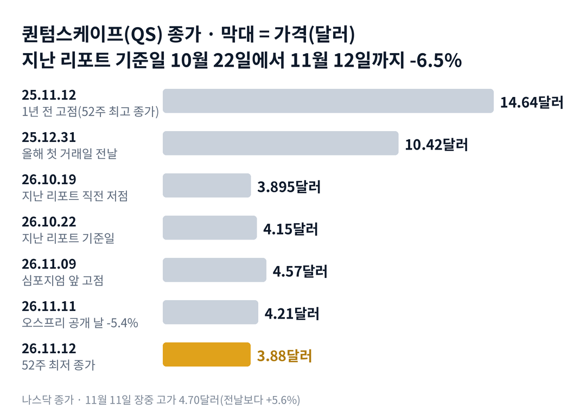

## 짧은 답

> **핵심:** 기술 이정표는 나왔지만 고객의 돈과 이어지지 않았고, 주가는 발표 날 장중 고점 4.70달러 대비 다음 날 종가까지 17.4% 내렸습니다.

새 배터리를 공개한 날, 주가는 왜 장중 고점에서 10% 넘게 미끄러졌을까요? 퀀텀스케이프는 11월 11일 교토 심포지엄에서 새 전고체 셀 '오스프리'를 내놓았습니다. 주가는 아침에 5.6%까지 올랐다가 5.4% 내린 채 마감했습니다.

같은 날 경쟁사 솔리드파워는 4.8% 올랐고, 나스닥100 상장지수펀드(QQQ)도 2.3% 올랐습니다. 다음 날 퀀텀스케이프는 7.8% 더 내렸습니다. 지난 리포트 직전 저점보다 낮은 52주 최저 종가입니다.

**2026.11.12 진단: 국면 B(기대의 되돌림)로 다시 내려감 — 근거는 5부.** 장중에 오르다 꺾인 날 뒤 한 달이 어땠는지는 3부 '장중 반전 열한 번' 기록표에 있습니다.

> **유의사항** 저자는 금융·투자 자문가가 아닙니다. 이 글은 공개 공시와 시세를 정리한 교육용 분석이며 특정 종목의 매수·매도를 권하지 않습니다. 과거 패턴은 미래 수익을 보장하지 않고, 이 종목은 하루 10% 넘게 움직인 적이 여러 번 있습니다. 실제 투자 전에는 최신 공시를 직접 확인하세요.

이 리포트는 시청자 반응이 컸던 종목의 업데이트입니다.

## 지난 리포트 이후

[10월 23일 리포트](/r/qs-2026-10/)는 11월 11일 발표가 고객의 돈과 이어지는지를 가장 중요한 갈림길로 꼽았습니다. 지난 예측 성적은 적중 하나, 빗나감 둘, 확인 전 하나입니다. '기술만 나온다'는 계기는 맞았지만, 반응이 작을 것이라는 예상과 바닥 확인 진단은 빗나갔습니다. 항목별 채점은 6부 끝 채점표에 있습니다.

## 1부. 교토에서 무엇이 나왔나

> **핵심:** 오스프리는 양극 쪽 액체까지 고체로 바꾼 셀이고, 시험 결과는 좋지만 작은 실험실 셀에서 나왔습니다.

퀀텀스케이프는 전기차용 전고체 배터리를 개발하는 회사입니다. 2020년 11월 스팩 합병으로 상장했고, 아직 회계상 매출은 없습니다.

돈을 버는 방식은 기술을 넘기고 사용료를 받는 것입니다. 셀을 직접 대량 생산하기보다, 폭스바겐 배터리 자회사 파워코 같은 고객이 공장을 짓고 기술 사용료를 내는 구조를 택했습니다. 지금 들어오는 돈은 고객이 개발 단계마다 내는 지급금입니다.

그래서 파워코가 언제, 얼마를 내는지가 이 회사의 버틸 힘을 좌우합니다. 새 기술 발표가 고객의 돈으로 이어지는지가 주가의 큰 갈림길이 되어 온 이유입니다.

지금 몸값은 11월 12일 종가 기준 시가총액 약 24억 800만 달러입니다. 3분기 가중평균 주식 수 약 6억 2,060만 주로 계산했습니다. 9월 말 유동성 8억 1,980만 달러가 그 약 34%입니다.

지금 제품인 첫 상용 목표 셀(QSE-5, 약 5Ah)은 이름과 달리 전부 고체가 아닙니다. 회사 백서는 QSE-5를 세라믹 분리막에 액체 전해질이 든 양극을 붙인 구조로 설명합니다. 분리막은 양극과 음극 사이를 막는 얇은 판입니다.

오스프리는 그 양극 속 액체를 황화물 고체 전해질로 바꿨습니다. 황화물은 도요타와 삼성SDI(삼성의 배터리 계열사)가 오래 연구해 온 재료입니다. 대신 높은 압력으로 눌러야 작동한다는 약점이 있었습니다. 퀀텀스케이프는 자기 분리막을 쓰면 1기압에서도 된다고 밝혔습니다.

### 숫자로 본 오스프리(11월 11일 공개, Electrek 백서 정리)

| 항목 | 값 · 시험 조건 |
| --- | --- |
| 수명 | **1,000번 충방전 뒤 용량 약 80%** 2층 셀, 양극 50×65mm, 30도, 1기압 |
| 빠른 충전 | **10%→80% 5분** 섭씨 80도, 2층 셀 |
| 추위 | **-20도에서 상온 용량의 68%** 21×21mm 단층 셀, 천천히 방전 |
| 부피당 에너지 | **최대 약 1,100Wh/L(전망)** 동전 크기 셀, 3기압, 100번 |
| 고객·일정 | **발표 없음** 고객 자체 양극도 쓰는 '열린 플랫폼' |
| 11월 12일 종가 | **3.88달러** 1년 전 고점 14.64달러보다 73.5% 낮음 |

Electrek은 2층 셀의 용량을 약 0.3~0.4Ah로 계산했습니다. QSE-5 한 장(약 5Ah)의 열몇 분의 일입니다. 백서도 공정이 '실험실 규모'에서 확인됐고 공정 개발에 할 일이 많이 남았다고 적었습니다. 이 발표를 앞뒤로 주가는 어떻게 움직였을까요?

## 2부. 발표 앞뒤 일곱 거래일

> **핵심:** 발표를 앞두고 10.9% 올랐던 주가는 발표 2거래일 전 고점부터 15.1% 내렸고, 그 사이 경쟁사와 지수는 다르게 움직였습니다.

위 차트에서 보듯 주가는 11월 3일 4.12달러에서 11월 9일 4.57달러까지 올랐습니다. 심포지엄 2거래일 전입니다. 그 뒤 3거래일 동안 3.88달러까지 내려 그 상승분을 모두 돌려줬습니다.

발표 날 거래량은 2,634만 주로 그 전 50거래일 평균의 약 2.0배였습니다. 다음 날도 약 1.7배였습니다. 많은 사람이 그 2거래일 동안 손을 바꿨다는 뜻입니다.

### 같은 날 다른 종목과 견주면

| 날짜 | 퀀텀스케이프 | 솔리드파워 · QQQ |
| --- | --- | --- |
| 11.09(발표 2거래일 전) | **+6.8%** | -2.8% · +3.5% |
| 11.10 | **-2.6%** | -2.1% · -0.7% |
| 11.11(오스프리 공개) | **-5.4%** | +4.8% · +2.3% |
| 11.12 | **-7.8%** | -6.1% · -0.3% |

발표 날 하락은 퀀텀스케이프 혼자였습니다. 솔리드파워는 황화물 전해질을 만드는 회사라, 경쟁사가 황화물 진영에 들어온 소식이 그쪽에는 나쁘지 않게 읽혔을 수 있습니다. 다음 날에는 두 회사가 함께 내렸습니다.

하락의 직접 원인은 공시로 확인되지 않습니다. 다만 숫자로 확인되는 차이는 둘입니다. 보도자료의 '5분 충전'이 백서에서는 섭씨 80도 조건이었습니다. 그리고 새 고객, 계약 금액, 양산 일정이 하나도 없었습니다.

돈 쪽 소식은 발표 전에 이미 나와 있었습니다. 10월 23일 장 마감 뒤 낸 분기 보고서(10-Q)에 10월 파워코 계약 2차 개정이 적혀 있었습니다. 전환 지급 700만 달러를 없애고, 새 작업 범위를 협상하는 동안 마일스톤 지급을 멈춘다는 내용입니다.

주주 서한은 같은 일을 '작업 범위를 맞춰 가는 중'이라고만 썼습니다. 보고서가 나온 다음 거래일 10월 26일, 주가는 3.2% 내렸고 QQQ는 1.1% 올랐습니다.

세 날을 나란히 놓으면 공통점이 하나 보입니다. 10월 26일, 11월 11일, 11월 12일 모두 지수가 아니라 고객의 돈과 관련된 소식이 나온 뒤였습니다. 이번처럼 장중에 오르다 꺾인 날은 과거에 몇 번 있었을까요?

## 3부. 장중 반전 열한 번, 다음 날과 20거래일 뒤

> **핵심:** 장중 5% 넘게 올랐다가 3% 넘게 내린 채 끝난 열한 번 가운데 열 번은 다음 날 더 내렸고, 20거래일 뒤 그날 종가보다 높았던 것은 세 번이었습니다.

기준은 이렇습니다. 장중 고가가 전날 종가보다 5% 이상 높았는데, 종가는 전날보다 3% 이상 낮았던 날입니다. 2021년 11월부터 2026년 10월까지 나스닥 일별 시세에서 조건에 맞는 날을 하나도 빼지 않았습니다. 기대에 사람이 몰렸다가 같은 날 빠져나간 날이라, 지금과 비슷한 조건이기 때문입니다.

비교 기준은 반전한 날의 종가입니다. 예를 들어 이번에는 11월 11일 종가 4.21달러가 기준이고, 11월 12일 3.88달러는 그보다 -7.8%입니다.

**한눈에:** **10/11** 다음 날 더 내림 · **3/11** 20거래일 뒤 그날 종가보다 위 · **-4.9%** 20거래일 뒤 가운데 값(중앙값).

### 장중 반전 열한 번, 다음 날과 20거래일 뒤

| 날짜 · 장중 고점 | 그날 종가 · 다음 날 | 20거래일 뒤 |
| --- | --- | --- |
| 2021.11.22 +6.0% | -3.0% · -3.7% | -29.7% |
| 2022.01.20 +5.1% | -3.5% · -9.1% | -6.6% |
| **2022.02.17 +5.1%** | **-4.9% · -3.4%** | **+5.6%** |
| 2022.05.10 +5.4% | -5.3% · -13.9% | -3.2% |
| **2023.01.18 +5.0%** | **-3.0% · -2.6%** | **+60.9%** |
| 2023.02.03 +5.4% | -4.9% · +1.3% | -4.9% |
| 2024.01.09 +9.4% | -3.4% · -2.7% | -14.5% |
| **2024.12.18 +10.5%** | **-4.3% · -6.9%** | **+0.8%** |
| 2025.01.07 +5.5% | -4.4% · -9.1% | -20.3% |
| 2025.11.20 +6.4% 2회 심포지엄 보도자료 | -5.9% · -2.1% | -2.5% |
| 2026.06.22 +5.6% | -5.3% · -2.5% | -20.5% |

굵게 쓴 세 줄이 20거래일 뒤 반전한 날 종가보다 높았던 경우입니다. 그중 2024년 12월은 +0.8%로 거의 제자리였습니다. 크게 회복한 것은 2023년 1월 한 번뿐입니다.

눈에 띄는 줄은 2025년 11월 20일입니다. 1년 전 2회 심포지엄 보도자료가 나온 날에도 주가는 장중 6.4% 올랐다가 5.9% 내린 채 끝났습니다. 두 해 연속 같은 행사 무렵에 같은 모양이 나온 셈입니다.

> **이번 사례(20거래일 결과 미확정):** 2026.11.11 오스프리 공개 · 장중 +5.6% → 종가 -5.4%, 다음 날 -7.8% · 기준은 11월 11일 종가 4.21달러 · 20거래일째 12월 10일 판정

이 기록의 한계도 분명합니다. 열한 번 가운데 원인이 확인된 날은 일부뿐이라, 기술 발표 날만 따로 떼어 볼 수는 없었습니다. 2023년 1월과 2월, 2024년 12월과 2025년 1월처럼 측정 기간이 서로 겹치는 경우가 있어 독립된 열한 번이 아니므로 참고 자료로 봅니다. 그렇다면 한 달을 버티게 해 줄 돈은 어디에 있을까요?

## 4부. 돈으로 다시 본 버틸 힘

> **핵심:** 파워코가 줄 수 있는 최대 금액은 계산상 약 6,840만 달러로 더 줄었고, 협상이 끝날 때까지 남은 지급금도 들어오지 않습니다.

파워코 계약은 7월에 한 번 바뀌었습니다. 최대 지급액이 1억 3,070만 달러에서 7,540만 달러(이미 받은 돈 포함)로 줄었습니다. 10월 개정에서 전환 지급 700만 달러가 빠졌으니, 단순히 빼면 약 6,840만 달러입니다.

파워코는 3분기에 1,850만 달러, 올해 9개월 동안 2,890만 달러를 냈습니다. 10-Q는 협상이 성공한다는 보장이 없다고 적었습니다. 회사는 협상 범위에 차세대 기술과 데이터센터·로봇 용도까지 넣었습니다. 오스프리가 바로 그 차세대 기술입니다.

회사가 가진 돈은 9월 말 유동성 8억 1,980만 달러입니다. 11월 12일 종가와 3분기 가중평균 주식 수(약 6억 2,060만 주)로 계산한 시가총액은 약 24억 800만 달러입니다. 유동성이 시가총액의 약 34%입니다.

주식 수 쪽에서는 11월 4일 임원 네 명이 양도제한조건부주식 약 215만 주를 받았습니다. 매도는 없었습니다. 2025년 8월에 끝난 시장 판매(ATM) 뒤 새 주식 판매 계획은 나오지 않았습니다.

과거 기록은 장중 반전한 날 뒤 한 달이 대부분 더 낮았다는 것까지 알려 줍니다. 그래서 앞으로 확인할 조건은 두 가지입니다. 하나는 주가가 오스프리 날 종가를 한 달 안에 되찾는가, 다른 하나는 그 사이 고객의 돈이 공시로 확인되는가입니다. 이 두 조건으로 나누면 어떤 갈림길이 나올까요?

## 5부. 오스프리 뒤 네 가지 시나리오

> **핵심:** 지금은 국면 B(기대의 되돌림)이고, 12월 10일 종가와 새 고객 계약 공시가 시나리오를 가릅니다.

> **국면 정의(퀀텀스케이프 시리즈 공통, 10월 23일 리포트 5.1):** 국면 A 이정표 랠리 — 공정·시연·협력 발표에 크게 오르는 단계. 국면 B 기대의 되돌림 — 매출 없음과 고객 돈 축소가 확인되며 반등이 꺾이는 단계. 국면 C 바닥 확인 — 1년 안 최저 근처에서 나쁜 소식에도 덜 내리는 단계.

**2026년 11월 12일 진단: 국면 B로 다시 내려감.** 국면 B 신호 다섯 개 가운데 넷이 맞습니다. 매출 없음 확인, 파워코 지급 중단, 반등이 3거래일 만에 꺾임, 50일 평균(4.55달러) 아래입니다. 국면 C 신호는 셋(1년 최저 근처, 새 주식 발행 없음, 실적 다음 날 상승)입니다. 다음 이정표 날짜는 지금 정해진 것이 없습니다.

**판정 기준 두 가지:** 모두 12월 10일(11월 11일부터 20번째 거래일) 기준입니다. 하나는 그날 종가가 오스프리 날 종가 4.21달러보다 높은가입니다. 다른 하나는 그때까지 새 고객 계약이나 파워코 새 지급 조건이 공시되는가입니다.

### 앞으로 일어날 수 있는 일

**확인된 사실:** 11월 12일 종가 3.88달러는 기준 4.21달러보다 7.8% 낮습니다. 새 계약 공시는 아직 없습니다.

**과거 기록:** 3부 표에서 장중 반전한 날 20거래일 뒤 그날 종가보다 높았던 것은 열한 번 중 세 번이었습니다. 지난 리포트에서 다룬 기술 이정표 급등도 고객 돈이 따라오지 않으면 대부분 한 달 안에 되돌렸습니다.

**추정:** 과거 빈도로 보면 장중 반전한 날은 11번 중 3번만 20거래일 뒤 그날 종가 위였습니다. 아래 가능성은 주가가 오를 확률이 아니라, 12월 10일에 두 판정 기준이 어느 칸에 들어갈지에 대한 분석자의 주관적 추정입니다. 네 경우는 겹치지 않아 '약 N%'를 더하면 100%이고, 괄호 안 구간은 흔들림의 폭이라 서로 더하지 않습니다.

| 시나리오(판정 2026년 12월 10일) | 가격·계약 | 가능성(추정) |
| --- | --- | --- |
| **1 · 되돌림 계속** | 아래 · 계약 없음 | 높음 약 55% (45~65%) |
| 2 · 계약 없는 반등 | 위 · 계약 없음 | 중간 약 20% (10~30%) |
| 3 · 계약이 이끈 반등 | 위 · 계약 있음 | 낮음 약 15% (5~25%) |
| 4 · 불리한 계약 확정 | 아래 · 계약 있음 | 낮음 약 10% (5~15%) |

시나리오 1이면 다음 확인은 4분기 실적에서 청구액과 파워코 협상 결과입니다. 시나리오 2면 반등이 거래량을 동반하는지 봅니다. 시나리오 3이면 계약 금액과 지급 일정이 함께 나왔는지, 시나리오 4면 파워코 최대 지급액이 얼마로 정해졌는지 봅니다.

위쪽 두 칸에 35%를 준 것은 과거 열한 번 중 세 번(약 27%)에 1년 전보다 낮아진 주가 수준을 조금 더한 값입니다. 계약이 나오는 두 칸을 25%로 낮게 둔 것은 회사가 협상 마감일을 밝히지 않았기 때문입니다.

반대쪽 요인도 같은 무게로 있습니다. 파워코 지급은 멈춰 있고, 오스프리에는 양산 일정이 없으며, 52주 최저 종가가 이번 주에 새로 나왔습니다. 이 진단을 가장 빨리 뒤집을 수 있는 위험은 무엇일까요?

## 6부. 위험과 체크리스트

> **핵심:** 판을 가장 빨리 바꿀 수 있는 것은 파워코 협상 결과이고, 그다음이 오스프리를 쓰겠다는 고객의 이름과 금액입니다.

먼저 이 분석의 한계입니다. 3부 표는 열한 번뿐이고, 발표 내용이 같은 날은 거의 없습니다. 오스프리 숫자는 회사 백서와 Electrek 정리를 따랐고, 외부 기관의 시험 결과는 아직 없습니다.

사업 실행 쪽 위험이 가장 큽니다. 지금 제품 QSE-5의 첫 100메가와트시 라인은 2028년 생산이 목표이고, 오스프리에는 아직 일정이 없습니다. 고객 쪽에서는 파워코 의존이 그대로입니다. 협상 기간에는 마일스톤 지급이 없고, 파워코가 기술 사용 계약을 맺을 의무도 없습니다.

자금 조달 쪽에서는 유동성이 연간 사용액의 약 2.6~3.0년 치(지난 리포트 계산)입니다. 주가가 4달러 아래에서 새 주식을 팔면, 같은 돈에 더 많은 주식이 필요합니다. 혼다와는 2026년 6월 공동 연구 계약을 맺었지만(지난 리포트 3부), 아직 큰 지급금으로 이어지지는 않았습니다.

외부 환경 쪽에서는 경쟁사 일정이 다가옵니다. 삼성SDI는 2027년 하반기 황화물 전고체 양산을 목표로 하고 있어, 고객이 기다려 줄 시간이 길지 않을 수 있습니다. 매출 없는 성장주라 금리와 전기차 수요 소식에도 크게 흔들립니다.

**핵심 확인 세 가지:** 위에서부터 판정을 바꾸는 힘이 큰 순서입니다.

- ☐ 1순위 · 12월 10일까지 파워코 새 지급 조건 8-K 공시 1건 이상 나왔나
- ☐ 2순위 · 12월 10일(20거래일째) 종가가 4.21달러보다 높은가
- ☐ 3순위 · 12월 10일까지 오스프리 고객 이름·금액 공시 1건 이상 나왔나

**보조 확인:** 새 주식 판매 계획이 공시되는지 확인합니다.

**지난 리포트 점검(따로 판정):** 11월 18일 종가가 10월 21일 종가 3.98달러보다 높은지 봅니다(지난 리포트 시나리오 3).

**기억할 판단 기준:** 이 종목은 기술 소식에 장중 크게 반응하지만, 고객의 돈이 따라오지 않은 상승은 한 달을 넘기지 못한 경우가 많았습니다.

### 지난 예측 채점표

10월 23일 리포트(10월 22일 기준)의 진단과 시나리오를 11월 12일 기준으로 채점한 결과입니다. 지난 리포트에는 시나리오별 가능성 숫자가 없었습니다.

| 지난 점검 항목 · 당시 기준 | 판정 및 실제 결과(11월 12일) |
| --- | --- |
| **시나리오 2 계기: 기술 발표만 나온다** 고객 돈·일정 없음 | **[적중]** 오스프리 성능만 공개, 고객·금액·일정 없음 |
| **시나리오 2 예상: 반응이 작다** 파워블록 +1.3%처럼 | **[빗나감]** 발표 날 -5.4%, 다음 날 -7.8% |
| **진단: 국면 C(바닥 확인)의 초입** 10월 19일 3.895달러 저점 | **[빗나감]** 11월 12일 3.88달러로 52주 최저 종가 경신 |
| **시나리오 3: 반등이 20거래일을 넘긴다** 11월 18일 종가 vs 3.98달러 | **[확인 전]** 11월 12일 3.88달러, 11월 18일 판정 |

시나리오 1(고객 돈과 연결)과 4(새 주식 발행)는 일어나지 않아 표에서 뺐습니다. 가장 큰 빗나감은 진단이었습니다. 52주 최저 근처와 실적 다음 날 상승만 보고 바닥을 점쳤는데, 10-Q의 파워코 지급 중단을 신호에 넣지 못했습니다. 이번 리포트부터는 분기 보고서의 고객 계약 문단을 진단 근거에 함께 둡니다.

같은 전고체 배터리 업종의 흐름은 [솔리드파워 리포트](/r/sldp-2026-11/)에서 함께 볼 수 있습니다. 다음 갱신은 파워코 협상 결과나 12월 10일 20거래일째 반응을 본 뒤에 합니다. 공시는 [퀀텀스케이프 SEC 공시 목록](https://www.sec.gov/cgi-bin/browse-edgar?action=getcompany&CIK=0001811414)에서 확인할 수 있습니다.
