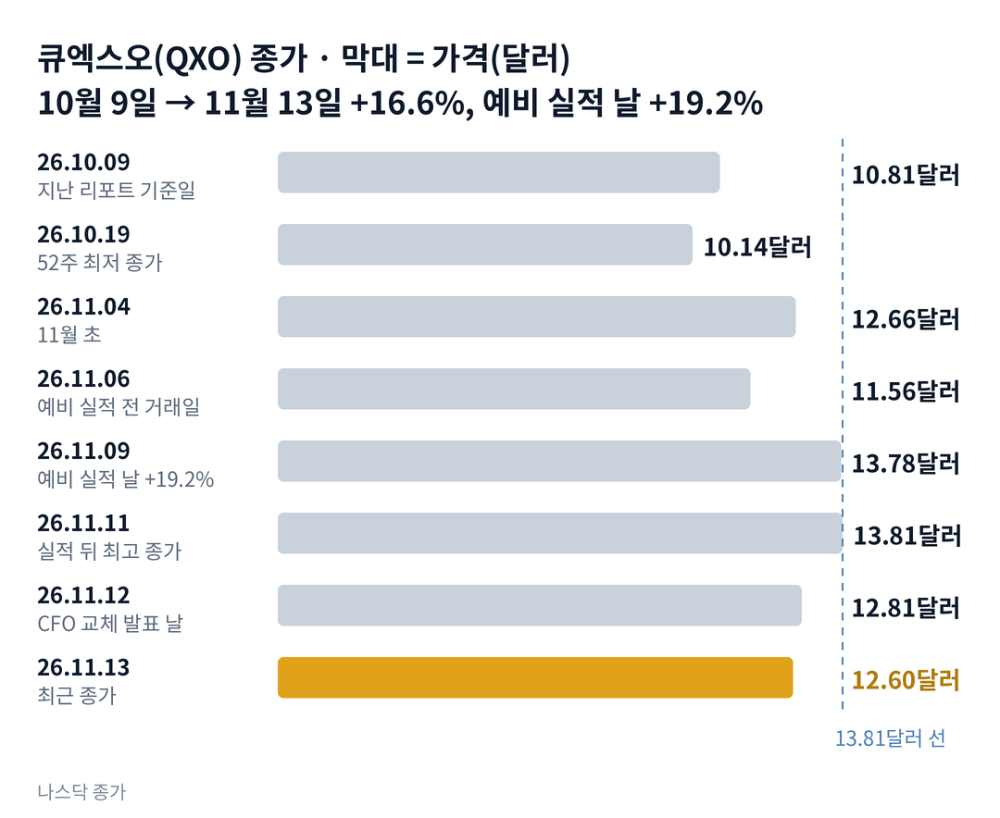

## 짧은 답

> **핵심:** 통합 효과는 가격과 배송에서 먼저 보이고, 물량과 한 주당 이익에는 아직 덜 닿았습니다. 그래도 주가는 예비 실적 하루에 19.2% 올랐습니다.

회사 이익은 85% 늘었습니다. 그런데 주주 한 주의 이익은 왜 오히려 줄었을까요? 큐엑스오는 11월 9일 장 시작 전에 3분기 예비 실적을 냈습니다. 조정 EBITDA(이자·세금·감가상각 등을 빼기 전 이익을 회사 기준으로 조정한 값)는 5억 5,700만 달러였습니다. 주가는 그날 11.56달러에서 13.78달러로 올랐습니다.

이번 리포트는 시청자 요청 종목입니다. 실적 발표 뒤 업데이트를 부탁하며 '인수한 회사들 통합이 잘되어 가는지 궁금하다'고 물어 주셨습니다. 이 리포트는 그 질문 하나를 실적 숫자로 따라갑니다.

숫자를 한 겹 벗기면 다른 얼굴이 나옵니다. 새로 산 탑빌드와 코디악을 빼면, 가장 오래 데리고 있던 비컨 쪽 매출은 1년 전보다 약 2.4%(계산) 적습니다. 조정 주당 이익도 1년 전보다 1센트 적었습니다. 주가는 11월 13일 12.60달러로, 11월 9일 종가 대비 4거래일 만에 8.6% 내렸습니다.

**2026.11.13 진단: 지난 리포트의 '업황 검증'(실적과 금리가 방향을 정하는 단계) 국면에서 실적이 첫 답을 줬지만, 급등의 절반가량을 되돌리는 중입니다 — 근거는 5부.** 비컨 통합을 항목별로 채점한 표는 2부 '비컨 통합 성적표'에 있습니다.

> **유의사항** 저자는 금융·투자 자문가가 아닙니다. 이 글은 공개 공시와 시세를 정리한 교육용 분석이며 특정 종목의 매수·매도를 권하지 않습니다. 과거 패턴은 미래 수익을 보장하지 않고, 이 종목은 하루 7% 넘게 움직인 날이 여러 번 있습니다. 실제 투자 전에는 최신 공시를 직접 확인하세요.

## 지난 리포트 이후

[10월 11일 리포트](/r/qxo-2026-10/)는 주가가 '업황 검증' 국면에 있고, 11월 초 3분기 실적의 이익률이 다음 방향을 정할 것이라고 봤습니다. 지난 예측 성적은 시나리오 넷 가운데 적중·부분 적중·빗나감·안 일어남이 하나씩입니다. '10~14달러 범위'는 맞았고, '새 증자로 9.14달러 근처'는 빗나갔습니다. 항목별 채점은 6부 끝 채점표에 있습니다.

기준일 종가는 10월 9일 10.81달러에서 11월 13일 12.60달러로 16.6% 올랐습니다. 지난 리포트는 실적 날짜를 '11월 5일 전후 장 마감 뒤'로 추정했습니다. 실제로는 11월 9일 장 전에 예비 숫자가, 11월 12일 장 마감 뒤에 확정 실적이 나왔습니다.

## 1부. 한 달 사이 회사에 생긴 일

> **핵심:** 탑빌드를 석 달 내내 합친 첫 분기에 매출과 이익이 크게 늘었고, 회사는 5억 달러 자사주 매입과 재무 책임자 교체를 함께 발표했습니다.

큐엑스오는 미국 코네티컷 그리니치에 본사를 둔 건축 자재 유통·시공 회사입니다. 회장 겸 최고경영자는 연쇄 인수로 이름난 브래드 제이콥스입니다. 2025년 4월 지붕재 유통 회사 비컨 루핑을, 2026년 4월 건자재 회사 코디악을, 7월 단열재 회사 탑빌드를 사들였습니다.

돈을 버는 방식은 두 가지입니다. 지붕재·단열재·목재 같은 건축 자재를 시공 업체와 건설사에 팔아 차익을 남깁니다. 탑빌드가 들어온 뒤로는 단열재를 직접 시공하고 공사비도 받습니다. 회사 설명으로 지금 북미 단열재 유통·시공 1위, 지붕재 유통 2위입니다.

그래서 주가를 움직이는 변수는 주택 경기와 인수한 회사들을 얼마나 잘 합치느냐입니다. 집을 짓고 고치는 일이 줄면 매출이 먼저 흔들립니다. 같은 고객에게 여러 자재를 함께 팔고 함께 사들일수록, 남는 돈은 커집니다. 고객은 약 19만 4,000곳입니다.

지금 몸값은 11월 13일 종가 기준 시가총액 약 131억 달러(계산)입니다.

### 3분기 숫자(1년 전 대비, 회사 발표)

| 항목 | 2026년 3분기 |
| --- | --- |
| 매출 | **48억 9,500만 달러** 1년 전 27억 2,800만 달러, +79% |
| 조정 EBITDA | **5억 5,700만 달러** 이익률 11.4%, 1년 전 11.0% |
| 순손실 | **1억 2,300만 달러** 1년 전 1억 3,900만 달러 |
| 조정 주당 이익 | **0.13달러** 1년 전 0.14달러 |
| 현금 · 장기 부채 | **5억 2,800만 · 약 89억 5,000만 달러** 9월 30일, 연초 23억 6,200만 · 30억 5,700만 달러 |

매출에는 새로 산 탑빌드와 코디악이 들어 있고, 1년 전 3분기에는 둘 다 없었습니다. 지난 리포트가 적은 시장 예상은 매출 약 48억 8,000만 달러였습니다. 매출은 예상과 거의 같았고, 조정 주당 이익은 예상(0.14달러)보다 1센트 모자랐습니다.

같은 11월 9일, 제이콥스는 아홉 번째 회사를 시작한다고 밝혔습니다. 뉴욕증권거래소 아메리칸에 상장된 토지 관리 회사 CKX(씨케이엑스) 랜즈에 10억 달러를 현금으로 넣는 계획입니다. 업종은 아직 정하지 않았고, 큐엑스오 회장·최고경영자 자리는 그대로 지킨다고 했습니다.

11월 12일 장 전에는 새 최고재무책임자로 알루미늄 회사 노벨리스의 데브 아후자를 선임했습니다. 2027년 1월부터 일합니다. 지금의 이산 에사이드는 부회장이 돼 인수합병과 자금 조달을 맡습니다. 그날 주가는 7.2% 내렸고, 같은 날 주택건설 ETF(XHB)는 1.7% 내렸습니다.

확정 실적과 함께 이사회는 5억 달러 자사주 매입을 승인했습니다. 지난 리포트가 걱정한 새 증자 대신 반대 방향의 발표가 나온 셈입니다. 이익이 이만큼 늘었는데, 가장 오래 데리고 있던 비컨은 어땠을까요?

## 2부. 비컨 통합 18개월, 숫자로 본 성적

> **핵심:** 비컨 쪽 매출은 아직 줄었지만, 가격·이익률·배송 지표는 모두 좋아졌고 10월에는 매출이 9% 늘었습니다.

통합을 숫자로 보려면 먼저 '새로 산 것'과 '합쳐서 나아진 것'을 나눠야 합니다. 이익이 85% 늘어난 이유의 대부분은 탑빌드와 코디악을 사서 더한 결과입니다. 통합이 잘되는지는 오래 데리고 있던 비컨 쪽 숫자에서 먼저 보입니다.

비컨 쪽 매출은 회사가 따로 밝히지 않아 계산했습니다. 전체 매출에서 회사가 밝힌 탑빌드와 코디악 매출을 뺐습니다. 남은 약 26억 6,200만 달러는 1년 전 27억 2,800만 달러보다 약 2.4% 적습니다. 여기에는 작은 소프트웨어 매출도 섞여 있습니다. 회사는 아직 사업 부문별 실적을 나눠 내지 않습니다.

### 비컨 통합 성적표(지붕·방수, 회사 발표와 계산)

| 항목 | 결과 · 판정 |
| --- | --- |
| 비컨 쪽 매출(계산) | **약 -2.4%** 아직 줄어듦 |
| 지붕재 매출 | **19억 9,600만 달러, -4.3%** 1년 전 20억 8,600만 달러 |
| 지붕·방수 가격 | **4월 -1.1% → 9월 +4.1%** 회사 전체는 6월부터 플러스 |
| 지붕·방수 매출총이익률 | **1년 전보다 상승** 폭은 밝히지 않음 |
| 정시 배송 · 품절 | **+6.5%포인트 · 25% 넘게 감소** 청구서 정확도 90% 초반 → 후반 |
| 10월 하루 매출 | **+9%** 가장 오래 보유한 지붕·보완재 |

표를 읽는 순서는 이렇습니다. 물량은 아직 줄었는데, 값은 더 받고 배송은 좋아졌습니다. 그리고 10월에는 매출까지 늘었습니다. 회사는 이것을 서비스 개선의 효과로 설명합니다.

자체 브랜드 트라이빌트도 같은 방향입니다. 3분기 매출은 2억 8,300만 달러로 2.6% 늘었습니다. 지붕·방수 매출에서 차지하는 비중은 10.6%로 사상 최고였습니다. 자체 브랜드는 같은 종류의 유명 브랜드 제품보다 남는 돈이 많다고 회사는 밝혔습니다.

세 회사를 합친 효과는 아직 숫자로 거의 안 나왔습니다. 세 회사가 한 해에 사들이는 물건은 약 120억 달러입니다. 그 가운데 두 회사 이상이 같은 공급사에서 사는 금액이 76억 달러입니다. 이 금액을 묶어 값을 깎는 일은 이제 시작이고, 지금까지 실현했다고 밝힌 것은 차량·전산·폐기물 같은 간접 구매뿐입니다.

전산 통합도 시험 단계입니다. 새 주문·재고·창고 시스템을 일부 지점에서 시험 중이고, 2027년 말까지 세 회사 매출 대부분을 이 시스템에 올리는 것이 목표입니다.

가격, 배송, 자체 브랜드, 구매를 나란히 놓으면 공통점이 하나 보입니다. 모두 비컨을 더 잘 운영하는 데서 나온 변화입니다. 세 회사를 묶어서 생긴 효과는 아직 거의 없습니다. 통합이 진행 중이라면, 그 효과는 왜 주주 한 주의 이익으로 이어지지 않았을까요?

## 3부. 하루 19% 오른 날 뒤의 기록

> **핵심:** 11월 9일 +19.2%는 2024년 8월 이후 가장 큰 하루 상승이었고, 앞선 15% 넘는 두 번은 20거래일 뒤 모두 그날보다 낮았습니다.

기준은 이렇습니다. 2024년 8월 15일부터 11월 13일까지 나스닥 일별 시세에서 종가 기준 하루 10% 넘게 오른 날을 하나도 빼지 않았습니다. 그날 종가를 10거래일 뒤, 20거래일 뒤 종가와 비교했습니다. 이번 급등이 실적 숫자 하나로 생긴 큰 하루였기 때문에 이 기준을 골랐습니다.

예를 들어 2026년 2월 11일은 코디악 인수 발표로 16.6% 오른 날입니다. 그날 종가 27.06달러를 20거래일 뒤 종가와 비교하면 27.9% 낮았습니다.

**한눈에:** **+19.2%** 11월 9일, 2024년 8월 이후 최대 · **2/2** 앞선 15% 넘는 날, 20거래일 뒤 그날보다 낮음 · **4/7** 10% 넘게 오른 날 가운데 20거래일 뒤 낮았던 날.

### 하루 10% 넘게 오른 날과 그 뒤(종가, 계산)

| 날짜 · 하루 상승 | 10거래일 뒤 | 20거래일 뒤 |
| --- | --- | --- |
| 2024.08.16 +11.2% | +9.4% | +9.0% |
| 2025.04.09 +11.3% | -7.3% | +1.0% |
| 2025.06.06 +13.4% | +26.9% | +13.9% |
| 2025.06.18 +11.7% | -2.3% | -3.9% |
| 2026.01.05 +18.2% | +0.9% | -2.0% |
| 2026.02.11 +16.6% | -11.8% | -27.9% |
| 2026.06.11 +10.1% | +7.2% | -16.2% |

> **이번 사례(결과 미확정):** 2026.11.09 +19.2%, 종가 13.78달러 · 4거래일 뒤 12.60달러(-8.6%) · 11월 23일 10거래일째, 12월 14일 20거래일째 판정

이번 급등은 업종보다 훨씬 컸습니다. 같은 날 주택건설 상장지수펀드(ETF) XHB(SPDR S&P 주택건설 ETF)는 3.6%, 빌더스 퍼스트소스(BLDR)는 5.5% 올랐습니다. 거래량은 4,216만 주로 직전 20거래일 평균의 약 2.1배였습니다.

이 기록의 한계도 분명합니다. 15% 넘는 날은 두 번뿐이고, 그때는 아폴로 투자와 코디악 인수라는 다른 재료였습니다. 2026년 1월 5일 급등 뒤에는 9거래일 뒤 23.80달러 보통주 매각이 나왔습니다. 이번에는 증자 대신 자사주 매입이 나왔다는 점이 다릅니다. 주주 한 주의 이익은 어떻게 계산될까요?

## 4부. 이익 85%와 한 주당 0.13달러 사이

> **핵심:** 회사 이익이 늘어난 만큼 주식 수와 이자도 늘어, 주주 한 주의 조정 이익은 1년 전보다 1센트 적었습니다.

조정 EBITDA는 회사 전체가 번 돈의 크기입니다. 주주에게 돌아가는 이익은 여기서 이자, 세금, 우선주 배당을 내고 남은 돈을 주식 수로 나눈 것입니다. 이 단계마다 1년 전과 달라진 것이 있습니다.

**1년 전과 달라진 것(3분기, 회사 발표와 계산)**

| 항목 | 2025년 3분기 → 2026년 3분기 |
| --- | --- |
| 조정 EBITDA | **3억 100만 → 5억 5,700만 달러** +85% |
| 이자 비용(순) | **3,700만 → 1억 6,300만 달러** 약 4.4배 |
| 우선주 배당 | **3,000만 → 6,600만 달러** 아폴로 주도 우선주 3,600만 달러 새로 |
| 조정 희석 주식 수 | **8억 7,530만 → 11억 9,290만 주** 약 +36% |
| 조정 주당 이익 | **0.14 → 0.13달러** 약 -7% |

이자는 탑빌드를 사려고 빌린 돈에서 왔습니다. 장기 부채는 연초 30억 5,700만 달러에서 9월 말 약 89억 5,000만 달러가 됐습니다. 주식 수는 탑빌드 주주에게 준 3억 1,160만 주가 가장 큽니다.

그래서 이 질문은 두 갈래로 나뉩니다. 사업 통합은 가격과 배송에서 나아지는 중입니다. 주주 이익은 인수 대가인 주식과 부채를 이익이 따라잡을 때까지 기다려야 합니다. 회사가 내건 목표는 지금 가진 사업으로 2030년 조정 EBITDA 40억 달러입니다. 올해 9월까지 쌓인 조정 EBITDA는 8억 3,000만 달러였습니다.

한 달 전체로 보면 큐엑스오는 업종과 비슷하게 움직였습니다. 아래 표는 지난 리포트 기준일 10월 9일 종가와 11월 13일 종가를 비교한 것입니다.

**10월 9일 → 11월 13일 종가 변화(나스닥 시세, 계산)**

| 종목 | 변화 |
| --- | --- |
| 큐엑스오(QXO) | **+16.6%** 10.81 → 12.60달러 |
| 빌더스 퍼스트소스(BLDR) | **+14.8%** 52.85 → 60.68달러 |
| 주택건설 ETF(XHB) | **+7.7%** 94.77 → 102.07달러 |
| S&P500 ETF(SPY) | **-3.1%** 778.57 → 754.37달러 |

시장 전체가 내릴 때 주택 관련주는 함께 올랐습니다. 급등 뒤 4거래일도 비슷해서, 큐엑스오는 8.6%, 빌더스 퍼스트소스는 8.0% 내렸습니다.

과거 기록이 알려 주는 것은 큰 급등 뒤 20거래일의 방향까지입니다. 그래서 앞으로 확인할 조건은 두 가지입니다. 하나는 12월 14일 종가가 12.60달러를 지키는가, 다른 하나는 그 사이 실적 뒤 최고 종가 13.81달러 위 마감이 나오는가입니다. 이 두 조건으로 나누면 어떤 갈림길이 나올까요?

## 5부. 국면 진단과 네 가지 시나리오

> **핵심:** 업황 검증 국면에서 실적이 첫 답을 줬고, 이제 12월 14일 종가와 그 사이 13.81달러 위 마감 여부가 다음 갈림길을 정합니다.

> **국면 정의(큐엑스오 시리즈 공통, 10월 11일 리포트 5.1):** 국면 A(희석과 물량 하락, 새 주식이 시장에 풀리며 내리는 단계). 국면 B(인수 기대 상승, 새 인수나 높은 값의 투자 소식에 오르는 단계). 국면 C(업황 검증, 새 거래 없이 실적과 금리가 방향을 정하는 단계).

**2026년 11월 13일 진단: 국면 C(업황 검증)가 이어지는 중.** 새 인수나 보통주 매각은 넉 달째 없습니다. 실적이 주가를 하루 19.2% 움직였고, 그 뒤에는 업종과 함께 되돌렸습니다. 국면 A 신호인 새 주식 발행은 없고, 오히려 자사주 매입이 승인됐습니다.

**판정 기준 두 가지:** 하나는 12월 14일(11월 13일부터 20번째 거래일) 종가가 11월 13일 종가 12.60달러보다 높은가입니다. 다른 하나는 그때까지 실적 뒤 최고 종가 13.81달러(11월 11일)보다 높게 마감한 날이 하루라도 있는가입니다.

### 앞으로 일어날 수 있는 일

**확인된 사실:** 10월 하루 매출은 회사 전체 +5%, 지붕·보완재 +9%였습니다. 5억 달러 자사주 매입이 승인됐고, 새 최고재무책임자는 2027년 1월에 옵니다.

**과거 기록:** 3부 표에서 하루 15% 넘게 오른 앞선 두 번은 20거래일 뒤 모두 그날보다 낮았습니다. 10% 넘게 오른 일곱 번으로 넓히면 20거래일 뒤 낮았던 날이 넷, 높았던 날이 셋입니다.

**추정:** 출발점은 15% 넘는 급등 2번 중 2번이 20거래일 뒤 낮았다는 기록입니다. 아래 가능성은 주가가 오를 확률이 아니라, 12월 14일에 두 판정 기준이 어느 칸에 들어갈지에 대한 분석자의 주관적 추정입니다. 네 경우는 겹치지 않아 '약 N%'를 더하면 100%이고, 괄호 안 구간은 흔들림의 폭이라 서로 더하지 않습니다.

| 시나리오(판정 2026년 12월 14일) | 조건 | 가능성(추정) |
| --- | --- | --- |
| **1 · 급등 되돌림** | 12.60 아래 · 없음 | 높음 약 40% (35~45%) |
| 2 · 좁은 범위 유지 | 12.60 위 · 없음 | 높음 약 30% (25~35%) |
| 3 · 통합 확인 돌파 | 12.60 위 · 있음 | 낮음 약 25% (20~30%) |
| 4 · 돌파 뒤 급락 | 12.60 아래 · 있음 | 낮음 약 5% (3~8%) |

시나리오 1이면 11월 23일 종가가 실적 전 종가 11.56달러 쪽으로 내려가는지 먼저 봅니다. 시나리오 2면 12달러대에서 주택 지표와 금리를 따라 오르내리는지 봅니다. 시나리오 3이면 자사주 매입 집행이나 11월 매출 같은 새 숫자가 계기였는지 봅니다. 시나리오 4는 주택 업종 전체가 급락하는 경우입니다.

1번에 가장 큰 무게를 둔 것은 앞선 두 번의 큰 급등이 모두 그 방향이었고, 이번에도 이미 8.6% 되돌렸기 때문입니다. 다만 표본이 둘이고 이번에는 증자 대신 자사주 매입이 나와, 2·3번과의 차이를 크게 두지 않았습니다. 3번은 10월 매출 +9%와 가격 상승이 이어질 가능성을 반영했습니다.

반대쪽 요인도 같은 무게로 있습니다. 한 달 동안 주택 관련주가 함께 올랐고, 큐엑스오는 그 흐름 안에 있습니다. 이 진단을 가장 빨리 뒤집을 수 있는 위험은 무엇일까요?

## 6부. 위험과 체크리스트

> **핵심:** 판을 가장 빨리 바꿀 수 있는 것은 주택 업황과 금리이고, 그다음이 부채와 주식 수, 그리고 제이콥스의 시간입니다.

먼저 이 분석의 한계입니다. 비컨 쪽 매출은 회사가 따로 밝힌 숫자가 아니라 계산한 값입니다. 3부 표의 15% 넘는 급등은 두 번뿐이고, 10거래일·20거래일이라는 기간도 비교를 위해 정한 기준입니다.

사업 실행 쪽 위험이 먼저입니다. 지붕재 매출은 아직 4.3% 줄었습니다. 가격을 올리는 동안 물량이 더 빠지면, 10월의 +9%가 한 달짜리로 끝날 수 있습니다. 구매 통합과 전산 통합은 2027년 말까지 이어지는 긴 일정입니다. 사람도 바뀝니다. 제이콥스는 CKX 랜즈로 아홉 번째 회사를 시작하고, 최고재무책임자는 2027년 1월에 바뀝니다. 통합 실무는 9월부터 하니웰 출신 켄 웨스트 사장이 맡고 있습니다.

자금 조달 쪽에서는 부채가 무겁습니다. 현금은 5억 2,800만 달러로 연초보다 크게 줄었고, 분기 이자 비용은 1억 6,300만 달러입니다. 회사는 2031년 전에는 큰 부채 만기가 없고 쓸 수 있는 유동성이 20억 달러가 넘는다고 밝혔습니다. 우선주와 신주 인수권이 보통주로 바뀌면 주식 수는 더 늘 수 있습니다(지난 리포트 5.5).

외부 환경 쪽에서는 주택 경기와 금리가 가장 큽니다. 이번 한 달 큐엑스오는 주택 관련주와 함께 움직였습니다. 금리가 다시 오르거나 주택 지표가 나빠지면, 회사 안의 개선과 관계없이 함께 내릴 수 있습니다. 지난 리포트 때 30년 주택담보대출 금리는 7.40%였습니다.

**핵심 확인 세 가지:** 위에서부터 판정을 바꾸는 힘이 큰 순서입니다.

- ☐ 1순위 · 11월 23일(급등 10거래일째) 종가가 11.56달러 아래인가
- ☐ 2순위 · 12월 14일(20거래일째) 종가가 12.60달러보다 높은가
- ☐ 3순위 · 12월 14일까지 종가가 13.81달러를 넘은 날이 1일 이상 있었나

**보조 확인:** 4분기 실적(2027년 2월 무렵)에서 비컨 쪽 매출이 1년 전보다 늘었는지, 자사주 매입을 실제로 했는지 봅니다.

**기억할 판단 기준:** 이 종목의 통합 성적은 회사 전체 이익보다 비컨 쪽 매출과 한 주당 이익으로 봅니다. 회사 전체 숫자는 새로 산 회사가 더해지면 저절로 커지기 때문입니다.

### 지난 예측 채점표

10월 11일 리포트(10월 9일 기준)의 시나리오를 11월 13일 기준으로 채점한 결과입니다. 지난 리포트에는 시나리오별 가능성 숫자가 없었습니다.

| 지난 점검 항목 · 당시 기준 | 판정 및 실제 결과(11월 13일) |
| --- | --- |
| **시나리오 1: 이익률 회복** 이익률 11.1% 근접, 4거래일 15~20% 반등 | **[부분 적중]** 11.4%, 11월 6일 → 11일 +19.5%, 비용 절감 숫자 없음 |
| **시나리오 2: 업황 악화와 새 증자** 9.14달러 근처 | **[빗나감]** 증자 없음, 최저 종가 10.14달러 |
| **시나리오 3: 현금 위주 새 인수** 하루 두 자릿수 상승 | **[안 일어남]** 큐엑스오 인수 없음 |
| **시나리오 4: 넓은 등락** 10~14달러 | **[적중]** 종가 10.14~13.81달러 |

국면 진단의 '실적의 이익률이 다음 방향을 정한다'는 말은 맞았습니다. 13달러대 시험대도 닿았지만, 16달러대까지는 가지 못했습니다. 지난 리포트가 쓴 1년 전 이익률 11.1%는 이번 공시 숫자로 다시 계산하면 11.0%입니다. 이번 리포트부터는 판정 기준을 가격 자리(12.60·13.81달러)에 직접 두었습니다.

같은 주택 경기 흐름은 업종 ETF와 빌더스 퍼스트소스로 함께 볼 수 있습니다. 다음 갱신은 12월 14일 20거래일째 반응이나 4분기 실적을 본 뒤에 합니다. 공시는 [큐엑스오 투자자 관계 페이지](https://investors.qxo.com)와 [SEC 공시 목록](https://www.sec.gov/cgi-bin/browse-edgar?action=getcompany&CIK=0001236275)에서 확인할 수 있습니다.
