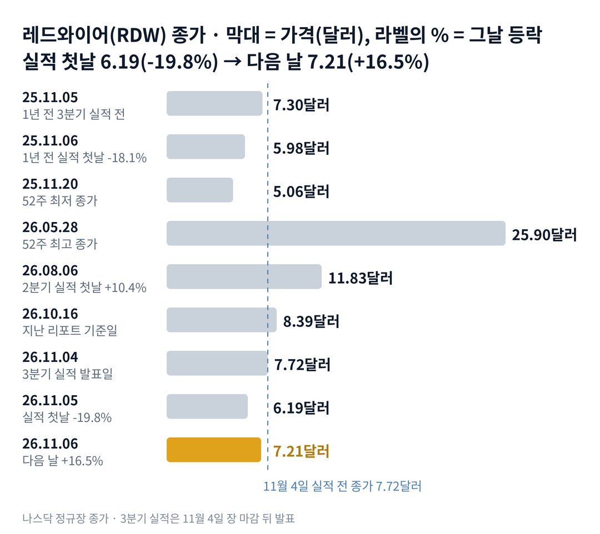

## 짧은 답

수주잔고는 사상 최대였고, 매출총이익률도 사상 최고였습니다. 그런데 레드와이어 주가는 왜 실적 첫날 무너졌을까요?

결론부터 말하면, 업종 전체가 팔린 날에 '이번 분기에 넘긴 물건이 적다'는 숫자가 겹쳤기 때문입니다. 주문은 많이 받았지만 매출은 예상에 못 미쳤고, 그 사이 현금은 빠르게 나갔습니다. 지난주와 달라진 점은 주가를 누르던 걱정이 '새 주식 판매'에서 '실적과 현금'으로 바뀌었다는 것입니다. **2026.11.06 진단: 공급 소화 국면 후반 유지 — 근거는 5부.**

그렇다고 사상 최대 수주잔고가 주가의 바닥을 보장하지는 않습니다. 주문이 매출과 현금으로 바뀌는 데에는 시간이 걸리기 때문입니다. 그렇다면 과거에 실적 첫날 이렇게 무너졌을 때, 다음 날의 반등은 한 달 뒤에도 남았을까요? 답은 3부 '실적 첫날 10% 넘게 무너진 날, 20거래일 뒤는?' 표에 있습니다.

> **유의사항** 저자는 금융·투자 자문가가 아닙니다. 이 글은 공개 공시와 시세를 정리한 교육용 분석이며 특정 종목의 매수·매도를 권하지 않습니다. 과거의 주가 반응이 미래에 반복된다는 보장은 없고, 레드와이어는 실적 날 하루에 두 자릿수로 움직인 적이 많은 종목입니다. 실제 투자 전에는 최신 가격과 공시를 직접 확인하세요.

## 지난 리포트 이후

[10월 16일 기준 리포트](/r/rdw-2026-10-2/)는 레드와이어를 '공급 소화 국면 후반'으로 보고, 남은 주식 판매 한도를 가장 큰 짐으로 꼽았습니다. 그 뒤 주가는 8.39달러에서 14.1% 내렸지만, 회사는 3분기에 새 주식을 한 주도 팔지 않았습니다. 지난 예측 성적은 다섯 항목 가운데 부분 적중 하나, 빗나감 둘, 진행 중 둘이고 적중은 없습니다. 가장 아픈 빗나감은 '실적 증명' 시나리오입니다. 매출 증가·이익률 개선·주식 수 정지라는 조건은 대부분 켜졌는데, 주가는 오르지 않고 첫날 크게 내렸습니다. 항목별 채점표는 6부 끝에 있습니다. 이번 리포트가 새로 답할 질문은 '조건이 켜졌는데 왜 정반대였나, 그리고 그 뒤 한 달'입니다.

## 1부. 레드와이어는 어떤 회사이고, 무엇으로 돈을 버는가

> **핵심:** 레드와이어는 우주 장비와 군용 무인기를 함께 만드는 회사이고, 이번 분기에는 주문이 매출보다 훨씬 빨리 쌓였습니다.

레드와이어는 우주 정거장용 태양 전지판, 위성 부품, 우주 제조 장비를 만드는 미국 회사입니다. 2025년 군용 무인기 회사 에지 오토노미를 인수한 뒤로는 방산 부문(디펜스 테크)이 매출의 큰 축이 됐습니다. 주력 무인기는 스토커입니다. 본사는 플로리다주 잭슨빌에 있고, 뉴욕증권거래소에 상장돼 있습니다.

돈을 버는 방식은 계약을 받아 만들어 넘기는 방식입니다. 정부 기관이나 우주 기업과 계약을 맺으면, 그 금액이 수주잔고(아직 매출로 잡지 않은 확정 계약, 회사 기준으로는 잔여수행의무와 비슷한 개념)에 쌓입니다. 무인기 같은 제품은 실제로 출하할 때 매출이 됩니다. 그래서 주문이 늘어도 출하가 밀리면, 그 분기 매출은 기대보다 작게 나옵니다.

이 구조가 중요한 이유는 이번 분기가 정확히 그 모습이었기 때문입니다. 3분기에 새로 따낸 계약은 1억 8,866만 달러로 매출의 1.73배였습니다. 들어온 주문을 매출로 나눈 이 비율을 북투빌이라고 부르는데, 1보다 크면 일감이 쌓인다는 뜻입니다. 반면 방산 부문 매출은 1년 전보다 16.0% 줄었습니다.

지금 몸값은 시가총액으로 약 18억 400만 달러입니다. 현금을 빼고 차입을 더한 회사 가치(기업가치·EV)는 약 13억 6,200만 달러로, 아래 표에 계산을 적었습니다. 이 비교가 주가의 하한선은 아닙니다. 현금은 시가총액의 약 27%지만, 그렇다고 이 현금이 주가의 바닥을 보장하지는 않습니다. 3분기에만 잉여현금흐름(영업으로 번 돈에서 설비 투자를 뺀 돈)이 큰 적자였기 때문입니다.

### 숫자로 본 지금의 크기(11월 6일 기준)

| 항목 | 값 · 계산 근거 |
| --- | --- |
| 종가 | **7.21달러** 5월 28일 최고 종가 25.90달러보다 72.2% 낮음 |
| 시가총액 | **약 18억 400만 달러** 7.21달러 × 2억 5,021만 9,316주(11월 2일) |
| 기업가치(EV) | **약 13억 6,200만 달러** 시가총액 − 현금 4억 8,890만 + 차입 약 4,700만 |
| 3분기 매출 | **1억 903만 달러** 1년 전보다 5.4% 증가, 예상 약 1억 2,660만 달러 |
| 수주잔고 | **6억 1,967만 달러** 9월 말, 사상 최대 · 1년 전보다 약 75% 증가 |
| 연간 매출 전망 | **4억 5,000만~5억 달러** 11월 4일 유지 · 9개월 매출 3억 2,308만 달러 |
| 3분기 잉여현금흐름 | **-6,635만 달러** 영업현금 -6,359만 − 설비 투자 276만 |
| 4분기 필요 매출(전망 하단) | **약 1억 2,692만 달러** 연간 하단 4억 5,000만 − 9개월 3억 2,308만 |
| 남은 주식 판매 한도 | **3억 5,040만 달러** 9월 말, 3분기 판매 0주 |

4분기 필요 매출은 회사가 유지한 올해 매출 전망의 아래 끝을 지키는 데 필요한 값입니다. 3분기보다 16.4% 많아야 하고, 올해 가장 컸던 2분기 매출보다도 큽니다. 전망 위 끝을 지키려면 4분기에 약 1억 7,692만 달러가 필요합니다. 그렇다면 이런 숫자 앞에서, 실적 첫날 주가는 무엇에 가장 크게 반응했을까요?

## 2부. 실적 첫날에 겹친 세 가지

> **핵심:** 업종 전체의 급락, 방산 출하 지연, 빨라진 현금 소진이 같은 날 겹쳤고, 시장이 돌아온 뒤에도 회사 숫자의 영향은 남았습니다.

첫 번째는 업종 전체의 급락이라는 시장 사건입니다. 실적은 11월 4일 오후 4시 21분(미국 동부 시각), 장 마감 뒤에 나왔습니다. 그래서 첫 반응일은 11월 5일입니다. 그날 나스닥 100 지수를 따르는 상장지수펀드(ETF)인 나스닥 100 ETF(QQQ)는 6.5% 내렸습니다. 보도에 따르면 11월 3일 중간선거에서 민주당이 의회 양원을 가져간 뒤 기술주와 우주주가 함께 팔렸습니다. 성장 기대가 큰 주식부터 팔리면 → 우주주처럼 이익이 아직 없는 종목의 값이 먼저 깎이고 → 실적을 낸 회사도 그 물결 위에서 평가받게 됩니다.

### 실적 전후, 우주·기술주 성적

| 종목 · 성격 | 11.05 하루 | 11.06 하루 |
| --- | --- | --- |
| **레드와이어(RDW)** 우주·방산 | **-19.8%** | **+16.5%** |
| 나스닥 100 ETF(QQQ) | -6.5% | +1.4% |
| 우주 ETF(UFO) | -5.6% | +4.8% |
| 로켓랩(RKLB) 발사·위성 | -12.2% | +15.4% |
| AST 스페이스모바일(ASTS) 위성 통신 | -15.2% | +7.1% |
| 인튜이티브 머신스(LUNR) 달 착륙선 | -13.2% | +21.5% |

11월 5일은 레드와이어만의 날이 아니었습니다. 다만 레드와이어는 우주 ETF보다 14.2%포인트 더 빠졌습니다. 거래량도 직전 5거래일 평균의 약 2.0배로 늘었습니다. 11월 6일에는 10월 고용 지표가 예상보다 좋게 나오며 시장이 숨을 돌렸다는 보도가 나왔습니다. 그런데 실적 전 종가부터 2거래일을 합치면 레드와이어는 -6.6%였고, 로켓랩은 +1.3%였습니다. 시장이 돌아온 뒤에도 남은 이 차이가 회사 숫자의 영향으로 볼 수 있는 부분입니다.

두 번째는 방산 출하 지연이라는 사업 사건입니다. 3분기 매출은 시장 예상(S&P 집계 약 1억 2,660만 달러)보다 약 14% 적었습니다. 우주 부문 매출은 1년 전보다 31.6% 늘었습니다. 반면 방산 부문은 16.0% 줄었습니다. 회사는 방산 감소분 가운데 770만 달러가 무인기의 생산·출하 시점 때문이라고 공시했습니다. 보도에 따르면 스토커가 새 모델(블록 40)로 바뀌고 펭귄 무인기도 새 버전으로 넘어가는 사이 출하가 밀렸습니다. 출하가 밀리면 → 그 분기 매출이 빠지고 → 연간 전망을 지키려면 다음 분기에 몰아서 넘겨야 하는 부담이 생깁니다.

세 번째는 현금 소진이라는 숫자의 질입니다. 매출총이익률 32.3%는 1년 전 16.3%의 두 배 가까운 사상 최고였지만, 1년 전 숫자에는 에지 오토노미 인수 회계에서 생긴 재고 비용 약 1,123만 달러가 들어 있었습니다(보도). 이를 뺀 조정 기준으로는 두 분기 모두 약 27%였다고 전해집니다. 조정 EBITDA(세금·이자·감가상각을 빼기 전 이익, 회사 기준)는 -530만 달러로 1년 전보다 나빠졌습니다. 연구개발비가 87.1% 늘어난 영향이 컸습니다. 현금이 빨리 나가면 → 남은 주식 판매 한도를 다시 쓸 수 있다는 걱정이 붙고 → 같은 수주잔고에도 낮은 값이 매겨집니다.

세 사건을 나란히 놓으면 공통점이 하나 보입니다. 주문이 줄었다는 소식은 하나도 없었다는 점입니다. 결국 이번 하락은 업종의 급락 위에, 출하가 밀린 매출과 빨라진 현금 소진이 겹친 결과였습니다. 그렇다면 과거에 실적 첫날 이렇게 크게 무너졌을 때, 그 뒤 한 달은 어땠을까요?

## 3부. 실적 첫날 10% 넘게 무너진 다섯 번

> **핵심:** 2022년 이후 분기 실적 첫날 10% 넘게 빠진 다섯 번 가운데 네 번은 다음 날 반등했지만, 20거래일 뒤 실적 전 종가보다 높았던 것은 한 번이었습니다.

이 기록을 보는 이유는 이번이 '실적 첫날 두 자릿수 급락'이기 때문입니다. 2022년 3월부터 이번까지 레드와이어의 분기 실적 발표는 20번이었습니다. 이번을 뺀 19번 가운데 첫날 내린 것은 13번이었고, 그중 10% 넘게 빠진 다섯 번만 골랐습니다.

표의 세 칸은 세 질문에 답합니다. 첫 칸은 그날 무엇이 나왔나, 둘째 칸은 다음 날 어떻게 반응했나, 셋째 칸은 한 달 동안 회복했나입니다. 실적이 장 마감 뒤 나오면 다음 거래일을 첫날로 셉니다. 다음 날은 첫날 종가 대비, 20거래일 뒤는 첫날을 1로 센 20번째 거래일 종가를 실적 전 종가와 비교했습니다.

예를 들어 이번에는 실적 전 종가 7.72달러가 첫날 6.19달러(-19.8%)가 됐고, 다음 날 7.21달러(+16.5%)가 됐습니다. 20번째 거래일은 12월 3일입니다.

### 실적 첫날 10% 넘게 무너진 날, 20거래일 뒤는?

| 첫날 · 그날 나온 내용 | 다음 날 | 20거래일 뒤 |
| --- | --- | --- |
| **2022.04.01** 늦어진 2021년 실적 회계 조사 종결 뒤 *(첫날 -28.7%)* | +7.1% | -29.0% |
| **2022.11.09** 2022년 3분기 실적 *(첫날 -13.0%)* *(로켓랩 -7.2%)* | +5.3% | -24.8% |
| **2024.08.08** 2024년 2분기 실적 *(첫날 -10.3%)* *(로켓랩 +4.1%)* | +4.5% | +5.6% |
| **2025.08.07** 2분기 매출 예상 크게 미달 *(첫날 -30.9%)* | -5.1% | -40.1% |
| **2025.11.06** 3분기 매출 미달·전망 하향 *(첫날 -18.1%)* *(로켓랩 -12.1%)* | +9.7% | -15.9% |

다섯 번은 분기마다 따로 일어나 20거래일 측정 기간이 서로 겹치지 않습니다. 다만 그때와 지금은 주가 수준, 주식 수, 사업 구성이 크게 다르므로 이 표는 확률이 아니라 과거 움직임의 참고 자료입니다. 로켓랩도 7% 넘게 빠진 날과 겹친 두 번(2022년 11월, 2025년 11월)은 모두 다음 날 반등했지만, 한 달 뒤에는 실적 전 종가 아래였습니다.

> **이번(미확정):** 2026.11.05 · 매출 예상 약 14% 미달, 수주잔고 사상 최대, 연간 전망 유지 · 첫날 -19.8%(로켓랩 -12.2%) · 다음 날 +16.5% · 5거래일째 11월 11일, 20거래일째 12월 3일 판정

여기서 기억할 사실은 하나입니다. 다음 날의 반등은 다섯 번 중 네 번 있었지만, 한 달 뒤 실적 전 종가를 되찾은 것은 2024년 8월 한 번뿐이었습니다. 그렇다고 이것이 이번 결과를 정하는 규칙은 아닙니다. 이번 다음 날 반등 +16.5%는 다섯 번의 가장 큰 반등 +9.7%보다 컸습니다. 그렇다면 1년 전 같은 날과 이번은 무엇이 같고 무엇이 다를까요?

## 4부. 1년 전 같은 날과 이번이 다른 점

> **핵심:** 같은 분기, 같은 업종 급락, 같은 매출 미달이었지만, 이번에는 전망을 지켰고 새 주식을 팔지 않았습니다.

두 시점은 묻는 질문이 달랐습니다. 다음 날의 질문은 '시장이 돌아오면 같이 돌아오나'였고, 한 달 뒤의 질문은 '밀린 매출이 실제로 넘어가나'입니다. 2025년 11월에는 첫날 반등까지는 같았지만, 그 뒤 한 달은 연간 전망 하향과 정부 셧다운에 따른 계약 지연 걱정이 값을 정했습니다. 그때 주가는 11월 20일 52주 최저 종가 5.06달러까지 내려갔습니다.

이번에는 세 가지가 다릅니다. 첫째, 회사는 연간 매출 전망을 내리지 않았습니다. 둘째, 수주잔고는 1년 전보다 약 75% 많고, 만들고 있거나 쌓아 둔 재고가 4,680만 달러어치 있습니다. 셋째, 3분기에 시장 판매 계약(ATM: 회사가 시장에서 새 주식을 조금씩 파는 방식)을 쓰지 않았습니다. 11월 2일 주식 수는 8월 3일보다 0.09% 늘었을 뿐입니다.

3개월 전인 8월 6일 2분기 실적 첫날에는 오히려 10.4% 올랐다는 점도 이번과 대비됩니다. 같은 점도 있습니다. 매출이 예상에 못 미쳤고, 그 이유가 '시점'이라는 설명도 같습니다. 1년 전에도 회사는 셧다운으로 계약이 밀렸다고 설명했고, 그 뒤 한 달 동안 주가는 그 설명을 믿지 않았습니다. 앞서 본 현금 소진도 1년 전보다 이번에 더 큰 걱정거리입니다.

과거 기록이 알려 주는 것은 다음 날의 반등이 한 달 뒤를 정하지 않았다는 점입니다. 결국 앞으로 확인할 것은 두 가지입니다. 하나는 남은 주식 판매 한도 3억 5,040만 달러가 4분기에 다시 쓰이는가입니다. 다른 하나는 4분기 매출이 전망 하단에 필요한 약 1억 2,692만 달러를 넘는가입니다. 이 두 가지로 다음 몇 달을 나누면 어떤 갈림길이 나올까요?

## 5부. 판매 재개와 전망 달성, 네 가지 시나리오

> **핵심:** 지금은 지난 리포트의 '공급 소화 국면 후반'이 이어지는 단계이고, 4부에서 본 두 가지가 시나리오를 가르는 축입니다.

> **국면 정의(레드와이어 시리즈 공통):** 테마 과열 국면 — 회사 밖 이벤트로 한 달에 50% 넘게 오르고 새 주식 판매가 늘 때. 공급 소화 국면 — 고점에서 절반 넘게 내려오고 판매 한도·대주주 매도가 남아 좋은 소식의 상승이 몇 주 안에 사라질 때. 실적 증명 국면 — 매출과 수주잔고가 함께 늘고 판매가 멈추며 실적 뒤 상승이 한 달 넘게 유지될 때.

**2026년 11월 6일 진단: 공급 소화 국면 후반 유지, 지난 리포트 진단 유지.** 실적 증명 국면의 신호 가운데 판매 정지와 수주잔고 증가는 켜졌습니다. 하지만 매출은 직전 분기보다 6.9% 줄었고, 실적 뒤 상승 대신 첫날 19.8% 하락이 나왔습니다. 남은 판매 한도 3억 5,040만 달러를 7.21달러에 모두 쓰면 약 4,860만 주입니다.

이 물량을 세 분모로 보면 다음과 같습니다. 11월 2일 전체 발행주식 2억 5,022만 주의 약 19.4%입니다. 유통주식(거래되는 주식)은 회사가 따로 밝히지 않아 같은 날 발행주식을 대신 썼으므로, 실제 유통주식 대비 비율은 이보다 클 수 있습니다. 직전 20거래일 평균 거래량(약 1,144만 주)으로는 약 4.2거래일치입니다.

**판정 기준 두 가지:** 첫째, 판매 재개입니다. 4분기 보고서(2027년 2월 말~3월 예상)에서 시장 판매 계약으로 판 주식이 있으면 '재개'로 봅니다. 둘째, 전망 달성입니다. 4분기 매출이 약 1억 2,692만 달러 이상이면 '달성'으로 봅니다.

### 앞으로 일어날 수 있는 일

3부 기록에서 실적 첫날 10% 넘게 빠진 경우는 5번 중 1번만 한 달 뒤 실적 전 종가를 되찾았습니다. 반대로 회사가 연간 전망을 지킨 채 다음 분기를 맞은 경우는 이번이 처음이라, 과거 기록만으로 4분기를 읽기는 어렵습니다.

**확인된 사실:** 3분기 매출은 예상보다 약 14% 적었고, 회사는 연간 전망을 지켰으며 새 주식은 팔지 않았습니다. **과거 기록:** 첫날 크게 빠진 뒤 한 달 안에 되찾은 경우는 드물었습니다(3부). **추정:** 아래 가능성은 분석자의 주관적 추정이며, 주가가 오를 확률이 아니라 회사 숫자 조합의 가능성입니다. 네 경우는 겹치지 않아 '약 N%'를 더하면 100%이고, 괄호 안 구간은 흔들림의 폭이라 서로 더하지 않습니다.

| 시나리오(판정 4분기 실적 발표) | 판매 · 달성 | 가능성(추정) |
| --- | --- | --- |
| 1 · 판매 없이 전망 달성 | 없음 · ○ | 중간 약 30% (25~35%) |
| 2 · 판매 재개, 전망 달성 | 재개 · ○ | 낮음 약 15% (10~20%) |
| **3 · 판매 없이 전망 미달** | 없음 · × | 높음 약 40% (35~45%) |
| 4 · 판매 재개, 전망 미달 | 재개 · × | 낮음 약 15% (10~20%) |

**한눈에:** 4분기 전망 하단 달성 약 45%(1+2) · 판매 재개 약 30%(2+4). 분석자의 주관적 추정을 더한 값이며, 실제 확률이나 통계 예측값은 아닙니다. 회사 숫자가 맞아도 주가 방향은 따로 읽어야 합니다.

시나리오 3을 가장 높게 본 이유는 4분기 문턱이 올해 어느 분기보다 높기 때문입니다. 3분기보다 16.4% 많이 팔아야 하고, 출하는 수출 승인과 부품 공급에 달려 있다고 경영진도 말했습니다. 하지만 같은 무게로 반대쪽 요인도 있습니다. 북투빌 1.73과 4,680만 달러어치 재고는 밀린 매출이 실제로 존재한다는 근거입니다.

시나리오 2와 4를 낮게 본 이유는 현금이 아직 넉넉하기 때문입니다. 9월 말 현금 4억 8,890만 달러는 3분기 같은 속도라면 1년 넘게 버틸 수 있는 금액입니다. 다만 과거 테마 랠리 때는 주가가 오르면 판매도 함께 늘었습니다. 그렇다면 이 진단을 가장 빨리 뒤집을 수 있는 위험은 무엇일까요?

## 6부. 세 갈래 위험과 체크리스트

> **핵심:** 위험은 사업 실행, 자금 조달, 외부 환경 세 갈래이고, 가장 빨리 판을 바꿀 수 있는 것은 4분기 무인기 출하입니다.

먼저 이 분석의 한계입니다. 3부 표는 다섯 번뿐인 작은 표본이고, 2022년과 지금은 주가 수준과 사업 구성이 크게 다릅니다. 시장 예상치와 조정 이익률은 보도 집계라 회사가 확인한 숫자가 아닙니다. 11월 5일 하락 가운데 시장 영향과 회사 영향을 정확히 나누는 방법은 없습니다.

첫째 갈래는 사업 실행입니다. 스토커 새 모델과 펭귄 새 버전의 출하가 4분기에도 밀리면, 연간 전망 하단을 지키지 못할 수 있습니다. 회사는 매출을 출하할 때 인식하므로, 수출 승인이나 부품 하나가 늦어져도 매출이 다음 해로 넘어갑니다.

둘째 갈래는 자금 조달입니다. 3분기 잉여현금흐름은 6,635만 달러 적자로, 상반기 여섯 달의 약 4,800만 달러보다 컸습니다. 이 속도가 이어지면 남은 판매 한도를 다시 쓸 가능성이 커집니다. 판매가 재개되면 주식 수가 늘어 기존 주주 한 주의 비중이 작아지는 희석이 생깁니다.

셋째 갈래는 외부 환경입니다. 미국 정부는 12월 11일까지 임시 예산으로 움직이고 있습니다. 1년 전 셧다운 때처럼 예산 처리가 늦어지면 국방·우주 계약이 밀릴 수 있습니다. 11월 5일처럼 기술주 전체가 팔리는 날에는 회사 숫자와 상관없이 함께 내렸습니다.

**핵심 확인 세 가지:**

- ☐ 12월 3일 종가가 실적 전 종가 7.72달러보다 높은가(3부 20거래일째)
- ☐ 12월 11일 임시 예산 만료 뒤 정부 예산이 셧다운 없이 처리되는가
- ☐ 2027년 4분기 실적 발표 때 4분기 매출이 약 1억 2,692만 달러를 넘었나

**보조 확인:**

- ☐ 11월 11일 종가가 첫날 종가 6.19달러보다 높은가(5거래일째)
- ☐ 분기 보고서(2027년 2월 말~3월) 기준 4분기 시장 판매 계약 판매가 0주인가

**지난 리포트 점검(따로 판정):**

- ☐ 12월 11일 임시 예산 만료 뒤 셧다운 0일로 처리됐나(지난 리포트 시나리오 3)
- ☐ 12월 31일까지 미사일 방어 대형 발주 같은 새 테마 소식이 1건 이상 나왔나(지난 리포트 시나리오 4)

**기억할 판단 기준 세 가지:** 첫째, 이번 실적에서 주문은 줄지 않았고 매출만 밀렸습니다. 둘째, 시장은 업종 급락 위에서 이익률보다 현금이 나가는 속도를 먼저 봤습니다. 셋째, 과거에 첫날 크게 빠진 뒤 다음 날 반등이 한 달 뒤까지 남은 경우는 드물었습니다.

다음 갱신은 12월 3일 20거래일째 반응과 12월 11일 예산 결과를 본 뒤에 합니다. 공시는 [레드와이어 SEC 공시 목록](https://www.sec.gov/cgi-bin/browse-edgar?action=getcompany&CIK=0001819810&type=&dateb=&owner=include&count=40)과 [레드와이어 투자자 정보](https://ir.rdw.com/)에서 확인할 수 있습니다.

### 지난 예측 채점표

10월 19일 리포트(10월 16일 기준)의 진단과 시나리오를 11월 6일 기준으로 채점한 결과입니다. 지난 리포트에는 시나리오별 가능성 숫자가 없었습니다.

| 지난 점검 항목 · 당시 기준 | 판정 및 실제 결과(11월 6일) |
| --- | --- |
| **진단: 공급 소화 국면 후반** 남은 판매 한도 3억 5,040만 달러 | **[부분 적중]** 약세는 이어졌지만(-14.1%) 판매 0주, 하락은 실적·시장에서 |
| **시나리오 1: 실적 증명** 매출·이익률 개선, 주식 수 정지 → 10~20% 상승 | **[빗나감]** 조건은 대부분 켜졌으나 조정 EBITDA 적자 확대, 첫날 -19.8% |
| **시나리오 2: 공급 지속** 남은 한도로 판매 이어짐 | **[빗나감]** 3분기 판매 0주, 주식 수 +0.09% |
| **시나리오 3: 정부 예산 충격** 12월 11일 임시 예산 만료 | **[진행 중]** 만료 전(12월 11일 판정) |
| **시나리오 4: 새 테마** 미사일 방어 대형 발주 등 | **[진행 중]** 대형 발주 발표 없음 |
