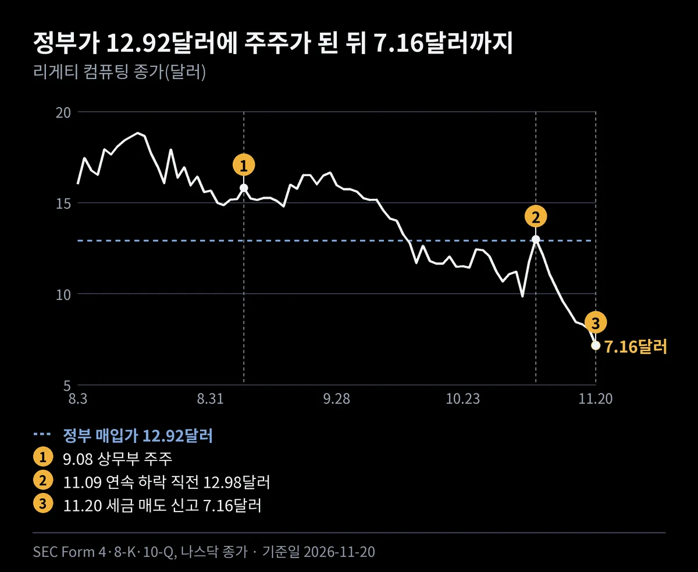
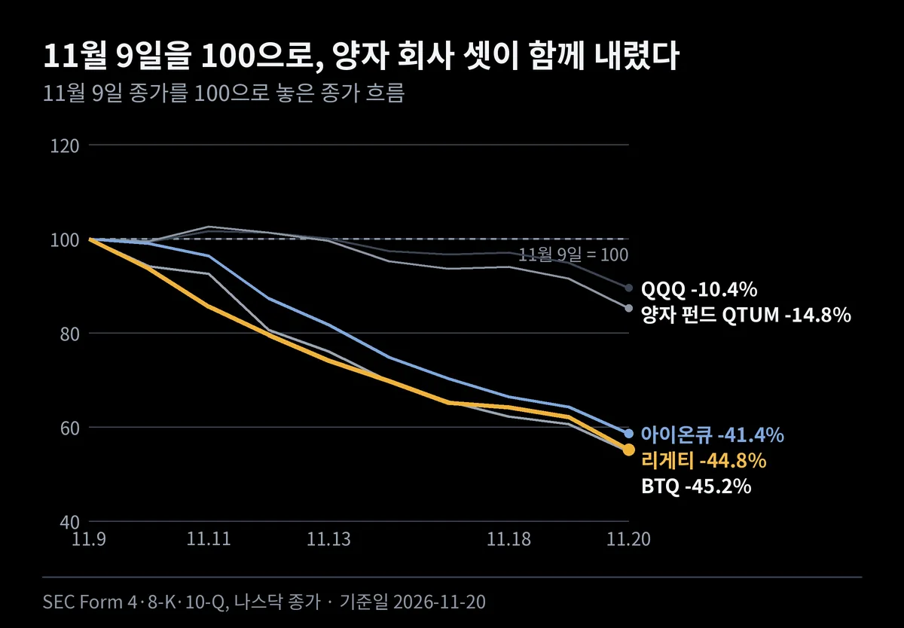
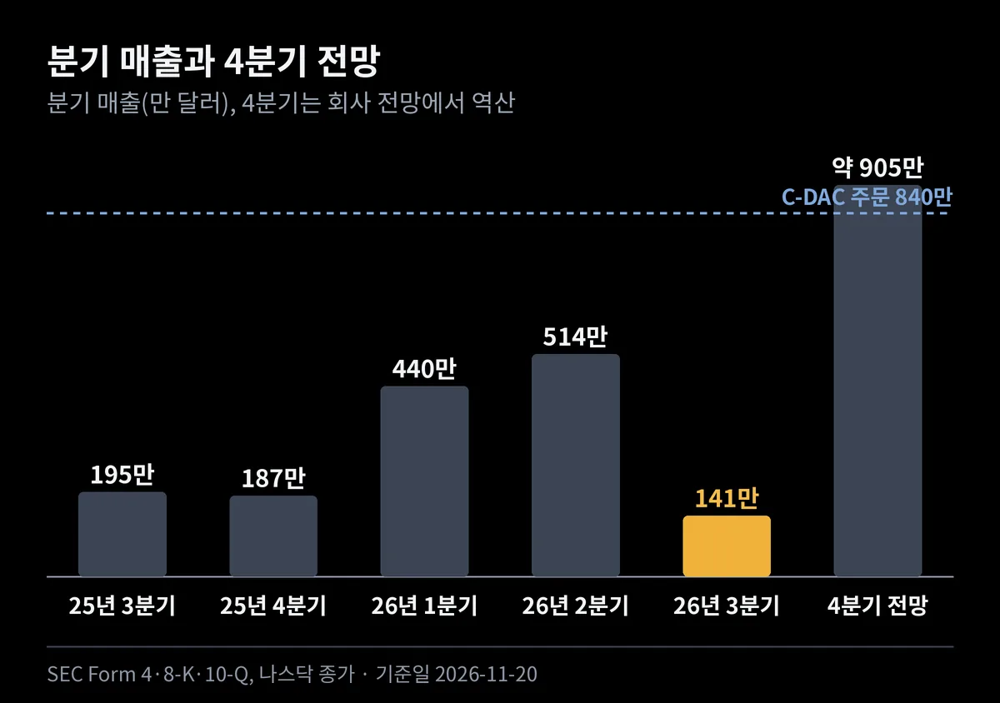
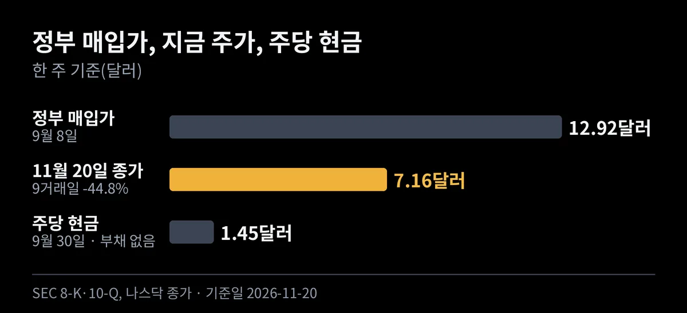
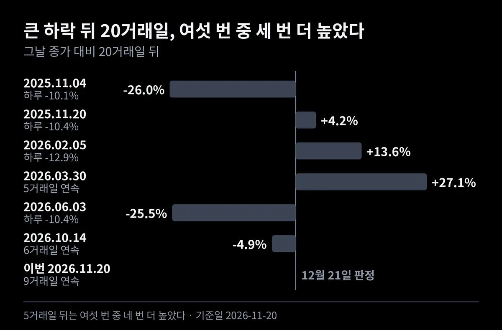
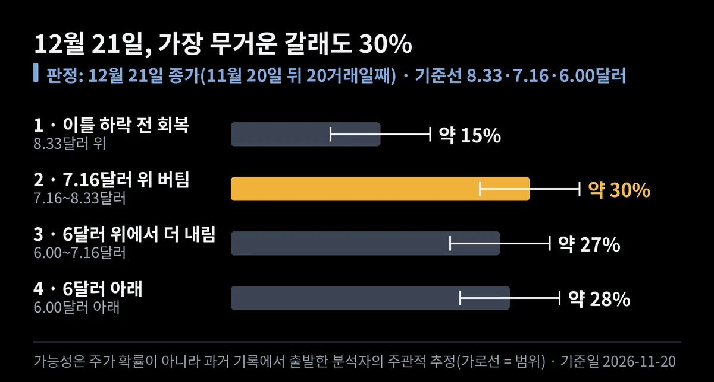

11월 20일 장이 끝난 뒤, 리게티 컴퓨팅 임원 세 명이 주식을 판 신고서가 한꺼번에 올라왔습니다. 최고재무책임자, 최고기술책임자, 최고운영책임자입니다. 그날 주가는 11.2% 내려 7.16달러로 마감했습니다.

11월 9일 12.98달러에서 시작해 9거래일 연속 내린 끝이었습니다. 11월 9일 종가보다 44.8% 낮고, 최근 1년 가운데 가장 낮은 종가입니다. 회사를 가장 잘 아는 사람들이 가장 나쁜 날 판 것처럼 보입니다. 그런데 신고서 주석은 다른 이야기를 합니다. 그 날짜도 석 달 전에 이미 정해져 있었습니다.

> **유의사항** 저자는 금융·투자 자문가가 아닙니다. 이 글은 공개 공시와 시세를 정리한 교육용 분석이며 특정 종목의 매수·매도를 권하지 않습니다. 과거 패턴은 미래 수익을 보장하지 않고, 리게티 컴퓨팅은 하루에 30% 넘게 오르내린 적이 있는 종목입니다. 실제 투자 전에는 최신 공시를 직접 확인하세요.

김박사 월드는 10월 14일 리포트에서 리게티를 처음 다뤘습니다([정부 매입가 리포트](/r/rgti-2026-10/)). 그때 주가는 12.78달러로, 미국 상무부가 주주가 되며 받은 값 12.92달러 바로 아래였습니다. 지난 예측 성적부터 적겠습니다. 세 갈래 가운데 '띠 아래로 이탈'은 맞았습니다. 기준으로 적은 11.40달러 부근을 깨고 지금은 7.16달러입니다. '11~13달러 띠에서 바닥 확인'은 빗나갔습니다. '빅테크·정부 재료로 급등'은 11월 6일 하루 19.3% 오르긴 했지만, 계기가 아이온큐 실적이라 판정에서 뺐습니다. 그 리포트는 갈래마다 가능성 %를 붙이기 전이라 예측 장부 채점에는 들어가지 않습니다.

리게티는 초전도 방식 양자컴퓨터를 만드는 미국 회사입니다. 아주 차갑게 식힌 칩 위에서 양자 비트, 즉 큐비트를 움직입니다. 칩은 캘리포니아 자체 공장에서 만듭니다. 돈을 버는 방식은 세 가지입니다. 연구소에 양자컴퓨터를 통째로 팔고, 클라우드로 빌려주고, 정부 연구 과제를 받습니다.

이번 장면의 주인공인 신고서부터 보겠습니다. 가장 많이 판 사람은 최고기술책임자로, 2만 8천여 주였습니다. 세 사람을 합치면 41,492주, 약 32만 달러입니다. 사람별 수량과 값은 글 끝 표에 적었습니다.

세 신고서에는 같은 주석이 붙어 있습니다. 회사가 준 주식(RSU)이 지급될 때 생기는 세금을 내려고, 정해진 만큼 '의무적으로' 판 매도라는 내용입니다. 이런 매도를 '셀 투 커버(sell to cover)'라고 부릅니다. 본인이 팔 날과 수량을 고르지 않습니다. 이 수량은 발행 주식의 약 0.012%입니다. 그날 거래량 2,516만 주와 비교해도 약 0.165%입니다.

판 값도 눈여겨볼 만합니다. 평균 약 7.78달러로, 그날 종가 7.16달러보다 높습니다. 장중 더 높은 값에 팔렸고, 그 뒤로 주가가 더 내렸다는 뜻입니다.

그 날짜는 어디서 왔을까요? 8월 20일에도 같은 세 사람이 같은 주석을 단 신고서를 냈습니다. 그때는 18,689주를 평균 약 16.8달러에 팔았고, 금액은 약 31만 달러였습니다. 같은 세금을 내는 데 석 달 뒤에는 주식이 두 배 넘게 필요했습니다. 주가가 절반 아래로 내렸기 때문입니다.

8월 신고서에는 최고기술책임자가 RSU 75만 주를 새로 받았다는 줄도 있습니다. 주석에는 지급 일정이 적혀 있습니다. 석 달마다 20일에 16분의 1씩 주고, 첫 지급일은 2026년 11월 20일이라는 내용입니다. 11월 20일 매도는 석 달 전 공시에 날짜까지 적혀 있던 일정이었습니다. 최고기술책임자의 매도 수량이 8월 5,791주에서 28,236주로 늘어난 것도 이 새 지급분이 처음 풀렸기 때문으로 보입니다.

그러면 11월 9일 종가부터 9거래일 동안 이어진 하락은 무엇이었을까요. 같은 기간 다른 양자 회사들을 나란히 놓으면 답이 보입니다. 아이온큐는 41.4%, 양자 보안 회사 BTQ(BTQ 테크놀로지스)는 45.2%, 실스크는 33.7% 내렸습니다. 리게티만 유난히 내린 것이 아니었습니다.

시장 전체도 약했습니다. 나스닥 100 펀드(QQQ)는 11월 9일 종가 대비 10.4% 내렸습니다. 11월 20일 하루에만 5.7%였습니다. 양자 관련 큰 회사들이 섞인 양자 펀드(QTUM)는 같은 기준으로 14.8%, 그날 하루 6.9% 내렸습니다. 작은 양자 회사들은 그 세 배쯤 내렸습니다.

하락한 날 나온 내부자 매도 신고는 회사 소식처럼 읽히기 쉽습니다. 하지만 석 달마다 같은 날 같은 이유로 나오는 신고는, 날짜가 먼저 정해진 매도입니다. 그날 주가와는 따로 봐야 합니다. 이날 리게티가 낸 8-K는 없었습니다.

회사 쪽 숫자가 아무것도 아니었다는 뜻은 아닙니다. 11월 10일 장이 끝난 뒤 3분기 실적이 나왔습니다. 매출은 141만 달러로 1년 전보다 27.5% 적었고, 2분기의 약 4분의 1이었습니다.

주가는 발표 전부터 내리고 있었습니다. 실적 날 종가는 12.15달러로 하루 6.4% 내렸고, 다음 날 8.6% 더 내렸습니다.

회사는 올해 매출을 약 2,000만 달러로 예상했습니다. 단서가 붙었습니다. 인도 연구기관 C-DAC(첨단컴퓨팅개발센터)가 4분기에 108큐비트 시스템을 인수해, 그 매출이 4분기에 잡힌다는 전제입니다. 이 주문은 840만 달러입니다. 9월까지 매출을 빼면, 전망을 채우는 데 4분기에만 약 905만 달러가 필요합니다. 한 주문에 한 해 전망이 걸린 모양입니다.

기술 쪽 숫자는 반대로 좋았습니다. 108큐비트 시스템에서 두 큐비트를 함께 다루는 정확도(2큐비트 충실도) 중앙값 99.5%를 달성했습니다. 지난 리포트가 '연말 목표'로 적어 둔 숫자입니다. 다음 목표는 2028년 중반 300큐비트 이상, 충실도 약 99.7%입니다. 목표를 이룬 날과 주가가 내린 날이 겹친 셈입니다.

같은 무리에서 볼 장면이 하나 더 있습니다. 11월 6일 리게티는 실적 없이 하루 19.3% 올랐습니다. 아이온큐가 사상 최대 매출을 발표한 다음 날이었습니다([아이온큐 실적 리포트](/r/ionq-2026-11/)). 그 상승은 9거래일 만에 모두 사라졌습니다.

김박사 월드 장부에는 '작은 회사는 업종이 내릴 때는 같이 내리고, 오를 때는 덜 따라간다'는 기록이 있습니다. BTQ는 아이온큐가 크게 오른 날 오히려 내렸습니다([BTQ 3분기 보고서 리포트](/r/btq-2026-11-4/)). 실스크는 11월 20일 1달러 아래에서 마감했습니다([실스크 리포트](/r/laes-2026-11-5/)). 김박사 월드는 이렇게 종목마다 따로 보지 않고, 반복되는 모양을 모아 함께 셉니다.

9월 말 현금과 투자 자산은 4억 9,710만 달러이고, 부채는 없습니다. 11월 6일 주식 수로 나누면 주당 약 1.45달러입니다. 지금 주가로 매긴 시가총액은 약 24억 5,430만 달러입니다. 현금은 그 몸값의 약 20%입니다.

현금이 버티는 기간도 셌습니다. 올해 9개월 동안 영업으로 4,906만 달러, 설비에 4,260만 달러를 썼습니다. 1년으로 늘리면 약 1억 2,220만 달러입니다. 같은 속도라면 현금은 약 4년 버팁니다. 필자 계산이며, 상무부 연구 자금은 넣지 않았습니다.

주식 공급 쪽도 확인했습니다. 회사는 2025년 시장 판매 계약으로 새 주식 3억 5,000만 달러어치를 팔았습니다. 10-Q에 따르면 9월 말 그 계약에 남은 주식은 없습니다. 올해 9개월 동안 시장에서 판 새 주식도 없습니다. 새 계약을 맺으면 공시가 나오니, 그것이 다음에 볼 신호입니다.

이렇게 큰 하락 뒤에는 어땠는지도 셌습니다. 지난 1년 동안 하루 10% 넘게 내린 날과, 5거래일 넘게 연속 하락한 끝 날을 모았습니다. 10거래일 안에 겹친 것은 하나로 쳤습니다. 결과가 나온 것이 여섯 번입니다. 5거래일 뒤에는 네 번 더 높았습니다. 20거래일 뒤에는 세 번 더 높고 세 번 더 낮아, 반반이었습니다.

판정일은 예측이 맞았는지 종가로 채점하기로 정해 둔 날입니다. 이번 판정일은 12월 21일입니다. 11월 20일에서 20거래일째 되는 날입니다. 기준선은 세 개입니다. 첫째는 지금 종가 7.16달러, 둘째는 마지막 2거래일 하락 전인 11월 18일 종가 8.33달러입니다. 셋째는 6달러입니다.

출발점은 위 여섯 번입니다. 각 기록의 20거래일 뒤 변화율을 지금 종가에 곱해 네 칸에 나눴습니다. 6번 중 2번씩 들어간 칸이 둘로 가장 많았고, 나머지 두 칸은 1번씩이었습니다.

여기에 지금 사정을 15%포인트 안에서 얹었습니다. 8.33달러 위 칸은 약 15%로 낮췄습니다. 작은 양자 회사가 업종 반등을 덜 따라간 기록 때문입니다. 7.16~8.33달러 칸은 약 30%로 낮췄습니다. 가격 수준은 이어지는 경우가 많았기 때문입니다.

6~7.16달러 칸은 약 27%로 올렸습니다. 김박사 월드 핵심 종목에서 11월에 '기준선을 깨고 내려간다' 쪽 예측은 네 번 모두 맞았고, 9거래일 연속 하락이 아직 끝나지 않았습니다. 6달러 아래 칸은 약 28%로 낮췄습니다. 과거 25% 넘게 더 내린 두 번은 주가가 지금의 세 배 넘던 때였고, 지금은 남은 시장 판매 계약이 없습니다.

위 두 칸과 맨 아래 칸은 조금씩 낮췄고, 셋째 칸만 10%포인트 올렸습니다. 이 숫자는 주가가 오를 확률이 아니라, 과거 빈도에서 출발해 분석자가 주관적으로 매긴 추정입니다. 7.16달러 아래 두 칸을 합치면 약 55%입니다.

이 추정이 틀릴 이유도 적어 둡니다. 리게티는 정부·빅테크 소식에 하루 25~45%씩 오른 기록이 있습니다. 상무부 2차 자금 집행 같은 소식이 나오면 8.33달러 위 칸이 맞을 수 있습니다. 반대로 업종 하락이 이어지면 6달러 아래로 갈 수도 있습니다. 그래서 가장 무거운 칸도 40% 아래에 묶었습니다.

위험도 짚겠습니다. 가장 큰 한계는 표본입니다. 큰 하락 기록은 여섯 번뿐이고, 그중 세 번은 주가가 20달러가 넘던 때입니다. 4분기 매출은 C-DAC 시스템 인수 시점에 크게 달려 있어, 인수가 2027년으로 밀리면 올해 전망이 깨집니다. 기술 목표를 달성했다는 것과 그 기술로 매출을 낸다는 것은 다른 일입니다.

임원 셋의 매도 신고는 그날 하락의 이유가 아니었습니다. 앞에서 본 '날짜가 정해진 매도', 곧 석 달 전에 날짜가 잡힌 세금 매도였고, 금액은 8월과 거의 같았습니다. 11월 9일 종가부터의 연속 하락은 양자 업종 전체가 함께 내린 흐름과 비슷했고, 회사 쪽에서는 3분기 매출 감소와 4분기 한 건에 걸린 전망이 남아 있습니다. 다음 갱신은 12월 21일 종가와 C-DAC 인수 소식을 본 뒤에 하고, 그 전에 새 주식 판매 계약 공시가 나오면 앞당깁니다.

## 숫자로 다시 보기

### 9거래일 연속 하락

| 날짜 · 장면 | 리게티 종가 | 하루 |
| --- | --- | --- |
| 11.05 아이온큐 실적 전날 | 9.85달러 | -12.1% |
| 11.06 아이온큐 실적 다음 날 | 11.75달러 | +19.3% |
| **11.09 연속 하락 직전** | **12.98달러** | +10.5% |
| 11.10 3분기 실적(장 마감 뒤) | 12.15달러 | -6.4% |
| 11.11 실적 다음 날 | 11.11달러 | -8.6% |
| 11.13 | 9.62달러 | -6.9% |
| 11.18 2거래일 하락 전 | 8.33달러 | -1.5% |
| 11.19 | 8.06달러 | -3.2% |
| **11.20 임원 셋 세금 매도 신고** | **7.16달러** | **-11.2%** |

11월 20일 종가는 2025년 11월 3일부터의 1년 시세에서 가장 낮습니다. 그날 거래량은 직전 20거래일 평균의 약 1.5배였습니다.

| 기준 | 값 | 11월 20일 종가와 차이 |
| --- | --- | --- |
| 상무부 매입가 | 12.92달러 | -44.6% |
| 9월 8일 종가 상무부 주주 된 날 | 15.81달러 매입가보다 +22.4% | - |
| 11월 9일 종가 연속 하락 직전 | 12.98달러 매입가보다 +0.5% | -44.8% |

### 두 번의 세금 매도

| 항목 | 8월 20일 | 11월 20일 |
| --- | --- | --- |
| 최고기술책임자 | 5,791주 16.8053달러 | **28,236주** 7.7756달러 |
| 최고운영책임자 | 9,038주 16.7885달러 | 9,277주 7.7771달러 |
| 최고재무책임자 | 3,860주 16.8877달러 | 3,979주 7.79달러 |
| 합계 | 18,689주 약 31.4만 달러 | **41,492주** 약 32.3만 달러 |
| 신고서 주석 | 세금 원천징수용 의무 매도 | 세금 원천징수용 의무 매도 |

금액은 수량에 평균 가격을 곱한 필자 계산입니다.

11월 합계는 발행 주식의 약 0.012%, 그날 거래량의 약 0.165%입니다. 최고기술책임자가 8월 18일 받은 RSU는 75만 주입니다. 2·5·8·11월 20일마다 16분의 1씩 지급되고, 첫 지급일이 11월 20일입니다.

### 같은 기간 업종 성적

| 종목 · 11.09→11.20 | 11.20 하루 |
| --- | --- |
| **리게티(RGTI) -44.8%** | **-11.2%** |
| 아이온큐(IONQ) -41.4% | -8.8% |
| BTQ 테크놀로지스(BTQ) -45.2% | -9.6% |
| 실스크(LAES) -33.7% | -14.1% |
| 양자 펀드(QTUM) -14.8% | -6.9% |
| 나스닥 100 펀드(QQQ) -10.4% | -5.7% |

### 분기 매출과 올해 전망

| 분기 | 매출 |
| --- | --- |
| 2025년 3분기 | 195만 달러 |
| 2025년 4분기 | 187만 달러 |
| 2026년 1분기 | 440만 달러 |
| 2026년 2분기 | 514만 달러 |
| **2026년 3분기** | **141만 달러** |
| 2026년 4분기(전망에서 역산) | 약 905만 달러 C-DAC 840만 달러 인수 전제 |

2026년 9개월 매출은 1,095만 달러로 1년 전보다 약 110% 많습니다. 4분기 값은 회사 전망 약 2,000만 달러에서 9개월 매출을 뺀 필자 계산입니다.

3분기 영업손실은 3,319만 달러였습니다. 연구개발비가 1년 전보다 약 70% 늘어난 2,550만 달러였기 때문입니다.

### 돈과 주식으로 본 지금

| 항목 | 값 · 근거 |
| --- | --- |
| 시가총액 | **약 24억 5,430만 달러** 7.16달러 × 342,783,018주 |
| 현금과 투자 자산 | **4억 9,710만 달러** 9월 30일 · 부채 없음 |
| 주당 현금 | 약 1.45달러 주가의 약 20% |
| 9개월 쓴 돈 | 9,166만 달러 영업 4,906만 · 설비 4,260만 |
| 현금이 버티는 기간 | 약 4년 필자 계산, 상무부 자금 제외 |
| 정부 매입가 | 12.92달러 773만 9,938주, 9월 8일 |
| 시장 판매 계약 | 남은 주식 없음 2025년 3억 5,000만 달러 소진 |

### 큰 하락 뒤 20거래일

지난 1년에서 하루 10% 넘게 내린 날과 5거래일 넘게 연속 하락한 끝 날을 모았고, 10거래일 안에 겹친 것은 앞의 것 하나로 셌습니다.

| 날짜 · 장면 | 5거래일 뒤 | 20거래일 뒤 |
| --- | --- | --- |
| 2025.11.04 하루 -10.1% | -10.7% | -26.0% |
| 2025.11.20 하루 -10.4% | +12.1% | +4.2% |
| 2026.02.05 하루 -12.9% | +0.1% | +13.6% |
| 2026.03.30 5거래일 연속 하락 | +7.3% | +27.1% |
| 2026.06.03 하루 -10.4% | -19.3% | -25.5% |
| 2026.10.14 6거래일 연속 하락 | +3.2% | -4.9% |
| **2026.11.20 하루 -11.2% 9거래일 연속** | **11월 30일** | **12월 21일 판정** |

11월 5일 하루 -12.1%는 20거래일이 아직 차지 않아 표본에서 뺐습니다.

### 앞으로 일어날 수 있는 일

출발점은 위 기록의 20거래일 뒤 변화율을 지금 종가에 곱한 값입니다. 6번 중 2번이 7.16~8.33달러 칸에 들어갔습니다. 아래 가능성은 분석자가 주관적으로 매긴 추정이며, 주가가 오를 확률이 아닙니다. 네 갈래는 겹치지 않아 더하면 100%입니다.

| 갈래(판정 12월 21일) | 판정 조건 | 가능성(추정) |
| --- | --- | --- |
| 1 · 2거래일 하락 전 회복 | 12월 21일 종가 8.33달러 위 과거 6번 중 1번 | 낮음 약 15% (10~20%) |
| **2 · 7.16달러 위 버팀** | 12월 21일 종가 7.16~8.33달러 과거 6번 중 2번 | 중간 약 30% (25~35%) |
| 3 · 6달러 위에서 더 내림 | 12월 21일 종가 6.00~7.16달러 과거 6번 중 1번 | 중간 약 27% (22~32%) |
| 4 · 6달러 아래 | 12월 21일 종가 6.00달러 아래 과거 6번 중 2번 | 중간 약 28% (23~33%) |

### 핵심 확인 세 가지

| 순위 · 확인할 것 | 판정 날짜 |
| --- | --- |
| **1순위** 종가가 7.16달러 위인가, 8.33달러 위로 돌아왔는가 | 12월 21일 |
| **2순위** C-DAC 108큐비트 시스템 인수와 4분기 매출 인식 소식 | 4분기 실적(2027년 초) |
| **3순위** 새 시장 판매 계약(주식 공급) 공시가 나왔는가 | 12월 21일까지 |

공시는 [리게티 SEC 공시 목록](https://www.sec.gov/cgi-bin/browse-edgar?action=getcompany&CIK=0001838359&type=&dateb=&owner=include&count=40)에서 확인할 수 있습니다.

## 함께 읽기

- [리게티 정부 매입가 리포트](/r/rgti-2026-10/): 상무부가 12.92달러에 주주가 된 장면과 다섯 시기 연대기(10월 13일 기준).
- [실스크 리포트](/r/laes-2026-11-5/) · [영상](https://youtu.be/2LuMR4kBlmA): 같은 양자 무리, 양자주가 다 내린 날 혼자 오른 하루(11월 18일 기준).
- [BTQ 3분기 보고서 리포트](/r/btq-2026-11-4/) · [영상](https://youtu.be/usFP6dPpDX8): 아이온큐가 오른 날 혼자 내린 작은 양자 회사(11월 17일 기준).
- [아이온큐 실적 리포트](/r/ionq-2026-11/) · [영상](https://youtu.be/q7ZHQ1FeMTw): 리게티가 실적 없이 19.3% 오른 11월 6일(11월 9일 기준).
