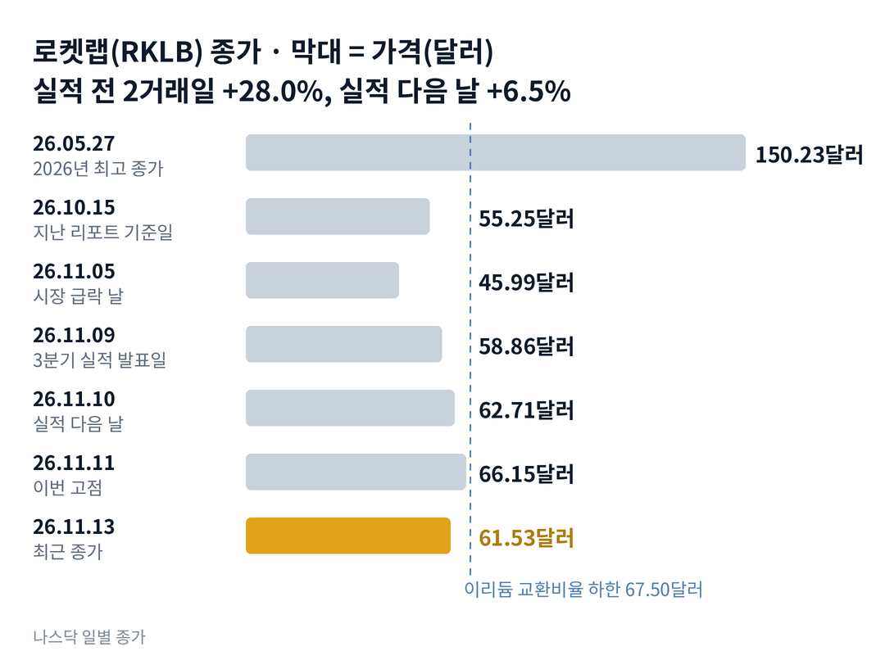

로켓랩의 3분기 매출은 회사가 8월에 내다본 범위 안에 들었을까요? 그 범위는 2억 5,000만~2억 6,500만 달러였습니다. 이 질문은 시청자 요청 종목으로 로켓랩을 고른 분이 '실적에서 가장 먼저 볼 숫자는 매출'이라고 답하면서 시작됐습니다. 답은 '안에 들지 않았다'입니다. 11월 9일 장이 끝난 뒤 나온 3분기 매출은 2억 6,780만 달러로, 전망의 위쪽 끝보다 약 280만 달러 많았습니다.

그런데 다음 날 아침 주가는 반대로 움직였습니다. 정규장이 열리기 전 거래에서 5% 넘게 빠졌다는 보도가 나왔습니다. 그날 종가는 62.71달러로, 전날보다 6.5% 올라 끝났습니다. 몇 시간 만에 방향이 뒤집힌 셈인데, 시장은 그 사이 어떤 숫자를 다시 읽었을까요?

> **유의사항** 저자는 금융·투자 자문가가 아닙니다. 이 글은 공개 공시와 시세를 정리한 교육용 분석이며 특정 종목의 매수·매도를 권하지 않습니다. 과거 패턴은 미래 수익을 보장하지 않고, 이 종목은 하루 30% 넘게 움직인 날이 여러 번 있습니다. 실제 투자 전에는 최신 공시를 직접 확인하세요.

이 글은 [10월 16일 리포트](/r/rklb-2026-10/)를 잇는 실적 뒤 후속편입니다. 그 리포트는 사상 최고 매출에도 주가가 고점보다 63% 낮은 이유를 아직 날지 않은 로켓과 늘어난 주식에서 찾았습니다. 그리고 앞으로 갈 길을 네 갈래로 적었습니다. 첫째는 3분기 실적의 방향, 둘째는 새 대형 계약입니다. 셋째는 뉴트론 추가 연기, 넷째는 이리듐 인수와 내부자 물량입니다. 이 네 갈래를 채점한 지난 예측 성적은 적중 둘, 빗나감 하나, 확인 전 하나입니다.

맞은 쪽부터 보겠습니다. 새 대형 계약이 나오면 오른다는 둘째 갈래는 맞았습니다. 회사는 3분기에만 약 10억 달러어치 발사 계약을 새로 맺었다고 밝혔고, 다음 날 주가가 올랐습니다. 이리듐 인수와 내부자 물량이 부담으로 남는다는 넷째 갈래도 맞았습니다. 11월 2일 최고재무책임자와 이사 한 명이 주식을 팔았고, 주가는 이 기간 내내 67.50달러 아래에 머물렀습니다.

가장 크게 빗나간 것은 첫째 갈래였습니다. 지난 리포트는 3분기 실적에서 매출보다 뉴트론 첫 발사 분기가 적혔는지를 먼저 보라고 했습니다. 실적의 방향이 뉴트론 문구에서 갈릴 것이라고 봤기 때문입니다. 실제로는 이번에도 발사 분기가 없었는데 다음 날 주가는 올랐습니다. 하루 반응만 보면 매출과 수주잔고가 더 크게 작용했을 가능성이 큽니다. 추가 연기를 다룬 셋째 갈래는 새 연기 소식이 없어 아직 확인 전입니다.

로켓랩이 무엇으로 돈을 버는지 짧게 짚고 가겠습니다. 이 회사는 두 사업으로 돈을 법니다. 하나는 소형 로켓 일렉트론으로 남의 위성을 우주에 실어 주고 받는 발사 요금입니다. 다른 하나는 위성 몸체와 태양전지, 자세 제어 장치 같은 부품을 만들어 파는 '우주 시스템' 사업입니다. 이번 분기 매출의 80%가 이 우주 시스템에서 나왔습니다.

여기에 아직 매출이 없는 두 가지 미래가 붙어 있습니다. 하나는 개발 중인 재사용 중형 로켓 뉴트론입니다. 일렉트론보다 훨씬 큰 위성을 쏠 수 있는 로켓인데, 첫 발사가 2027년으로 밀려 있습니다. 다른 하나는 위성 통신 회사 이리듐 인수입니다. 회사는 이 인수에 현금 30억 달러 넘게 들어간다고 적었고, 2027년 마무리를 목표로 합니다.

지금 몸값은 약 419억 달러입니다. 회사가 4분기에 쓸 것이라고 밝힌 평균 주식 수 6억 8,100만 주에 11월 13일 종가 61.53달러를 곱한 값입니다(계산). 9월 말 현금과 유가증권은 약 47억 400만 달러였습니다. 다만 이 돈의 큰 부분은 이리듐 인수 대금으로 나갈 예정이라, 회사가 자유롭게 쓸 돈으로 보기는 어렵습니다.

이제 실적 주간으로 들어가 보겠습니다. 이야기는 발표 2거래일 전부터 시작됩니다. 11월 5일 기술주가 크게 빠졌습니다. QQQ(나스닥 100 지수를 따르는 상장지수펀드)가 하루 6.5% 내렸습니다. 같은 날 로켓랩은 12.2% 내려 45.99달러가 됐습니다. 그 뒤 두 거래일 동안 주가는 58.86달러까지 28.0% 올랐습니다. 같은 기간 QQQ는 5.0% 올랐으니, 로켓랩의 반등이 시장보다 훨씬 컸습니다.

그 상태에서 11월 9일 실적이 나왔습니다. 보도자료는 첫 줄부터 '사상 최고 매출'을 내세웠습니다. 매출 2억 6,780만 달러는 1년 전보다 73% 많았고, 바로 앞 분기의 2억 3,410만 달러보다도 많았습니다. 늘어난 매출의 대부분은 1년 새 88% 커진 우주 시스템에서 나왔습니다. 발사 매출도 일렉트론 발사 횟수가 1년 전보다 두 번 늘며 함께 커졌습니다.

수익성도 전망보다 나았습니다. 매출에서 원가를 빼고 남는 비율인 매출총이익률은 33.6%였습니다. 회사가 8월에 내놓은 전망은 29~31%였습니다. 조정 EBITDA(이자와 세금, 감가상각, 주식 보상을 빼기 전 영업 손익)는 1,800만 달러 손실이었습니다. 회사 전망인 1,700만~2,300만 달러 손실 범위 안입니다.

가장 눈에 띈 숫자는 수주잔고였습니다. 수주잔고는 계약은 맺었지만 아직 매출로 잡지 않은 일감의 합입니다. 9월 말 수주잔고는 35억 7,300만 달러였습니다. 6월 말 약 23억 6,000만 달러보다 회사 발표 기준 52% 늘었습니다. 회사는 이 가운데 약 33%가 앞으로 12개월 안에 매출이 될 것으로 봤습니다. 계산하면 약 11억 8,000만 달러입니다.

뉴트론 쪽에서도 숫자가 나왔습니다. 첫 발사 전인데도 3분기에 5억 1,500만 달러 넘는 뉴트론 발사 계약을 새로 맺었습니다. 뉴트론으로 쏘기로 한 일감은 16번이 됐습니다. 회사는 업계의 발사 자리가 빠듯해지면서 일부 계약의 기본 발사 가격을 7,000만 달러로 올렸다고 밝혔습니다.

그렇다면 장 전에는 왜 빠졌을까요? 보도에 따르면 주당 순손실이 0.12달러로, 시장이 예상한 0.07달러보다 컸습니다. 순손실은 7,970만 달러로, 1년 전 1,830만 달러의 네 배를 넘었습니다. 매출이 기대보다 좋았는데 손실도 기대보다 컸으니, 첫 반응이 엇갈린 것입니다.

손실표를 한 줄씩 내려가면 이유가 보입니다. 회사는 이리듐 인수 대금을 위해 36억 달러 규모 단기 대출 약정을 잡아 두었습니다. 이 약정을 쓰지 않고 해지하면서 2,730만 달러 비용이 생겼고, 공시는 이를 '부채 소멸 손실'로 적었습니다. 회사가 새 주식을 팔아 인수 대금을 먼저 마련했기 때문에 이 대출이 필요 없어졌습니다.

인수 거래 비용 2,130만 달러도 따로 있었습니다. 이 두 항목만 더해도 4,860만 달러로, 순손실의 약 61%입니다(계산). 공시 기준 영업비용은 1억 6,930만 달러로, 회사 전망의 위쪽 끝보다 약 2,030만 달러 많았습니다. 같은 분기 거래 비용이 2,130만 달러였으니, 초과분은 거래 비용으로 거의 설명됩니다. 손실의 상당 부분이 일회성이라는 점이 장중 반전의 한 요인이었을 수 있습니다. 같은 날 매출과 수주잔고도 함께 반영됐을 테니, 하나로 가르기는 어렵습니다.

돈의 흐름도 나쁘지 않았습니다. 3분기 영업활동 현금흐름은 720만 달러 플러스였습니다. 영업활동으로 들어온 현금이 나간 현금보다 조금 많았다는 뜻입니다. 9월까지 아홉 달을 합치면 아직 1억 2,730만 달러 마이너스라, 한 분기의 숫자로 흐름이 바뀌었다고 말하기는 이릅니다.

4분기 전망도 함께 나왔습니다. 매출 전망은 2억 7,000만~2억 9,000만 달러입니다. 범위의 가운데 값(중앙값)은 3분기 매출보다 약 4.5% 많습니다. 수익성 전망도 매출총이익률과 조정 EBITDA 모두 이번 분기보다 조금 나아졌습니다.

다만 주가는 그 뒤 계속 오르지 않았습니다. 11월 11일 66.15달러까지 오른 뒤 다시 내려, 11월 13일 종가는 61.53달러였습니다. 11월 11일 종가보다 7.0% 낮은 자리입니다. 이 가격은 실적 전 종가 58.86달러보다 4.5% 높습니다. 5월 27일 최고 종가 150.23달러와 비교하면 아직 59.0% 낮습니다. 실적 전 2거래일의 반등이 실적 뒤 하루 반응보다 네 배 넘게 컸다는 점도 기억해 둘 만합니다.

그렇다면 매출이 전망 위쪽 끝을 넘은 일은 이 종목에서 처음이었을까요? 시청자분이 매출을 가장 먼저 본다고 하셔서, 회사가 분기마다 낸 매출 전망과 실제 매출을 2023년 1분기부터 모두 맞대 봤습니다. 이번 직전까지 14분기입니다. 전망 위쪽 끝을 넘은 분기는 4번, 범위 안은 8번, 아래쪽 끝에 못 미친 분기는 2번이었습니다.

넘은 분기는 2023년 초 한 번, 2025년 여름과 가을 두 번, 2026년 봄 한 번이었습니다. 이때는 모두 실적 다음 날부터 20거래일 뒤 종가가 실적 다음 날 종가보다 높았습니다. 범위 안에 든 8번은 4번만 그랬습니다. 20거래일을 잡은 이유는 한 달 남짓이면 첫 반응이 가라앉고 다음 소식이 쌓이기 시작하기 때문입니다.

가장 큰 예는 2026년 5월입니다. 그때 매출 2억 30만 달러는 전망 위쪽 끝 2억 달러를 넘었습니다. 다음 날 주가는 34.2% 뛰었고, 20거래일 뒤에도 그날보다 7.8% 높았습니다. 반대로 2분기 매출이 전망 범위 안에 들었던 8월에는 다음 날 주가가 제자리였고, 20거래일 뒤에는 21.2% 낮았습니다.

이 기록의 한계도 분명합니다. 표본이 4번뿐입니다. 그중 2025년 가을 실적은 위쪽 끝을 약 8만 달러 넘었을 뿐입니다. 2026년 봄 실적도 약 35만 달러 차이라, 두 번은 사실상 끝자락에 걸친 경우입니다. 2023년은 주가가 4달러대였고, 그 사이 회사 크기와 사업 구성도 크게 바뀌었습니다. 그래서 이 기록은 '4번 모두 그랬다'는 참고 자료로만 씁니다.

이번이 다를 수 있는 점도 있습니다. 이번에는 매출이 넘었을 뿐 아니라, 앞서 본 대로 실적 전 2거래일 동안 주가가 이미 크게 올라 있었습니다. 기대가 먼저 가격에 들어간 상태였다는 뜻입니다. 그리고 11월 13일 종가 61.53달러는 이미 실적 다음 날 종가 62.71달러보다 1.9% 낮습니다.

실적 한 주가 지난 지금, 회사 숫자는 지난 리포트 때보다 한 걸음 앞으로 갔습니다. 매출이 전망을 넘었고, 수주잔고가 석 달 새 52% 늘었고, 수익성도 전망보다 나았습니다. 하지만 주가는 실적 다음 날 고점 근처를 지키지 못하고 이리듐 교환비율 하한 67.50달러 아래에 머물러 있습니다.

교환비율 하한은 이리듐 주주가 받을 로켓랩 주식 수를 정하는 기준입니다. 공시에 따르면 기준 가격은 인수 마무리 2거래일 전까지 연속 10거래일의 거래량 가중 평균 가격입니다. 이 가격이 67.50달러 이하이면 이리듐 한 주당 로켓랩 0.4주를 주고, 그 위로 올라가면 받는 주식 수가 줄어듭니다. 그래서 마무리 직전에도 주가가 이 선 아래라면 새로 나갈 주식이 최대치가 됩니다.

앞으로 길을 가를 기준은 두 가지입니다. 하나는 실적 다음 날부터 20번째 거래일인 12월 9일 종가가 실적 다음 날 종가 62.71달러보다 높은가입니다. 다른 하나는 그때까지 뉴트론의 남은 시험 완료나 구체적인 발사 시기 발표가 나오는가입니다. 회사는 교체할 탱크 덮개를 만들고 압력 시험과 극저온 시험을 마친 뒤 일정을 더 구체적으로 알리겠다고 적었습니다.

두 기준을 겹치면 갈 길은 네 갈래입니다. 뉴트론 발표가 나오고 종가가 62.71달러 위라면 첫째 갈래, 숫자와 로켓이 함께 받친 경우입니다. 발표가 나왔는데도 그 아래라면 둘째 갈래, 소식에도 되돌림이 이어진 경우입니다. 발표 없이 그 아래라면 셋째 갈래, 실적 반등이 식은 경우입니다. 발표 없이도 위를 지키면 넷째 갈래, 매출이 받친 경우입니다.

제 주관적 추정으로는 첫째 갈래가 약 20%, 둘째가 약 10%입니다. 셋째와 넷째는 각각 약 35%입니다. 이 숫자는 주가가 오를 확률이 아니라, 12월 9일에 두 기준이 어느 칸에 들어갈지에 대한 추정입니다. 62.71달러 위에서 끝나는 첫째와 넷째를 합쳐 약 55%로 잡았습니다.

이 숫자의 출발점은 2023년 이후 모든 실적의 20거래일 뒤 기록으로, 14번 중 9번이 실적 다음 날보다 높았습니다(약 64%). 과거 상단 위 4번은 모두 위였지만, 11월 13일 종가가 이미 그 선 아래라 그보다 조금 낮춰 잡았습니다.

뉴트론 발표 가능성은 첫째와 둘째를 더한 약 30%로 봤습니다. 회사가 남은 시험을 마친 뒤에 일정을 알리겠다고 했고, 10월 14일 연기 발표 뒤 한 달이 지났을 뿐이기 때문입니다. 지난 리포트가 다섯 번의 연기를 정리했듯, 이 로켓의 일정은 예상보다 늦게 나온 적이 많았습니다.

위험도 짚어 두겠습니다. 먼저 이 분석의 한계입니다. 매출 전망 기록은 14분기뿐이고, 위쪽 끝을 넘은 분기는 4번입니다. 매출 말고도 같은 날 나온 수주잔고, 뉴트론 소식, 시장 분위기가 함께 주가를 움직였기 때문에, 매출 하나의 효과만 떼어 낼 수는 없습니다.

사업 쪽에서는 뉴트론이 가장 큽니다. 16번의 뉴트론 일감과 7,000만 달러 발사 가격은 로켓이 실제로 날아야 매출이 됩니다. 수주잔고에는 고객이 해지 수수료를 내고 계약을 끝낼 수 있는 조건이 붙은 계약도 들어 있다고 회사는 적었습니다. 연구개발비는 3분기에 1년 전보다 39% 늘었습니다.

바깥 환경도 무시할 수 없습니다. 11월 5일처럼 기술주 전체가 크게 빠지는 날에는 로켓랩이 시장의 두 배 가까이 움직였습니다. 우주 기업들의 상장과 경쟁 로켓의 일정 소식에도 주가가 크게 흔들린 적이 있습니다. 이리듐 인수는 미국 연방통신위원회와 몇몇 해외 당국의 승인을 아직 기다리고 있습니다.

자금과 주식 수도 계속 봐야 합니다. 회사는 올해 시장에서 새 주식을 팔아 39억 달러 넘게 모았습니다. 4분기 평균 주식 수 전망은 6억 8,100만 주입니다. 3분기 전망보다 4,000만 주 많습니다. 이리듐 인수가 끝나면 이리듐 주주에게 줄 주식이 더해집니다. 내부자 매도도 11월 2일까지 이어졌습니다.

시청자분이 가장 먼저 본 매출은 전망 안이 아니라 그 위에 있었습니다. 보도는 장 전 하락의 이유로 예상보다 큰 주당 손실을 짚었는데, 그 손실을 키운 것은 이리듐에 딸린 일회성 비용 4,860만 달러였습니다. 정규장에서는 매출과 수주잔고가 함께 반영되며 방향이 바뀐 것으로 보입니다. 과거 매출이 전망 위쪽 끝을 넘은 4번은 한 달 뒤 모두 더 높았지만, 이번에는 실적 전에 이미 가격이 크게 올라 있었습니다. 그래서 12월 9일에 가장 먼저 확인할 것은 그날 종가가 62.71달러 위인지입니다. 다음 갱신은 그 판정 뒤에 하고, 2027년 2월 무렵 4분기 실적에서 매출 전망이 지켜졌는지도 이어서 보겠습니다.

## 숫자로 다시 보기

본문에 나온 숫자를 찾아보기 쉽게 표로 모았습니다. 영상 설명과 고정 댓글이 가리키는 표는 아래에 같은 제목으로 있습니다.

### 숫자로 본 지금의 크기

| 항목 | 2026년 11월 기준 |
| --- | --- |
| 11월 13일 종가 | **61.53달러** 지난 리포트 기준일 10월 15일 55.25달러 |
| 시가총액(계산) | **약 419억 달러** 4분기 평균 주식 6억 8,100만 주 전망으로 계산 |
| 현금과 유가증권 | **약 47억 400만 달러** 9월 말, 큰 부분은 이리듐 인수 대금 |
| 수주잔고 | **35억 7,300만 달러** 6월 말 23억 6,000만 달러 |
| 이리듐 교환비율 하한 | **67.50달러** 이 가격 이하면 이리듐 한 주당 0.4주 |

### 3분기 실적 표 · 전망과 실제

| 항목 | 2026년 3분기 실제 | 8월에 낸 전망 |
| --- | --- | --- |
| 매출 | **2억 6,780만 달러** | 2억 5,000만~2억 6,500만 (상단보다 약 280만 위) |
| 매출총이익률(공시 기준) | **33.6%** | 29~31% |
| 조정 EBITDA | 1,800만 달러 손실 | 1,700만~2,300만 손실 |
| 영업비용(공시 기준) | 1억 6,930만 달러 | 1억 4,300만~1억 4,900만 |
| 순손실 | 7,970만 달러 | 1년 전 1,830만 |
| 그중 일회성 두 항목 | **4,860만 달러** | 대출 약정 해지 2,730만 거래 비용 2,130만 |
| 영업활동 현금흐름 | 720만 달러 플러스 | 9개월 합계 1억 2,730만 마이너스 |
| 4분기 매출 전망 | **2억 7,000만~2억 9,000만** | 가운데 값은 3분기 대비 약 +4.5% |

### 매출 전망 기록표 · 상단을 넘은 분기와 그 뒤

회사가 앞 분기 실적 때 낸 매출 전망과 실제 매출입니다(단위 백만 달러). 반응은 실적 다음 날 종가 변화, 20거래일 뒤는 실적 다음 날 종가와 비교했습니다.

**한눈에:** 전망 상단을 넘은 분기는 20거래일 뒤 모두 더 높았습니다(**4/4**). 범위 안에 든 분기는 **4/8**입니다. 하단 아래 분기는 **1/2**입니다.

| 분기 · 전망 | 실제 매출 | 다음 날 · 20거래일 뒤 |
| --- | --- | --- |
| **2023 1분기 · 51~54** | **54.9 (상단 위)** | +4.6% · **+28.2%** |
| 2023 2분기 · 60~63 | 62.0 (범위 안) | -3.2% · -2.0% |
| 2023 3분기 · 73~77 | 67.7 (하단 아래) | -1.8% · +12.1% |
| 2023 4분기 · 65~69 | 60.0 (하단 아래) | -2.5% · -9.8% |
| 2024 1분기 · 92~98 | 92.8 (범위 안) | -2.2% · +11.8% |
| 2024 2분기 · 105~110 | 106.3 (범위 안) | +12.6% · +14.3% |
| 2024 3분기 · 100~105 | 104.8 (범위 안) | +28.4% · +19.9% |
| 2024 4분기 · 125~135 | 132.4 (범위 안) | +3.3% · -9.1% |
| 2025 1분기 · 117~123 | 122.6 (범위 안) | -11.2% · +44.5% |
| **2025 2분기 · 130~140** | **144.5 (상단 위)** | +1.1% · **+6.8%** |
| **2025 3분기 · 145~155** | **155.1 (상단 위)** | -1.3% · **+12.3%** |
| 2025 4분기 · 170~180 | 179.7 (범위 안) | -4.9% · -11.8% |
| **2026 1분기 · 185~200** | **200.3 (상단 위)** | +34.2% · **+7.8%** |
| 2026 2분기 · 225~240 | 234.1 (범위 안) | -0.0% · -21.2% |

**이번 사례(결과 미확정):** 2026년 3분기 실제 매출 267.8로 상단 위입니다. 실적 다음 날인 11월 10일 종가는 62.71달러였습니다. 12월 9일(20거래일째) 종가가 이보다 높은지 확인합니다.

### 시나리오 표 · 앞으로 일어날 수 있는 일

아래 가능성은 주가가 오를 확률이 아니라, 12월 9일에 두 판정 기준이 어느 칸에 들어갈지에 대한 분석자의 주관적 추정입니다. 네 경우는 겹치지 않아 '약 N%'를 더하면 100%이고, 괄호 안 구간은 흔들림의 폭이라 서로 더하지 않습니다.

| 시나리오(판정 2026년 12월 9일) | 발표·종가 | 가능성(추정) |
| --- | --- | --- |
| **1 · 숫자와 로켓이 함께 받침** | 있음 · 62.71 위 | 중간 약 20% (14~26%) |
| 2 · 소식에도 되돌림 | 있음 · 62.71 아래 | 낮음 약 10% (5~15%) |
| **3 · 실적 반등이 식음** | 없음 · 62.71 아래 | 높음 약 35% (28~42%) |
| **4 · 매출이 받침** | 없음 · 62.71 위 | 높음 약 35% (28~42%) |

### 핵심 확인 세 가지

위에서부터 판정을 바꾸는 힘이 큰 순서입니다.

- ☐ 1순위 · 12월 9일(20거래일째) 종가가 실적 다음 날 종가 62.71달러보다 높은가
- ☐ 2순위 · 12월 9일까지 뉴트론 압력·극저온 시험 완료나 발사 시기 발표가 있나
- ☐ 3순위 · 2027년 2월 무렵 4분기 실적에서 매출이 회사 전망 범위 안이나 위인가

**보조 확인:** 이리듐 인수의 연방통신위원회 승인, 다음 분기 보고서의 주식 수, 내부자 매도 공시(Form 4)를 봅니다.

### 지난 예측 채점표

10월 16일 리포트(10월 15일 기준 종가 55.25달러)의 예측을 11월 13일 기준으로 채점한 결과입니다. 지난 리포트에는 시나리오별 가능성 숫자가 없었습니다.

| 지난 점검 항목 · 당시 기준 | 판정 및 실제 결과(11월 13일) |
| --- | --- |
| **시나리오 1: 3분기 실적** 방향은 뉴트론 문구가 가른다 | **[빗나감]** 발사 분기 없이도 다음 날 +6.5%, 매출·수주잔고가 가름 |
| **시나리오 2: 새 대형 계약** 계약 소식에 오른다 | **[적중]** 3분기 발사 계약 약 10억 달러 공개, 다음 날 +6.5% |
| **시나리오 3: 추가 연기나 시험 문제** 반응일 하락 | **[확인 전]** 새 연기 없음, 2027년 첫 발사 유지 |
| **시나리오 4: 이리듐과 내부자 물량** 67.50달러 아래면 주식 부담 | **[적중]** 내내 67.50달러 아래(최고 66.15), 11월 2일 내부자 매도 |
