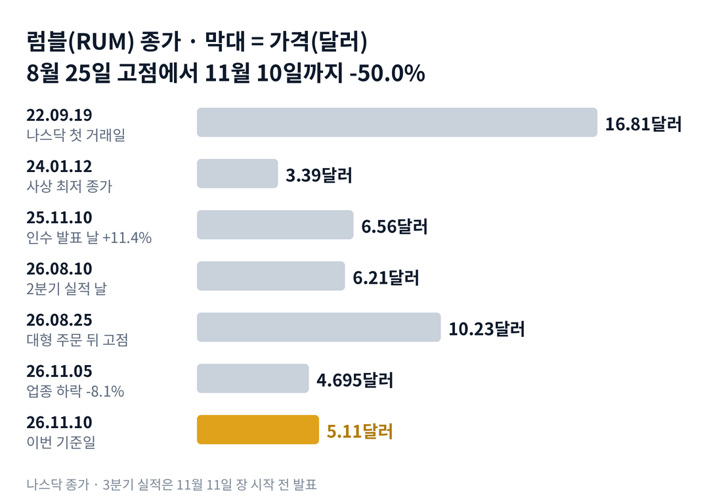

## 짧은 답

> **핵심:** 매출은 회사 전망을 넘었지만, 8월 고점 뒤 하락은 업종 전체의 매도에 '큰 주문을 지을 돈을 어디서 구하나'라는 질문이 겹친 결과였습니다.

매출은 1년 전의 약 3.9배가 됐습니다. 그런데 주가는 왜 석 달 사이 절반이 됐을까요? 럼블은 11월 11일 아침 3분기 매출 9,658만 달러를 발표했고, 전날 종가 5.11달러는 8월 25일 고점 10.23달러의 딱 절반입니다.

결론부터 말하면, 하락의 큰 줄기는 업종이었습니다. 같은 기간 아이렌은 럼블보다 더 내렸고, 코어위브와 네비우스도 40% 넘게 내렸습니다. 회사 안에서는 8월에 받은 137억 달러 주문이 오히려 질문을 남겼습니다. 공시에 '지금은 이 설비를 지을 자금이 없다'는 문장이 함께 있었기 때문입니다.

그래서 이번 실적의 무게는 매출보다 자금 쪽에 있습니다. 회사는 이번 자료에서 2027년 목표 설비 250MW(메가와트, 데이터센터 전력 규모) 일부가 2028년 이후로 밀릴 수 있다고 적었습니다. 새 주식을 바로 팔 수 있는 등록 절차도 이번 주에 바꾼다고 밝혔습니다. **2026.11.11 진단: 국면 C(자금 검증기, 큰 주문을 지을 돈을 확인받는 단계) 초입 — 근거는 5부.**

과거 실적 16번 가운데 첫날 10% 넘게 오른 세 번과 0~10% 오른 다섯 번은 한 달 뒤가 정반대였습니다. 그 갈림길은 3부 '실적 16번, 첫날과 20거래일 뒤' 표에 있습니다.

> **유의사항** 저자는 금융·투자 자문가가 아닙니다. 이 글은 공개 공시와 시세를 정리한 교육용 분석이며 특정 종목의 매수·매도를 권하지 않습니다. 과거 패턴은 미래 수익을 보장하지 않고, 럼블은 실적 날 하루에 19% 넘게 움직인 적이 있는 종목입니다. 실제 투자 전에는 최신 공시를 직접 확인하세요.

이 리포트는 실시간 인기 종목 순위(11월 11일 아침, 1위)에서 고른 종목입니다.

## 1부. 럼블은 어떤 회사이고, 무엇으로 돈을 버는가

> **핵심:** 럼블은 이제 동영상 회사보다 그래픽 처리 장치를 빌려주는 클라우드 회사에 가깝고, 3분기 매출의 70% 이상이 그쪽에서 나왔습니다.

럼블은 2013년 캐나다에서 시작한 동영상 플랫폼입니다. 2022년 9월 기업인수목적회사(SPAC, 상장만을 위해 만든 회사)와 합병해 나스닥에 올랐습니다. 본사는 미국 플로리다주 롱보트키에 있고, 창업자 크리스 파블로프스키가 대표를 맡고 있습니다.

2026년 6월 17일, 회사는 독일 데이터센터 회사 노던데이터를 인수했습니다. 다음 날 지주회사 이름도 럼 그룹(RUM Group Inc.)으로 바꿨습니다. 티커는 그대로 RUM이고, 이 글에서는 익숙한 이름인 럼블로 부릅니다.

돈을 버는 방식은 지금 둘입니다. 하나는 원래의 동영상 플랫폼 럼블입니다. 광고와 구독으로 돈을 법니다. 다른 하나는 퀘이크 AI입니다. 엔비디아 그래픽 처리 장치(GPU, 인공지능 계산에 쓰는 칩) 약 2만 2천 개를 데이터센터에 두고, 그 연산 능력을 다른 회사에 빌려줍니다.

큰 주주도 알아 둘 만합니다. 스테이블코인 회사 테더는 2025년 7억 7,500만 달러를 투자했고, 노던데이터의 대주주이기도 했습니다. 인수 과정에서 테더는 럼블 주식을 거의 공짜에 살 수 있는 선행 워런트(한 주 0.0001달러에 주식을 받는 권리)를 받았습니다.

### 숫자로 본 지금의 크기(11월 10일 기준, 3분기는 11월 11일 발표)

| 항목 | 값 · 계산 근거 |
| --- | --- |
| 종가 | **5.11달러** 올해 최고 종가 10.23달러(2026.08.25)보다 50.0% 낮음 |
| 3분기 매출 | **9,658만 달러** 1년 전 2,476만 달러보다 290%, 2분기보다 139% 증가 |
| 퀘이크 AI 매출 | **6,820만 달러** 3분기 매출의 70% 이상, 첫 온전한 분기 |
| 동영상 럼블 매출 | **약 2,838만 달러** 전체 매출에서 퀘이크 AI를 뺀 값, 1년 전보다 360만 달러 증가 |
| 3분기 조정 EBITDA(회사 기준 영업 이익) | **흑자(회사 역사상 처음)** 2분기 -1,661만 달러 |
| 3분기 순손실 | **8,985만 달러** 1년 전 1,626만 달러보다 커짐 |
| 9월 말 현금 | **1억 3,440만 달러** 6월 말 2억 327만 달러, 비트코인 790만 달러는 별도 |
| 4분기 회사 전망 | **매출 8,800만~9,400만 달러** 중간값 9,100만 달러, 3분기 실제보다 낮음 |

조정 EBITDA(이자와 세금, 감가상각을 빼기 전 이익)는 주식 보상처럼 현금이 나가지 않는 비용도 빼기 전에 잰 이익입니다. 회사가 직접 정한 기준이라, 공식 회계 기준의 순손실과 함께 봐야 합니다. 이번 분기도 순손실은 1년 전보다 다섯 배 넘게 컸습니다. 이렇게 매출이 커지는 회사의 주가는 언제부터 꺾였을까요?

## 2부. 137억 달러 주문 뒤 주가가 절반이 된 두 힘

> **핵심:** 업종 전체가 함께 내린 위에, 큰 주문을 지을 자금이 아직 없다는 회사 공시가 겹쳤습니다.

위 차트에서 보듯, 주가는 8월 10일 2분기 실적 날 6.21달러에서 8월 25일 10.23달러까지 올랐습니다. 8월 10일 종가 대비 11거래일 만에 64.7% 오른 겁니다. 그 사이 두 가지 소식이 있었습니다.

하나는 2분기 실적입니다. 회사는 노던데이터 인수를 마쳤다고 알리고, 처음으로 다음 분기 매출 전망을 냈습니다. 다음 날 주가는 11.4% 올랐습니다.

다른 하나는 8월 24일 장 시작 전 공시입니다. 미국의 한 클라우드 손님이 조지아주 마이스빌에 짓는 데이터센터에서 GPU 서비스를 사기로 했습니다. 세 번에 나눠 총 약 137억 달러, 기간은 6년입니다. 주가는 그날 3.4%, 다음 날 9.3% 올랐습니다.

### 8월 25일 뒤, 인공지능 데이터센터 주식과 반도체 상장지수펀드(ETF)

아래 표는 같은 날짜 종가끼리 비교했습니다. 기준일은 럼블의 고점일이라, 다른 종목에는 각자 고점 대비 낙폭이 아닙니다.

| 종목 · 성격 | 고점 뒤(8.25 → 11.10) | 11월 5일 하루 |
| --- | --- | --- |
| **럼블(RUM)** 동영상 · GPU 클라우드 | **-50.0%** | **-8.1%** |
| 아이렌(IREN) 채굴 출신 데이터센터 | -53.3% | -17.0% |
| 코어위브(CRWV) 인공지능 클라우드 | -44.7% | -9.8% |
| 네비우스(NBIS) 인공지능 클라우드 | -39.6% | -14.9% |
| 반도체 ETF(SOXX) | -14.5% | -12.1% |

첫 번째 힘은 업종입니다. 같은 무리의 낙폭은 40~53%였고, 럼블은 그 가운데쯤입니다. 11월 5일처럼 반도체 전체가 크게 내린 날에는 럼블이 오히려 덜 내렸습니다. 그러니 반토막의 큰 부분은 회사만의 일이 아니었습니다.

두 번째 힘은 주문서에 함께 적힌 조건입니다. 같은 8-K(주요 사건 수시 공시)의 위험 문구는 이렇게 적었습니다. "지금은 이 지출을 감당할 자금이 없고, 계약 의무에는 자금 조달 조건이 붙어 있지 않다." 돈을 못 구해도 지어야 한다는 뜻입니다.

손님에게 준 권리도 있습니다. 손님은 럼블 주식 최대 5,080만 8,408주를 한 주 1센트에 살 수 있는 워런트(정해진 값에 주식을 사는 권리)를 받습니다. 이 권리는 손님이 주문을 실제로 살 때마다 나눠서 생깁니다. 다 생기면 8월 6일 A주 2억 7,633만 주의 약 18%에 해당하는 수입니다.

이 둘을 묶으면, 주문이 클수록 지을 돈과 늘어날 주식 수도 커지는 구조입니다. 다만 업종과 회사 요인이 각각 몇 %였는지 가를 자료는 없습니다. 여기까지 보면 하락에는 업종의 매도와 자금 질문, 두 힘이 겹쳐 있었습니다. 이 회사 주가는 실적 날마다 무엇에 크게 반응했을까요?

## 3부. 실적 16번, 첫날과 20거래일 뒤

> **핵심:** 첫날 10% 넘게 오른 세 번은 한 달 뒤에도 모두 위였고, 0~10% 오른 다섯 번은 모두 아래였습니다.

럼블은 2022년 9월 상장 뒤 정기 실적을 16번 냈습니다. 상장 직후 합병 마무리 공시는 실적 발표가 아니라 뺐습니다. 이번 실적과 같은 조건인 정기 분기 발표만 모은 것입니다. 대부분은 장 마감 뒤에, 2025년부터 몇 번은 장 시작 전에 나왔습니다. 그래서 발표 직전 종가를 기준으로, 처음 반응한 날 종가와 그날을 첫날로 센 20번째 거래일 종가를 비교했습니다.

예를 들어 2026년 8월 10일은 장 마감 뒤 발표였습니다. 그날 종가 6.21달러가 다음 날 6.92달러로 +11.4%였고, 20번째 거래일인 9월 8일에는 발표 전보다 35.1% 높았습니다.

**한눈에:** **3/3** 첫날 크게 오른 날 한 달 뒤 위 · **0/5** 첫날 조금 오른 날 한 달 뒤 위 · **-6.6%** 20거래일 뒤 가운데 값(중앙값). 크게는 10% 넘게, 조금은 0~10%입니다.

### 실적 16번, 첫날과 20거래일 뒤

| 발표일 · 그날 나온 내용 | 첫날 | 20거래일 뒤 |
| --- | --- | --- |
| 2022.11.14 3분기 매출 1,100만 달러(+430%) | -2.1% | -31.4% |
| 2023.03.30 4분기 매출 2,000만 달러(+579%) | +7.1% | -14.7% |
| 2023.05.15 1분기, 인기 방송인 영입 | -3.7% | +1.8% |
| 2023.08.14 분기 매출 최대 2,500만 달러 | -14.0% | -16.4% |
| 2023.11.13 3분기 매출 +64% | +5.3% | -0.4% |
| 2024.03.27 연 매출 8,100만 달러 클라우드 출시 | -4.9% | -23.1% |
| 2024.05.14 1분기 매출 1,770만 달러 | 0.0% | -18.7% |
| 2024.08.12 매출 전 분기보다 +27% | +5.4% | -5.9% |
| 2024.11.12 분기 매출 최대 2,510만 달러 | -10.0% | +19.1% |
| 2025.03.25 테더 7억 7,500만 달러 투자 | +0.2% | -5.6% |
| **2025.05.08** 엘살바도르 정부 클라우드 계약 | **+19.5%** | **+18.4%** |
| 2025.08.11 매출 +12%, 러셀 지수 편입 | +3.0% | -7.2% |
| **2025.11.10** 같은 날 노던데이터 인수 발표 | **+11.4%** | **+22.2%** |
| 2026.03.05 연 매출 처음 1억 달러 넘음 | -12.5% | -11.2% |
| 2026.05.14 인수 일정 확인 럼블 매출 +7% | -11.8% | -12.4% |
| **2026.08.10** 인수 완료, 첫 분기 전망 | **+11.4%** | **+35.1%** |

굵게 쓴 세 줄이 첫날 10% 넘게 오른 날입니다. 세 번 모두 그날 자료에 새 사업의 크기가 처음 나왔습니다. 정부 클라우드 계약, 노던데이터 인수 발표, 인수 완료와 첫 공식 전망입니다.

반대로 첫날 0~10% 오른 다섯 번은 대부분 매출 기록이나 사용자 숫자가 머리기사였습니다. 다섯 번 모두 20번째 거래일에는 발표 전보다 낮았습니다. 첫날 내린 일곱 번 가운데 한 달 뒤 발표 전보다 높았던 것은 두 번이었습니다.

> **이번 사례(첫날·20거래일 결과 미확정):** 2026.11.11 장 시작 전 · 3분기 매출 9,658만 달러, 첫 조정 EBITDA 흑자 · 기준은 11월 10일 종가 5.11달러 · 10%의 선은 5.62달러 · 5거래일째 11월 17일, 20거래일째 12월 9일 판정

이 기록의 한계도 분명합니다. 10% 넘게 오른 날은 세 번뿐이라, 한 번만 달랐어도 '3번 중 3번'은 '3번 중 2번'이 됩니다. 2024년까지는 회사가 동영상 사업뿐이었고 매출도 지금의 4분의 1 아래였습니다. 그래서 이 표는 규칙이 아니라 첫날을 읽는 참고 자료입니다.

그렇다면 이번 3분기 자료에도 첫날을 10% 넘게 밀어 올릴 '새 사업의 크기'가 있었을까요?

## 4부. 이번 자료에서 바뀐 문장 두 개

> **핵심:** 매출과 흑자는 좋아졌지만, 2027년 설비 일정과 새 주식 등록 절차에서 결이 다른 문장이 나왔습니다.

먼저 좋아진 쪽입니다. 매출 9,658만 달러는 회사가 8월에 낸 전망 8,700만~9,300만 달러의 위쪽 끝보다 3.8% 많았습니다. GPU 약 2만 2천 개의 가동률은 약 85%였습니다. 동영상 쪽은 비용을 다시 짜기 시작했고, 그 절감은 2027년에 걸쳐 나타난다고 적었습니다.

시장 예상은 따로 봐야 합니다. 나스닥 사이트에 실린 잭스 집계 3분기 주당순이익 예상은 -0.15달러였고, 추정한 곳은 한 곳뿐이었습니다. 매출 예상 집계는 이번 조사에서 확인하지 못했습니다.

바뀐 첫 문장은 설비 일정입니다. 8월 자료는 '2027년을 목표로 한 250MW, 연 30억 달러 넘는 매출 기회'라고 썼습니다. 이번 자료는 '시장 상황 때문에 그 일부가 2027년 뒤로 밀릴 수 있다'고 적었습니다. 얼마나 밀리는지는 숫자로 나오지 않았습니다.

바뀐 둘째 문장은 주식 등록입니다. 회사는 '잘 알려진 대형 발행사(WKSI, 신고 즉시 증권을 팔 수 있는 자격)'가 됐다고 밝혔습니다. 그래서 기존 일반 증권 등록과 테더 보유 주식의 재판매 등록을 자동 등록 방식으로 이번 주에 바꾼다고 적었습니다.

이 말은 곧, 회사가 필요할 때 새 주식을 더 빨리 팔 수 있는 길을 열어 둔다는 뜻입니다. 다만 등록은 판매가 아닙니다. 실제로 몇 주를 언제 파는지는 별도 공시로 나옵니다. 테더의 재판매는 회사의 새 주식이 아니라 기존 주식이 손을 바꾸는 일입니다.

현금 쪽 숫자도 같은 방향을 가리킵니다. 9월 말 현금 1억 3,440만 달러는 석 달 전보다 약 6,890만 달러 줄었습니다. 137억 달러 주문을 짓는 데 드는 돈과 견주면 아주 작은 크기입니다.

3부의 세 번은 '새 사업의 크기'가 처음 나온 날이었습니다. 이번 자료의 머리기사는 매출 기록과 첫 흑자였고, 새 크기 대신 일정이 밀릴 수 있다는 문장이 붙었습니다. 과거 기록이 알려 주는 것은 첫날이 '크기'에 반응했다는 점입니다. 그래서 앞으로 한 달 동안 확인할 조건은 두 가지입니다. 하나는 마이스빌을 지을 대출이 확정되는가, 다른 하나는 회사가 새 주식을 파는가입니다. 이 두 조건으로 나누면 어떤 갈림길이 나올까요?

## 5부. 대출과 새 주식, 네 가지 시나리오

> **핵심:** 지금은 국면 C(자금 검증기) 초입이고, 마이스빌을 지을 돈이 대출로 오는지 새 주식으로 오는지가 시나리오를 가르는 축입니다.

> **국면 정의(럼블 시리즈 공통):** 국면 A 동영상 성장기 — 사용자 수와 광고 매출에 반응하던 2022~2025년. 국면 B 사업 전환기 — 인수와 대형 계약처럼 새 사업의 크기가 나올 때 급등. 국면 C 자금 검증기 — 큰 주문을 지을 돈을 어디서 구하는지 확인받는 단계.

**2026년 11월 11일 진단: 국면 C(자금 검증기) 초입.** 8월까지는 인수 완료와 137억 달러 주문처럼 크기가 커지는 소식에 주가가 크게 올랐습니다. 지금은 회사 스스로 '자금이 아직 없다'고 적었고, 새 주식을 빨리 팔 수 있는 등록을 준비합니다. 국면 C를 지나는 신호는 '대출 확정'과 '새 주식 없이 두 분기'입니다.

### 돈의 흐름으로 본 지금의 자리

아래 값은 성격이 달라 서로 더하지 않습니다.

| 항목 | 값 · 계산 근거 |
| --- | --- |
| 보유 현금 | **1억 3,440만 달러** 9월 말, 비트코인 94.68개(790만 달러) 별도 |
| 3분기 현금 감소 | **약 6,890만 달러** 6월 말 2억 327만 달러에서 |
| 마이스빌 주문 크기 | **약 137억 달러** 세 번에 나눠 6년, 셋째 묶음은 손님 승인 필요 |
| 손님 워런트 | **최대 5,080만 8,408주** 한 주 1센트, 주문을 살 때마다 나눠 생김 |
| 테더 선행 워런트(9월 30일분) | **1,674만 4,307주** 노던데이터 주식 추가 취득의 대가 |
| 8월 6일 주식 수 | **A주 2억 7,633만 주** C주 1억 2,369만 · D주 9,579만 별도 |

주문 크기는 앞으로 6년에 걸친 매출이지, 지금 들어온 돈이 아닙니다. 반대로 그 매출을 내려면 먼저 데이터센터와 GPU에 큰돈을 써야 합니다. 그 돈의 출처가 아직 공시되지 않은 것이 지금 주가의 가장 큰 질문입니다.

**판정 기준:** 하나는 대출 확정입니다. 12월 9일까지 마이스빌 설비 자금에 쓰는 대출·리스 계약 체결 공시가 나오면 '확정'으로 봅니다. 다른 하나는 새 주식 판매입니다. 같은 기간 회사가 새 주식이나 주식으로 바뀌는 증권을 판다는 공시가 나오면 '판매'로 봅니다. 테더의 기존 주식 재판매는 넣지 않습니다.

### 앞으로 일어날 수 있는 일

**확인된 사실:** 회사는 8월 공시에서 필요한 지출의 상당 부분을 '추가 부채나 지분 조달'로 마련할 것이라고 적었습니다. 이번 주에는 자동 등록 방식으로 바꾼다고 밝혔습니다.

**과거 기록:** 지난 12개월 동안 큰 자금은 주로 테더와의 거래로 왔습니다. 2025년 투자, 2026년 6월 담보 대출 계약, 6월과 9월의 선행 워런트입니다. 상장 뒤 회사가 시장에서 새 주식을 판 기록은 이번 조사에서 확인하지 못했습니다.

과거 빈도로 보면 상장 뒤 실적 16번 사이에 회사가 시장에서 새 주식을 판 분기는 16번 중 0번이었습니다. 큰 자금 거래는 지난 12개월에 테더와 4번이었습니다.

**추정:** 아래 가능성은 주가가 오르거나 내릴 확률이 아니라, 12월 9일까지 '대출 확정'과 '새 주식 판매' 공시가 나오는 조합에 대한 분석자의 주관적 추정입니다. 네 경우는 겹치지 않아 '약 N%'를 더하면 100%이고, 괄호 안 구간은 흔들림의 폭이라 서로 더하지 않습니다.

| 시나리오(판정 2026년 12월 9일) | 대출·새 주식 | 가능성(추정) |
| --- | --- | --- |
| **1 · 둘 다 아직 없음** | 미정 · 없음 | 높음 약 45% (35~55%) |
| 2 · 대출만 확정 | 확정 · 없음 | 중간 약 20% (15~25%) |
| 3 · 새 주식만 판매 | 미정 · 판매 | 중간 약 20% (15~25%) |
| 4 · 대출 확정과 새 주식 함께 | 확정 · 판매 | 낮음 약 15% (10~20%) |

시나리오 1이면 다음에 확인할 것은 4분기 실적에서 250MW 일정이 얼마나 밀렸는지입니다. 시나리오 2면 대출 금리와 담보 조건, 시나리오 3이면 판매 주식 수와 값을 봅니다. 시나리오 4면 두 조건을 합쳐 기존 주주 한 주의 비중이 얼마나 줄었는지를 봅니다.

시나리오 1을 가장 높게 본 이유는 기간입니다. 20거래일은 대형 대출을 마무리하기에 짧고, 회사는 9월 말 현금으로 당장 몇 달은 버틸 수 있습니다. 새 주식 판매를 20%로 둔 것은 자동 등록을 바로 이번 주에 준비한다는 점을 더한 값입니다. 다만 상장 뒤 시장 판매 기록이 없다는 점을 깎았습니다.

하지만 같은 무게로 반대쪽 요인도 있습니다. 현금은 한 분기에 약 6,890만 달러 줄었고, 마이스빌 대출 계약은 아직 하나도 공시되지 않았습니다. 이 속도가 이어지면 시나리오 1에 머무는 시간은 길지 않습니다.

주가 방향은 다른 질문이라 따로 적습니다. 3부 기록으로 보면 첫날 10%를 넘느냐가 한 달을 가른 적이 많았습니다. 하지만 세 번은 작은 표본이고, 이번 자료에는 그 세 번과 달리 새 사업의 크기가 없었습니다. 그렇다면 이 진단을 가장 빨리 뒤집을 수 있는 위험은 무엇일까요?

## 6부. 위험과 체크리스트

> **핵심:** 가장 빨리 판을 바꿀 수 있는 것은 마이스빌 자금 조달 공시이고, 그다음이 업종 전체의 흐름입니다.

먼저 이 분석의 한계입니다. 3부 표는 16번이지만, 지금 회사와 같은 사업 구조로 낸 실적은 한 번뿐입니다. 8월 고점 뒤 하락에서 업종과 회사 요인이 각각 얼마였는지는 가를 수 없습니다. 이번 3분기 자료는 발표 직후 읽은 것이라, 10-Q(분기 보고서)의 세부 숫자는 아직 반영하지 못했습니다.

첫째 갈래는 자금 조달입니다. 회사는 마이스빌 계약 의무에 자금 조달 조건이 없다고 공시했습니다. 돈을 비싸게 구하면 이자 부담이 커지고, 새 주식으로 구하면 주식 수가 늘어 기존 주주 한 주의 비중이 작아지는 희석이 생깁니다. 손님 워런트도 주문이 실행될수록 주식 수를 늘립니다.

둘째 갈래는 사업 실행입니다. 이번 자료의 미래 전망 주의 문구는 데이터센터에 대한 지역 반대와 규제가 일정을 늦출 수 있다고 적었습니다. 250MW 일부가 밀릴 수 있다는 문장과 같은 방향입니다.

셋째 갈래는 외부 환경, 곧 업종 흐름입니다. 2부 표 그대로입니다. 이 무리는 같은 소식에 함께 오르고 함께 내렸습니다. 실적이 좋아도 업종이 같은 날 크게 흔들리면 첫날 반응이 가려질 수 있습니다.

**핵심 확인 세 가지:**

- ☐ 1순위 · 12월 9일까지 마이스빌 설비 자금의 대출·리스 계약 체결 공시 1건 이상 나왔나
- ☐ 2순위 · 12월 9일까지 회사의 새 주식이나 주식으로 바뀌는 증권 판매 공시 0건인가
- ☐ 3순위 · 11월 11일 종가가 5.62달러(전날보다 +10%) 위였고, 12월 9일 종가가 5.11달러 위인가

보조로 볼 것도 있습니다. 11월 17일 종가가 첫날 종가보다 높은지(5거래일째)를 봅니다. 10-Q에서 9월 말 부채와 약정 금액이 6월 말 약정 2억 5,300만 달러보다 얼마나 늘었는지도 확인합니다. 4분기 실적에서는 250MW 가운데 2027년에 남는 규모가 숫자로 나오는지를 봅니다.

**기억할 판단 기준:** 8월 고점 뒤 반토막은 업종과 함께였고, 럼블은 그 무리의 가운데쯤이었습니다. 이 종목의 첫날은 매출 기록보다 '새 사업의 크기'에 크게 움직였습니다. 지금은 그 크기를 지을 돈이 어디서 오는지가 다음 질문입니다.

같은 업종의 흐름은 [네비우스 리포트](/r/nbis-2026-11/)와 [아이렌 리포트](/r/iren-2026-11-2/)에서 함께 볼 수 있습니다. 다음 갱신은 첫날과 5거래일 결과가 나온 뒤, 또는 자금 조달 공시가 나오면 합니다. 공시는 [럼 그룹 SEC 공시 목록](https://www.sec.gov/cgi-bin/browse-edgar?action=getcompany&CIK=0001830081&type=&dateb=&owner=include&count=40)에서 확인할 수 있습니다.
