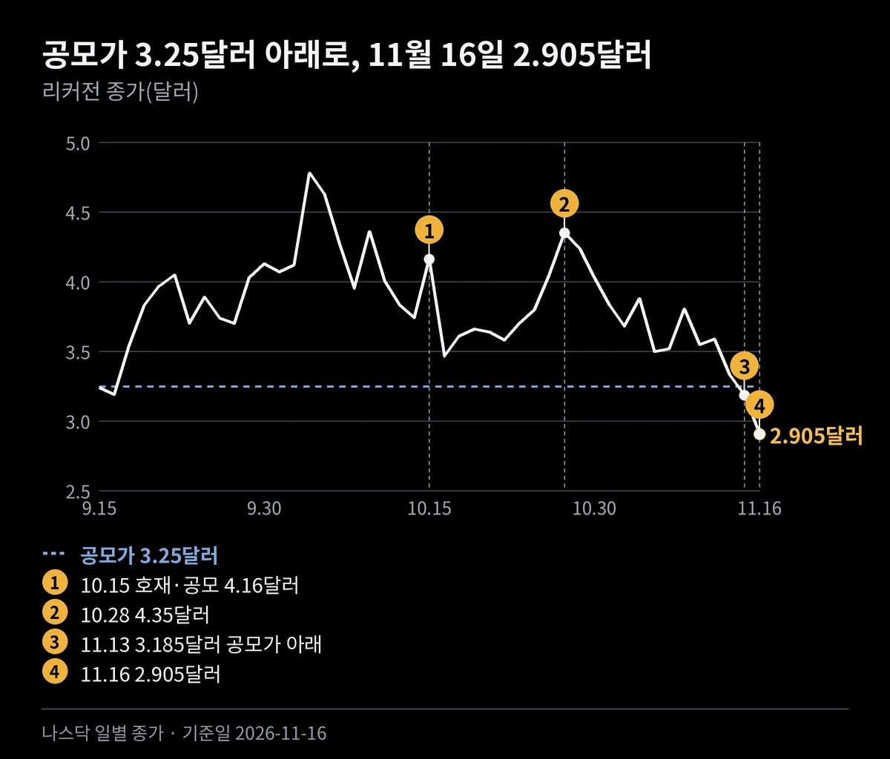
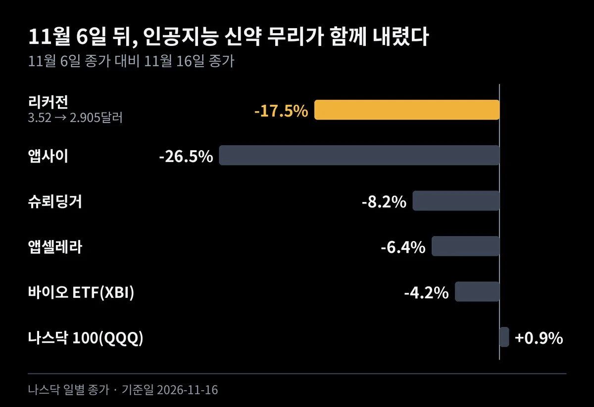
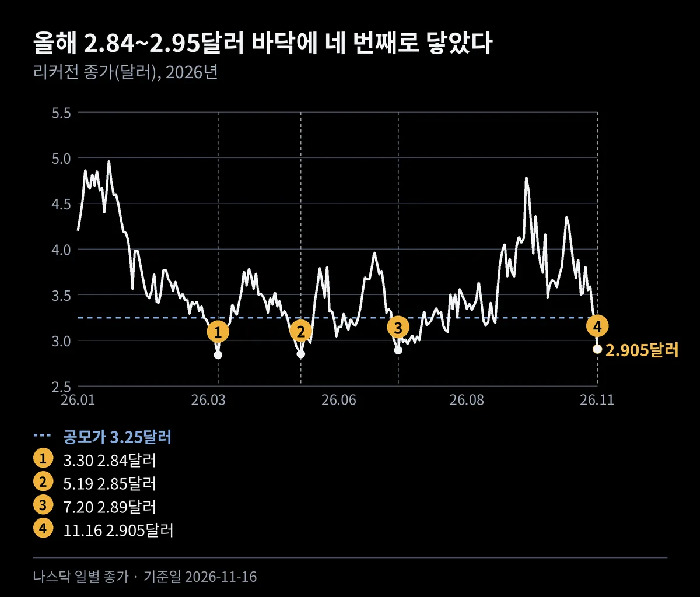
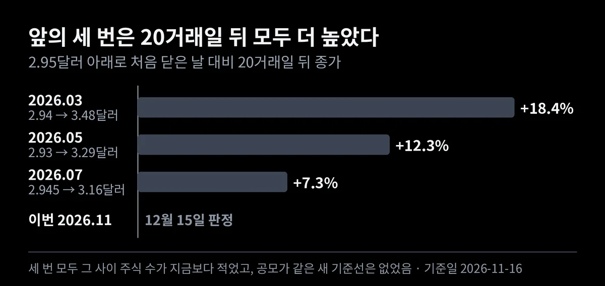
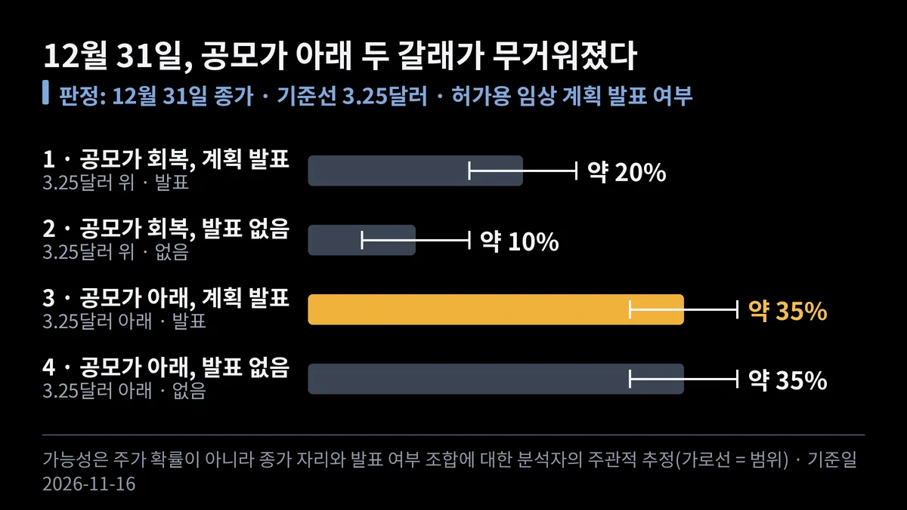

리커전은 한 달 전, 새 주식 6,154만 주를 한 주 3.25달러에 팔았습니다. 약 2억 달러짜리 공모였습니다. 그 가격은 그 뒤 주가의 기준선이 됐습니다. 그런데 11월 13일, 주가가 처음으로 그 선 아래인 3.185달러에서 마감했습니다. 다음 거래일인 16일에는 8.8% 더 내려 2.905달러가 됐습니다. 공모로 산 사람들은 이제 10.6% 손실입니다. 이상한 점은 그사이 회사에서 나온 나쁜 소식이 없었다는 것입니다. 무엇이 값을 눌렀을까요?

> **유의사항** 저자는 금융·투자 자문가가 아닙니다. 이 글은 공개 공시와 시세를 정리한 교육용 분석이며 특정 종목의 매수·매도를 권하지 않습니다. 과거 패턴은 미래 수익을 보장하지 않고, 리커전은 회사 소식 없이도 하루 10% 넘게 움직인 날이 많은 종목입니다. 실제 투자 전에는 최신 공시를 직접 확인하세요.

이 글은 [11월 6일 기준 리포트](/r/rxrx-2026-11/)의 후속편입니다. 그 리포트는 지금을 '공급과 반납' 단계로 진단했습니다. 좋은 소식에도 새 주식이 값을 누르는 단계라는 뜻입니다. 그리고 공모가 3.25달러가 공급이 소화되는지를 가늠하는 선이라고 적었습니다. 지난 예측 성적은 적중 둘, 빗나감 없음, 진행 중 셋입니다.

적중한 둘은 이렇습니다. 진단은 그대로 이어졌습니다. 11월 9일 8.1% 오른 날이 있었지만, 다음 날부터 그 상승을 다 돌려줬습니다. 11월 11일 종가 3.59달러는 급등 전날 종가 3.74달러보다 낮았습니다. 하루 10% 넘게 오른 뒤 20거래일째에는 대부분 낮았다는 과거 기록과 같은 방향입니다. 진행 중인 셋 가운데 연말 공모가 유지는 지금 불리합니다.

리커전은 아직 파는 약이 없는 신약 개발 회사입니다. 로봇 실험실에서 찍은 세포 사진과 인공지능 모델로 신약 후보를 찾습니다. 돈을 버는 방식은 두 갈래입니다. 사노피·로슈 같은 대형 제약사와 공동 연구를 하고 단계마다 받는 돈이 하나입니다. 다른 하나는 자체 약을 허가까지 키워 파는 것인데, 아직 허가받은 약은 없습니다. 3분기 매출은 1,860만 달러였고, 순손실은 1억 1,900만 달러였습니다.

그래서 연구비의 대부분은 주식 시장에서 옵니다. 10월 공모가 그랬고, 3분기에도 시장에서 주식을 조금씩 팔았습니다. 공모 대금을 더한 현금은 한 주에 약 1.20달러입니다. 지금 시가총액 약 18억 900만 달러에서 현금을 빼면 약 10억 6,000만 달러가 남습니다. 시장이 약 후보와 연구 방식에 매긴 값이 이만큼이라는 뜻입니다. 주식 수와 현금의 자세한 숫자는 끝의 '지금의 크기' 표에 있습니다.

11월 9일부터 하루씩 보면 모양이 분명합니다. 9일 8.1% 올라 3.805달러가 됐습니다. 10일 6.7% 내렸고, 11일 1.1% 올랐습니다. 12일 7.2%, 13일 4.4%가 빠지며 공모가 아래로 내려갔습니다. 16일에는 8.8%가 더 빠졌습니다. 9일 종가 대비 4거래일 동안 23.7%가 사라진 셈입니다.

이 사이 회사가 SEC에 낸 서류는 두 건이었습니다. 11월 10일 스테이트 스트리트가 9월 30일 기준 5.6%를 가졌다고 보고했습니다. 11월 13일에는 아크 인베스트먼트가 같은 날 기준 8.36%를 가졌다는 정정 보고를 냈습니다. 둘 다 석 달 전 지분을 정해진 때에 알리는 정기 보고입니다. 이번 하락을 설명하는 회사 소식은 찾지 못했습니다.

거래량도 눈에 띄게 늘지 않았습니다. 16일 거래량은 약 1,979만 주로, 직전 20거래일 평균 약 2,088만 주와 비슷했습니다. 누군가 한꺼번에 던진 날의 모양은 아닙니다. 사는 쪽이 조금씩 물러나며 값이 미끄러진 모양에 가깝습니다.

리커전 혼자 내린 것도 아닙니다. 같은 기간 인공지능으로 신약을 찾는 회사들이 함께 내렸습니다. 11월 6일 종가부터 16일까지 앱사이는 26.5% 내렸습니다. 리커전은 17.5%, 슈뢰딩거는 8.2%, 앱셀레라는 6.4% 내렸습니다. 바이오 회사를 묶어 거래하는 상장지수펀드(ETF)도 4.2% 내렸고, 나스닥 100은 0.9% 올랐습니다.

시장 전체가 무너진 기간은 아니었습니다. 바이오 업종이 조금 내리고, 그 안에서 인공지능 신약 무리가 더 크게 내렸습니다. 리커전은 그 무리 한가운데에 있었습니다. 이 무리는 대부분 아직 약을 팔지 않고, 연구비를 주식으로 채우는 회사들입니다. 같은 걱정이 한꺼번에 값에 들어간 것으로 볼 수 있습니다.

리커전에만 있는 짐도 하나 더 있습니다. 공모 뒤에도 시장에서 주식을 팔 수 있는 한도가 약 2억 1,330만 달러 남아 있습니다. 2.905달러로 다 팔면 약 7,340만 주이고, 지금 주식 수의 약 11.8%입니다. 평소 거래량으로는 3.5거래일치입니다. 쓸지는 회사가 정하지만, 값이 낮을수록 같은 돈에 더 많은 주식이 필요합니다. 11월 말에는 공모 때 임원과 이사가 약속한 45일 보호예수(정해진 기간 주식을 팔지 않기로 한 약속)도 끝납니다.

이 설명은 시세의 모양과 공시 목록에서 나온 해석입니다. 시장이 무엇을 걱정했는지 회사가 밝힌 적은 없습니다. 무리와 함께 내렸다고 이유까지 같다고 말할 수도 없습니다. 판정할 수 있는 것은 앞으로의 종가와 회사의 발표입니다.

그렇다면 이 가격대는 처음일까요? 2026년 시세를 다시 꺼내 보니 그렇지 않았습니다. 3월 30일 2.84달러가 올해 가장 낮은 종가였습니다. 5월 19일 2.85달러, 7월 20일 2.89달러도 거의 같은 자리였습니다. 11월 16일 2.905달러는 그 바닥에 네 번째로 닿은 날입니다.

앞의 세 번은 그 뒤가 비슷했습니다. 2.95달러 아래로 처음 닫은 날을 기준으로 20거래일 뒤 종가를 봤습니다. 3월은 18.4%, 5월은 12.3%, 7월은 7.3% 높았습니다. 3번 중 3번이 더 높았던 셈입니다. 세 번 모두 그 20거래일 안에 공모가와 같은 3.25달러 위에서 한 번 이상 마감하기도 했습니다. 바닥에 닿은 뒤 같은 자리에 오래 머문 적은 없었습니다.

다만 이번이 다른 점도 분명합니다. 세 번은 모두 주식 수가 지금보다 적을 때였습니다. 같은 2.9달러라도 지금 회사의 몸값은 그때보다 큽니다. 그리고 그때는 공모가처럼 '손해 본 사람이 많은 선'이 바로 위에 없었습니다. 이번에는 3.25달러 위로 올라가면, 공모로 산 사람이 본전에 팔 수 있는 자리가 됩니다. 세 번뿐인 작은 표본이라 방향을 말할 근거로는 약합니다.

지난 리포트의 '공급과 반납' 진단은 유지합니다. 공모가 아래로 내려간 것은 공급이 아직 소화되지 않았다는 가장 분명한 신호입니다. 단계가 바뀌었다고 볼 신호도 정해 두겠습니다. 시장 판매 없이 3.25달러 위를 되찾는 것, 또는 허가용 임상 계획이 구체적으로 나오는 것입니다. 둘 다 아직은 보이지 않습니다.

판정은 두 날짜에 합니다. 먼저 12월 15일입니다. 11월 16일 뒤 20번째 거래일로, 그날 종가가 2.905달러보다 높은지 봅니다. 앞의 세 번과 같은 길인지 확인하는 날입니다. 다음은 12월 31일입니다. 지난 리포트의 네 갈래를 그대로 쓰고 무게만 바꿨습니다. 공모가 위로 돌아오는 두 갈래를 합쳐 약 30%로 낮추고, 아래 두 갈래를 약 35%씩으로 올렸습니다.

공모가 아래를 무겁게 본 이유는 세 가지입니다. 지금 값이 3.25달러보다 10.6% 낮습니다. 함께 내린 인공지능 신약 무리가 아직 방향을 바꾸지 않았습니다. 남은 판매 한도와 보호예수 해제가 위쪽을 누를 수 있습니다. 위쪽을 약 30% 남긴 이유는 올해 세 번의 바닥 기록입니다. 이 숫자는 주가가 오를 확률이 아니라, 연말 종가 자리와 발표 여부 조합에 대한 분석자의 주관적 추정입니다.

이 판단이 틀릴 수 있는 곳도 있습니다. 첫째는 임상 일정입니다. 회사는 희귀 대장 용종 질환 약의 허가용 임상을 2027년 하반기에 시작하겠다며 미국 식품의약국(FDA)과 협의 중이라고 밝혔습니다. 그 설계가 좋게 나오면 무리 전체의 걱정과 따로 움직일 수 있습니다. 둘째는 공급입니다. 시장 판매가 다시 확인되면 위쪽 두 갈래는 더 가벼워집니다. 셋째는 무리입니다. 앱사이와 슈뢰딩거가 반등하면 리커전도 따라 바뀔 가능성이 큽니다.

한 달 전의 공모가는 이제 리커전 위에 놓인 천장이 됐습니다. 회사 소식이 없는 하락이었기에, 다시 올라갈 열쇠도 회사의 다음 발표와 무리의 방향에 있습니다. 12월 15일 종가가 2.905달러보다 높은지, 12월 31일 종가가 3.25달러 위인지를 차례로 확인합니다. 다음 갱신은 11월 말 보호예수가 끝난 뒤의 공시를 보고 합니다.

## 숫자로 다시 보기

### 지난 리포트 뒤 하루씩

| 날짜 · 종가 | 하루 변화 | 공모가 대비 |
| --- | --- | --- |
| **11월 6일** 3.52달러 | +0.6% | +8.3% |
| **11월 9일** 3.805달러 | +8.1% | +17.1% |
| **11월 10일** 3.55달러 | -6.7% | +9.2% |
| **11월 11일** 3.59달러 | +1.1% | +10.5% |
| **11월 12일** 3.33달러 | -7.2% | +2.5% |
| **11월 13일** 3.185달러 | -4.4% | -2.0% |
| **11월 16일** 2.905달러 | -8.8% | -10.6% |

### 같은 무리와 비교

| 종목 | 11월 6일 → 16일 | 11월 10일 → 16일 |
| --- | --- | --- |
| **리커전** | **-17.5%** | **-18.2%** |
| 앱사이(ABSI) | -26.5% | -25.0% |
| 슈뢰딩거(SDGR) | -8.2% | -15.6% |
| 앱셀레라(ABCL) | -6.4% | -10.8% |
| XBI 바이오 묶음 펀드 | -4.2% | -5.9% |
| 나스닥 100(QQQ) | +0.9% | -1.9% |

### 2.95달러 아래로 처음 닫은 날, 20거래일 뒤

**한눈에:** 2026년 **3번**(이번 제외) · 20거래일 뒤 더 높았던 것 **3번** · 그 안에 3.25달러 위 마감 **3번**

| 처음 닫은 날 · 종가 | 그 구간 바닥 | 20거래일 뒤 |
| --- | --- | --- |
| **2026.03.27** 2.94달러 | 3월 30일 2.84달러 | +18.4% 3.48달러 |
| **2026.05.15** 2.93달러 | 5월 19일 2.85달러 | +12.3% 3.29달러 |
| **2026.07.17** 2.945달러 | 7월 20일 2.89달러 | +7.3% 3.16달러 |
| **이번 2026.11.16** 2.905달러 | - | 12월 15일 판정 |

20거래일 안 가장 높은 종가는 3월 3.78달러, 5월 3.80달러, 7월 3.35달러였습니다. 세 번 모두 주식 수가 지금보다 적을 때입니다.

### 공모가 3.25달러와 견준 주요 종가

| 날짜 · 종가 | 공모가 대비 | 무슨 날 |
| --- | --- | --- |
| **2026.03.30** 2.84달러 | -12.6% | 올해 가장 낮은 종가 |
| **2026.05.19** 2.85달러 | -12.3% | 5월 바닥 |
| **2026.07.20** 2.89달러 | -11.1% | 7월 바닥 |
| **2026.10.15** 4.16달러 | +28.0% | 호재·공모 발표 |
| **2026.10.16** 3.465달러 | +6.6% | 공모 마감 |
| **2026.10.28** 4.35달러 | +33.8% | 공모 뒤 가장 높은 종가 |
| **2026.11.16** 2.905달러 | -10.6% | 바닥에 네 번째 |

### 지금의 크기(11월 16일 기준)

| 항목 | 값 · 근거 |
| --- | --- |
| 종가 | **2.905달러** 공모가 3.25달러보다 10.6% 낮음 |
| 시가총액 | **약 18억 900만 달러** 2.905달러 × 6억 2,276만 주(10월 26일) |
| 현금(잠정) | **약 7억 4,870만 달러** 9월 말 현금 + 공모 순 대금, 한 주 약 1.20달러 |
| 시가총액 − 현금 | **약 10억 6,000만 달러** 차입을 넣지 않은 단순 차감값 |
| 남은 시장 판매 한도 | **약 2억 1,330만 달러** 2.905달러면 약 7,340만 주, 11.8% |
| 평균 거래량 | **약 2,088만 주** 11월 13일까지 20거래일, 한도는 3.5거래일치 |
| 큰 주주 보고 | **아크 8.36% · 스테이트 스트리트 5.6%** 둘 다 9월 30일 기준 |

### 지난 예측 채점표

| 지난 점검 항목 · 당시 기준(11월 6일) | 판정과 실제 결과(11월 16일) |
| --- | --- |
| **진단: 공급과 반납 단계 진행** 국면 B | **[적중]** 11월 9일 +8.1%를 다음 4거래일에 다 반납 |
| **11월 11일 종가 3.74달러 위인가** 과거 기록은 대부분 아래 | **[적중]** 3.59달러, 기록과 같은 방향 |
| **12월 31일 종가 3.25달러 위** 1순위 확인 | **[진행 중]** 지금 2.905달러, 10.6% 아래 |
| **연말까지 허가용 임상 계획 발표** 2순위 확인 | **[진행 중]** 11월 16일까지 발표 없음 |
| **보호예수 끝난 뒤 임원 매도 공시** 보조 확인 | **[진행 중]** 11월 말 해제 |

### 앞으로 일어날 수 있는 일

과거 기록: 올해 2.95달러 아래로 처음 닫은 3번 중 3번이 20거래일 뒤 더 높았고, 그 안에 3.25달러 위에서 한 번 이상 마감했습니다.

3번 중 3번이 반등했다는 기록은 위쪽 갈래의 근거이고, 지금 값이 공모가 아래라는 사실은 아래쪽 갈래의 근거입니다. 아래 가능성은 주가 상승·하락 확률이 아니라, 12월 31일 종가의 자리와 허가 계획 발표 여부 조합에 대한 분석자의 주관적 추정입니다. 네 갈래는 겹치지 않아 더하면 100%이고, 괄호 안 범위는 더하지 않습니다.

| 시나리오(판정 12월 31일) | 종가 · 발표 | 가능성(추정) |
| --- | --- | --- |
| 1 · 공모가 회복, 계획 발표 | 3.25달러 위 · 발표 | 낮음 약 20% (15~25%) |
| 2 · 공모가 회복, 발표 없음 | 3.25달러 위 · 없음 | 낮음 약 10% (5~15%) |
| **3 · 공모가 아래, 계획 발표** | 3.25달러 아래 · 발표 | 높음 약 35% (30~40%) |
| 4 · 공모가 아래, 발표 없음 | 3.25달러 아래 · 없음 | 높음 약 35% (30~40%) |

지난 리포트(11월 6일 기준)는 1번 약 35%, 2번 약 15%, 3번 약 30%, 4번 약 20%였습니다.

### 핵심 확인 세 가지

| 순위 · 확인할 것 | 판정 날짜 |
| --- | --- |
| **1순위** 12월 15일 종가가 2.905달러보다 높은가 | 12월 15일 |
| **2순위** 12월 31일 종가가 3.25달러 위인가 | 12월 31일 |
| **3순위** 보호예수 해제 뒤 임원·이사 매도 공시가 있는가 | 11월 말 이후 |
