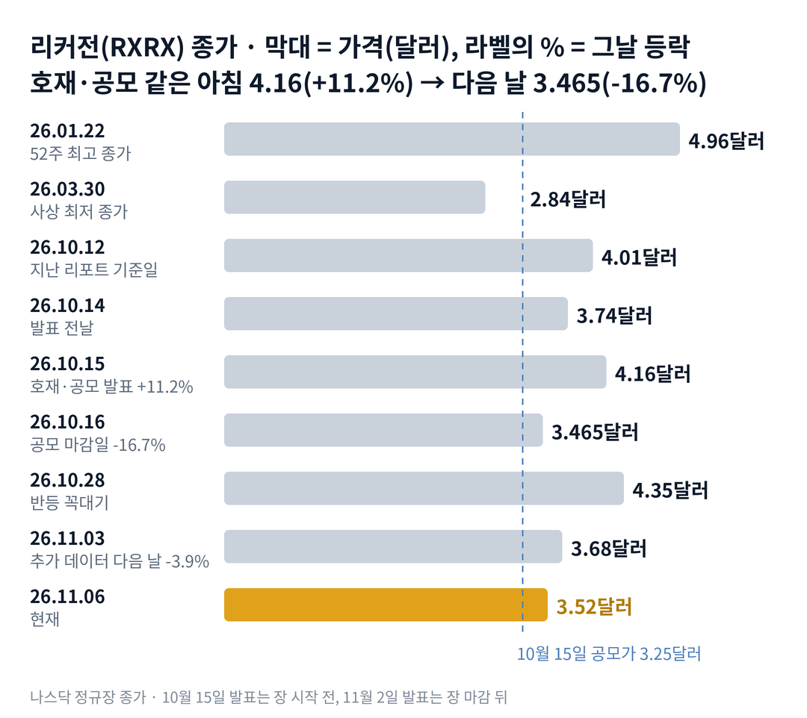

## 짧은 답

> **핵심:** 같은 아침에 좋은 소식과 새 주식이 함께 나왔고, 첫날은 소식이, 다음 날은 공급이 값을 정했습니다.

임상 데이터는 좋았고, 대형 제약사도 후보 약을 골랐습니다. 그런데 리커전 주가는 왜 다음 날 더 크게 빠졌을까요?

결론부터 말하면, 호재와 함께 2억 달러어치 새 주식이 전날보다 싼 가격에 풀렸기 때문입니다. 이 주식은 원래 급등한 다음 날 자주 내렸지만, 이번에는 회사가 그 급등 가격 아래에서 새 주식을 판 날이었습니다. 지난 리포트와 달라진 점은 '공급이 올까'라는 질문이 '공급이 소화될까'로 바뀌었다는 것입니다. **2026.11.06 진단: 국면 B(공급과 반납) 진행 — 근거는 5부.**

그렇다고 넉넉해진 현금이 주가의 바닥을 보장하지는 않습니다. 현금은 분기마다 줄고, 시장은 앞으로의 손실과 추가 판매 가능성까지 값에 넣기 때문입니다. 그렇다면 과거에 이렇게 급등했을 때, 그 상승은 한 달 뒤에도 남았을까요? 답은 3부 '하루 10% 넘게 오른 날, 20거래일 뒤는?' 표에 있습니다.

> **유의사항** 저자는 금융·투자 자문가가 아닙니다. 이 글은 공개 공시와 시세를 정리한 교육용 분석이며 특정 종목의 매수·매도를 권하지 않습니다. 과거의 주가 반응이 미래에 반복된다는 보장은 없고, 리커전 파마슈티컬스는 회사 소식 없이도 하루 10% 넘게 움직인 날이 많은 변동성이 큰 종목입니다. 실제 투자 전에는 최신 가격과 공시를 직접 확인하세요.

## 지난 리포트 이후

[10월 12일 기준 리포트](/r/rxrx-2026-10/)는 리커전이 '이야기로 오르던 단계'에서 '새 주식 공급이 누르는 단계'로 넘어가는 자리라고 봤고, 그 답은 3분기 보고서의 주식 수가 줄 것이라고 적었습니다. 그 뒤 주가는 12.2% 내렸고, 주식 수는 석 달 만에 16.3% 늘었습니다. 지난 예측 성적은 다섯 항목 가운데 적중 1 · 부분 적중 1 · 빗나감 2 · 진행 중 1입니다. 진단은 맞았지만, 공급은 예상한 시장 판매보다 한 번의 큰 공모로 왔습니다. 항목별 채점표는 6부 끝에 있습니다. 이번 리포트가 새로 답할 질문은 '호재와 공모가 겹친 날의 상승은 얼마나 남는가'입니다.

## 1부. 리커전은 어떤 회사이고, 무엇으로 돈을 버는가

> **핵심:** 리커전은 아직 파는 약이 없는 신약 개발 회사이고, 그동안의 연구비는 주로 새 주식을 팔아 마련했습니다.

리커전은 로봇 실험실에서 만든 세포 사진과 인공지능 모델로 신약 후보를 찾는 미국 바이오 회사입니다. 본사는 유타주 솔트레이크시티에 있고, 나스닥에 상장돼 있습니다. 2024년 영국 엑스사이언티아와 합쳤고, 2026년부터는 나자트 칸 대표가 회사를 이끌고 있습니다.

돈을 버는 방식은 두 갈래입니다. 하나는 사노피·로슈 같은 대형 제약사와 공동 연구를 하고 선급금과 마일스톤(연구가 정해진 단계를 넘을 때 받는 돈)을 받는 것입니다. 다른 하나는 자체 약을 허가까지 키워 파는 것인데, 아직 허가받은 약은 없습니다. 그래서 매출은 분기마다 크게 흔들리고, 손실을 메우는 돈은 대부분 주식 시장에서 왔습니다.

이 구조가 중요한 이유는 좋은 소식이 곧바로 매출이 되지 않기 때문입니다. 임상 데이터가 좋으면 → 미국 식품의약국(FDA)과 허가용 임상을 설계하고 → 몇 년 뒤 허가를 받아야 → 약값이 들어옵니다. 그 사이의 연구비는 새 주식으로 채워야 하니, 좋은 소식이 나온 날은 회사가 주식을 팔기 좋은 날이기도 합니다. 10월 15일이 바로 그날이었습니다.

지금 몸값은 시가총액으로 약 21억 9,200만 달러입니다. 공모 대금을 더한 현금은 약 7억 4,870만 달러로, 한 주에 약 1.20달러입니다. 시가총액에서 현금을 빼면 약 14억 4,300만 달러가 남는데, 이 값은 차입을 넣지 않은 단순 차감값입니다. 이 비교가 주가의 하한선은 아닙니다.

### 숫자로 본 지금의 크기(11월 6일 기준)

| 항목 | 값 · 계산 근거 |
| --- | --- |
| 종가 | **3.52달러** 지난 리포트 4.01달러보다 12.2% 낮음 |
| 시가총액 | **약 21억 9,200만 달러** 3.52달러 × 6억 2,276만 주(10월 26일) |
| 공모 | **6,154만 주 · 3.25달러** 총 약 2억 달러, 10월 16일 마감 |
| 3분기 시장 판매 | **2,370만 주** 순 8,550만 달러, 평균 약 3.61달러 |
| 주식 수(병합 없음) | **5년 새 약 3.7배** 상장 때 약 1억 6,830만 → 6억 2,276만 주 |
| 한 주당 현금 | **약 1.20달러** 잠정 계산: 9월 말 현금 + 공모 순 대금 ÷ 10월 26일 주식 수 |
| 단순 차감값 | **약 14억 4,300만 달러** 시가총액 − 현금 약 7억 4,870만, 차입 미포함 |
| 남은 시장 판매 한도(추정) | **2억 1,330만 달러** 3.52달러면 약 6,060만 주, 주식 수의 9.7% |
| 3분기 매출 · 순손실 | **1,860만 · 1억 1,900만 달러** 매출은 1년 전 520만 달러의 3배 넘음 |
| 현금 시간표 | **2029년 안까지** 2027년 현금 영업비용 3억 6,000만 달러 미만 전망 |

남은 한도까지 다 쓰면 주식은 지금보다 약 10% 더 늘 수 있습니다. 현금 시간표가 길어진 것은 주식 수가 늘어난 대가였습니다. 그렇다면 같은 아침에 나온 호재와 공모 가운데, 시장은 무엇을 먼저 봤을까요?

## 2부. 같은 아침에 나온 네 가지와 그 뒤의 3주

> **핵심:** 10월 15일의 상승은 회사 소식이 만들었지만, 그 뒤의 하락은 공급과 시장이 함께 만들었습니다.

첫 번째는 임상 데이터라는 사업 사건입니다. 회사는 10월 15일 장 시작 전, 유전성 대장 용종 질환인 FAP(가족성 선종성 용종증) 약의 임상 2단계 데이터를 냈습니다. 이 약은 회사가 붙인 후보 번호(REC)로 REC-4881이라고 부릅니다. 12주 투여 뒤 용종 부담이 가운데 값(중앙값)으로 47% 줄었고, 투약을 멈춘 뒤에도 대부분 처음보다 낮았습니다. 암 약 REC-1245에서는 종양이 줄어든 부분 반응이 3명 나왔습니다. 데이터가 좋으면 → 허가 가능성이 커지고 → 회사의 약값에 대한 기대가 오릅니다.

두 번째는 파트너의 선택입니다. 사노피가 공동 연구에서 첫 개발 후보를 골라 마일스톤 1,000만 달러가 생겼습니다. 사노피가 이 후보로 받은 돈은 누적 1억 4,400만 달러가 됐습니다. 대형 제약사가 고르면 → 인공지능으로 찾은 후보가 실제 약 개발로 넘어간다는 근거가 생기고 → 플랫폼의 값이 오릅니다.

세 번째는 같은 공시 안의 공급입니다. 회사는 6,154만 주를 3.25달러에 파는 인수 공모(증권사가 한꺼번에 사서 투자자에게 넘기는 공모)를 같은 아침에 발표했습니다. 공모가는 전날 종가보다 13.1% 낮았습니다. 이 물량은 9월 말 공모 전 발행주식의 11.0%입니다. 유통주식(거래되는 주식)은 회사가 따로 밝히지 않아 같은 값을 썼으므로 실제 유통주식 대비 비율은 이보다 큽니다. 직전 5거래일 평균 거래량으로 나누면 약 2.4거래일치입니다.

네 번째는 시장입니다. 첫날 주가는 장중 4.41달러까지 올라 4.16달러(+11.2%)로 마쳤고, 거래량은 직전 5거래일 평균의 약 2.4배였습니다. 공모가 마감된 10월 16일에는 3.465달러(-16.7%)로 내려왔습니다. 그날은 바이오 상장지수펀드(ETF)를 비롯해 업종도 함께 약했습니다.

### 10월 16일과 지난 리포트 뒤, 바이오·기술주 성적

| 종목 · 성격 | 10.16 하루 | 10.12 → 11.06 |
| --- | --- | --- |
| **리커전(RXRX)** 인공지능 신약 | **-16.7%** | **-12.2%** |
| 바이오 ETF(XBI) | -3.6% | +0.5% |
| 나스닥 100 ETF(QQQ) | -2.5% | -12.1% |
| 슈뢰딩거(SDGR) 계산 신약 설계 | -11.3% | +15.1% |
| 앱시(ABSI) 인공지능 항체 | -7.1% | +5.2% |
| 앱셀레라(ABCL) 항체 발굴 | -6.9% | -6.0% |

10월 16일은 비슷한 회사들도 함께 빠진 날이었지만, 리커전은 바이오 ETF보다 13.1%포인트 더 빠졌습니다. 지난 리포트 이후 전체로 보면 리커전은 바이오 업종이 아니라 나스닥 100과 거의 같은 폭으로 내렸습니다. 11월 5일에는 나스닥 100 ETF가 6.5%, 바이오 ETF가 6.7% 빠진 날 리커전도 9.8% 내렸습니다.

11월 2일 장 마감 뒤에는 같은 약의 추가 데이터와 3분기 실적이 나왔습니다. 큰 용종(5mm 넘는 것)이 있던 8명 가운데 6명에게서 그 수가 줄었습니다. 그런데 다음 날 주가는 3.9% 내렸고, 같은 날 바이오 ETF는 1.9% 올랐습니다. 처음 나온 데이터에는 올랐지만, 이미 알려진 데이터를 더 자세히 보여 준 날에는 값이 더 붙지 않았습니다.

세 사건을 나란히 놓으면 공통점이 하나 보입니다. 데이터나 파트너 관계가 나빠졌다는 소식은 하나도 없었다는 점입니다. 결국 이번 하락은 호재 위에 할인된 새 주식이 얹히고, 그 뒤 기술주 매도가 겹친 결과였습니다. 그렇다면 과거에 이렇게 하루 크게 올랐을 때, 그 상승은 얼마나 오래 남았을까요?

## 3부. 하루 10% 넘게 오른 14번

> **핵심:** 2025년 이후 하루 10% 넘게 오른 14번 가운데 11번은 다음 날 내렸고, 회사 발표가 있던 급등은 이번이 처음이었습니다.

이 기록을 보는 이유는 이번이 '하루 두 자릿수 급등 뒤의 급락'이기 때문입니다. 2025년 1월부터 11월 6일까지 리커전 종가가 하루 10% 넘게 오른 날은 이번까지 15번입니다. 회사 제출 목록과 대조해 보니, 이번을 뺀 14번은 그날과 전날 모두 회사의 8-K(주요 사항 공시)가 없었습니다.

표의 세 칸은 세 질문에 답합니다. 첫 칸은 그날 무엇이 있었나, 둘째 칸은 다음 날 어떻게 반응했나, 셋째 칸은 한 달 동안 상승이 남았나입니다. 다음 날은 급등일 종가 대비, 20거래일 뒤는 급등일을 1로 센 20번째 거래일 종가를 급등 전날 종가와 비교했습니다. 예를 들어 이번에는 급등 전날 종가 3.74달러가 기준이고, 20번째 거래일은 11월 11일입니다.

**한눈에:** 다음 날 하락 11번 · 20번째 거래일에 급등일 종가보다 낮음 12번 · 다음 날 가운데 값(중앙값) -3.7%. 하루 급등의 대부분은 한 달 안에 줄어들었다는 뜻입니다.

### 하루 10% 넘게 오른 날, 20거래일 뒤는?

| 급등일 · 그날 있던 일 | 다음 날 | 20거래일 뒤 |
| --- | --- | --- |
| **2025.02.14** 엔비디아 지분 공시 *(그날 +23.9%)* | +1.0% | -25.3% |
| **2025.04.09** 나스닥 100 +12.0% *(그날 +17.1%)* | -3.0% | +5.5% |
| **2025.04.11** FDA 인공지능 계획 *(그날 +27.7%)* | -4.3% | -4.0% |
| **2025.06.04** 회사 8-K 없음 *(그날 +11.8%)* | -6.9% | +18.7% |
| **2025.06.06** 회사 8-K 없음 *(그날 +20.1%)* | -2.2% | +7.9% |
| **2025.10.08** 회사 8-K 없음 *(그날 +16.4%)* | -3.0% | -4.4% |
| **2025.10.15** 회사 8-K 없음 *(그날 +15.3%)* | -6.3% | -20.0% |
| **2025.10.20** 회사 8-K 없음 *(그날 +14.0%)* | -8.5% | -29.4% |
| **2025.12.17** 회사 8-K 없음 *(그날 +11.4%)* | -5.1% | +10.5% |
| **2026.02.06** 바이오 ETF +4.0% *(그날 +11.8%)* | 0.0% | -2.8% |
| **2026.08.19** 바이오 ETF +5.9% *(그날 +13.3%)* | -4.6% | +3.2% |
| **2026.09.17** 회사 8-K 없음 *(그날 +11.0%)* | +8.2% | +17.2% |
| **2026.10.05** 회사 8-K 없음 *(그날 +16.0%)* | -3.1% | -2.2% |
| **2026.10.09** 회사 8-K 없음 *(그날 +10.4%)* | -8.0% | -11.4% |

셋째 칸은 급등 전날 종가 대비입니다. 14번 가운데 10번은 다른 급등과 20거래일 안에 붙어 있어 측정 기간이 서로 겹치므로, 독립된 14번이 아닙니다. 그때와 지금은 주가 수준과 주식 수, 회사 구성도 다르니 이 표는 확률이 아니라 과거 움직임의 참고 자료로 봐야 합니다.

> **이번(미확정):** 2026.10.15 · 임상 데이터·사노피 마일스톤·2억 달러 공모 같은 아침 · 그날 +11.2%(바이오 ETF +2.1%) · 다음 날 -16.7% · 20번째 거래일 11월 11일 판정

여기서 기억할 사실은 하나입니다. 이번 다음 날 -16.7%는 15번 가운데 가장 큰 다음 날 하락으로, 이전 최대였던 2025년 10월 21일의 -8.5%보다 두 배 가까이 컸습니다. 그렇다고 이 표가 11월 11일의 결과를 정하지는 않습니다. 그렇다면 회사 소식이 있던 이번 급등은 회사 소식이 없던 과거와 무엇이 달랐을까요?

## 4부. 소식 없는 급등과 공모가 붙은 급등의 차이

> **핵심:** 과거 급등은 이야기가 식으며 천천히 꺼졌고, 이번 급등은 같은 아침의 공모가가 다음 날 바로 기준선을 그었습니다.

두 시점은 묻는 질문이 다릅니다. 다음 날의 질문은 '첫날 산 사람보다 싸게 산 사람이 있나'였고, 한 달 뒤의 질문은 '데이터가 허가 계획으로 이어지나'입니다. 과거 급등은 대부분 회사 밖의 이야기에서 왔기에, 다음 날은 이야기가 식는 속도만큼 천천히 내렸습니다.

이번에는 세 가지가 다릅니다. 첫째, 상승의 출처가 회사 자신의 데이터와 파트너 선택이었습니다. 둘째, 같은 아침에 전날보다 13.1% 낮은 공모가가 정해져, 첫날 4달러 위에서 산 투자자보다 싸게 받은 투자자가 6,154만 주만큼 생겼습니다. 셋째, 3분기에 이미 시장 판매로 2,370만 주가 풀려 있었습니다. 공모 직후 다음 날 시장에 나올 수 있는 물량이 평소 거래량보다 훨씬 컸다는 흔적입니다.

같은 점도 있습니다. 이번에도 오른 다음 날 내렸고, 한 달 안 반등의 꼭대기(10월 28일 4.35달러)는 첫날 장중 고가 4.41달러에 닿지 못했습니다. 그 뒤 11월 5일 시장 급락까지 겹치며 주가는 다시 공모가 근처로 내려왔습니다.

과거 기록이 알려 주는 것은 하루 급등이 한 달 뒤까지 남는 경우가 드물었다는 점입니다. 결국 앞으로 확인할 것은 두 가지입니다. 하나는 주가가 공모가 3.25달러 위에서 공급을 소화하는가입니다. 다른 하나는 회사가 연말까지 허가용 임상 계획을 구체적으로 밝히는가입니다. 이 두 가지로 연말까지를 나누면 어떤 갈림길이 나올까요?

## 5부. 공모가 유지와 허가 계획, 네 가지 시나리오

> **핵심:** 지금은 지난 리포트가 예고한 국면 B(공급과 반납)가 진행 중이고, 4부에서 본 두 가지가 시나리오를 가르는 축입니다.

> **국면 정의(리커전 시리즈 공통):** 국면 A 이야기 랠리 — 회사 소식 없이 하루 15% 넘게 오르고 거래량이 평소의 세 배 넘게 늘 때. 국면 B 공급과 반납 — 새 주식 판매가 늘고, 좋은 소식에도 며칠 안에 상승분을 반납할 때. 국면 C 숫자로 버티기 — 새 주식을 팔지 않고 지출 전망을 지키며, 최저가 근처에서 더 내려가지 않을 때.

**2026년 11월 6일 진단: 국면 B(공급과 반납) 진행, 지난 리포트 진단 적중.** 주식 수는 석 달 만에 16.3% 늘었고, 좋은 소식이 나온 다음 날 상승분보다 큰 하락이 나왔습니다. 국면 C의 신호 가운데 '지출 전망 유지'는 켜졌지만, '새 주식을 팔지 않음'은 꺼져 있습니다. 남은 시장 판매 한도 2억 1,330만 달러를 3.52달러에 모두 쓰면 약 6,060만 주입니다.

이 물량을 세 분모로 보면 다음과 같습니다. 10월 26일 전체 발행주식 6억 2,276만 주의 약 9.7%입니다. 유통주식은 회사가 밝히지 않아 같은 수를 썼으므로 실제 유통주식 대비 비율은 이보다 클 수 있습니다. 직전 5거래일 평균 거래량(약 2,099만 주)으로는 약 2.9거래일치입니다.

**판정 기준 두 가지:** 첫째, 공모가 유지입니다. 12월 31일 종가가 3.25달러 위면 '유지'로 봅니다. 둘째, 허가 계획입니다. 회사가 12월 31일까지 REC-4881 허가용 임상의 설계나 FDA 협의 결과를 공시나 보도자료로 밝히면 '발표'로 봅니다.

### 앞으로 일어날 수 있는 일

3부 기록에서 하루 10% 넘게 오른 14번 중 12번은 20번째 거래일에 급등일 종가보다 낮았습니다. 반대로 회사가 '올해 안에 더 설명하겠다'고 밝힌 허가 계획은 아직 판정 전이라, 과거 기록만으로 연말을 읽기는 어렵습니다.

**확인된 사실:** 공모는 3.25달러에 마감됐고, 회사는 허가용 임상을 2027년 하반기에 시작하겠다며 FDA와 협의 중이라고 밝혔습니다. **과거 기록:** 하루 급등은 한 달 안에 대부분 줄었습니다(3부). **추정:** 아래 가능성은 분석자의 주관적 추정이며, 주가가 오를 확률이 아니라 두 조건 조합의 가능성입니다. 네 경우는 겹치지 않아 '약 N%'를 더하면 100%이고, 괄호 안 구간은 흔들림의 폭이라 서로 더하지 않습니다.

| 시나리오(판정 12월 31일) | 공모가 · 계획 | 가능성(추정) |
| --- | --- | --- |
| **1 · 공모가 위, 허가 계획 발표** | 유지 · 발표 | 높음 약 35% (30~40%) |
| 2 · 공모가 위, 발표 없음 | 유지 · 없음 | 낮음 약 15% (10~20%) |
| 3 · 공모가 아래, 허가 계획 발표 | 이탈 · 발표 | 중간 약 30% (25~35%) |
| 4 · 공모가 아래, 발표 없음 | 이탈 · 없음 | 중간 약 20% (15~25%) |

**한눈에:** 연말 공모가 위 약 50%(1+2) · 허가 계획 발표 약 65%(1+3). 분석자의 주관적 추정을 더한 값이며, 실제 확률이나 통계 예측값은 아닙니다. 계획이 발표돼도 주가 방향은 따로 읽어야 합니다.

시나리오 1을 가장 높게 본 이유는 회사가 허가 계획을 '올해 안에' 더 설명하겠다고 이미 밝혔고, 지금 주가가 공모가보다 8.3% 위에 있기 때문입니다. 하지만 같은 무게로 반대쪽 요인도 있습니다. 남은 판매 한도 약 6,060만 주가 열려 있고, 11월 말에는 임원과 이사의 45일 보호예수(정해진 기간 동안 주식을 팔지 않기로 한 약속)가 끝납니다.

시나리오 3과 4를 합쳐 절반으로 본 이유는 이 주식의 하루 움직임이 크기 때문입니다. 지난 3주 동안에도 주가는 4.35달러에서 3.50달러까지 움직였습니다. 그렇다면 이 진단을 가장 빨리 뒤집을 수 있는 위험은 무엇일까요?

## 6부. 세 갈래 위험과 체크리스트

> **핵심:** 위험은 사업 실행, 자금 조달, 외부 환경 세 갈래입니다. 가장 빨리 판을 바꿀 수 있는 것은 허가용 임상 계획의 내용입니다.

먼저 이 분석의 한계입니다. 3부 표는 측정 기간이 겹치는 작은 표본이고, 급등일의 원인은 회사 공시가 없다는 사실만 확인했을 뿐 실제 이유는 대부분 밝혀지지 않았습니다. 10월 16일 하락 가운데 공모 영향과 업종 영향을 정확히 나누는 방법은 없습니다. 임상 결과는 26명 안팎의 초기 시험이라 허가 시험에서 달라질 수 있습니다.

첫째 갈래는 사업 실행, 그중에서도 임상입니다. FDA 협의에서 허가용 임상의 규모가 커지거나 시작이 늦어지면, 약값이 들어오는 날도 함께 밀립니다. 희귀 질환 약은 환자 수가 적어 시험 설계 하나가 일정 전체를 바꿀 수 있습니다.

둘째 갈래는 자금 조달입니다. 3분기 영업 현금 유출은 7,741만 달러였고, 2027년 현금 영업비용 전망은 3억 6,000만 달러 미만입니다. 현금 시간표가 2029년까지라도 남은 판매 한도를 다시 쓰면 주식 수가 늘어 기존 주주 한 주의 비중이 작아지는 희석이 생깁니다.

셋째 갈래는 외부 환경입니다. 지난 리포트 이후 리커전은 바이오 업종보다 나스닥 100에 더 가깝게 움직였습니다. 11월 5일처럼 기술주 전체가 팔리는 날에는 회사 소식과 상관없이 크게 내렸습니다.

**핵심 확인 세 가지:**

- ☐ 11월 11일 종가가 급등 전날 종가 3.74달러보다 높은가(3부 20번째 거래일)
- ☐ 12월 31일 종가가 공모가 3.25달러 위인가
- ☐ 12월 31일까지 REC-4881 허가용 임상 계획이 1건 이상 발표됐나

**보조 확인:**

- ☐ 11월 말 보호예수 45일이 끝난 뒤 임원·이사 매도 공시가 몇 건인가
- ☐ 2027년 2~3월 연간 보고서에서 4분기 시장 판매 주식이 0주인가

**지난 리포트 점검(따로 판정):**

- ☐ 12월 31일까지 대형 기술 기업이나 규제 당국의 인공지능 신약 소식으로 하루 15% 넘게 오른 날이 있나(지난 리포트 시나리오 4)

**기억할 판단 기준 세 가지:** 첫째, 이번 하락은 데이터가 나빠서가 아니라 같은 아침의 할인된 공급 때문이었습니다. 둘째, 과거 급등은 대부분 회사 밖의 이야기였고, 회사가 직접 만든 급등은 이번이 처음이었습니다. 셋째, 공모가 3.25달러는 이제 공급이 소화되는지를 가늠하는 기준선입니다.

다음 갱신은 11월 11일 20번째 거래일 반응과 연말 허가 계획 발표를 본 뒤에 합니다. 공시는 [리커전 SEC 공시 목록](https://www.sec.gov/cgi-bin/browse-edgar?action=getcompany&CIK=0001601830&type=&dateb=&owner=include&count=40)과 [리커전 투자자 정보](https://ir.recursion.com/)에서 확인할 수 있습니다.

### 지난 예측 채점표

10월 13일 리포트(10월 12일 기준)의 진단과 시나리오를 11월 6일 기준으로 채점한 결과입니다. 지난 리포트에는 시나리오별 가능성 숫자가 없었습니다.

| 지난 점검 항목 · 당시 기준 | 판정 및 실제 결과(11월 6일) |
| --- | --- |
| **진단: 국면 A에서 B로 넘어가는 자리** 3분기 보고서의 주식 수가 가림 | **[적중]** 3분기 판매 2,370만 주 + 공모 6,154만 주, 주식 +16.3% |
| **시나리오 1: 약이 값을 받는다** 데이터 뒤 5거래일 상승 유지 | **[빗나감]** 10월 21일 종가가 발표 전보다 -2.7% |
| **시나리오 2: 다시 공급이 누른다** 10월 급등 때 주식 판매 | **[부분 적중]** 공급은 시장 판매가 아닌 2억 달러 공모로 |
| **시나리오 3: 협력 매출 감소** 분기 매출 감소·선택권 지연 | **[빗나감]** 3분기 매출 1,860만 달러, 사노피 후보 선택 |
| **시나리오 4: 새 이야기 랠리** 회사 밖 인공지능 소식에 하루 15%↑ | **[진행 중]** 판정일 없던 시나리오, 12월 31일 점검 |
