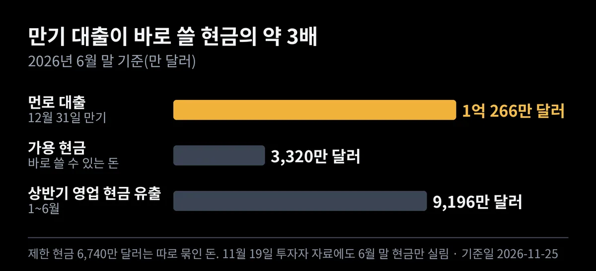
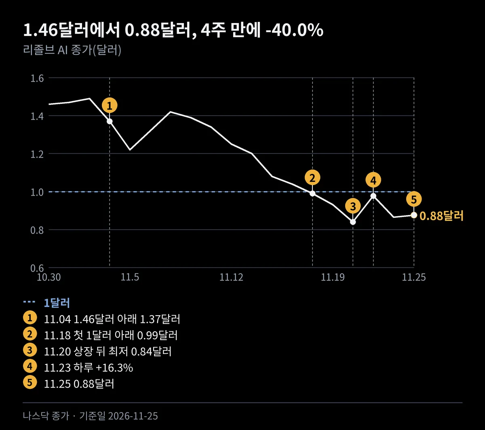
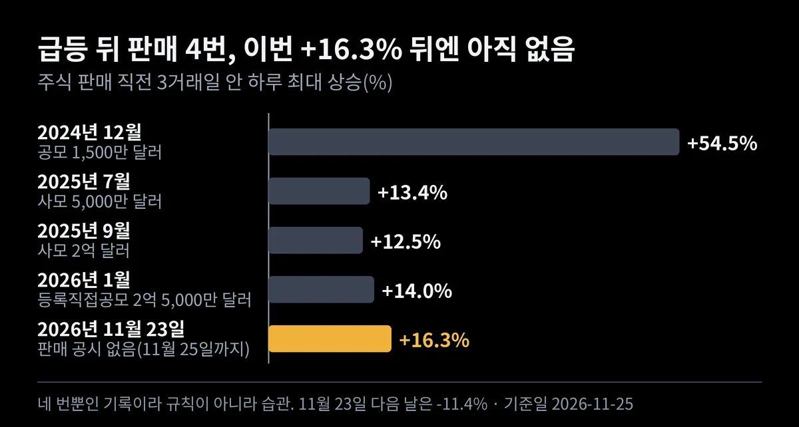
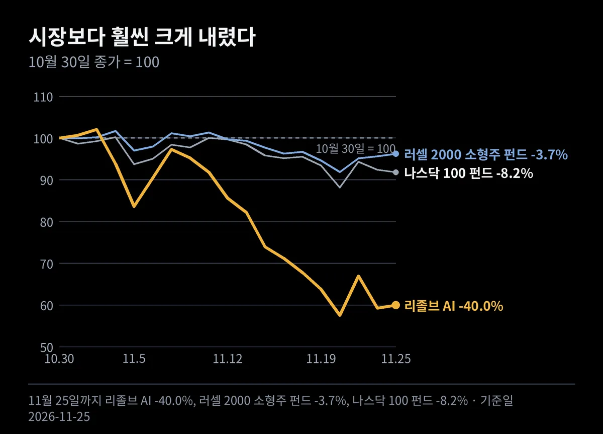
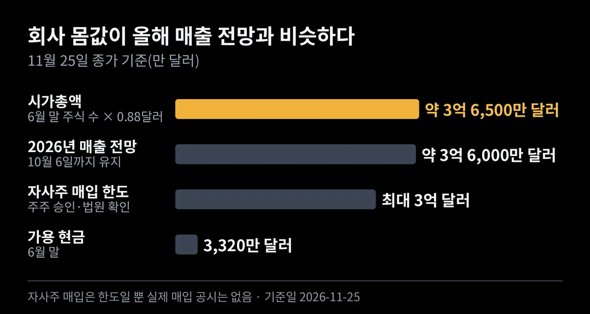
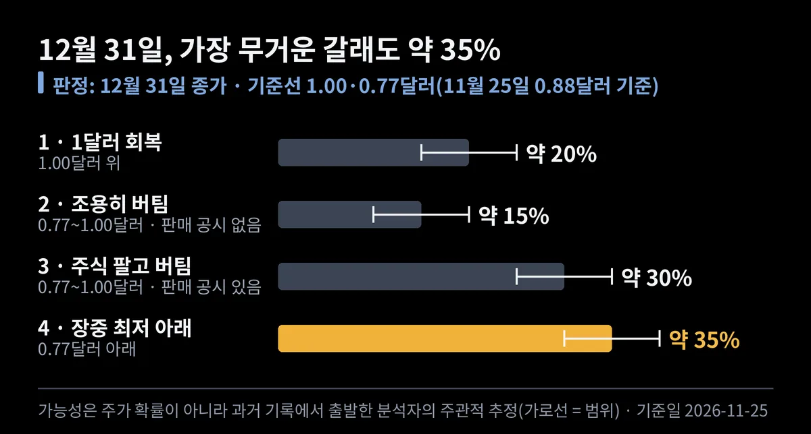

> **유의사항** 이 글은 공시와 시세 기록을 정리한 교육용 자료이며, 특정 종목의 매수·매도를 권하지 않습니다. 가능성 숫자는 과거 기록에 조건을 더한 주관적 추정입니다.

10월 6일 투자자의 날, 한 질문이 화면에 올라왔습니다. "먼로 대출이 약 1억 400만 달러이고 12월 31일 만기인데, 어떻게 갚을 계획입니까?" 재무 책임자 아서 야오는 이렇게 답했습니다. "이미 구조가 있습니다. 아직 발표하지 않았고, 실행하면 발표하겠습니다." 그로부터 36거래일이 지난 11월 25일, 그 발표는 아직 나오지 않았습니다. 주가는 0.88달러로 마감했습니다.

이 글은 시청자 요청으로 썼습니다. 실스크 영상에 댓글로 요청해 주신 분께 "12월 말 대출 만기와 매출 가운데 무엇이 더 궁금하신지" 여쭸고, 이번 글은 그 둘을 나란히 놓는 데서 시작합니다. 질문은 하나입니다. 1년 중 가장 낮은 자리에 온 지금, 여기서 더 내려갈 근거가 더 무거운가요?

[지난 리포트](/r/rzlv-2026-11/)는 10월 30일 종가 1.46달러를 기준으로 썼습니다. 그때 내다본 네 갈래는 판정일이 모두 12월 31일이라, 지난 예측 성적은 네 개 모두 확인 전입니다. 가장 무겁게 본 갈래는 '판매가 누른다'였습니다. 그 가운데 '새 최저'라는 가격 조건은 11월 4일 이미 켜졌습니다. 다만 같은 갈래의 다른 조건인 새 주식 판매 공시는 아직 한 건도 없습니다.

리졸브 AI가 돈을 버는 방식부터 짚겠습니다. 온라인 쇼핑몰에 상품 검색, 추천, 결제를 돕는 소프트웨어를 팔고, 회사를 여러 번 사들여 매출을 키웠습니다. 2026년 상반기 매출은 약 1억 3,079만 달러로, 1년 전보다 스무 배쯤 커졌습니다. 그런데 같은 반년 동안 영업으로 빠져나간 현금이 약 9,196만 달러였습니다. 매출이 늘어도 아직은 현금을 쓰는 회사입니다.

그래서 대출이 중요합니다. 6월 말 먼로 대출은 약 1억 266만 달러였고, 금리는 기준금리(SOFR)에 5.5%포인트를 더한 변동 금리, 만기는 12월 31일입니다. 같은 날 바로 쓸 수 있는 현금(가용 현금)은 약 3,320만 달러였습니다. 고객 정산용으로 묶인 제한 현금 약 6,740만 달러는 따로입니다. 이 말은 곧 지금 손에 든 현금만으로는 만기 원금의 3분의 1도 안 된다는 뜻입니다.

그 뒤 4주를 날짜순으로 보겠습니다. 11월 4일 종가 1.37달러로 지난 리포트의 기준인 1.46달러를 처음 깼습니다. 11월 18일에는 0.99달러로 처음 1달러 아래에서 마감했습니다. 11월 19일 회사는 11월 투자자 발표 자료를 공시했고, 다음 날 주가는 9.8% 내려 0.84달러가 됐습니다. 상장 뒤 가장 낮은 종가입니다.

11월 19일 자료를 원문에서 찾아봤습니다. 현금은 6월 말 숫자 그대로였고, 주주 승인과 법원 확인을 받은 자사주 매입 한도 최대 3억 달러가 실려 있었습니다. 연간 약 6,000만 달러 비용 절감과 2027년 6월 한 달 조정 EBITDA(이자·세금·감가상각 전 이익) 흑자 목표도 있었습니다. 그런데 '먼로', '대출', '만기', '차환'이라는 낱말은 한 번도 나오지 않았습니다. 2026년 매출 전망 약 3억 6,000만 달러도 다시 실리지 않았습니다.

11월 23일에는 다른 장면이 있었습니다. 산업 부품 회사 플로우텍에서 검색량이 넉 달 만에 약 185% 늘었다는 고객 사례 발표가 나온 날, 주가는 하루 16.3% 올랐습니다. 지난 리포트에서 짚은 습관이 바로 여기서 중요합니다. 상장 뒤 회사가 값을 정해 새 주식을 판 네 번은 모두 직전 3거래일 안에 하루 10% 넘는 급등이 있었습니다. 이번에는 다음 날 11.4% 내렸고, 11월 25일까지 판매 공시는 나오지 않았습니다.

판매가 없었다는 사실은 두 가지로 읽힐 수 있습니다. 하나는 최고경영자가 투자자의 날에 한 말과 맞습니다. 그는 회사 주식을 사겠다는 자본 수요가 많지만 저평가라고 보는 지금 가격에서는 팔기를 꺼린다고 했고, 희석 없는 다른 구조를 검토 중이라고 했습니다. 다른 하나는 1달러 아래에서는 같은 돈을 모으려면 주식을 훨씬 많이 팔아야 한다는 점입니다. 어느 쪽인지는 서류가 나와야 압니다.

시장도 함께 봐야 합니다. 10월 30일 종가 대비 11월 25일 나스닥 100 펀드(QQQ)는 8.2% 내렸습니다. 리졸브 AI는 평소 이 펀드보다 약 1.9배 크게 움직이는 종목이라(평소 민감도), 시장만으로 설명되는 하락은 -16.0% 정도입니다. 실제 하락은 그보다 훨씬 깊었고, 그 차이는 평소 흔들림의 끝자락에 있습니다. 시장이 같이 내린 것은 맞지만, 대부분은 이 회사 자신의 이야기로 봐야 합니다.

이제 요청하신 비교입니다. 매출 쪽에는 좋은 숫자가 있습니다. 11월 20일 아일랜드 스포츠 소매점 인터스포츠 엘버리스는 온라인 매출이 3,100만 유로에서 4,396만 유로로 42% 늘었다고 했고, 11월 24일 더바리는 방문이 4% 줄었는데도 온라인 매출이 18% 늘었다고 했습니다. 다만 이것은 고객사의 매출이지 리졸브 AI의 매출이 아닙니다. 회사의 하반기 매출은 아직 어떤 서류에도 나오지 않았습니다.

몸값으로 보면 이상한 그림이 하나 더 있습니다. 6월 말 주식 수 4억 1,687만 주에 0.88달러를 곱하면 시가총액은 약 3억 6,500만 달러입니다. 회사가 내건 2026년 매출 전망 약 3억 6,000만 달러와 거의 같습니다. 1년 매출만큼의 값이라면 싸 보일 수 있습니다. 하지만 시장은 그 매출보다 12월 31일의 대출과 그 뒤 늘어날 수 있는 주식 수를 먼저 가격에 넣고 있습니다.

달력에 날짜가 하나 더 겹칩니다. 나스닥 규정은 종가가 30거래일 연속 1달러 미만이면 회사에 통지하고, 보통 180일의 회복 기간을 줍니다. 11월 18일부터 1달러 아래가 이어지면 30번째 거래일이 하필 12월 31일, 대출 만기와 같은 날입니다. 통지가 곧 상장 폐지는 아니지만, 회사가 풀어야 할 숙제가 같은 날 두 개가 됩니다.

이런 장면이 처음은 아닙니다. 상장 뒤 한 달이 안 되는 사이에 35% 넘게 내린 때가 아홉 번 있었습니다. 그 뒤 한 달 남짓 지나 보면 크게 오른 경우가 네 번, 더 크게 내린 경우가 네 번이었습니다. 반반이지만 아홉 번뿐이라 표본이 작습니다. 하지만 상장 뒤 모든 날로 넓히면 더 낮아진 쪽이 높아진 쪽의 두 배 가까이 많았습니다. 자세한 숫자는 아래 부록 표에 있습니다.

더 내려갈 쪽 근거는 셋입니다. 대출이 가용 현금의 약 3배이고, 처리 방법이 36거래일째 발표되지 않았습니다. 회사는 주가가 뛸 때마다 주식을 판 기록이 네 번 있고, 1달러 아래에서는 한 번 팔 때 주식 수가 더 많이 늘어납니다. 11월 19일 자료에 매출 전망이 다시 실리지 않았습니다.

반대쪽 근거도 셋입니다. 재무 책임자는 이미 구조가 있다고 공개 석상에서 말했고, 그 녹취는 회사가 정정까지 해서 SEC에 냈습니다. 11월 23일 급등 뒤에는 습관과 달리 판매가 나오지 않았습니다. 그리고 몸값이 1년 매출 전망과 비슷한 수준까지 내려와, 희석 없는 해결이 발표되면 반응이 클 수 있는 자리입니다.

과거 기록부터 다시 보면, 큰 하락 뒤 아홉 번 중 네 번은 24거래일 뒤 더 크게 내렸습니다. 상장 뒤 모든 날 548번 중 243번(44%)도 그랬습니다. 아래 확률은 주가 상승·하락 가능성이 아니라 12월 31일 종가 구간과 판매 공시라는 판정 조건에 대한 분석자의 주관적 추정입니다.

그래서 질문에는 이렇게 답할 수 있습니다. 지금 가장 무거운 갈래는 장중 최저 0.77달러 아래(약 35%)이고, 그다음이 0.77~1.00달러에서 주식을 팔아 버티는 갈래(약 30%)입니다. 판매 공시 없이 그 자리에서 버티는 갈래와 1달러를 되찾는 갈래는 그보다 낮게 봤고, 갈래마다 출발한 기록은 아래 표 옆에 적었습니다. 가능성은 주가 확률이 아니라 과거 기록에서 출발해 이번 조건을 더한 주관적 추정입니다. 판단을 바꿀 신호는 하나입니다. 12월 31일 전에 대출 처리 공시가 나오는지, 그 안에 새 주식이 들어 있는지입니다.

대출을 새 주식으로 갚으면 0.88달러 근처에서 주식 수가 크게 늘 수 있습니다. 반대로 희석 없는 구조가 발표되면, 지금까지 기록과 반대 방향으로 크게 움직일 수 있습니다. 거시 일정으로는 12월 9일 FOMC(미국 연방공개시장위원회)와 12월 23일 PCE(개인소비지출 물가)가 있습니다. 변동성 지수(VIX)가 11월 25일 28.29로 20거래일 전보다 11.38포인트 높아, 소형주가 크게 흔들리기 쉬운 때이기도 합니다.

정리하면 리졸브 AI는 매출은 늘었지만 현금을 쓰는 회사이고, 12월 31일까지 가용 현금의 약 3배인 대출을 처리해야 합니다. 경영진은 방법이 있다고 했지만, 11월 25일까지 서류는 없습니다. 지금 주가는 대출 처리 방법이 나오기 전의 불확실성을 반영하고 있을 수 있습니다. 결정은 각자의 몫이며, 이 영상과 리포트는 판단 근거를 정리한 교육용 자료입니다.

## 숫자로 다시 보기

### 지금 자리(11월 25일 종가)
| 항목 | 값 | 메모 |
|---|---|---|
| 종가 | 0.88달러 | 10월 30일 1.46달러 대비 -40.0% |
| 상장 뒤 최저 종가 | 0.84달러 | 11월 20일 |
| 11월 25일 장중 최저 | 0.77달러 | 거래량 1,258만 주 |
| 1달러 아래 연속 | 6거래일 | 11월 18일부터 |
| 52주 최고 종가 | 4.63달러 | 1월 15일 |
| 시가총액 | 약 3억 6,500만 달러 | 6월 말 4억 1,687만 주 기준 |

### 대출과 현금(6월 말, 상반기 경영진 분석)
| 항목 | 금액 | 메모 |
|---|---|---|
| 먼로 대출 | 1억 266만 달러 | 12월 31일 만기, SOFR+5.5% |
| 단기 차입 합계 | 1억 2,311만 달러 | 약속어음 2,000만 달러 포함 |
| 가용 현금 | 3,320만 달러 | 바로 쓸 수 있는 돈 |
| 제한 현금 | 6,740만 달러 | 고객 정산용으로 묶임 |
| 상반기 영업 현금 유출 | 9,196만 달러 | 1~6월 |
| 상반기 매출 | 1억 3,079만 달러 | 1년 전의 약 20배 |

### 회사가 한 말과 서류(10월 6일 이후)
| 날짜 | 무엇 | 대출 언급 |
|---|---|---|
| 10월 6일 | 투자자의 날(녹취 10월 8일 정정) | 재무 책임자 "이미 구조가 있다, 실행하면 발표" |
| 10월 6일 | 2026년 매출 전망 약 3억 6,000만 달러 유지 | 없음 |
| 11월 19일 | 11월 투자자 발표 자료(6-K) | 없음(먼로·만기·차환 0번) |
| 11월 20~24일 | 고객 사례 보도자료 3건 | 없음 |

- 10월 30일 뒤 SEC 제출 서류는 11월 19일 6-K 하나입니다.

### 주식 판매 네 번과 이번 급등
| 날짜 · 판매 | 직전 3거래일 안 최대 상승 | 그 뒤 |
|---|---|---|
| **2024년 12월** 공모 1,500만 달러 | +54.5% | 5거래일째 +51.3% |
| **2025년 7월** 사모 5,000만 달러 | +13.4% | 5거래일째 -17.1% |
| **2025년 9월** 사모 2억 달러 | +12.5% | 5거래일째 -30.6% |
| **2026년 1월** 등록직접공모 2억 5,000만 달러 | +14.0% | 5거래일째 -38.4% |
| **2026년 11월 23일** 판매 공시 없음 (11월 25일까지) | +16.3% | 다음 날 -11.4% |

### 큰 하락 뒤 24거래일(상장 뒤 나스닥 종가)
| 출처 | 24거래일 뒤 | 메모 |
|---|---|---|
| **큰 하락 뒤 9번** 18거래일 -35% 넘게 | 위 4 · 사이 1 · 아래 4 | 위 = +14% 넘게 |
| **상장 뒤 모든 날** 548번 | 위 134 · 사이 171 · 아래 243 | 아래 = -12% 넘게(44%) |

- +14%는 0.88달러에서 1달러, -12%는 0.77달러에 해당합니다.

### 시장·거시·정책 배경
| 대상 | 10월 30일→11월 25일 | 11월 25일 하루 |
|---|---|---|
| 리졸브 AI | -40.0% | +1.2% |
| 나스닥 100 펀드(QQQ) | -8.2% | -0.7% |
| 러셀 2000 소형주 펀드(IWM) | -3.7% | +0.6% |
| S&P 500 펀드(SPY) | -5.2% | -0.3% |

| 예상 vs 실제(QQQ 기준) | 값 | 메모 |
| --- | --- | --- |
| 평소 민감도 | 약 1.9배 | 구간 전 250거래일 |
| 예상 | -16.0% | 민감도 × QQQ |
| 실제 | -40.0% | 차이 -24.0%p |
| 평소 흔들림 | ±25.0%p | 차이는 이 안의 끝자락 |
| 미 국채 10년 | 4.85% | 11월 25일 |
| VIX(시장 변동성 지수) | 28.29 | 11월 25일 |

- 다음 거시 일정: 12월 9일 FOMC · 12월 23일 PCE(개인소비지출 물가, 11월분). 소비자물가(CPI)·고용 일정은 확인 안 됨
- 정책: 직접 연결 확인 안 됨
- 통섭: 같은 18거래일 동안 핵심 종목 8개 가운데 8개가 평소 시장 민감도로 예상한 범위 안에서 움직였습니다([실스크](/r/laes-2026-11-7/) · [솔리드파워](/r/sldp-2026-11-5/))

### 판단 전에 확인할 것

| 순서 · 확인할 것 | 볼 곳 |
| --- | --- |
| **1** 12월 31일 전에 먼로 대출을 갚거나 연장하는 공시가 나오나 | SEC 제출 목록(6-K) |
| **2** 그 해결에 새 주식(공모·사모·등록직접공모·시장가 판매)이 들어 있나 | 6-K·424B |
| **3** 2026년 매출 전망 약 3억 6,000만 달러를 다시 확인하나 | 보도자료·6-K |
| **4** 12월 31일까지 종가가 1달러 위로 한 번이라도 돌아오나 | 나스닥 종가 |

### 지난 예측 채점표

지난 예측 성적: 적중 0 · 빗나감 0 · 확인 전 4

| 지난 시나리오 · 그때 추정 | 판정과 지금 자리(11월 25일) |
| --- | --- |
| **1 · 매출이 이긴다** 12월 31일 1.46달러 위 · 15~25% | **[확인 전]** 0.88달러, 대출 처리 공시 없음 |
| **2 · 새 주식으로 버틴다** 2달러 아래 · 25~35% | **[확인 전]** 2달러 아래, 판매 공시 0건 |
| **3 · 판매가 누른다** 1.46달러 아래 새 최저 · 35~45% | **[확인 전]** 가격 조건만 켜짐(11월 4일), 판매 공시 0건 |
| **4 · 조용한 연장** 1.46~2달러 횡보 · 5~15% | **[확인 전]** 1.46달러 아래 |

### 앞으로 일어날 수 있는 일

큰 하락 뒤 아홉 번 중 네 번, 상장 뒤 모든 날 548번 중 243번이 24거래일 뒤 0.77달러에 해당하는 자리 아래였습니다. 이 기록에서 출발했습니다. 아래 가능성은 그 기록에서 출발해 분석자가 주관적으로 매긴 추정이며, 주가가 오를 확률이 아닙니다. 네 갈래는 겹치지 않아 합이 100입니다. 아래 확률은 주가 상승·하락 가능성이 아니라 12월 31일 종가 구간과 판매 공시라는 판정 조건에 대한 분석자의 주관적 추정입니다.

| 갈래(판정 12월 31일) | 판정 조건 | 가능성(추정) |
| --- | --- | --- |
| 1 · 1달러 회복 | 12월 31일 종가 1.00달러 위 | 낮음 약 20% (15~25%) |
| 2 · 조용히 버팀 | 12월 31일 종가 0.77~1.00달러 · 새 주식 판매 공시 없음 | 낮음 약 15% (10~20%) |
| 3 · 주식 팔고 버팀 | 12월 31일 종가 0.77~1.00달러 · 새 주식 판매 공시 있음 | 중간 약 30% (25~35%) |
| **4 · 장중 최저 아래** | 12월 31일 종가 0.77달러 아래 | 높음 약 35% (30~40%) |

- 1번 약 20%는 상장 뒤 모든 날 24거래일 뒤 +14% 넘게 오른 24%에서 출발해 최근 1년 흐름을 보고 낮췄습니다.
- 틀린다면: 12월 31일 전에 희석 없는 차환이 발표되면 1번 갈래가 커집니다.

### 핵심 확인 세 가지
- 1순위: 먼로 대출 처리 공시 — 12월 31일까지 나오는지
- 2순위: 새 주식 판매 공시 — 12월 31일까지 나오는지
- 3순위: 1달러 아래 30번째 거래일 — 12월 31일까지 이어지는지

## 함께 읽기
- [리졸브 AI, 매출 20배에도 52주 최저 1.46달러(10월 30일 기준)](/r/rzlv-2026-11/)
- [실스크 반등 신호일까?(11월 26일 기준)](/r/laes-2026-11-7/)
- [솔리드파워 물타기 해도 될까?(11월 25일 기준)](/r/sldp-2026-11-5/)
