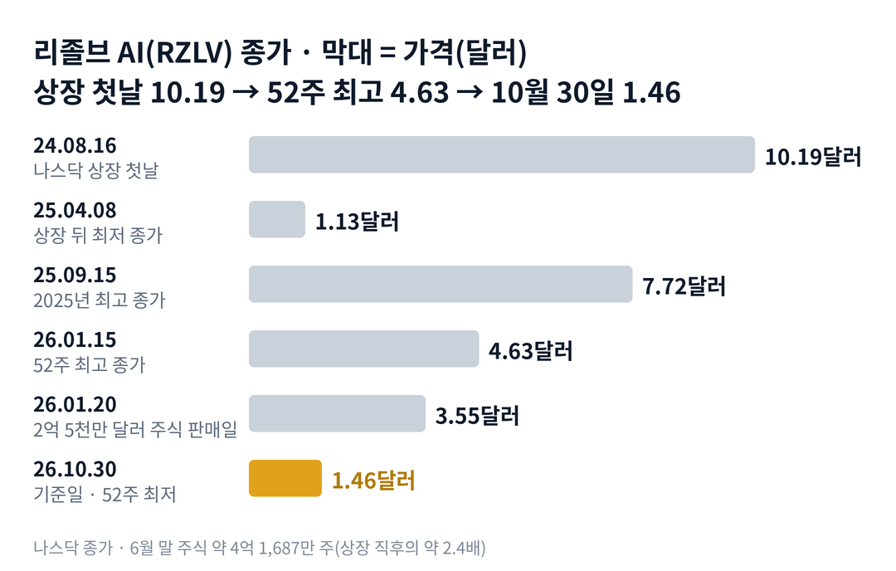

## 짧은 답

> **핵심:** 매출은 인수로 크게 늘었지만 손실이 매출보다 컸고, 회사는 주가가 뛸 때마다 새 주식을 팔아 와서 주가는 매출과 반대로 움직였습니다.

리졸브 AI의 10월 30일 종가는 1.46달러로, 지난 1년 중 가장 낮은 값입니다. 엔코어 에너지 영상에 댓글로 요청해 주신 종목입니다. 상반기 매출이 1년 전의 약 20배가 됐는데도, 시장은 매출보다 현금과 주식 수를 먼저 보고 있습니다.

> **국면 정의(리졸브 AI 시리즈 공통):** 국면 A 급등과 판매 — 회사 발표에 하루 10% 넘게 오르고, 며칠 안에 새 주식 판매가 나오는 때. 국면 B 계단식 하락 — 큰 급등 없이 조금씩 내려 52주 최저를 새로 쓰는 때. 국면 C 재정비 — 만기 대출을 새 주식 없이 넘기고, 매출 숫자가 전망대로 확인되는 때.

**지금 진단: 국면 B(계단식 하락).** 근거는 5부에, 매출과 손실·현금은 2부 표에, 주식 판매 네 번의 기록은 3부 표에 있습니다.

> **유의사항** 저자는 금융·투자 자문가가 아닙니다. 이 글은 공개 공시와 시세를 정리한 교육용 분석이며 특정 종목의 매수·매도를 권하지 않습니다. 과거 패턴은 미래 수익을 보장하지 않습니다. 실제 투자 전에는 최신 공시를 직접 확인하세요.

## 1부. 리졸브 AI는 어떤 회사인가

> **핵심:** 온라인 쇼핑몰에 인공지능 검색·추천·결제 소프트웨어를 파는 영국 회사로, 인수를 거듭해 매출을 키웠습니다.

리졸브 AI(Rezolve AI)는 영국 런던에 본사를 둔 회사입니다. 온라인 쇼핑몰이 상품을 더 잘 찾게 하고, 손님에게 맞는 상품을 추천하고, 결제를 쉽게 하도록 돕는 인공지능 소프트웨어를 팝니다. 창업자 다니엘 와그너가 회장 겸 최고경영자입니다.

2024년 8월 15일 기업인수목적회사(SPAC, 다른 회사와 합병해 상장시키려고 만든 빈 회사) 아르마다와 합병을 마치고, 다음 날 나스닥에서 거래를 시작했습니다. 그 뒤 상품 검색 회사(GroupBy), 웹사이트 관리 회사(Crownpeak), 보상 프로그램 회사(Reward) 등을 차례로 사들였습니다. 그중 위치 기반 마케팅 회사 블루닷은 최고경영자가 지분을 모두 가진 회사에서 산 특수관계 거래였습니다.

### 숫자로 본 지금의 크기(10월 30일 기준)

| 항목 | 값 · 근거 |
| --- | --- |
| 종가 | **1.46달러** 52주 최저 종가, 상장 첫날 10.19달러 대비 -85.7% |
| 시가총액 | **약 6억 900만 달러** 6월 말 주식 4억 1,687만 주 기준 |
| 2026년 상반기 매출 | **약 1억 3,079만 달러** 1년 전 약 630만 달러의 약 20배 |
| 2026년 상반기 순손실 | **약 1억 3,948만 달러** 매출보다 큼 |
| 6월 말 가용 현금 | **약 3,320만 달러** 제한 현금 약 6,740만 달러는 별도 |
| 2026년 매출 전망 | **약 3억 6,000만 달러** 3월 30일 제시, 10월 6일까지 유지 |

이 말은 곧 회사의 몸값이 올해 매출 전망의 두 배가 안 된다는 뜻입니다. 매출만 보면 싸 보이지만, 시장은 손실과 만기 대출, 늘어나는 주식 수를 함께 가격에 넣고 있습니다.

위 그림처럼 주가는 2025년 4월 1.13달러까지 내려갔다가 9월 7.72달러까지 올랐습니다. 그 뒤 올해 1월 4.63달러가 지난 1년의 꼭대기였고, 지금은 1.46달러입니다.

## 2부. 매출과 현금, 반대로 간 두 숫자

> **핵심:** 매출은 늘었지만 손실과 현금 유출이 더 컸고, 연말 만기 대출이 바로 쓸 수 있는 현금의 세 배가 넘습니다.

연간 숫자부터 보겠습니다. 2024년 매출은 약 201만 달러였고, 2025년에는 약 4,680만 달러가 됐습니다. 2026년 상반기 한 해의 반에만 약 1억 3,079만 달러를 냈습니다. 대부분은 인수한 회사들의 매출이 더해진 결과이고, 상반기 매출의 79%가 영국과 유럽에서 나왔습니다.

### 연도별 매출과 순손실

| 기간 | 매출 | 순손실 |
| --- | --- | --- |
| 2024년 | 약 201만 달러 | 약 1억 7,345만 달러 |
| 2025년 | 약 4,680만 달러 | 약 1억 141만 달러 |
| 2026년 상반기 | 약 1억 3,079만 달러 | 약 1억 3,948만 달러 |

이 말은 곧 매출이 커지는 동안 손실도 함께 커졌다는 뜻입니다. 2026년 상반기 영업으로 빠져나간 현금은 약 9,200만 달러였습니다.

현금과 차입금을 나란히 놓으면 압박이 보입니다. 6월 말 바로 쓸 수 있는 현금은 약 3,320만 달러였습니다. 따로 묶인 제한 현금 약 6,740만 달러는 보상 프로그램 고객사가 미리 넣은 정산 자금과 관련된 돈입니다. 반면 12월 31일 만기인 먼로 대출은 약 1억 266만 달러이고, 최소 현금 1,000만 달러를 지켜야 하는 약정이 붙어 있습니다.

그래서 2025년 연간 보고서와 2026년 반기 재무제표에는 '계속기업으로 존속할 능력에 중대한 의문'이 있다는 문장이 들어 있습니다. 회사가 앞으로 1년 동안 정상적으로 운영될 수 있을지 불확실하다는 회계 기준의 표현입니다.

말과 숫자가 엇갈린 장면도 있습니다. 3월 30일 실적 발표에서 회사는 운영을 위한 추가 지분 조달이 필요 없다고 밝혔습니다. 그러나 9월 1일 공시에 따르면 시장가 주식 판매(ATM)로 1,360만 주를 주당 2.50~3.09달러에 팔아 약 3,990만 달러를 마련했습니다. 반대로 최고경영자는 4월 2일 주당 4달러에 약 81만 주를 시장에서 샀고, 8월 기준 지분은 약 13.8%입니다.

## 3부. 주식 판매 네 번의 기록

> **핵심:** 상장 뒤 회사가 값을 정해 현금을 받고 새 주식을 판 네 번은 모두 직전 3거래일 안에 하루 10% 넘는 급등 뒤였고, 발표 뒤 5거래일째 주가는 네 번 중 세 번 더 낮았습니다.

상장 뒤 회사가 가격을 정해 현금을 받고 새 주식을 판 경우를 모두 모았습니다. 공모, 사모, 등록직접공모를 합쳐 네 번이고, 합계는 약 5억 1,500만 달러입니다. 반응은 발표 전 거래일 종가 대비이고, '5거래일째'는 발표 반응일을 첫날로 센 다섯 번째 거래일 종가입니다.

### 현금 증자 네 번, 직전 급등과 그 뒤

| 이벤트일 · 그날 나온 내용 | 당일 | 5거래일째 |
| --- | --- | --- |
| **2024.12.20** 1,500만 달러 공모(3.00달러), 직전 12.17 +54.5% | -2.6% | +51.3% |
| **2025.07.24** 5,000만 달러 사모(2.50달러, 직전 종가보다 26.3% 쌈), 직전 7.22 +10.7%·7.23 +13.4% | -10.3% | -17.1% |
| **2025.09.24** 2억 달러 사모(5.40달러, 24.8% 쌈), 직전 9.23 +12.5% | -5.0% | -30.6% |
| **2026.01.20** 2억 5,000만 달러 등록직접공모(4.00달러, 13.2% 쌈), 직전 1.15 +14.0% | -23.0% | -38.4% |

※ 2024년 12월 공모는 장 마감 뒤 발표돼 12월 20일이 반응일입니다. 증권신고서가 효력을 얻은 12월 19일에는 이미 18.9% 내렸습니다.

이 말은 곧 주가가 뛰면 회사가 곧바로 주식을 팔아 왔다는 뜻입니다. 5거래일째에 더 높았던 한 번(2024년 12월)은 연말 개인 투자자 매수가 몰린 시기였습니다. 2026년 1월 판매는 52주 최고 종가(1월 15일 4.63달러)에서 두 거래일 뒤였습니다.

이 네 번 말고도 주식은 늘었습니다. 시장가 판매, 인수 대가, 전환사채 전환으로 나간 주식이 있었습니다. 2024년 8월 합병 직후 약 1억 7,218만 주였던 주식은 2026년 6월 말 약 4억 1,687만 주가 됐습니다. 두 해가 안 되는 사이 약 2.4배입니다.

## 4부. 되풀이된 이야기

> **핵심:** 좋은 소식에 급등한 날은 며칠 안에 그 몫을 내주는 일이 반복됐고, 그 사이 주식 판매나 실적 발표가 끼어 있었습니다.

첫째, 호재 뒤 반납입니다. 2025년 12월 16일 '첫 조정 EBITDA(이자·세금·감가상각 전 이익) 흑자' 발표에 28.0% 올랐다가 다음 날 19.2% 내렸습니다. 2026년 8월 25일 구글이 회사의 분산 데이터베이스를 쓴다는 발표에 21.8% 올랐지만, 9월 1일 상반기 실적 날 17.3% 내렸습니다.

둘째, 10월의 계단입니다. 10월 5일 마스터카드와 글로벌 재판매 계약 소식에 8.3% 올라 2.23달러가 됐습니다. 다음 날 투자자의 날 행사가 열렸고, 그 뒤 주가는 하루 10%가 넘는 급락 없이 조금씩 내려 10월 22일 1.48달러, 30일 1.46달러가 됐습니다. 4월에는 미국 전자상거래 회사 커머스닷컴에 주식을 맞바꾸는 인수를 먼저 제안했지만, 상대 이사회는 받아들이지 않았습니다.

셋째, 정식 분기 실적이 없습니다. 회사는 분기마다 정식 실적을 내지 않고, 반기·연간 보고서와 회사가 고른 시점의 발표로 숫자를 알립니다. 그래서 하반기 매출을 확인할 수 있는 자리는 내년 봄 연간 보고서일 가능성이 큽니다.

## 5부. 지금 어느 단계이고, 무엇을 볼까

> **핵심:** 큰 급등 없이 조금씩 내리는 국면 B이고, 12월 31일 만기 대출을 어떻게 처리하는지가 다음 국면을 가를 것입니다.

**2026년 10월 30일 진단: 국면 B(계단식 하락).** 근거는 세 가지입니다. 9~10월 하루 10%를 넘게 움직인 날은 9월 1일 하루뿐이었고, 그 뒤 52주 최저를 새로 썼습니다. 10월 5일 마스터카드 계약 같은 발표도 다음 날부터 밀렸습니다. 6월 말 가용 현금이 연말 만기 대출의 3분의 1에 못 미쳐, 국면 C의 조건(새 주식 없는 대출 처리)은 아직 확인되지 않았습니다.

### 앞으로 일어날 수 있는 일

과거 기록부터 보겠습니다. 현금 증자는 4번 중 4번이 급등 직후였고, 4번 중 3번은 발표 뒤 5거래일째에 더 낮았습니다. 아래 가능성은 이 빈도와 지금 신호를 함께 본 추정입니다.

| 시나리오 · 예상 반응(판정 12월 31일) | 무증자·전망 | 가능성(추정) |
| --- | --- | --- |
| 1 · 매출이 이긴다 12월 31일 종가 1.46달러 위 | ○ / ○ | 낮음 (15~25%) |
| 2 · 새 주식으로 버틴다 반등이 짧고 2달러 아래 | × / ○ | 중간 (25~35%) |
| **3 · 판매가 누른다** 1.46달러 아래 새 최저 | × / × | 높음 (35~45%) |
| 4 · 조용한 연장 1.46~2달러 사이 횡보 | ○ / × | 낮음 (5~15%) |

표의 '무증자'는 12월 31일까지 새 주식 판매 공시 없이 먼로 대출을 연장하거나 갚은 경우, '전망'은 같은 날까지 회사가 2026년 매출 약 3억 6,000만 달러 전망을 다시 확인한 경우입니다.

시나리오 3을 가장 높게 본 이유는 습관과 숫자입니다. 6월 말 가용 현금은 약 3,320만 달러였고, 회사는 3월에 필요 없다던 주식 판매를 그 뒤에 했습니다. 전망 3억 6,000만 달러를 지키려면 하반기에만 약 2억 2,900만 달러의 매출이 필요합니다.

시나리오 1의 근거는 매출의 크기입니다. 회사는 하반기가 상반기보다 훨씬 클 것이라고 밝혔고, 최고경영자는 4월 주당 4달러에 주식을 샀습니다. 판매 뒤 5거래일째에도 더 높았던 2024년 12월 같은 경우도 한 번 있었습니다.

## 6부. 조심할 점과 체크리스트

> **핵심:** 기록표는 네 번뿐인 작은 표본이고, 3분기 매출과 시장가 판매의 날짜별 내역은 공개되지 않았습니다.

3부 표는 '판매 뒤 반드시 내린다'는 규칙이 아닙니다. 네 번은 아주 작은 표본이고, 판매 규모와 할인율이 모두 달랐습니다. 회사는 분기 실적을 정식으로 내지 않아, 7~10월 매출과 시장가 판매의 날짜별 내역은 확인할 수 없었습니다.

회사 보도자료 일부는 원문 사이트가 막혀 재게시본으로 확인했습니다. 증권사 목표가는 회사가 인용한 숫자뿐이라 쓰지 않았습니다. 2024년 12월 17일 급등은 직접적인 계기를 원문으로 확인하지 못했습니다.

- ☐ 12월 31일까지 먼로 대출(약 1억 266만 달러)을 새 주식 판매 공시 없이 연장하거나 갚는가
- ☐ 12월 31일까지 새 주식 판매(공모·사모·등록직접공모) 공시가 0건인가
- ☐ 12월 31일까지 회사가 2026년 매출 약 3억 6,000만 달러 전망을 다시 확인하는가
- ☐ 12월 31일 종가가 1.46달러 위인가
- ☐ 12월 31일까지 하루 +10% 급등 뒤 3거래일 안에 주식 판매 공시가 0건인가

다음 갱신은 12월 31일 대출 만기 처리 공시가 나온 뒤에 합니다.
