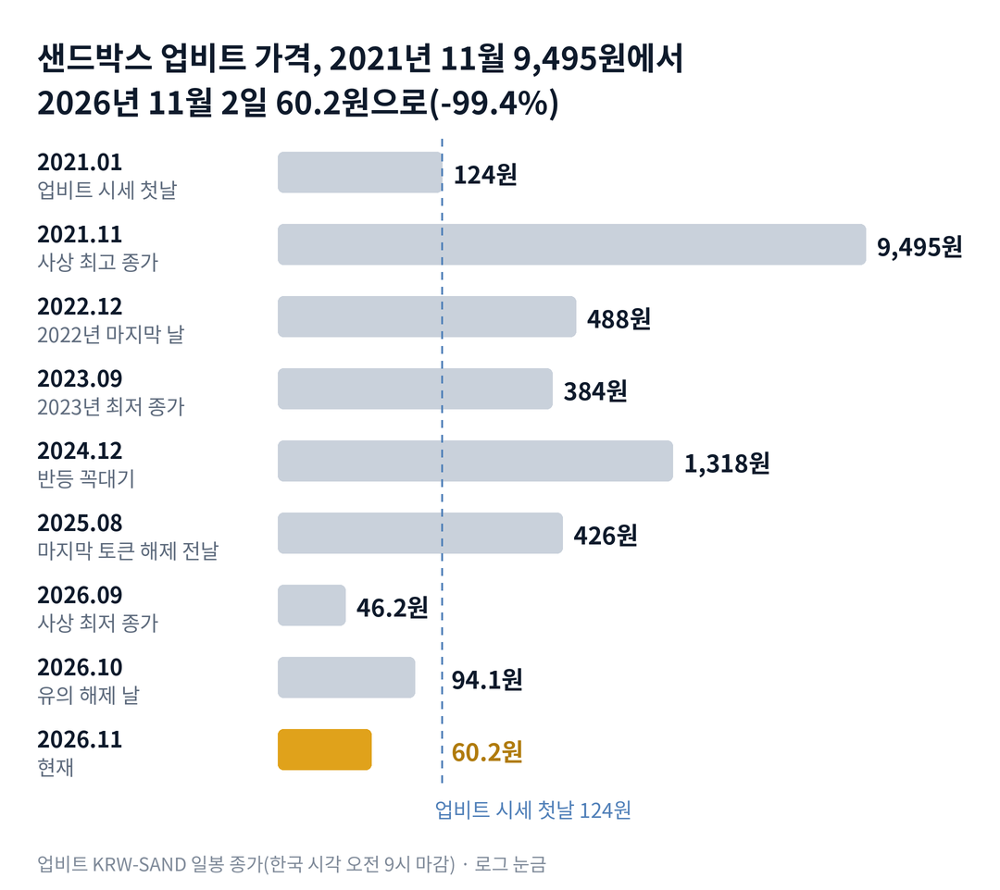

## 짧은 답

> **핵심:** 유의 해제는 새 가치가 생긴 소식이 아니라 막혔던 거래가 다시 열린 소식이었고, 한꺼번에 몰린 매수가 빠지자 가격은 사고 전 자리로 돌아왔습니다.

이 리포트는 시청자 요청(11월 1일)으로 만들었습니다. 샌드박스는 지난 1년 동안 한 번도 사고 전 가격을 되찾지 못한 채 내려왔고, 10월 2일 하루의 급등도 그 흐름을 바꾸지 못했습니다. 해제 날 몰린 거래가 한 달 만에 평소 수준으로 줄었다는 점이 가장 큰 단서입니다.

> **국면 정의(샌드박스 시리즈 공통):** 국면 A 몰림 — 업비트 거래대금이 평소의 수십 배로 뛰며 하루 30% 넘게 오르는 때. 국면 B 되돌림 — 몰린 거래가 빠지며 급등 전날 가격 근처로 돌아오는 때. 국면 C 바닥 다지기 — 큰 소식 없이 거래가 적고 가격이 좁은 범위에서 움직이는 때.

**11월 2일 진단: 국면 B(되돌림)의 끝자락.** 근거는 5부에, 사고부터 해제 뒤 한 달까지의 흐름은 2부 표에 있습니다. 한 달 안에 제자리로 돌아온 급등들이 그 뒤 급등 날 가격을 되찾았는지는 3부 '하루 +30% 넘게 오른 15번, 한 달 뒤 몇 번 제자리였나' 표에 있습니다.

> **유의사항** 저자는 금융·투자 자문가가 아닙니다. 이 글은 공개 보도와 시세를 정리한 교육용 분석이며 특정 매매를 권하지 않습니다. 과거의 가격 반응이 미래에 반복된다는 보장은 없고, 샌드박스는 하루에 수십 퍼센트씩 움직이는 변동성이 매우 큰 코인입니다. 실제 투자 전에는 최신 가격과 공지를 직접 확인하세요.

## 1부. 샌드박스는 어떤 코인인가

> **핵심:** 메타버스 게임 플랫폼 '더 샌드박스'에서 땅과 아이템을 사고팔 때 쓰는 코인이고, 정해진 토큰 해제는 2025년 8월에 모두 끝났습니다.

더 샌드박스는 이용자가 가상 공간에 땅(랜드)을 사고, 그 위에 게임과 아이템을 만들어 팔 수 있게 한 블록체인 게임입니다. 처음 만든 곳은 프랑스 게임 회사 픽소울(Pixowl)이고, 2018년 홍콩의 블록체인 투자 회사 애니모카 브랜즈가 인수했습니다. SAND는 이 안에서 결제, 투표(거버넌스), 보상에 쓰는 코인입니다. 원래 이더리움 위에서 발행됐고, 나중에 폴리곤·베이스·BNB(바이낸스가 만든 블록체인) 체인으로도 옮겨 쓸 수 있게 연결 통로를 늘렸습니다. 이 연결 통로가 2026년 8월 사고가 난 자리입니다.

공급량은 30억 개로 정해져 있습니다. 2020년 8월 14일부터 6개월마다 팀·투자자·회사 보유분이 조금씩 풀렸고, 2025년 8월 14일 마지막 해제로 남은 잠금 물량은 0이 됐습니다. 2025년 8월 말에는 직원 절반 정도를 줄이는 구조조정이 보도됐고, 창업자 두 명이 일상 경영에서 물러나 애니모카의 로비 영이 최고경영자를 맡았습니다.

### 숫자로 본 지금의 크기(11월 2일 기준)

| 항목 | 값 · 근거 |
| --- | --- |
| 업비트 종가 | **60.2원** 11월 3일 오전 9시 마감 일봉, 크라켄 0.0444달러 |
| 사상 최고 종가 대비 | **-99.4%** 2021년 11월 28일 9,495원 |
| 지난 1년 종가 범위 | **46.2~312원** 최저 9월 15일(사상 최저), 최고 2025년 11월 10일 |
| 유통량 | **약 29억 3,764만 개** 전체 30억 개의 97.9%, 10월 집계 |
| 시가총액 | **약 1,768억 원** 유통량 × 업비트 종가, 약 1억 3,043만 달러 |
| 남은 잠금 물량 | **0개** 마지막 해제 2025년 8월 14일 |
| 10월 2일 거래대금 | **약 2,296억 원** 직전 20일 평균의 76.3배, 2021년 이후 가장 큰 배수 |

이 말은 곧 새로 풀릴 물량이라는 부담은 사라졌지만, 가격은 4년 전 꼭대기의 160분의 1 수준이라는 뜻입니다. 지금 가격을 움직이는 것은 해제 일정이 아니라 거래소 공지와 한국 거래의 쏠림입니다.

위 그림처럼 가격은 2021년 11월 꼭대기 뒤 4년 가까이 내려왔고, 2024년 12월 한 번 1,318원까지 반등했습니다. 2026년에는 9월 15일 46.2원으로 사상 최저 종가를 쓴 뒤, 10월 해제 급등이 한 달 만에 거의 사라졌습니다.

## 2부. 사고, 유의 지정, 해제, 그리고 한 달

> **핵심:** 브릿지 사고 때 업비트 가격은 해외보다 더 빠졌고, 해제 날에는 해외와 함께 올랐지만, 한 달 뒤에는 사고 직전 수준 아래로 돌아왔습니다.

8월 22일 베이스와 BNB 체인에 놓인 SAND 연결 다리(브릿지, 다른 블록체인으로 코인을 옮기는 통로)에서 사고가 났습니다. 공격자는 발행 권한을 빼앗아 뒷받침 없는 SAND를 대량으로 찍었습니다. 찍힌 숫자는 약 149억 개로, 전체 공급량의 다섯 배 가까운 숫자로 알려졌습니다. 하지만 실제로 쓸 수 있는 지갑으로 옮겨진 것은 약 1,475만 개였다는 분석이 나왔습니다. 회사는 이더리움과 폴리곤의 SAND는 영향이 없었고, 직접 영향은 전체 공급의 0.01% 미만이라고 밝혔습니다.

업비트와 빗썸은 같은 날 입출금을 멈추고 투자 유의를 안내했고, 이어 코인원까지 세 거래소가 거래 유의 종목으로 지정했습니다. 거래 유의 종목은 거래소가 투자자에게 위험을 알리는 단계로, 정해진 기간 안에 사유가 풀리지 않으면 거래 지원 종료(상장 폐지)로 이어질 수 있습니다. 실제로 같은 여름 보안 사고로 유의 종목이 된 밈코인 봉크(BONK)는 업비트와 코인원에서 거래 지원 종료가 결정됐고, 빗썸만 유의를 풀었습니다. 그래서 유의 기간의 샌드박스 가격에는 상장 폐지 가능성이 함께 들어가 있었습니다.

업비트 가격은 8월 24일 일봉에서 22.0% 내렸습니다. 같은 날 해외 거래소 크라켄의 달러 가격은 7.0% 내려, 한국 가격만 더 크게 빠졌습니다.

### 유의 지정부터 해제 뒤 한 달까지

| 날짜 · 무슨 일 | 업비트 종가 | 크라켄 종가 |
| --- | --- | --- |
| **2026.08.21** 사고 전날 | 67.2원 | 0.0490달러 |
| **2026.08.24** 입출금 중단 뒤 유의 지정 | 48.0원 | 0.0427달러 |
| **2026.09.15** 업비트 사상 최저 종가 | 46.2원 | 0.0335달러 |
| **2026.10.01** 해제 전날 | 61.4원 | 0.0450달러 |
| **2026.10.02** 세 거래소 유의 해제 | 94.1원 | 0.0693달러 |
| **2026.10.07** 해제 뒤 가장 높은 종가 | 107.0원 | 0.0779달러 |
| **2026.11.02** 기준일 | 60.2원 | 0.0444달러 |

이 말은 곧 유의 기간에는 한국에서만 할인이 붙었다가, 해제와 함께 그 할인이 풀렸다는 뜻입니다. 8월 21일 두 가격의 비율은 1달러당 약 1,371원이었지만, 8월 24일에는 약 1,124원으로 낮아졌습니다. 10월 1일에는 약 1,364원으로 거의 돌아와 있었습니다.

해제 날의 급등은 한국만의 일이 아니었습니다. 10월 2일 크라켄 가격도 54.0% 올라, 두 가격의 비율은 평소 수준을 지켰습니다. 그런데 그 뒤가 문제였습니다. 10월 7일 107.0원을 끝으로 내려와 10월 29일 59.7원으로 해제 전날 가격 아래가 됐습니다. 11월 2일 거래대금은 약 14억 6,000만 원으로, 해제 날의 160분의 1 수준이었습니다.

토큰 해제 이야기도 함께 봐야 합니다. 2022년 8월부터 2025년 8월까지 일곱 번의 해제를 업비트 원화 가격으로 다시 쟀습니다. 물량은 해제 시점 시가총액 대비 비율이고, 반응은 해제 전날 종가 대비입니다.

### 토큰 해제 7번, 20일째 가격

| 해제일 · 시가총액 대비 물량 | 당일 | 20일째 |
| --- | --- | --- |
| **2022.08.14** 29.1% | +1.4% | -27.3% |
| **2023.02.14** 22.5% | +3.4% | -7.8% |
| **2023.08.14** 18.4% | 0.0% | -21.1% |
| **2024.02.14** 15.5% | +2.8% | +52.6% |
| **2024.08.14** 9.3% | -3.7% | -8.9% |
| **2025.02.14** 3.7% | +2.9% | -21.7% |
| **2025.08.14** 3.6% | -6.8% | -9.6% |

이 말은 곧 해제 당일보다 그 뒤 3주가 더 무거웠다는 뜻입니다. 일곱 번 중 여섯 번은 20일째 가격이 해제 전날보다 낮았고, 높았던 한 번(2024년 2월)은 코인 시장 전체가 오르던 때였습니다. 보도된 물량으로 보면 2023년 2월 해제는 약 3억 7,275만 개로 전체의 약 12.4%였습니다. 2023년 8월은 약 3억 3,255만 개, 2024년 2월은 약 2억 559만 개였습니다. 해외 거래소를 합친 평균 거래량은 확인하지 못해 '며칠치 물량'은 계산하지 않았습니다.

## 3부. 하루 30% 넘게 오른 날들의 기록

> **핵심:** 업비트 원화 시세에서 하루 30% 넘게 오른 날은 15번이었고, 그중 6번은 30일 안에 급등 전날 가격 아래로 돌아왔습니다.

2021년 1월 21일부터 2026년 11월 2일까지 업비트 일봉에서 종가가 전날보다 30% 넘게 오른 날을 모두 모았습니다. '30일 뒤'는 급등 날로부터 30일이 지난 날의 종가를 급등 전날 종가와 비교한 값입니다. 코인은 주말에도 거래되므로 날짜를 달력 그대로 셉니다. '제자리'는 30일 안에 처음으로 급등 전날 종가 이하로 마감한 날입니다.

### 하루 +30% 넘게 오른 15번, 한 달 뒤 몇 번 제자리였나

| 이벤트일 · 그날 나온 내용 | 당일 | 30일 뒤 |
| --- | --- | --- |
| **2021.02.05** 확인한 발표 없음 | +40.4% | +297.2% |
| **2021.02.14** 확인한 발표 없음 | +30.5% | +209.4% |
| **2021.02.18** 확인한 발표 없음 · 7일째 제자리 | +33.5% | +135.3% |
| **2021.05.22** 확인한 발표 없음 · 1일째 제자리 | +46.8% | -45.2% |
| **2021.07.07** 확인한 발표 없음 | +30.8% | +103.9% |
| **2021.07.14** 확인한 발표 없음 · 6일째 제자리 | +34.6% | +48.6% |
| **2021.07.23** 확인한 발표 없음 | +31.6% | +31.9% |
| **2021.08.29** 확인한 발표 없음 · 22일째 제자리 | +32.6% | -18.6% |
| **2021.10.30** 페이스북 메타 사명 변경(10.28 발표) 2일째 | +52.3% | +526.5% |
| **2021.11.01** 9,300만 달러 투자 유치 발표(소프트뱅크 주도) | +36.1% | +341.0% |
| **2021.11.02** 투자 유치 다음 날, 사상 최고가 경신 | +43.4% | +230.9% |
| **2021.11.24** 아디다스 협업 예고 보도 · 13일째 제자리 | +40.5% | +7.1% |
| **2024.11.16** 업비트 거래대금 약 1,178억 원 | +35.4% | +152.9% |
| **2024.11.24** 업비트 거래대금 약 2조 416억 원 | +75.9% | +56.3% |
| **2026.10.02** 업비트·빗썸·코인원 유의 해제 · 27일째 제자리 | +53.3% | +0.3% |

※ '확인한 발표 없음'은 그날 회사나 거래소의 공식 발표를 찾지 못했다는 뜻입니다. 2021년 상반기 급등은 코인 시장 전체의 강세장과 겹쳤습니다.

이 말은 곧 열다섯 번 중 아홉 번은 30일 동안 급등 전날 가격 아래로 한 번도 내려가지 않았지만, 여섯 번은 한 달 안에 출발점으로 돌아왔다는 뜻입니다. 같은 50%대 급등이라도 결과는 정반대였습니다. 2021년 10월 30일은 30일 뒤 +526.5%였고, 2026년 10월 2일은 +0.3%였습니다.

제자리로 돌아온 여섯 번이 그 뒤 90일 안에 급등 날 종가를 되찾았는지도 셌습니다. 판정이 끝난 다섯 번 가운데 네 번(2021년 2월 18일, 5월 22일, 7월 14일, 8월 29일)은 되찾았습니다. 네 번 모두 2021년 강세장 한가운데였습니다. 되찾지 못한 한 번은 2021년 11월 24일, 사상 최고가 바로 앞이었고, 2026년 10월 2일은 아직 판정 전입니다. 이 말은 곧 제자리로 돌아온 뒤 다시 오른 경우는 시장 전체가 오르던 때에 몰려 있었다는 뜻입니다. 2021년과 다른 지금의 시장에서 같은 일이 일어날지는 5부 시나리오에서 따로 채점합니다.

## 4부. 되풀이된 이야기

> **핵심:** 샌드박스 가격은 회사 소식보다 '거래가 몰렸는가'에 더 크게 움직였고, 몰린 거래가 빠지면 소식의 크기와 상관없이 되돌아왔습니다.

첫째, 바깥의 큰 이름이 불을 붙인 시기입니다. 2021년 10월 28일 페이스북이 사명을 메타로 바꾸자 메타버스 코인 전체가 올랐습니다. 샌드박스는 10월 30일 하루 52.3% 올랐고, 11월 1일 소프트뱅크가 이끈 9,300만 달러 투자 유치가 더해졌습니다. 11월 24일 아디다스 협업 예고까지 이어져 11월 28일 9,495원의 사상 최고 종가를 썼습니다.

둘째, 업비트 쏠림입니다. 2024년 11월 24일 업비트 거래대금은 약 2조 416억 원으로 직전 20일 평균의 72.7배였습니다. 그날 가격은 하루 75.9% 올랐습니다. 2026년 1월 22일에도 비트코인이 흔들리는 가운데 샌드박스만 오르며 업비트 거래대금이 약 1,053억 원으로 뛰었습니다. 이런 날은 한국 거래가 해외 가격까지 끌고 갔습니다.

셋째, 공급과 사람의 부담입니다. 6개월마다 풀린 해제 물량은 2부 표처럼 20일째 가격을 일곱 번 중 여섯 번 끌어내렸습니다. 2025년 8월 구조조정 보도 무렵 가격은 약 0.28달러였고, 회사는 메타버스와 창작자 중심 방향은 그대로라고 밝혔습니다. 그래도 가격은 2026년 9월 사상 최저까지 내려왔습니다.

넷째, 거래소 공지의 무게입니다. 샌드박스는 한국 원화 거래소에서 거래가 많은 코인이라, 입출금 중단과 유의 지정처럼 국내 거래소의 공지가 나온 날 가격이 가장 크게 흔들렸습니다. 8월 24일 하락은 해외보다 한국에서 컸고, 10월 2일 해제 급등은 해외 가격까지 함께 끌어올렸습니다. 공지가 가격을 움직였지만, 공지가 사업의 크기를 바꾸지는 않았다는 점이 한 달 뒤의 되돌림으로 드러났습니다.

## 5부. 지금 어느 단계이고, 무엇을 볼까

> **핵심:** 해제 날 몰렸던 거래가 빠지고 가격이 출발점 아래로 돌아온 국면 B의 끝자락이며, 다시 거래가 몰릴 계기가 있는지가 다음 국면을 가릅니다.

**2026년 11월 2일 진단: 국면 B(되돌림)의 끝자락.** 근거는 세 가지입니다. 11월 2일 종가 60.2원이 해제 전날 61.4원 아래입니다. 거래대금은 해제 날의 160분의 1 수준으로 줄었습니다. 남은 토큰 해제는 없지만, 브릿지 사고 보상과 기술 보고서처럼 회사가 약속한 후속 발표의 날짜는 확인되지 않았습니다.

### 앞으로 일어날 수 있는 일

과거 기록부터 보겠습니다. 하루 30% 넘게 오른 15번 중 6번은 30일 안에 제자리로 돌아왔습니다. 2022년 이후 급등 세 번 가운데 한 달 뒤 출발점 근처였던 것은 이번 한 번입니다. 해제 7번 중 6번은 20일째 가격이 낮았지만, 이제 남은 해제는 없습니다.

| 시나리오 · 예상 반응(판정 12월 2일) | 몰림·발표 | 가능성(추정) |
| --- | --- | --- |
| 1 · 다시 불붙는다 12월 2일 종가 94.1원 위 | ○ / ○ | 낮음 (10~20%) |
| 2 · 반짝 뒤 원위치 하루 급등 뒤 60~94원 사이 | ○ / × | 중간 (20~30%) |
| **3 · 조용히 바닥을 다진다** 46.2~70원 사이 | × / ○ | 높음 (35~45%) |
| 4 · 새 최저로 간다 46.2원 아래 종가 | × / × | 낮음 (10~20%) |

표의 '몰림'은 12월 2일까지 업비트 거래대금이 직전 20일 평균의 10배를 넘는 날이 있는 경우입니다. '회사 발표'는 같은 날까지 베이스·BNB 체인 브릿지 재개, 사고 보상 완료, 기술 보고서 공개 가운데 하나가 나온 경우입니다.

시나리오 3을 가장 높게 본 이유는 거래의 크기입니다. 11월 2일 거래대금 약 14억 6,000만 원은 해제 날의 160분의 1 수준이고, 회사 발표가 나와도 거래가 몰리지 않으면 가격이 좁게 움직였습니다. 1부 표의 유통량 97.9%처럼 새로 풀릴 물량이 없다는 점도 아래쪽을 받치는 근거입니다.

시나리오 2와 4의 근거는 지난 1년의 방향입니다. 지난 1년 종가는 312원에서 46.2원까지 내려왔고, 몰린 거래가 빠질 때마다 가격이 출발점으로 돌아왔습니다.

## 6부. 조심할 점과 체크리스트

> **핵심:** 기록표는 업비트 한 곳의 원화 시세이고, 급등 날의 이유를 확인하지 못한 날이 많아 원인을 단정할 수 없습니다.

3부 표는 '급등하면 반드시 돌아온다'는 규칙이 아닙니다. 열다섯 번 중 열두 번이 2021년에 몰려 있고, 그해는 코인 시장 전체가 크게 오르던 해였습니다. 급등 날 대부분은 회사나 거래소의 공식 발표를 찾지 못했습니다.

해외 가격과의 비교에는 크라켄 한 곳만 썼습니다. 크라켄 자료는 2024년 11월부터라 2021년 급등 날의 한국과 해외 차이는 계산하지 못했습니다. 원·달러 환율을 따로 넣지 않고 두 가격의 비율만 비교했기 때문에, 환율이 움직인 날에는 비율 변화의 일부가 환율 영향일 수 있습니다.

브릿지 사고의 피해 규모는 보도마다 차이가 큽니다. 찍힌 숫자 약 149억 개, 옮겨진 숫자 약 1,475만 개, 회사가 밝힌 0.01% 미만이 모두 다른 기준입니다. 업비트·빗썸 공지 원문은 열리지 않아 보도로 확인했고, 유의 지정의 정확한 시각은 확인하지 못했습니다.

- ☐ 12월 2일 종가가 해제 전날 61.4원 위인가
- ☐ 12월 2일까지 업비트 거래대금이 직전 20일 평균의 10배를 넘는 날이 있는가
- ☐ 12월 2일까지 베이스·BNB 체인 브릿지 재개나 보상 완료 공지가 나오는가
- ☐ 12월 2일까지 46.2원 아래 종가가 나오는가
- ☐ 12월 2일까지 국내 거래소의 새 유의·입출금 중단 공지가 0건인가

다음 갱신은 12월 2일 시나리오 판정 뒤에 합니다.
