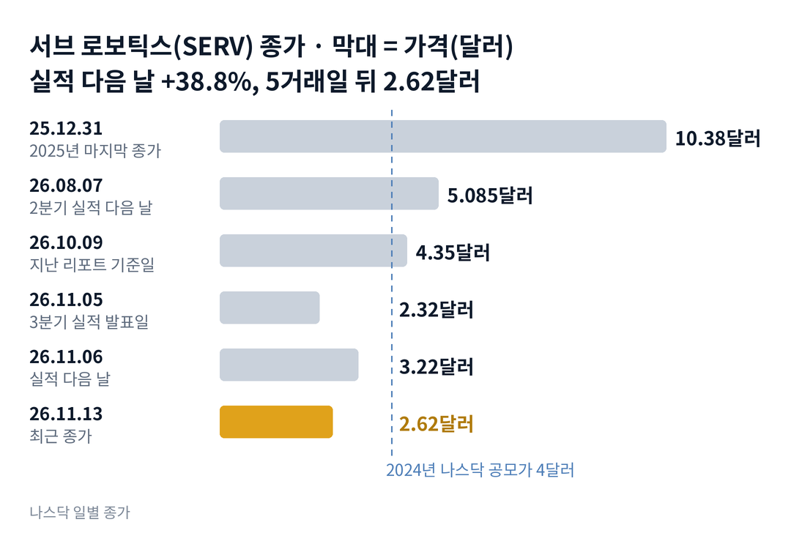

매출 전망을 올린 다음 날 주가가 38.8% 뛰었는데, 왜 일주일도 안 돼 그 상승의 절반 넘게 사라졌을까요? 서브 로보틱스는 11월 5일 장이 끝난 뒤 3분기 실적을 냈습니다. 올해 매출 전망은 900만~1,000만 달러에서 1,200만 달러로 올라갔습니다.

다음 날인 11월 6일 주가는 2.32달러에서 3.22달러가 됐습니다. 그런데 5거래일 뒤인 11월 13일 종가는 2.62달러였습니다. 급등 날 종가보다 18.6% 낮은 자리입니다. 같은 기간 소형주를 모은 상장지수펀드(ETF)인 IWM(러셀 2000 지수 추종)은 1.4% 올랐으니, 시장 전체가 끌어내린 움직임은 아니었습니다.

> **유의사항** 저자는 금융·투자 자문가가 아닙니다. 이 글은 공개 공시와 시세를 정리한 교육용 분석이며 특정 종목의 매수·매도를 권하지 않습니다. 과거 패턴은 미래 수익을 보장하지 않고, 이 종목은 하루 40% 가까이 움직인 날이 여러 번 있습니다. 실제 투자 전에는 최신 공시를 직접 확인하세요.

이 이야기는 시청자 반응이 컸던 종목의 업데이트입니다. [10월 11일 리포트](/r/serv-2026-10/)는 이 주식을 움직인 힘을 '약속의 크기'와 '그 약속을 위해 새로 나오는 주식'의 줄다리기로 봤습니다. 그리고 앞으로 갈 길을 네 갈래로 적었습니다. 새 손님이 우버의 빈자리를 메우는 길, 희석이 이어지며 공모가 아래로 가는 길, 이름값 급등이 반복되는 길, 우버 계약 만료의 공백입니다. 여기에 9월 말 현금 추정을 더한 다섯 항목을 채점하면, 지난 예측 성적은 적중 하나, 부분 적중 둘, 빗나감 하나, 확인 전 하나입니다. 부분 적중은 결과는 맞았지만 계기가 달랐다는 뜻입니다.

맞은 것은 첫 번째 갈래였습니다. 새 배달 손님이 우버의 빈자리를 메우면 하루 평균 운행 로봇 수가 다시 늘 것이라고 봤습니다. 실제로 3분기 운행 로봇은 하루 평균 917대였습니다. 2분기 792대보다 늘어난 숫자입니다. 매출 전망도 지켜진 정도가 아니라 올라갔습니다.

가장 크게 빗나간 것은 현금이었습니다. 지난 리포트는 9월 말 현금을 약 1억 9,400만 달러 안팎으로 계산했습니다. 실제로는 1억 9,800만 달러였고, 그 사이 새 주식은 한 주도 팔지 않았습니다. 주식을 팔아 희석이 이어진다는 두 번째 갈래도 그래서 절반만 맞았습니다. 주가는 10월 12일 공모가 4달러 아래로 내려갔지만, 이유는 새 주식 판매가 아니었습니다.

서브 로보틱스가 어떤 회사인지부터 짚고 가겠습니다. 이 회사는 2021년 우버에서 떨어져 나온 보도 배달 로봇 회사입니다. 미국 여러 도시에 로봇 2,000대 넘게 깔아 두고, 배달 앱 주문을 식당에서 손님 집 앞까지 나릅니다. 올해 1월에는 병원 안에서 물건을 나르는 로봇 회사 딜리전트 로보틱스를 사들였습니다.

돈을 버는 방식은 크게 두 갈래입니다. 공시는 매출을 '플릿 서비스'와 '소프트웨어 서비스'로 나눕니다. 플릿 서비스는 로봇이 실제로 일해서 받는 돈입니다. 배달 요금, 로봇 몸체에 붙이는 광고, 병원 로봇 서비스가 여기에 들어갑니다. 소프트웨어 서비스는 로봇을 움직이는 기술을 다른 곳에 파는 돈입니다.

문제는 아직 버는 돈보다 쓰는 돈이 훨씬 크다는 점입니다. 3분기 매출은 283.5만 달러였고, 매출을 내는 데 든 원가는 1,039만 달러였습니다. 원가가 매출의 약 3.7배입니다. 연구와 관리 비용까지 더한 순손실은 5,923만 달러였습니다.

지금 몸값은 11월 13일 종가 기준 약 2억 2,940만 달러입니다. 9월 말 주식 수 8,756만 주로 계산한 값입니다. 회사가 9월 말 가진 현금과 유가증권은 1억 9,800만 달러입니다. 둘을 단순히 빼면 약 3,140만 달러입니다. 부채를 넣지 않은 단순 차감값이지만, 시장이 사업 자체에 매긴 값이 그 정도에 가깝다고 볼 수 있습니다. 그렇다고 이 현금이 주가의 바닥을 보장하지는 않습니다.

이제 실적 날로 돌아가 보겠습니다. 발표 직전인 11월 5일 낮에 주가는 하루 12.5% 내려 2.32달러였습니다. 그날은 소형주 ETF도 4.6% 내린 날이라, 시장 전체가 약한 상태에서 실적을 맞았습니다. 장이 끝난 뒤 나온 보도자료의 첫 줄은 화려했습니다. 매출이 1년 전보다 313% 늘었고, 연 매출 전망을 1,200만 달러로 올린다는 내용이었습니다.

같은 날 회사는 새 사업도 내놓았습니다. 이름은 '서브 피지컬 AI 서비스'입니다. 서브가 자기 로봇을 굴리며 쌓은 연결 기술과 주행 데이터를 다른 로봇 회사에 파는 사업입니다. 첫 고객으로는 건설 장비 자율주행 회사 베드록 로보틱스가 소개됐습니다. 다만 가격과 예상 매출은 공개되지 않았습니다.

비용 쪽 소식도 좋았습니다. 회사는 주식 보상과 인수 관련 비용을 뺀 올해 영업비용 전망을 1억 5,000만 달러로 낮췄습니다. 연초에 낸 전망의 아래쪽 끝인 1억 6,000만 달러보다도 작습니다. 10월에는 호주에서 첫 해외 도시 서비스도 시작했습니다. 다음 날 주가가 38.8% 뛴 데는 이렇게 좋은 소식이 한꺼번에 나온 영향이 컸던 것으로 보입니다.

그런데 보도자료 아래쪽 표를 넘기면 다른 숫자가 나옵니다. 3분기 매출은 283.5만 달러였습니다. 2분기 323.8만 달러보다 12.4% 적습니다. 313%라는 숫자는 1년 전 3분기와 비교한 값이고, 바로 앞 분기와 비교하면 매출은 줄었습니다.

줄어든 곳은 소프트웨어 서비스였습니다. 앞 분기 93.3만 달러에서 이번 분기 25.3만 달러로 내려왔습니다. 로봇이 일해서 버는 플릿 서비스는 같은 기간 12.0% 늘었습니다. 본업은 자랐지만, 한 번에 들어오던 기술 매출이 빠지면서 전체 매출이 뒷걸음질한 것입니다.

올린 전망도 계산해 보면 크기가 달라 보입니다. 회사가 9월까지 올린 매출은 905.7만 달러입니다. 올해 1,200만 달러를 채우려면 4분기에 약 294만 달러가 필요합니다. 3분기 283.5만 달러보다 약 3.8% 많은 정도입니다. 전망을 올렸다는 말은 맞지만, 4분기에 매출이 크게 뛴다는 뜻은 아니었습니다.

현금도 같은 방향을 가리킵니다. 현금과 유가증권은 6월 말보다 9월 말에 4,240만 달러 줄어 1억 9,800만 달러가 됐습니다. 새 주식을 팔지 않은 분기에 줄어든 돈입니다. 9월 말 현금을 3분기 감소액으로 나누면 약 4.7분기입니다. 이 속도가 이어진다면 2027년 말 무렵까지 버티는 계산입니다. 회사는 보고서에서 앞으로 최소 12개월은 버틸 수 있다고 적었습니다.

그리고 판매 창구가 아직 열려 있습니다. 판매 창구는 회사가 시장 가격으로 새 주식을 조금씩 팔 수 있게 미리 열어 둔 통로입니다. 9월 말 기준 남은 한도는 7,240만 달러입니다. 11월 13일 종가로 이 한도를 모두 쓰면 약 2,763만 주가 새로 나옵니다. 지금 주식 수의 약 31.6%입니다(계산).

이렇게 놓고 보면 투자자들이 무엇을 다시 계산했는지 보입니다. 첫 줄의 313%와 1,200만 달러는 1거래일 만에 가격에 들어갔습니다. 그 뒤 며칠 동안 시장은 앞 분기보다 줄어든 매출과 비슷한 4분기, 그리고 여전히 큰 현금 소진을 차례로 반영했습니다. 11월 9일 3.39달러를 찍은 뒤 4거래일 동안 2.62달러까지 밀린 흐름이 그 과정이었습니다.

이런 하루 급등은 이 종목에서 처음이 아니었습니다. 나스닥 일별 종가로 2024년 4월 상장부터 2026년 10월까지 전날보다 20% 넘게 오른 날을 모두 골라 보니 10번이었습니다. 이번 급등이 하루에 나왔기 때문에 '하루 상승폭'을 기준으로 잡았습니다. 그리고 급등 날 종가를 20거래일 뒤 종가와 비교했습니다. 한 달 남짓이면 첫 흥분이 가라앉고 숫자가 다시 보이는 기간이기 때문입니다.

예를 들어 2025년 10월 9일에는 도어대시와의 제휴 발표로 하루 28.6% 올라 17.68달러가 됐습니다. 그러나 20거래일 뒤 종가는 급등 날보다 39.5% 낮았습니다. 다음 날 회사가 1억 달러어치 새 주식 판매를 발표한 영향도 컸습니다. 큰 소식이 나온 날의 상승이 한 달을 버티지 못한 셈입니다.

10번 전체를 놓고 보면 결과는 한쪽으로 기웁니다. 20거래일 뒤 종가가 급등 날 종가보다 낮았던 경우가 8번이었습니다. 급등 전날 종가보다도 낮아져 상승을 모두 내준 경우는 4번이었습니다. 20거래일 뒤 변화의 중앙값은 -16.2%였습니다.

예외는 두 번이었습니다. 2024년 7월 19일 엔비디아의 지분 보유가 알려진 날은 하루 187.1% 뛰었고, 20거래일 뒤에도 47.8% 더 높았습니다. 2024년 12월 6일 급등도 한 달 뒤 57.7% 더 높았습니다. 두 번 모두 2024년, 주가가 처음 크게 오르던 시기에 나왔습니다.

실적 발표만 따로 봐도 비슷합니다. 2024년 이후 실적을 낸 11번 가운데 다음 날 주가가 오른 것은 이번을 포함해 3번뿐이었습니다. 그중 2025년 5월만 큰 매출 목표를 내놓은 뒤 오름세가 이어졌습니다. 이번 하락 속도도 지난 기록 안에 있습니다. 급등 10번 가운데 5번은 5거래일 뒤 종가가 급등 날 종가보다 12% 넘게 낮았습니다.

이 기록에는 한계도 있습니다. 10번 가운데 2024년 7월과 2025년 1월의 급등은 며칠 간격으로 붙어 있어 측정 기간이 겹칩니다. 그래서 10번을 독립된 사례로 보기는 어렵습니다. 그 사이 회사의 크기와 주가 수준도 크게 바뀌었습니다. 그래서 이 기록은 10번 중 8번이 그랬다는 참고 자료로만 씁니다.

이번이 다를 수 있는 점도 있습니다. 지난 급등 대부분은 엔비디아, 도어대시 같은 이름이나 테마에서 나왔습니다. 이번에는 운행 로봇 수와 매출 전망처럼 회사가 직접 낸 숫자에서 나왔습니다. 시가총액이 현금보다 약 3,140만 달러 많을 뿐이라, 현금이 바닥을 받쳐 줄 수 있다는 시각도 있습니다. 다만 그 현금은 한 분기에 4,240만 달러씩 줄고 있습니다.

지금 위치를 한 줄로 말하면, 숫자는 지난 리포트가 바란 방향으로 한 걸음 움직였습니다. 운행 로봇이 늘었고 비용 전망도 낮아졌습니다. 하지만 주가는 그 숫자의 크기를 1거래일 만에 넘겨 받았다가 다시 덜어 내는 중입니다. 11월 13일 종가 2.62달러는 실적 전 종가 2.32달러보다 아직 12.9% 높습니다.

앞으로 길을 가를 기준은 두 가지입니다. 하나는 급등 날부터 20번째 거래일인 12월 7일 종가가 실적 전 종가 2.32달러보다 높은가입니다. 다른 하나는 그때까지 피지컬 AI 서비스의 새 고객이나 새 도시 같은 회사 발표가 나오는가입니다. 두 기준을 겹치면 갈 길은 네 갈래입니다.

새 발표가 나오고 종가가 2.32달러 위라면 첫째 갈래, 새 사업이 바닥을 받친 경우입니다. 발표가 나왔는데도 그 아래라면 둘째 갈래, 발표에도 되돌림이 이어진 경우입니다. 발표 없이 그 아래로 내려가면 셋째 갈래, 실적 급등을 모두 반납한 경우입니다. 발표 없이도 위를 지키면 넷째 갈래, 조용히 버틴 경우입니다. 제 주관적 추정으로는 첫째 갈래가 약 25%, 둘째가 약 20%입니다. 셋째는 약 30%, 넷째는 약 25%입니다. 이 숫자는 주가가 오를 확률이 아니라, 12월 7일에 두 기준이 어느 칸에 들어갈지에 대한 추정입니다.

과거 기록만 따르면 급등 전날 종가 아래로 내려간 경우는 10번 중 4번, 40%였습니다. 이번에는 2.32달러 아래에서 끝나는 둘째와 셋째 갈래를 합쳐 절반으로 올려 잡았습니다. 이번에는 5거래일 뒤 종가가 11월 6일 종가보다 18.6% 낮아 되돌림이 빨랐고, 같은 기간 시장은 오히려 올랐습니다. 12월 7일까지 새 고객이나 새 도시 발표가 나올 가능성은 첫째와 둘째 갈래를 더한 약 45%로 봤습니다. 회사는 10월 호주, 11월 새 사업처럼 한 달에 한 번꼴로 큰 발표를 냈습니다. 다만 새 사업의 고객 이름은 아직 하나뿐이라 절반 아래로 잡았습니다.

위험도 짚어 두겠습니다. 먼저 이 분석의 한계입니다. 급등 10번의 기록은 서로 겹치는 날이 있고 표본이 작습니다. 운행 로봇 수는 2분기부터 병원 실내 로봇을 함께 셉니다. 그래서 보도 배달 로봇만의 변화는 이 숫자로 따로 알기 어렵습니다.

사업 쪽에서는 로봇이 일할수록 손실이 줄어드는 구조가 아직 확인되지 않았습니다. 3분기 원가가 매출의 약 3.7배였습니다. 피지컬 AI 서비스는 가격과 매출이 공개되지 않아 지금은 기대로만 남아 있습니다. 우버 이츠 물량은 회사 스스로 연말까지 줄어든 상태가 이어진다고 적었습니다. 우버와의 계약은 2027년 2월 24일 끝납니다.

바깥에서는 시장 분위기가 큽니다. 이 종목은 인공지능 로봇 테마가 달아오를 때 크게 뛰고, 식을 때 크게 내렸습니다. 11월 5일처럼 시장 전체가 약한 날에는 하루 두 자릿수 하락도 나왔습니다. 테마의 온도가 바뀌면 회사 숫자와 상관없이 주가가 흔들릴 수 있습니다.

가장 직접적인 위험은 자금 조달입니다. 지금 속도라면 현금은 2027년 말 무렵까지 버티는 계산입니다. 그 전에 남은 판매 창구 7,240만 달러를 쓰기 시작하면 주가가 낮을수록 더 많은 주식이 나옵니다. 지난 리포트가 말한 '약속과 새 주식의 줄다리기'가 다시 시작되는 셈입니다.

결국 이번 급등은 보도자료의 첫 줄에서, 되돌림은 그 아래 표에서 나왔습니다. 첫 줄은 1년 전과 비교했고, 표는 바로 앞 분기와 비교했기 때문입니다. 이 종목에서 큰 소식으로 뛴 날의 가격은 10번 중 8번 한 달 뒤 더 낮았습니다. 그래서 12월 7일 종가가 2.32달러 위인지와 새 고객 발표가 나왔는지가 이번 판정을 가릅니다. 다음 갱신은 그 판정 뒤, 그리고 2027년 3월 무렵 4분기 실적에서 1,200만 달러가 채워졌는지를 보고 하겠습니다.

## 숫자로 다시 보기

본문에 나온 숫자를 찾아보기 쉽게 표로 모았습니다. 영상 설명과 고정 댓글이 가리키는 표는 아래에 같은 제목으로 있습니다.

### 숫자로 본 지금의 크기

| 항목 | 2026년 11월 기준 |
| --- | --- |
| 11월 13일 종가 | **2.62달러** 지난 리포트 기준일 10월 9일 4.35달러 |
| 시가총액 | **약 2억 2,940만 달러** 9월 말 주식 8,756만 주로 계산 |
| 현금과 유가증권 | **1억 9,800만 달러** 9월 말, 6월 말 2억 4,040만 달러 |
| 시가총액에서 현금을 뺀 값 | **약 3,140만 달러** 부채를 넣지 않은 단순 차감값 |
| 판매 창구 남은 한도 | **7,240만 달러** 11월 13일 종가로 약 2,763만 주 |

### 3분기 실적 표 · 좋아진 숫자와 나빠진 숫자

| 항목 | 2026년 3분기 | 비교 |
| --- | --- | --- |
| 매출 | **283.5만 달러** | 2분기 323.8만 (-12.4%) |
| 플릿 서비스 매출 | 258.2만 달러 | 2분기 230.5만 (+12.0%) |
| 소프트웨어 서비스 매출 | 25.3만 달러 | 2분기 93.3만 |
| 하루 평균 운행 로봇 | **917대** | 2분기 792대 |
| 매출 원가 | 1,039만 달러 | 매출의 약 3.7배 |
| 순손실 | 5,923만 달러 | 2분기 6,413만 |
| 올해 매출 전망 | **1,200만 달러** | 종전 900만~1,000만 |
| 전망이 뜻하는 4분기 매출 | **약 294만 달러** | 3분기 대비 약 +3.8% |

### 급등 기록표 · 하루 20% 넘게 오른 날과 그 뒤

2024년 4월 상장부터 2026년 10월까지 10번입니다. 비교 기준은 급등 날 종가입니다.

**한눈에:** 20거래일 뒤 급등 날 종가보다 낮음 **8/10**. 급등 전날 종가보다도 낮음 **4/10**. 20거래일 뒤 변화의 중앙값 **-16.2%**.

| 급등 날 · 하루 변화 | 5거래일 뒤 | 20거래일 뒤 |
| --- | --- | --- |
| 2024.07.19 +187.1% · 엔비디아 지분 | +75.1% | **+47.8%** |
| 2024.07.25 +41.7% | +42.3% | -16.8% |
| 2024.07.29 +46.7% | -29.8% | **-50.6%** |
| 2024.10.28 +21.1% | -19.9% | -25.3% |
| 2024.12.06 +23.8% | +10.8% | **+57.7%** |
| 2024.12.26 +24.8% | +7.9% | -0.7% |
| 2025.01.03 +28.9% | -22.3% | -15.6% |
| 2025.01.06 +20.3% | -28.3% | -29.9% |
| 2025.05.22 +21.1% | +0.6% | -11.8% |
| 2025.10.09 +28.6% · 도어대시 제휴 | -12.7% | **-39.5%** |

**이번 사례(20거래일 결과 미확정):** 2026.11.06 하루 +38.8%, 급등 날 종가 3.22달러. 5거래일 뒤 11월 13일 2.62달러(-18.6%). 12월 7일(20거래일째) 종가가 3.22달러, 그리고 실적 전 종가 2.32달러보다 높은지 확인합니다.

### 시나리오 표 · 앞으로 일어날 수 있는 일

아래 가능성은 주가가 오를 확률이 아니라, 12월 7일에 두 판정 기준이 어느 칸에 들어갈지에 대한 분석자의 주관적 추정입니다. 네 경우는 겹치지 않아 '약 N%'를 더하면 100%이고, 괄호 안 구간은 흔들림의 폭이라 서로 더하지 않습니다.

| 시나리오(판정 2026년 12월 7일) | 발표 · 종가 | 가능성(추정) |
| --- | --- | --- |
| **1 · 새 사업이 바닥을 받침** | 있음 · 2.32 위 | 중간 약 25% (18~32%) |
| 2 · 발표에도 되돌림 | 있음 · 2.32 아래 | 중간 약 20% (14~26%) |
| **3 · 실적 급등 모두 반납** | 없음 · 2.32 아래 | 높음 약 30% (23~37%) |
| 4 · 조용히 버팀 | 없음 · 2.32 위 | 중간 약 25% (18~32%) |

### 핵심 확인 세 가지

위에서부터 판정을 바꾸는 힘이 큰 순서입니다.

- ☐ 1순위 · 12월 7일(20거래일째) 종가가 실적 전 종가 2.32달러보다 높은가
- ☐ 2순위 · 12월 7일까지 피지컬 AI 서비스 새 고객이나 새 도시 발표가 있나
- ☐ 3순위 · 2027년 3월 무렵 4분기 실적에서 연 매출 1,200만 달러와 현금 감소 폭

**보조 확인:** 판매 창구 사용 여부(다음 분기 보고서의 주식 수), 2027년 2월 24일 우버 계약 만료 뒤 물량 설명을 봅니다.

### 지난 예측 채점표

10월 11일 리포트(10월 9일 기준 종가 4.35달러)의 예측을 11월 13일 기준으로 채점한 결과입니다. 지난 리포트에는 시나리오별 가능성 숫자가 없었습니다.

| 지난 점검 항목 · 당시 기준 | 판정 및 실제 결과(11월 13일) |
| --- | --- |
| **시나리오 1: 새 손님이 우버의 빈자리를 메움** 운행 로봇 다시 증가, 전망 900만~1,000만 달러 유지 | **[적중]** 운행 로봇 792대에서 917대, 전망 1,200만 달러로 상향 |
| **시나리오 2: 희석이 이어지며 공모가 아래로** 판매 창구로 주식 증가, 4달러 아래 | **[부분 적중(다른 계기)]** 10월 12일 4달러 아래, 3분기 판매 창구 판매 없음 |
| **시나리오 3: 이름값과 테마 급등의 반복** 하루 두 자릿수 상승 뒤 한 달 안 되돌림 | **[부분 적중(다른 계기)]** 실적으로 +38.8%, 5거래일 -18.6% |
| **시나리오 4: 우버 계약 만료의 공백** 2027년 2월 24일 만료 | **[확인 전]** 만료 전 |
| **9월 말 현금 추정** 1억 9,300만~1억 9,500만 달러 | **[빗나감]** 실제 1억 9,800만 달러 |
