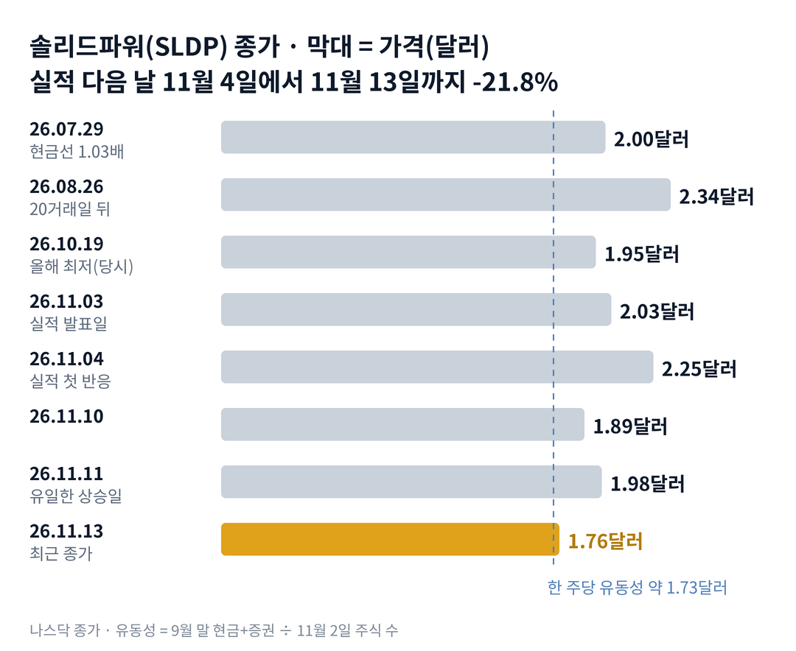

## 짧은 답

> **핵심:** 주가가 한 주당 현금과 거의 같아졌지만, 과거 네 번 가운데 세 번은 그 선을 곧 깼고, 버틴 한 번은 업종 대표가 함께 오른 때였습니다.

회사 사정은 그대로인데, 주가는 왜 현금 가치까지 내려왔을까요? 솔리드파워 주가는 11월 13일 1.76달러로 끝났습니다. 실적 다음 날인 11월 4일 종가 2.25달러 대비 7거래일 만에 21.8% 내린 값입니다. 회사의 9월 말 현금과 증권을 주식 수로 나누면 한 주당 약 1.73달러입니다. 주가와의 차이는 3센트뿐입니다.

현금이 이만큼 있으니 여기가 바닥이라고 생각하기 쉽습니다. 그렇다고 이 현금이 주가의 바닥을 보장하지는 않습니다. 이 종목의 기록도 그렇게 말합니다. 상장 뒤 주가가 한 주당 현금의 1.05배 안으로 처음 들어온 날은 네 번이었습니다. 세 번은 10거래일 안에 현금 가치 아래로 마감했고, 20거래일 뒤 주가가 그날보다 낮았습니다.

버틴 한 번은 2026년 7월 29일이었습니다. 같은 20거래일 동안 업종 대표 퀀텀스케이프(QS)는 7월 29일 종가 대비 15.7% 올랐습니다. 네 번 모두 솔리드파워는 퀀텀스케이프와 같은 방향으로 움직였습니다. 길을 가른 것은 현금이 아니라 업종의 방향이었습니다.

**2026.11.13 진단: 국면 C(현금이 주가를 받치는 단계)는 유지, 다만 현금선 자체를 시험하는 자리입니다 — 근거는 5부.** 지금 확인할 것은 두 가지입니다. 12월 14일까지 1.73달러 아래 종가가 나오는지, 그리고 그날 퀀텀스케이프가 11월 13일 종가 위에 있는지입니다.

> **유의사항** 저자는 금융·투자 자문가가 아닙니다. 이 글은 공개 공시와 시세를 정리한 교육용 분석이며 특정 종목의 매수·매도를 권하지 않습니다. 과거의 주가 반응이 미래에 반복된다는 보장은 없고, 솔리드파워는 하루에 10% 넘게 움직이는 일이 잦은 종목입니다. 실제 투자 전에는 최신 가격과 공시를 직접 확인하세요.

## 지난 리포트 이후

[11월 4일 리포트](/r/sldp-2026-11/)와 [10월 26일 리포트](/r/sldp-2026-10-3/)의 예측을 11월 13일 종가로 채점했습니다. 지난 예측 성적은 적중 3 · 빗나감 1 · 진행 중 4입니다. 현금이 주가를 받친다는 진단과 10월 리포트의 마감가 예측은 맞았고, 실적 첫 반응을 과거 범위 안으로 본 것은 빗나갔습니다. 진행 중인 넷은 다음 달 채점할 네 가지 시나리오입니다. 항목별 채점표는 6부 끝에 있습니다.

## 1부. 실적 뒤 7거래일, 주가와 현금의 거리

> **핵심:** 회사 사정은 실적 날과 달라진 것이 없는데, 주가가 내려와 한 주당 현금과의 거리가 29센트에서 3센트로 줄었습니다.

솔리드파워는 미국 콜로라도주에 본사를 둔 전고체 배터리 재료 회사입니다. 전고체 배터리는 액체 대신 고체 재료로 전기를 옮겨 불이 잘 붙지 않는 차세대 배터리입니다. 회사는 이 배터리에 들어가는 황화물 고체 전해질을 만듭니다.

돈을 버는 방식은 재료 판매와 기술 계약입니다. 배터리를 직접 대량으로 만들지 않고, 전해질을 삼성SDI(삼성 계열 배터리 회사)나 에스케이온(SK On, SK그룹의 배터리 회사) 같은 회사에 팔고 셀 설계를 빌려줍니다. 3분기 매출은 24만 3,000달러로 1년 전 373만 달러보다 93% 줄었고, 순손실은 2,440만 달러였습니다.

그래서 이 회사의 주가는 사업보다 현금에 기대고 있습니다. 매출이 손실을 메우려면 아직 시간이 걸리고, 그동안 버티는 힘은 예전에 모은 현금입니다. 부채는 없고, 회사는 분기 보고서에서 지금 가진 돈으로 앞으로 12개월 이상 버틸 수 있다고 밝혔습니다.

지금 몸값을 볼 때 가장 먼저 비교하는 숫자는 한 주당 유동성입니다. 유동성은 현금과 바로 현금으로 바꿀 수 있는 증권을 합친 돈입니다. 지난 리포트는 3분기 평균 주식 수로 나눠 약 1.74달러로 적었습니다. 이번에는 10-Q 표지에 나온 11월 2일 주식 수로 다시 나눠 약 1.73달러가 됐습니다.

### 숫자로 본 지금의 크기(11월 13일 기준)

| 항목 | 값 · 근거 |
| --- | --- |
| 9월 말 유동성 | **3억 9,756만 달러** 현금 2,328만 + 증권 3억 7,428만, 부채 0 |
| 11월 2일 주식 수 | **2억 2,919만 주** 10-Q 표지 |
| 한 주당 유동성 | **약 1.73달러** 유동성 ÷ 11월 2일 주식 수 |
| 11월 13일 종가 | **1.76달러** 한 주당 유동성의 약 1.01배 |
| 시가총액 − 유동성 | **약 580만 달러** 시가총액 약 4억 340만 달러에서 뺀 단순 차액 |
| 4분기 예상 현금 투입 | **약 1,840만~2,840만 달러** 연 전망 7,500만~8,500만 − 9개월 5,660만 |

시가총액에서 유동성을 빼고 남는 약 580만 달러는 시장이 연구소, 생산 라인, 특허, 고객 관계에 매긴 값으로 읽을 수 있습니다. 실적 발표 전날인 11월 3일에는 이 차액이 약 6,800만 달러였습니다. 다만 부채 외의 다른 의무와 앞으로 쓸 돈을 빼지 않은 단순 계산입니다.

위 그림처럼 주가는 11월 4일 꼭대기에서 거의 매일 내려왔습니다. 일곱 거래일 가운데 오른 날은 11월 11일 하루였습니다. 회사 숫자는 그대로인데, 주가는 왜 이렇게 내려왔을까요?

## 2부. 회사 소식 없이 내린 일곱 거래일

> **핵심:** 하락 기간에 회사 공시는 한 건도 없었고, 같은 업종의 퀀텀스케이프도 16.9% 내려 업종 전체에 찬바람이 분 것으로 보입니다.

11월 4일 주가는 10.8% 올랐습니다. 회사가 올해 현금 투입 전망을 8,500만~1억 달러에서 7,500만~8,500만 달러로 낮춘 다음 날이었습니다. 돈을 덜 쓰면 현금이 덜 줄어듭니다. 시장은 이 소식을 반겼습니다.

그 뒤 일곱 거래일 동안 회사가 미국 증권거래위원회(SEC)에 낸 새 서류는 없었습니다. 새 주식을 판다는 공시도, 계약이 끊겼다는 소식도 없었습니다. 11월 13일 거래량은 약 380만 주로, 최근 60거래일 평균 약 306만 주보다 조금 많은 정도였습니다.

같은 기간 다른 종목과 나란히 놓으면 하락의 성격이 보입니다. 비교 기간은 실적 다음 날인 11월 4일 종가부터 11월 13일 종가까지입니다.

| 종목 · 11월 4일 → 13일 | 변화 |
| --- | --- |
| **솔리드파워(SLDP)** 2.25 → 1.76달러 | **-21.8%** |
| **퀀텀스케이프(QS)** 4.43 → 3.68달러 | **-16.9%** |
| **미국 중소형주 지수(IWM)** 284.02 → 277.54달러 | **-2.3%** |

시장 전체는 거의 그대로였습니다. 그런데 전고체 배터리의 대표 주식은 솔리드파워와 비슷하게 크게 내렸습니다. 회사 고유의 나쁜 소식이 아니라, 업종 전체의 기대가 식은 쪽에 가깝다는 뜻입니다. 퀀텀스케이프의 사정은 [퀀텀스케이프 리포트](/r/qs-2026-11/)에서 볼 수 있습니다. 과거에 주가가 이렇게 현금 가치까지 내려왔을 때는 무슨 일이 있었을까요?

## 3부. 현금선에 처음 닿은 네 번의 기록

> **핵심:** 주가가 한 주당 유동성의 1.05배 안으로 처음 들어온 네 번 가운데 세 번은 곧 그 선을 깼고, 네 번 모두 퀀텀스케이프와 같은 방향으로 움직였습니다.

기준은 이렇습니다. 그날 이미 공개돼 있던 직전 분기 말 유동성과 주식 수로 한 주당 유동성을 계산했습니다. 그리고 다섯 거래일 내내 그 1.05배 위에 있던 주가가 처음 1.05배 안으로 마감한 날만 골랐습니다. 상장한 2021년 12월부터 11월 13일까지 네 번이 나왔고, 이번이 다섯 번째입니다. 이 날만 고른 이유는 지금과 같은 조건, 즉 주가가 현금 가치 바로 위까지 막 내려온 순간이기 때문입니다.

예를 들어 이번에는 11월 13일 종가 1.76달러를 한 주당 유동성 1.73달러로 나눠 1.01배가 됩니다. '20거래일 뒤'는 그날 종가와 20거래일 뒤 종가를 비교한 값입니다. 퀀텀스케이프 칸도 같은 날짜로 계산했습니다.

**한눈에:** **3/4** 10거래일 안에 1배 아래 마감 · **3/4** 20거래일 뒤 그날보다 낮음 · **4/4** 퀀텀스케이프와 같은 방향.

### 한 주당 유동성 1.05배 안으로 처음 들어온 날

| 날짜 · 종가(배수) | 1배 아래 마감 | 20거래일 뒤(QS) |
| --- | --- | --- |
| **2022.12.05** 3.02달러(1.05배) | 다음 날 | -25.8% (-24.6%) |
| **2023.03.01** 2.93달러(1.04배) | 10거래일째 | -1.7% (-12.3%) |
| **2023.07.20** 2.74달러(1.04배) | 다음 날 | -22.3% (-32.7%) |
| **2026.07.29** 2.00달러(1.03배) | 없음 | +17.0% (+15.7%) |

가장 닮은 예는 2022년 12월입니다. 12월 5일 3.02달러로 1.05배 안에 들어온 주가는 바로 다음 날 2.80달러로 현금 가치 아래로 내려갔습니다. 20거래일 뒤인 2023년 1월 4일에는 2.24달러였습니다. 현금 가치는 바닥이 아니라 지나가는 자리였습니다.

현금 가치 아래의 시간은 길었습니다. 2023년 8월 초 다시 1배 아래로 내려간 뒤, 2025년 6월 10일까지 거래일의 약 97%를 현금보다 싸게 거래됐습니다. 가장 쌀 때는 2024년 1월 18일 1.17달러로, 한 주당 유동성의 약 0.49배였습니다. 그렇다면 네 번 가운데 버틴 한 번은 무엇이 달랐을까요?

> **이번 사례(20거래일 결과 미확정):** 2026.11.13 종가 1.76달러(1.01배) · 퀀텀스케이프 3.68달러 · 12월 14일(20거래일째) 두 종가와 그 사이 1.73달러 아래 마감 여부를 확인

## 4부. 버틴 한 번과 깬 세 번의 차이

> **핵심:** 현금선을 지킨 2026년 7월에는 업종 대표가 함께 올랐고, 깬 세 번에는 업종 대표가 10% 넘게 내렸습니다.

2026년 7월 29일 주가는 2.00달러로, 한 주당 유동성의 1.03배까지 내려왔습니다. 일주일 뒤에는 2분기 실적이 있었고, 실적 다음 날 주가는 7.0% 내렸습니다. 그래도 주가는 1배 선을 한 번도 깨지 않았습니다. 20거래일 뒤인 8월 26일에는 2.34달러였습니다.

같은 기간 퀀텀스케이프는 7월 29일 종가 4.96달러에서 8월 26일 5.74달러로 15.7% 올랐습니다. 깬 세 번은 반대였습니다. 퀀텀스케이프는 각각 24.6%, 12.3%, 32.7% 내렸습니다. 솔리드파워의 20거래일 뒤 결과는 네 번 모두 퀀텀스케이프와 같은 방향이었습니다.

이 표에서 읽을 수 있는 것은 이렇습니다. 현금이 많다는 사실은 이 종목에서 바닥을 만들어 주지 못했습니다. 길을 정한 것은 전고체 배터리 업종의 바람이었습니다. 그래서 이번 시나리오는 현금선과 퀀텀스케이프 두 가지를 함께 축으로 씁니다.

현금선 자체도 조금씩 내려갑니다. 4분기에 1부 표의 현금 투입이 그대로 나가면 연말 한 주당 유동성은 약 1.61~1.65달러가 됩니다. 주가가 그대로여도 배수는 조금씩 올라가는 구조입니다.

회사가 새 주식을 팔 수 있는 문도 열려 있습니다. 시장에서 조금씩 주식을 파는 계약의 남은 한도가 9월 말 약 5,879만 달러입니다. 회사는 2026년 1~9월에 이 한도를 쓰지 않았습니다. 마지막 신주 발행은 1월 28일 계약한 1억 3,000만 달러 직접 공모였습니다.

과거 기록이 알려 주는 것은 현금선이 바닥을 정하지 않았다는 점입니다. 그래서 앞으로 확인할 조건은 두 가지입니다. 하나는 12월 14일까지 주가가 1.73달러 아래로 마감하는가이고, 다른 하나는 그날 퀀텀스케이프가 11월 13일 종가보다 높은가입니다. 이 두 조건을 엮으면 어떤 갈림길이 나올까요?

## 5부. 현금선과 업종, 네 가지 시나리오

> **핵심:** 지금은 국면 C(현금이 주가를 받치는 단계)의 끝자락이고, 12월 14일까지 현금선이 지켜지는지와 퀀텀스케이프의 방향이 시나리오를 가릅니다.

> **국면 정의(솔리드파워 시리즈 공통):** 국면 A(기대 확산) — 업종이 한 달에 20% 넘게 오르고 파트너 소식이 이어지는 때. 국면 B(실망과 희석) — 새 주식 발행이 나오고 좋은 소식에도 내리는 때. 국면 C(현금이 주가를 받치는 단계) — 시가총액이 유동성의 1.5배 안에서 자금 조달 없이 움직이는 때.

**2026년 11월 13일 진단: 국면 C 유지, 현금선 시험 중.** 배수는 1.01배로 국면 C 범위 안이고, 새 주식 발행 공시는 없습니다. 다만 배수가 1배 아래로 내려가면 2023~2025년처럼 현금보다 싸게 거래되는 긴 구간이 다시 올 수 있습니다. 국면 A로 넘어가는 신호는 금액이 붙은 합작법인 계약과 퀀텀스케이프의 한 달 20% 넘는 상승입니다.

**판정 기준 두 가지:** 모두 12월 14일(11월 13일부터 20번째 거래일) 기준입니다. 하나는 그날까지 종가가 한 주당 유동성 1.73달러 아래로 내려간 날이 있는가입니다. 다른 하나는 그날 퀀텀스케이프 종가가 11월 13일 3.68달러보다 높은가입니다.

### 앞으로 일어날 수 있는 일

**확인된 사실:** 11월 13일 배수는 약 1.01배이고, 10-Q 뒤 새 공시는 없습니다. 퀀텀스케이프는 11월 4일 뒤 16.9% 내렸습니다.

**과거 기록:** 3부의 4번 중 3번은 10거래일 안에 1배 아래로 마감했습니다. 4번 모두 20거래일 뒤 방향이 퀀텀스케이프와 같았습니다.

**추정:** 아래 가능성은 주가가 오를 확률이 아니라, 12월 14일에 두 판정 기준이 어느 칸에 들어갈지에 대한 분석자의 주관적 추정입니다. 네 경우는 겹치지 않아 '약 N%'를 더하면 100%이고, 괄호 안은 불확실성을 남긴 구간입니다.

| 시나리오(판정 2026년 12월 14일) | 현금선·QS | 가능성(추정) |
| --- | --- | --- |
| 1 · 지키고 업종 반등 | 지킴 · 위 | 중간 약 25% (20~30%) |
| 2 · 홀로 버팀 | 지킴 · 아래 | 낮음 약 10% (5~15%) |
| 3 · 깬 뒤 업종 반등 | 깸 · 위 | 낮음 약 20% (15~25%) |
| **4 · 깨고 업종도 약세** | 깸 · 아래 | 높음 약 45% (40~50%) |

시나리오 4를 가장 높게 본 이유는 세 가지 사실이 겹치기 때문입니다. 과거 네 번 중 세 번이 곧 선을 깼고, 지금 주가는 선보다 3센트 위이며, 퀀텀스케이프도 아직 내리는 중입니다. 시나리오 2를 낮게 둔 이유는 과거 네 번에 업종이 내리는데 현금선을 지킨 경우가 한 번도 없었기 때문입니다.

반대쪽 근거도 있습니다. 회사는 올해 쓸 돈을 줄였고, 부채가 없으며, 1월 직접 공모 뒤로 새 주식을 팔지 않았습니다. 그래서 선을 지키는 쪽(시나리오 1·2)도 합쳐 약 35% 남겼습니다. 하지만 같은 무게로 반대쪽 요인도 있습니다. 현금은 매 분기 줄고, 합작법인 계약은 아직 없으며, 시장 매각 한도도 남아 있습니다. 그래서 지키는 쪽을 절반보다 낮게 뒀습니다.

시나리오 1이면 7월처럼 업종 반등이 주가를 끌어올리는지 봅니다. 시나리오 4이면 시장 매각 한도를 쓰는지가 다음 관심사입니다. 이 진단이 틀릴 수 있는 곳은 어디일까요?

## 6부. 위험과 체크리스트

> **핵심:** 표본은 네 번뿐이고, 2022~2023년에는 한 주당 현금과 회사가 쓰는 돈의 크기가 지금과 달랐습니다.

먼저 이 분석의 한계입니다. 3부의 네 번은 작은 표본입니다. 2022~2023년의 한 주당 유동성은 2.6~2.9달러로 지금보다 많았습니다. 분기 말 유동성은 분기 보고서가 나온 날부터 반영했기 때문에, 그 사이 실제 현금은 표의 값보다 조금 적었을 수 있습니다. 퀀텀스케이프가 오를지 내릴지를 미리 알 방법도 없습니다.

**사업 실행:** 가장 큰 위험은 매출입니다. 에스케이온 개발 계약이 줄면서 3분기 매출이 1년 전의 10분의 1 아래로 내려왔습니다. 한국 전해질 합작법인은 회사가 '연말' 목표를 밝힌 논의 단계이고, 상대 회사와 금액이 공개되지 않았습니다. 새 생산 라인 모비우스(MOBIUS)는 4분기 시운전을 마칠 계획입니다.

**자금 조달:** 시장 매각 한도가 남아 있습니다. 주가가 현금 가치 근처일 때 주식을 팔면 한 주당 현금은 크게 줄지 않지만, 주식 수는 늘어납니다. 행사가 7.25달러 워런트 4,561만 개는 지금 주가와 거리가 멀어 당장의 공급원은 아닙니다.

**외부 환경:** 3부에서 본 것처럼 이 종목은 업종 대표와 같은 방향으로 움직여 왔습니다. 퀀텀스케이프나 전기차 수요 소식이 회사 소식보다 주가를 더 크게 흔들 수 있습니다.

**핵심 확인 세 가지:** 위에서부터 판정을 바꾸는 힘이 큰 순서입니다.

- ☐ 1순위 · 12월 14일까지 종가가 1.73달러 아래로 내려간 날이 있는가
- ☐ 2순위 · 12월 14일 퀀텀스케이프 종가가 3.68달러보다 높은가
- ☐ 3순위 · 12월 14일까지 시장 매각·공모·합작법인 계약 공시가 나오는가

**보조 확인:** 11월 20일은 10월 리포트의 마지막 판정일이고, 12월 3일은 11월 4일 리포트의 네 가지 시나리오를 채점하는 날입니다.

**기억할 판단 기준:** 이 종목에서 현금 가치는 바닥이 아니라 출발선이었습니다. 방향은 업종 대표와 함께 봅니다.

### 지난 예측 채점표

11월 4일 리포트(11월 3일 기준)와 10월 26일 리포트(10월 23일 기준)의 항목을 11월 13일 종가로 채점했습니다.

| 지난 점검 항목 · 당시 기준 | 판정 및 실제 결과(11월 13일) |
| --- | --- |
| **11월 4일 진단: 국면 C 지속** 유동성 1.5배 안, 자금 조달 없음 | **[적중]** 1.01배, 새 주식 발행 공시 0건 |
| **11월 4일 체크: 10-Q 주식 수·시장 매각** 2분기 말과 비슷, 판매 없음 | **[적중]** 2억 2,828만 주, 3분기 판매 0주 |
| **10월 리포트 시나리오 4** 11월 20일까지 1.84달러 아래 마감 | **[적중]** 11월 13일 1.76달러 |
| **11월 4일 체크: 첫 반응** 과거 범위 -19.2%~+6.8% 안 | **[빗나감]** +10.8%(2.03 → 2.25달러) |
| **11월 4일 시나리오 1~4** 12월 3일 판정 | **[진행 중]** 발행·합작 발표 모두 없음(시나리오 2 쪽) |

빗나간 첫 반응은 현금 투입 전망을 낮춘 소식 때문이었습니다. 그 상승은 하루로 끝났습니다. 이번 리포트부터는 업종 대표의 방향을 시나리오 축에 직접 넣었습니다.

다음 갱신은 12월 14일 20거래일째 결과나 합작법인 소식을 본 뒤에 합니다. 공시는 [솔리드파워 SEC 공시 목록](https://www.sec.gov/cgi-bin/browse-edgar?action=getcompany&CIK=0001844862&type=&dateb=&owner=include&count=40)에서 직접 확인할 수 있습니다.
