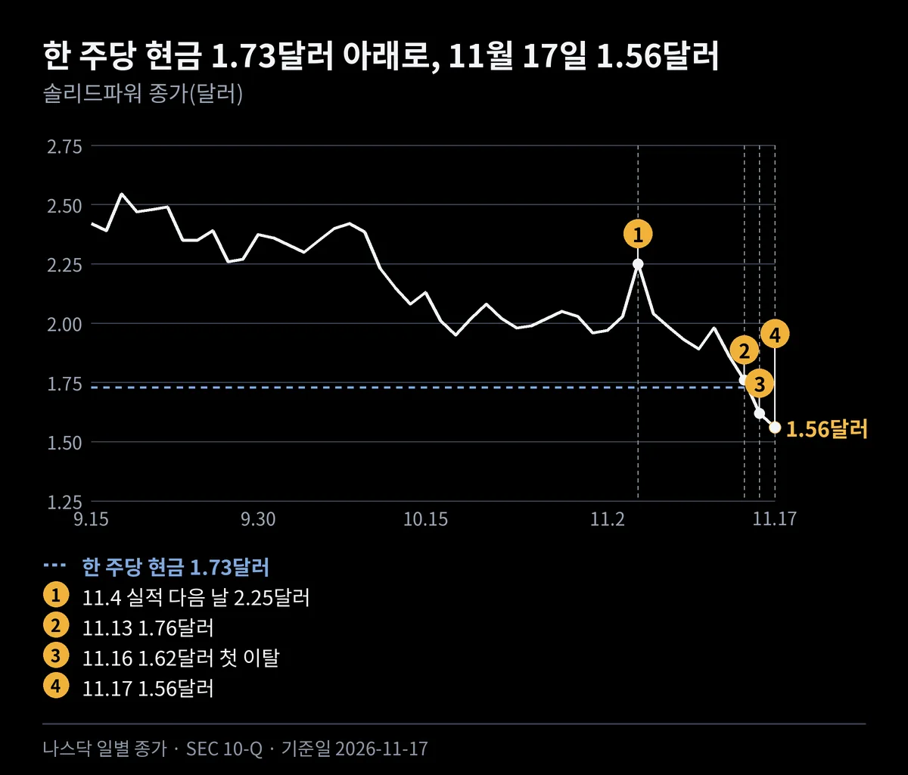
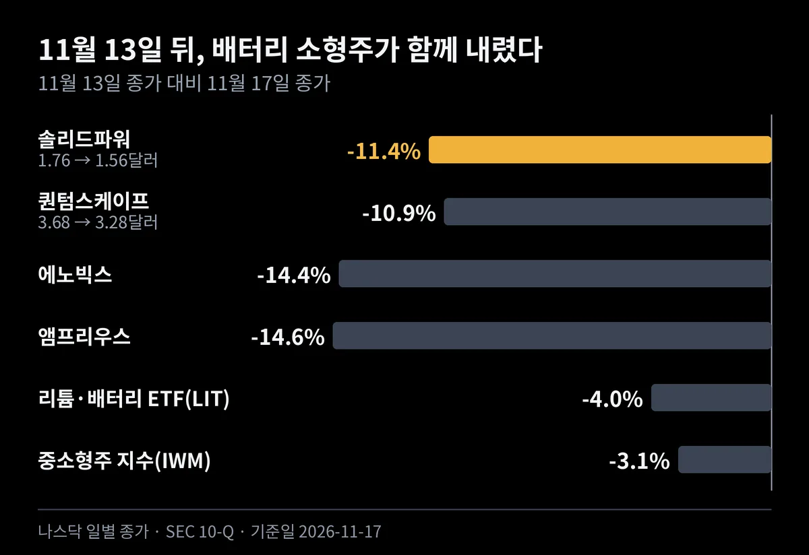
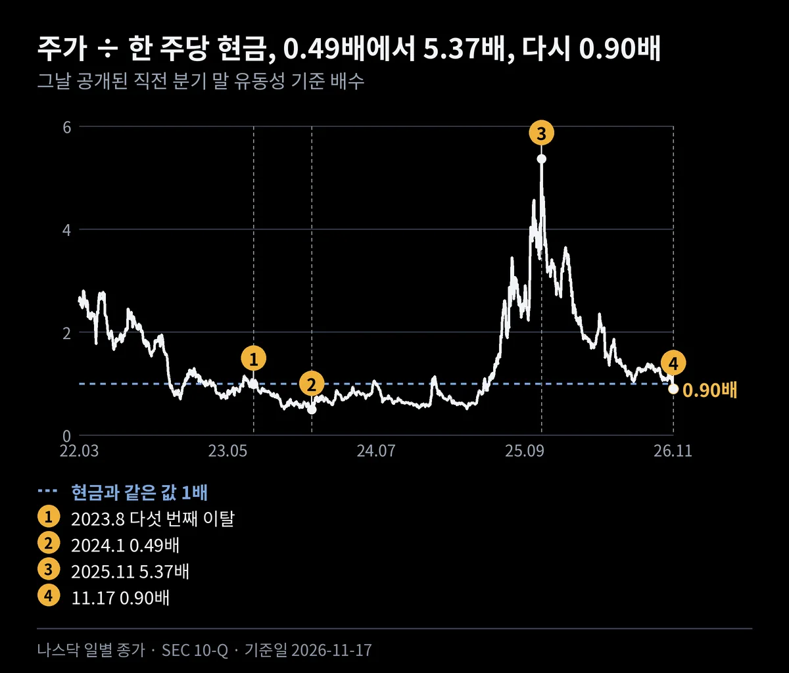
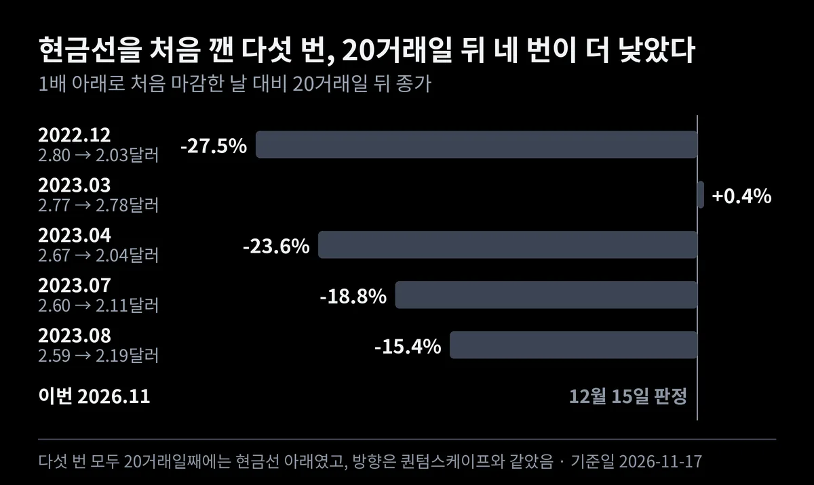
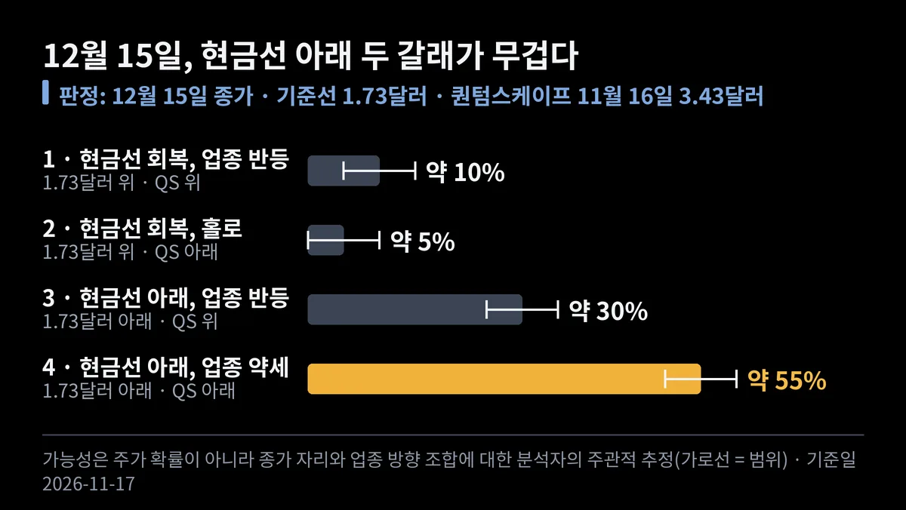

회사 하나를 통째로 산다고 해 보겠습니다. 값은 3억 5,753만 달러입니다. 그런데 사면 그 회사 금고에 든 현금과 증권 3억 9,756만 달러가 따라옵니다. 산 값보다 약 4,003만 달러 많은 돈입니다. 11월 17일 종가 1.56달러로 계산한 솔리드파워가 지금 이런 모양입니다. 시장이 이 회사의 기술과 공장, 계약을 모두 0보다 낮게 매겼다는 뜻일까요?

> **유의사항** 저자는 금융·투자 자문가가 아닙니다. 이 글은 공개 공시와 시세를 정리한 교육용 분석이며 특정 종목의 매수·매도를 권하지 않습니다. 과거 패턴은 미래 수익을 보장하지 않고, 솔리드파워는 회사 소식 없이도 하루 5% 넘게 움직이는 날이 잦은 종목입니다. 실제 투자 전에는 최신 공시를 직접 확인하세요.

이 글은 [11월 13일 기준 리포트](/r/sldp-2026-11-2/)의 후속편입니다. 그 리포트는 주가가 한 주당 현금 약 1.73달러와 3센트 차이까지 내려왔다고 적었습니다. 그리고 12월 14일 종가 자리를 네 갈래로 나눴습니다. 그때까지 이 선 아래 마감이 나오는지, 그날 업종 대표 퀀텀스케이프가 오르는지를 엮은 것입니다. 선을 깨는 두 갈래에 매긴 주관적 추정을 합치면 약 65%였습니다. 다음 거래일인 11월 16일, 주가는 1.62달러로 그 선 아래에서 마감했습니다.

지난 예측 성적은 적중 둘, 빗나감 없음, 진행 중 둘입니다. 하나는 방금 말한 현금선 이탈입니다. 다른 하나는 '현금이 주가를 받치는 단계'라는 진단입니다. 이 진단은 시가총액이 현금의 1.5배 안에 있고, 회사가 새 주식을 팔지 않는 때를 말합니다. 두 조건은 지금도 그대로입니다. 진행 중인 둘은 11월 4일 리포트와 11월 13일 리포트가 나눈 네 갈래입니다. 각각 12월 3일과 12월 14일 종가로 어느 갈래에 들어갔는지 채점합니다.

솔리드파워는 전고체 배터리에 들어가는 재료를 만드는 회사입니다. 전고체 배터리는 액체 대신 고체 재료로 전기를 옮겨, 불이 잘 붙지 않는 차세대 배터리입니다. 회사는 그 안에 들어가는 황화물 고체 전해질을 만듭니다. 돈을 버는 방식은 이 재료를 삼성SDI(삼성 계열 배터리 회사) 같은 곳에 팔고, 셀 설계 기술을 빌려주는 것입니다. 3분기 매출은 24만 3,000달러였습니다. 같은 분기 순손실은 2,440만 달러였습니다.

매출이 손실을 메우지 못하니, 이 회사가 버티는 힘은 예전에 모아 둔 현금입니다. 9월 말 현금과 증권은 3억 9,756만 달러이고 부채는 없습니다. 이를 11월 2일 주식 수 2억 2,919만 주로 나누면 한 주에 약 1.73달러입니다. 이 숫자를 이 글에서는 '현금선'이라고 부르겠습니다. 주가가 이 선과 같으면 시장은 사업에 값을 거의 매기지 않은 셈입니다.

이제 하루씩 보겠습니다. 지난 리포트 기준일인 11월 13일 종가는 1.76달러였습니다. 다음 거래일인 16일에는 8.0% 내려 1.62달러가 됐습니다. 처음으로 현금선 아래였습니다. 이날은 평소의 1.7배쯤 되는 주식이 거래됐습니다. 17일에는 1.56달러로 더 내려왔습니다.

실적 다음 날인 11월 4일 종가 2.25달러와 견주면 30.7%가 빠졌습니다. 그 사이 회사가 미국 증권거래위원회(SEC)에 낸 새 서류는 한 건도 없었습니다. 11월 4일 분기 보고서가 마지막입니다. 새 주식을 판다는 공시도, 계약이 끊겼다는 소식도 없었습니다. 회사 쪽에서는 이번 하락을 설명할 사건을 찾지 못했습니다.

솔리드파워 혼자 내린 것도 아니었습니다. 같은 두 거래일 동안 업종 대표 퀀텀스케이프는 3.68달러에서 3.28달러로 10.9% 내렸습니다. 실리콘 음극 배터리를 만드는 에노빅스는 14.4%, 앰프리우스는 14.6% 내렸습니다. 리튬·배터리 회사를 묶은 상장지수펀드(ETF)는 4.0%, 미국 중소형주 지수는 3.1% 내렸습니다.

시장 전체도 약했지만, 비교한 배터리 소형주 네 곳은 중소형주 지수보다 세 배 넘게 빠졌습니다. 이 무리는 대부분 아직 큰 매출이 없고, 쌓아 둔 현금으로 개발비를 대는 회사들입니다. 같은 걱정이 한꺼번에 값에 들어간 것으로 볼 수 있습니다. 다만 이것은 시세의 모양에서 읽은 해석이고, 회사나 시장이 이유를 밝힌 것은 아닙니다.

그렇다면 현금보다 싸다는 건 정말 이상한 일일까요? 꼭 그렇지는 않습니다. 회사는 매 분기 현금을 씁니다. 올해 전망대로라면 4분기에 약 1,840만~2,840만 달러가 더 나갑니다. 그러면 연말 현금은 약 3억 6,900만~3억 7,900만 달러, 한 주에 약 1.61~1.65달러가 됩니다. 현금선 자체가 조금씩 내려오는 셈입니다.

4분기 숫자는 올해 전망 7,500만~8,500만 달러에서 1~9월에 쓴 5,660만 달러를 뺀 값입니다. 그래도 11월 17일 시가총액은 그 연말 예상치보다도 낮습니다. 시장이 왜 그렇게 매겼는지는 공시에 없습니다. 이 종목에서 이런 장면은 처음이 아닙니다. 과거 기록을 꺼내 보겠습니다.

기준은 이렇게 정했습니다. 그날 이미 공개된 직전 분기 말 현금으로 현금선을 계산했습니다. 그리고 다섯 거래일 내내 현금선 위에 있던 주가가 처음 그 아래로 마감한 날만 골랐습니다. 상장 뒤 그런 날은 다섯 번이었습니다. 2022년 12월, 그리고 2023년 3월·4월·7월·8월입니다. 11월 16일이 여섯 번째입니다.

다섯 번의 뒤에는 공통점이 있었습니다. 네 번은 5거래일 안에 주가가 잠깐 현금선 위로 돌아왔습니다. 그런데 20거래일째에는 다섯 번 모두 현금선 아래에 있었습니다. 잠깐 돌아온 것이 20거래일 뒤의 자리를 바꾸지는 못했습니다.

값의 방향도 비슷했습니다. 20거래일 뒤 종가는 5번 중 4번 그날보다 낮았습니다. 가장 크게 내린 2022년 12월은 27.5% 낮았습니다. 거의 그대로였던 한 번은 2023년 3월이었습니다. 그때 퀀텀스케이프는 2023년 3월 15일 종가 대비 20거래일 뒤 10.6% 높았습니다.

다섯 번 모두 솔리드파워의 20거래일 뒤 방향은 퀀텀스케이프와 같았습니다. 지난 리포트에서 본 '현금선 근처 네 번'의 기록과 같은 모양입니다. 다만 방향이 같았다는 것이 업종 때문이라는 증거는 아닙니다. 표본이 다섯 번뿐이라 규칙이라고 부르기도 어렵습니다.

마지막 다섯 번째 이탈 뒤의 시간은 길었습니다. 2023년 8월부터 2025년 6월 10일까지 464거래일 가운데 449일을 현금보다 싸게 거래됐습니다. 약 97%입니다. 가장 쌀 때는 2024년 1월 18일 1.17달러로, 현금선의 0.49배였습니다. 그 뒤 업종 바람이 바뀌자 2025년 11월 5일에는 5.37배인 8.51달러까지 올랐습니다.

이번이 과거와 다른 점도 있습니다. 2023년에는 현금선이 한 주에 2.6~2.9달러로 지금보다 높았고, 회사가 쓰는 돈도 더 많았습니다. 올해 회사는 영업과 설비에 쓸 현금 전망을 8,500만~1억 달러에서 7,500만~8,500만 달러로 낮췄습니다. 또 1월 투자자에게 주식을 바로 판 직접 공모 뒤로는 새 주식을 팔지 않았습니다. 반대로 매출은 1년 전보다 93% 줄었고, 한국 전해질 합작법인 계약은 아직 발표되지 않았습니다.

정리하면 지금은 현금이 주가를 받치는 단계의 아래쪽 끝입니다. 새 주식 발행이 없으니 진단 이름은 그대로 둡니다. 다만 과거 다섯 번은 20거래일째 모두 현금선 아래였습니다. 이 진단이 바뀌는 신호도 정해 두겠습니다. 하나는 회사가 시장에서 주식을 조금씩 팔 수 있게 잡아 둔 한도를 쓴다는 공시입니다. 다른 하나는 금액이 붙은 한국 합작법인 계약입니다.

판정은 12월 15일에 합니다. 11월 16일 뒤 20번째 거래일로, 과거 다섯 번과 같은 자로 잴 수 있는 날입니다. 볼 것은 두 가지입니다. 그날 종가가 현금선 1.73달러 위로 돌아왔는가, 그리고 퀀텀스케이프 종가가 11월 16일 3.43달러 위인가입니다. 이 둘을 엮으면 네 갈래가 나옵니다.

현금선 아래에서 업종도 약한 네 번째 갈래를 약 55%로 가장 무겁게 봤습니다. 과거 5번 중 5번이 20거래일째 현금선 아래였고, 퀀텀스케이프가 아직 내리는 중이기 때문입니다. 현금선 아래에서 업종만 반등하는 세 번째 갈래는 약 30%입니다. 2023년 3월처럼 업종이 오르면 값은 버티지만, 현금선까지 되찾지는 못한 기록입니다.

현금선을 되찾는 두 갈래는 합쳐 약 15%만 남겼습니다. 과거 다섯 번에 20거래일째 되찾은 적은 없었습니다. 그래도 0으로 두지 않은 이유는 부채가 없고 쓰는 돈을 줄였다는 점입니다. 이 숫자는 주가가 오를 확률이 아니라, 12월 15일 종가 자리와 업종 방향 조합에 대한 분석자의 주관적 추정입니다.

이 판단이 틀릴 수 있는 곳도 있습니다. 첫째는 회사 소식입니다. 한국 합작법인 계약이나 새 생산 라인 모비우스(MOBIUS)의 4분기 시운전 소식은 업종과 따로 값을 움직일 수 있습니다. 둘째는 공급입니다. 시장에서 주식을 조금씩 팔 수 있는 한도가 9월 말 약 5,879만 달러 남아 있습니다. 새로 파는 값이 한 주당 현금보다 낮으면, 늘어나는 주식 수가 들어오는 현금보다 커서 한 주당 현금이 줄어듭니다. 셋째는 표본입니다. 다섯 번은 작은 숫자이고, 2023년과 지금은 회사의 크기가 다릅니다.

정리하면, 이번 하락은 회사 소식 없이 배터리 소형주와 함께 온 모양이었습니다. 그리고 그 흐름이 이 회사의 주가를 처음으로 현금보다 싸게 만들었습니다. 12월 15일 종가가 1.73달러 위로 돌아왔는지, 그날 퀀텀스케이프가 3.43달러 위인지를 차례로 확인합니다. 다음 갱신은 그 판정이나 합작법인 소식을 본 뒤에 합니다.

## 숫자로 다시 보기

### 지난 리포트 뒤 하루씩

| 날짜 · 종가 | 하루 변화 | 현금선 1.73달러 대비 |
| --- | --- | --- |
| **11월 4일** 2.25달러 | +10.8% | +30.1% |
| **11월 13일** 1.76달러 | -5.4% | +1.7% |
| **11월 16일** 1.62달러 | -8.0% | -6.4% |
| **11월 17일** 1.56달러 | -3.7% | -9.8% |

11월 16일 거래량은 약 518만 주, 17일은 약 448만 주였습니다. 직전 60거래일 평균은 약 306만 주입니다.

### 같은 무리와 비교

| 종목 | 11월 13일 → 17일 | 11월 4일 → 17일 |
| --- | --- | --- |
| **솔리드파워** | **-11.4%** | **-30.7%** |
| 퀀텀스케이프(QS) 3.68 → 3.28달러 | -10.9% | -26.0% |
| 에노빅스(ENVX) 1.60 → 1.37달러 | -14.4% | -50.9% |
| 앰프리우스(AMPX) 7.93 → 6.77달러 | -14.6% | -20.1% |
| 리튬·배터리 ETF(LIT) | -4.0% | -8.8% |
| 중소형주 지수(IWM) | -3.1% | -5.3% |

### 현금선을 처음 깬 날, 20거래일 뒤

**한눈에:** 상장 뒤 **5번**(이번 제외) · 5거래일 안 잠깐 복귀 **4번** · 20거래일째 현금선 위 **0번** · 그날보다 낮음 **4번** · 퀀텀스케이프와 같은 방향 **5번**

| 처음 깬 날 · 종가(배수) | 20거래일 뒤 | 그때 퀀텀스케이프 |
| --- | --- | --- |
| **2022.12.06** 2.80달러(0.97배) | -27.5% 2.03달러 · 0.70배 | -21.6% |
| **2023.03.15** 2.77달러(0.98배) | +0.4% 2.78달러 · 0.99배 | +10.6% |
| **2023.04.05** 2.67달러(0.95배) | -23.6% 2.04달러 · 0.72배 | -16.8% |
| **2023.07.21** 2.60달러(0.99배) | -18.8% 2.11달러 · 0.85배 | -27.6% |
| **2023.08.04** 2.59달러(0.98배) | -15.4% 2.19달러 · 0.88배 | -11.7% |
| **이번 2026.11.16** 1.62달러(0.93배) | 12월 15일 판정 | 3.43달러에서 |

현금선 위로 다시 올라온 날은 각각 28·1·2·5·3거래일 뒤였습니다. 배수는 그날 이미 공개된 직전 분기 말 유동성으로 계산했습니다.

### 지금의 크기(11월 17일 기준)

| 항목 | 값 · 근거 |
| --- | --- |
| 9월 말 유동성 | **3억 9,756만 달러** 현금 + 바로 팔 수 있는 증권, 부채 0 |
| 11월 2일 주식 수 | **2억 2,919만 주** 10-Q 표지 |
| 한 주당 유동성(현금선) | **약 1.73달러** 유동성 ÷ 주식 수 |
| 시가총액 | **약 3억 5,753만 달러** 1.56달러 × 주식 수, 약 0.90배 |
| 유동성 − 시가총액 | **약 4,003만 달러** 다른 의무를 빼지 않은 단순 차액 |
| 연말 예상 유동성 | **약 3억 6,900만~3억 7,900만 달러** 4분기 투입 약 1,840만~2,840만 달러를 뺀 값, 한 주 약 1.61~1.65달러 |
| 남은 시장 매각 한도 | **약 5,879만 달러** 9월 말 기준, 2026년 1~9월 사용 0 |

### 지난 예측 채점표

| 지난 점검 항목 · 당시 기준(11월 13일) | 판정과 실제 결과(11월 17일) |
| --- | --- |
| **현금선을 깨는 두 갈래 합 약 65%** 과거 4번 중 3번 곧 이탈 | **[적중]** 11월 16일 1.62달러로 첫 이탈 |
| **진단: 현금이 주가를 받치는 단계** 1.5배 안, 새 주식 발행 없음 | **[적중]** 약 0.90배, 발행 공시 0건 |
| **11월 13일 리포트 시나리오 1~4** 12월 14일 판정 | **[진행 중]** 현금선은 깸, 퀀텀스케이프 3.28달러로 3.68달러 아래 |
| **11월 4일 리포트 시나리오 1~4** 12월 3일 판정 | **[진행 중]** 발행·합작 발표 모두 없음 |

### 앞으로 일어날 수 있는 일

과거 기록: 현금선을 처음 깬 5번 중 5번이 20거래일째 현금선 아래였고, 5번 중 4번은 그날보다 낮았습니다. 5번 중 5번 방향이 퀀텀스케이프와 같았습니다.

5번 중 5번이 20거래일째 현금선 아래였다는 기록은 아래쪽 갈래의 근거이고, 부채가 없다는 사실은 위쪽 갈래를 남긴 이유입니다. 아래 가능성은 주가 상승·하락 확률이 아니라, 12월 15일 종가의 자리와 퀀텀스케이프 방향 조합에 대한 분석자의 주관적 추정입니다. 네 갈래는 겹치지 않아 더하면 100%이고, 괄호 안 범위는 더하지 않습니다.

| 시나리오(판정 12월 15일) | 종가 · QS | 가능성(추정) |
| --- | --- | --- |
| 1 · 현금선 회복, 업종 반등 | 1.73달러 위 · QS 위 | 낮음 약 10% (5~15%) |
| 2 · 현금선 회복, 홀로 | 1.73달러 위 · QS 아래 | 낮음 약 5% (0~10%) |
| 3 · 현금선 아래, 업종 반등 | 1.73달러 아래 · QS 위 | 중간 약 30% (25~35%) |
| **4 · 현금선 아래, 업종 약세** | 1.73달러 아래 · QS 아래 | 높음 약 55% (50~60%) |

지난 리포트(11월 13일 기준, 12월 14일 판정)는 1번 약 25%, 2번 약 10%, 3번 약 20%, 4번 약 45%였습니다.

### 핵심 확인 세 가지

| 순위 · 확인할 것 | 판정 날짜 |
| --- | --- |
| **1순위** 12월 15일 종가가 1.73달러 위인가 | 12월 15일 |
| **2순위** 12월 15일 퀀텀스케이프 종가가 3.43달러 위인가 | 12월 15일 |
| **3순위** 시장 매각·공모·합작법인 계약 공시가 나오는가 | 12월 15일까지 |

공시는 [솔리드파워 SEC 공시 목록](https://www.sec.gov/cgi-bin/browse-edgar?action=getcompany&CIK=0001844862&type=&dateb=&owner=include&count=40)에서 직접 확인할 수 있습니다.
