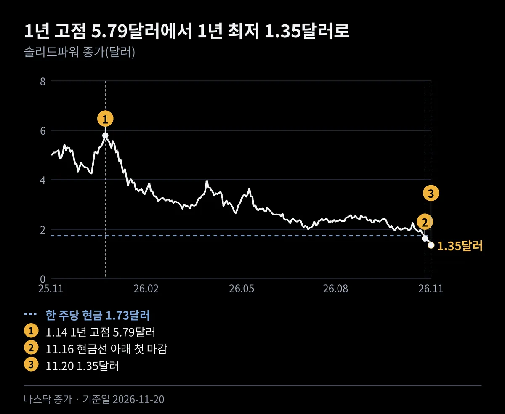
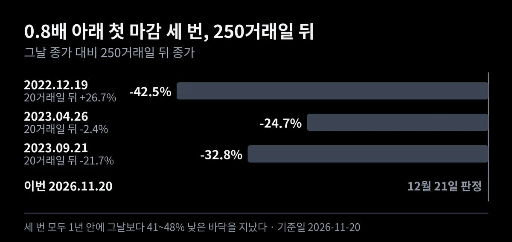
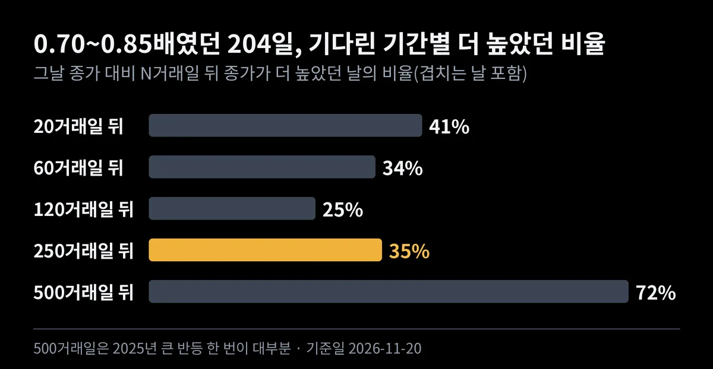
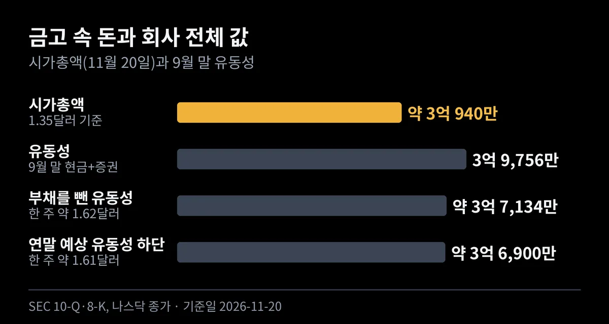
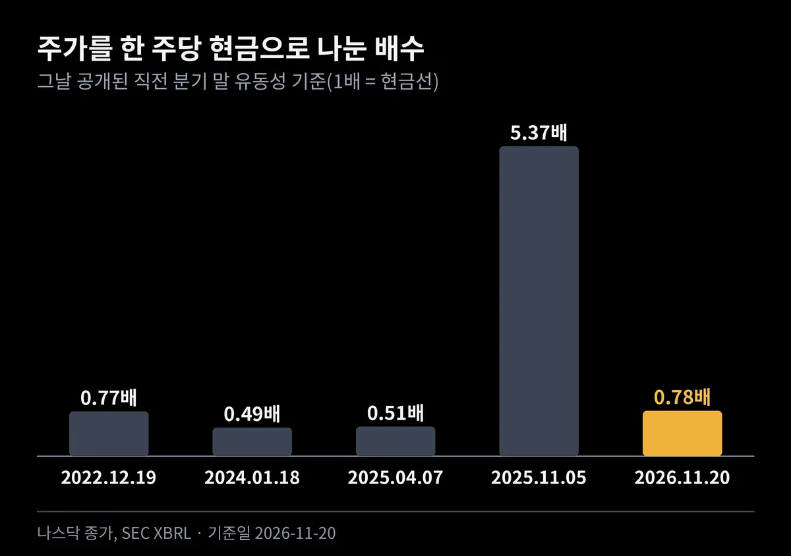
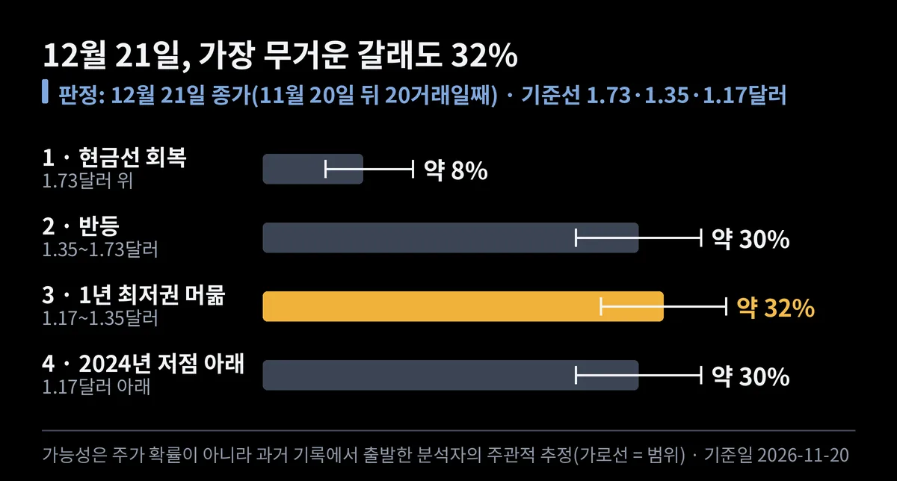

솔리드파워 지금 사도 될까? 요즘 이 종목 영상과 글에 가장 많이 붙는 질문입니다. 11월 20일 종가는 1.35달러였습니다. 1년 사이 가장 낮은 종가로, 올해 1월 고점 5.79달러보다 76.7% 아래입니다. 그런데 이 회사 금고에는 한 주에 약 1.73달러어치 현금과 증권이 있습니다. 주가가 그 돈의 약 0.78배까지 내려온 셈입니다. 이 글은 사라, 팔라를 말하지 않습니다. 대신 이 질문에 답하는 데 필요한 근거를 끝까지 꺼내 보겠습니다.

> **유의사항** 저자는 금융·투자 자문가가 아닙니다. 이 글은 공개 공시와 시세를 정리한 교육용 분석이며 특정 종목의 매수·매도를 권하지 않습니다. 과거 패턴은 미래 수익을 보장하지 않고, 솔리드파워는 최근 60거래일 가운데 13일이 하루 5% 넘게 움직인 종목입니다. 실제 투자 전에는 최신 공시를 직접 확인하세요.

이 글은 [11월 17일 기준 리포트](/r/sldp-2026-11-3/)의 후속편입니다. 그 리포트는 주가가 한 주당 현금 아래로 처음 내려간 장면을 다뤘습니다. 그 뒤 11월 17일 종가 대비 3거래일 동안 13.5%가 더 빠졌고, 마지막 날인 20일 하루에만 10.0%가 내렸습니다. 그날 같은 배터리 소형주 앰프리우스는 9.8% 내렸습니다. 나스닥 대형 기술주 100개를 따라가는 펀드(QQQ)도 5.7% 내렸습니다. 회사가 미국 증권거래위원회(SEC)에 낸 새 서류는 이달 초 분기 보고서 뒤로 없었습니다.

김박사 월드는 리포트마다 정해 둔 날의 종가와 공시로 지난 예측을 채점합니다. 지난 예측 성적은 적중 3, 빗나감 0, 진행 중 7입니다. 11월 20일에 판정이 끝난 10월 23일 리포트의 네 항목 가운데 셋이 맞았습니다. 1.84달러 아래 마감과 9월 말 현금 규모, 실적 뒤 약세였습니다. 낮게 본 한국 합작법인 발표는 일어나지 않았습니다. 11월 17일 리포트의 예측 일곱 개는 12월 판정이라 아직 진행 중입니다.

먼저 회사부터 짧게 보겠습니다. 솔리드파워는 전고체 배터리에 들어가는 황화물 고체 전해질을 만듭니다. 전고체 배터리는 액체 대신 고체 재료로 전기를 옮겨, 불이 잘 붙지 않는 차세대 배터리입니다. 돈을 버는 방식은 이 재료를 삼성SDI(삼성 계열 배터리 회사) 같은 곳에 팔고, 셀 설계 기술을 빌려주는 것입니다. 하지만 아직 매출은 작습니다. 3분기 매출은 24만 3,000달러였고, 순손실은 2,440만 달러였습니다.

이 질문의 첫 번째 열쇠는 '지금 가격이 과거 비슷한 순간에서 어디쯤인가'입니다. 기준은 이렇게 잡았습니다. 그날 이미 공개된 분기 말 현금으로 현금선을 계산하고, 주가가 그 0.8배 아래로 처음 마감한 날만 골랐습니다. 직전 20거래일은 모두 0.8배 위였던 날입니다. 상장 뒤 그런 날은 이번 전에 세 번이었습니다. 2022년 12월 19일, 2023년 4월 26일, 2023년 9월 21일입니다.

세 번의 뒤는 기간에 따라 달랐습니다. 20거래일 뒤 더 높았던 건 2022년 12월 한 번으로, 그날 종가보다 26.7% 높았습니다. 60거래일 뒤에는 세 번 중 두 번이 더 높았습니다. 그런데 약 1년 뒤인 250거래일째에는 세 번 모두 그날보다 낮았습니다. 셋 다 그 1년 안에 40% 넘게 더 내려간 바닥을 한 번 지났습니다.

이 기록을 조금 넓혀 봤습니다. 주가가 현금선의 0.70~0.85배에 있던 날은 모두 204일이었습니다. 그날 샀다고 치면 20거래일 뒤 더 높았던 날은 41%, 250거래일 뒤는 35%였습니다. 500거래일 뒤로 늘리면 72%로 뒤집힙니다. 다만 이 숫자는 겹치는 날을 모두 센 값입니다. 2025년의 큰 반등 한 번이 대부분을 차지해, 사실상 두세 번의 흐름입니다.

그래서 지금 자리는 이렇게 읽힙니다. 몇 주 안에 더 높았던 경우는 절반에 못 미쳤고, 1년 기록은 더 불리했습니다. 2년이 넘는 기록은 한 번의 큰 반등에 기대고 있습니다. 같은 가격이라도 얼마나 기다릴 사람인지에 따라 과거 기록이 다른 답을 냅니다. 이제 사는 쪽 근거와 사지 않는 쪽 근거를 셋씩 나란히 놓겠습니다.

사는 쪽 근거 첫째는 현금보다 싼 몸값입니다. 9월 말 현금과 바로 팔 수 있는 증권은 3억 9,756만 달러입니다. 11월 20일 종가로 계산한 시가총액은 약 3억 940만 달러입니다. 회사를 통째로 사도 금고 속 돈보다 약 8,816만 달러 적게 내는 셈입니다. 갚아야 할 모든 의무를 합친 부채도 2,622만 달러로, 현금의 약 6.6%입니다. 부채를 다 빼도 한 주에 약 1.62달러가 남고, 주가는 그 약 0.83배입니다.

돈을 쓰는 속도도 사는 쪽에 섭니다. 회사는 올해 현금 투입 전망을 8,500만~1억 달러에서 7,500만~8,500만 달러로 낮췄습니다. 시장에서 주식을 조금씩 팔 수 있는 한도도 있지만, 올해 1~9월 판 주식은 0주였습니다. 분기 보고서에는 현금과 증권이 앞으로 최소 12개월의 운영·설비 자금에 충분하다고 본다고 적었습니다. 연말 예상 현금으로 계산해도 한 주에 약 1.61~1.65달러로, 지금 주가보다 높습니다.

과거 바닥 뒤의 긴 기록도 사는 쪽 근거입니다. 이 종목의 배수는 2024년 1월 18일 0.49배, 1.17달러까지 내려간 적이 있습니다. 2025년 4월 7일에는 0.9269달러로 상장 뒤 가장 낮은 종가를 찍었습니다. 그 뒤 2025년 11월 5일 8.51달러, 현금선의 5.37배까지 올랐습니다. 2023년 9월 0.8배 첫 진입 사례도 500거래일 뒤에는 110.6% 높았습니다.

이번엔 사지 않는 쪽 근거입니다. 첫째는 방금 본 1년 기록입니다. 0.8배 아래 첫 진입은 3번 중 3번이 1년 뒤 더 낮았습니다. 셋 다 그 사이 40% 넘게 더 내려간 바닥을 지났습니다. 지난 리포트의 현금선 이탈 다섯 번도 20거래일째 모두 현금선 아래였습니다. 이 세 번과 다섯 번의 기록에서는, 싸다는 사실이 곧 바닥이라는 뜻이 아니었습니다.

매출은 아직 거의 없습니다. 3분기 매출은 1년 전보다 93% 줄었습니다. 매출이 손실을 메우지 못하니, 현금선 자체가 분기마다 내려옵니다. 9월 말 약 1.73달러였던 한 주당 현금은 연말 약 1.61~1.65달러로 줄어들 전망입니다. 금액이 붙은 한국 합작법인 계약도 아직 발표되지 않았습니다.

주식 공급과 업종도 사지 않는 쪽에 무게를 싣습니다. 시장 매각(ATM, 시장에서 주식을 조금씩 파는 방식) 한도는 9월 말 약 5,879만 달러 남아 있습니다. 이 한도는 쓸 수 있는 금액일 뿐 실제로 판 양은 아닙니다. 다만 만약 현금선보다 낮은 값에 새 주식을 팔게 되면, 한 주당 현금이 줄어듭니다. 또 소형주는 업종이 내릴 때 함께 내렸습니다. 11월 20일처럼 회사 소식 없이 하루 10% 빠지는 날이 다시 올 수 있습니다.

같은 모양은 다른 종목에서도 나왔습니다. 원전 회사 뉴스케일도 시가총액이 현금보다 작은 채 2024년 3월 뒤 최저로 내려간 장면을 [11월 17일 기준 리포트](/r/smr-2026-11-3/)에서 다뤘습니다. 같은 배터리 무리의 에노빅스는 [11월 19일 기준 리포트](/r/envx-2026-11/)에서 현금이 많아 보여도 부채를 함께 봐야 한다는 점을 짚었습니다. 김박사 월드가 11월 핵심 종목에 그어 둔 기준선 기록에서도, 실스크·솔리드파워 등의 기준선을 깨고 내려간다는 쪽이 네 번 모두 맞았고 지킨다는 쪽은 네 번 모두 빗나갔습니다. 다만 네 번뿐이라 일반화하기는 이릅니다.

그럼 무엇을 보면 판단이 바뀔까요? 세 가지 신호와 날짜를 정해 두겠습니다. 첫째는 12월 15일 종가입니다. 현금선을 처음 깬 11월 16일 뒤 20번째 거래일입니다. 둘째는 12월 21일 종가로, 11월 20일 뒤 20번째 거래일입니다. 이날 1.73달러 위로 돌아와 있으면 사는 쪽 근거가 강해집니다. 1.17달러 아래로 내려가 있으면 사지 않는 쪽 근거가 강해집니다.

공시도 신호입니다. 시장 매각을 썼다는 공시나 새 공모가 나오면 사지 않는 쪽 근거가 강해집니다. 반대로 금액이 붙은 한국 합작법인 계약, 새 전해질 생산 라인 모비우스(MOBIUS)의 4분기 시운전 소식도 사는 쪽 근거를 보탭니다. 회사는 이 라인으로 연 생산 능력을 약 30톤에서 약 75톤으로 늘린다고 했습니다. 4분기 실적과 연간 보고서는 지난해 일정으로 보면 2월 말 무렵입니다. 그때 연말 현금이 1.61~1.65달러 범위에 들어왔는지 확인할 수 있습니다.

사려는 사람이 먼저 볼 것은 두 가지입니다. 최신 분기 보고서의 현금과 주식 수로 한 주당 현금을 직접 계산해 보는 것, 그리고 하루 5~10%씩 움직이는 날을 견딜 수 있는지입니다. 시장 매각 여부와 매출 변화, 판정 날짜까지 다섯 가지 확인표는 글 끝 부록에 있습니다.

마지막으로 12월 21일 종가를 네 갈래로 나눴습니다. 출발점은 현금선의 0.70~0.85배였던 204일의 20거래일 뒤 기록이고, 그 기록에서는 지금 자리 근처 칸이 가장 많았습니다. 현금선을 처음 깬 다섯 번이 20거래일째 모두 현금선 아래였던 점을 반영해, 맨 위 칸은 줄이고 맨 아래 칸은 늘렸습니다.

1.17~1.35달러, 지금 자리 근처에 머무는 갈래를 약 32%로 가장 무겁게 봤습니다. 반등하는 갈래와 2024년 저점 아래로 내려가는 갈래는 각각 약 30%입니다. 현금선 위로 돌아오는 갈래는 약 8%만 남겼습니다. 이 숫자는 주가가 오를 확률이 아니라, 과거 빈도에서 출발한 분석자의 주관적 추정입니다.

하루 5% 넘게 움직이는 날이 잦아, 18센트 폭의 칸은 한두 번의 큰 날로 비껴갈 수 있습니다. 2022년 12월 19일 종가 대비 20거래일 뒤 26.7% 높았던 것처럼, 업종이 반등하면 빠르게 오를 수도 있습니다. 반대로 하락 추세의 가격은 이어진 기록이 많아, 1.17달러 아래 칸으로 갈 수도 있습니다. 세 번이라는 표본은 작고, 2023년과 지금은 회사가 쓰는 돈의 크기가 다릅니다.

지금 솔리드파워는 회사 금고 속 돈보다 싼 값에 거래되지만 매출은 아직 거의 없는 회사입니다. 과거 같은 자리의 기록은 몇 주 안에는 반반, 1년 뒤에는 불리, 2년 넘게는 한 번의 큰 반등이 있었습니다. 12월 21일 종가가 1.73달러 위로 돌아오고 주식 판매 공시가 없다면 사는 쪽 근거가 강해집니다. 1.17달러 아래이거나 시장 매각 공시가 나오면 사지 않는 쪽 근거가 강해집니다. 결정은 각자의 몫이며, 이 영상과 리포트는 판단 근거를 정리한 교육용 자료입니다.

## 숫자로 다시 보기

### 지난 리포트 뒤 하루씩

| 날짜 · 종가 | 하루 변화 | 현금선 1.73달러 대비 |
| --- | --- | --- |
| **11월 17일** 1.56달러 | -3.7% | -9.8% |
| **11월 18일** 1.54달러 | -1.3% | -11.0% |
| **11월 19일** 1.50달러 | -2.6% | -13.3% |
| **11월 20일** 1.35달러 | -10.0% | -22.0% |

11월 20일 1.35달러는 2025년 5월 22일 1.34달러 뒤 가장 낮은 종가입니다. 같은 날 앰프리우스는 6.40달러에서 5.77달러로 9.8%, QQQ는 645.04달러에서 608.45달러로 5.7% 내렸습니다.

### 사는 쪽 근거와 사지 않는 쪽 근거

| 사는 쪽 · 숫자 | 사지 않는 쪽 · 숫자 |
| --- | --- |
| **현금보다 싼 몸값** 시가총액 약 3억 940만 < 유동성 3억 9,756만 달러 | **1년 기록** 0.8배 첫 진입 3번 모두 250거래일 뒤 더 낮음 |
| **줄인 지출, 판매 0주** 현금 투입 전망 7,500만~8,500만 달러, 1~9월 시장 매각 0주 | **거의 없는 매출** 3분기 24만 3,000달러, 1년 전보다 -93% |
| **긴 바닥 뒤 반등** 2024년 0.49배·2025년 0.51배 뒤 5.37배 | **공급과 업종** 남은 매각 한도 약 5,879만 달러, 11월 20일 업종 동반 -10.0% |

### 0.8배 아래로 처음 마감한 날, 그 뒤

**한눈에:** 이번 전 **3번** · 250거래일 뒤 더 높음 **0번** · 1년 안 더 낮은 바닥 **3번**

| 처음 마감한 날 · 종가(배수) | 20 · 60거래일 뒤 | 250거래일 뒤 |
| --- | --- | --- |
| **2022.12.19** 2.21달러(0.77배) | +26.7% +27.1% | -42.5% 1년 안 최저 1.24달러 |
| **2023.04.26** 2.245달러(0.80배) | -2.4% +15.4% | -24.7% 1년 안 최저 1.17달러 |
| **2023.09.21** 1.98달러(0.80배) | -21.7% -33.3% | -32.8% 500거래일 뒤 +110.6% |
| **이번 2026.11.20** 1.35달러(0.78배) | 12월 21일 판정 | - |

배수는 그날 이미 공개된 직전 분기 말 유동성으로 계산했습니다. 1년 안 바닥은 그날 종가보다 41~48% 낮았습니다.

| 0.70~0.85배였던 204일 · 기다린 기간 | 더 높았던 비율 |
| --- | --- |
| **20거래일 뒤** | 41% |
| **60거래일 뒤** | 34% |
| **120거래일 뒤** | 25% |
| **250거래일 뒤** | 35% |
| **500거래일 뒤** | 72% 2025년 큰 반등 한 번이 대부분 |

겹치는 날을 모두 센 값입니다.

### 지금의 크기(11월 20일 기준)

| 항목 | 값 · 근거 |
| --- | --- |
| 9월 말 유동성 | **3억 9,756만 달러** 현금 + 바로 팔 수 있는 증권 |
| 9월 말 총부채 | **2,622만 달러** 유동성의 약 6.6% |
| 한 주당 유동성(현금선) | **약 1.73달러** 11월 2일 주식 2억 2,919만 주 |
| 시가총액 | **약 3억 940만 달러** 1.35달러 기준, 약 0.78배 |
| 부채 뺀 한 주당 | **약 1.62달러** 주가는 약 0.83배 |
| 부채 뺀 유동성 | **약 3억 7,134만 달러** 유동성 − 총부채 |
| 연말 예상 한 주당 | **약 1.61~1.65달러** 연말 유동성 약 3억 6,900만~3억 7,900만 달러 |

### 사기 전에 확인할 것

| 확인할 것 | 어디서 · 언제 |
| --- | --- |
| **한 주당 현금 다시 계산** 9월 말 약 1.73달러 | 분기 보고서 · 2월 말 무렵 |
| **시장 매각·공모 공시** 남은 한도 약 5,879만 달러 | SEC 제출 목록 · 수시 |
| **매출이 늘기 시작했나** 3분기 24만 3,000달러 | 실적 발표 · 2월 말 무렵 |
| **하루 5% 넘는 날을 견딜 수 있나** 최근 60거래일 13번 | 스스로 · 사기 전 |
| **판정 날짜 메모** 현금선 1.73 · 1.17달러 | 12월 15일 · 12월 21일 |

### 지난 예측 채점표

| 지난 점검 항목 · 당시 기준 | 판정과 실제 결과(11월 20일) |
| --- | --- |
| **10월 23일 리포트: 11월 20일까지 1.84달러 아래 마감** 약 40% | **[적중]** 11월 13일 1.76달러 |
| **10월 23일 리포트: 9월 말 유동성 3억 9,000만 달러 이상** 약 55% | **[적중]** 3억 9,756만 달러 |
| **10월 23일 리포트: 실적 뒤 20거래일 약세** 약 60% | **[적중]** 11월 20일 1.35달러 < 1.98달러 |
| **11월 17일 리포트 예측 7개(시나리오 1~4 포함)** 12월 15일 판정 | **[진행 중]** 현금선 1.73달러 아래 |

### 앞으로 일어날 수 있는 일

과거 기록: 현금선의 0.70~0.85배였던 204일 중 20거래일 뒤 1.73달러 위에 해당하는 날은 25일, 1.17달러 아래는 48일이었습니다.

현금선을 처음 깬 5번 중 5번이 20거래일째 현금선 아래였습니다. 아래 가능성은 주가 상승·하락 확률이 아니라, 12월 21일 종가의 자리에 대한 분석자의 주관적 추정입니다. 네 갈래는 겹치지 않아 더하면 100%이고, 괄호 안 범위는 더하지 않습니다.

| 시나리오(판정 12월 21일) | 종가 | 가능성(추정) |
| --- | --- | --- |
| 1 · 현금선 회복 | 1.73달러 위 | 낮음 약 8% (5~12%) |
| 2 · 반등 | 1.35~1.73달러 | 중간 약 30% (25~35%) |
| **3 · 1년 최저권 머묾** | 1.17~1.35달러 | 중간 약 32% (27~37%) |
| 4 · 2024년 저점 아래 | 1.17달러 아래 | 중간 약 30% (25~35%) |

### 핵심 확인 세 가지

| 순위 · 확인할 것 | 판정 날짜 |
| --- | --- |
| **1순위** 12월 21일 종가가 1.73달러 위인가, 1.17달러 아래인가 | 12월 21일 |
| **2순위** 12월 15일 종가가 1.73달러 위인가 | 12월 15일 |
| **3순위** 시장 매각·공모·합작법인 계약 공시가 나오는가 | 12월 21일까지 |

공시는 [솔리드파워 SEC 공시 목록](https://www.sec.gov/cgi-bin/browse-edgar?action=getcompany&CIK=0001844862&type=&dateb=&owner=include&count=40)에서 직접 확인할 수 있습니다.

## 함께 읽기

- [솔리드파워 현금선 이탈 리포트](/r/sldp-2026-11-3/) · [영상](https://youtu.be/K6zvU0sUeak): 한 주당 현금 1.73달러 아래로 처음 내려간 장면(11월 17일 기준).
- [뉴스케일 현금선 리포트](/r/smr-2026-11-3/) · [영상](https://youtu.be/CpGayNCaSHU): 시가총액이 현금보다 작아진 원전 회사(11월 17일 기준).
- [에노빅스 공짜 워런트 리포트](/r/envx-2026-11/) · [영상](https://youtu.be/9XvR-qdcTUE): 같은 배터리 무리, 현금과 부채를 함께 본 장면(11월 19일 기준).
