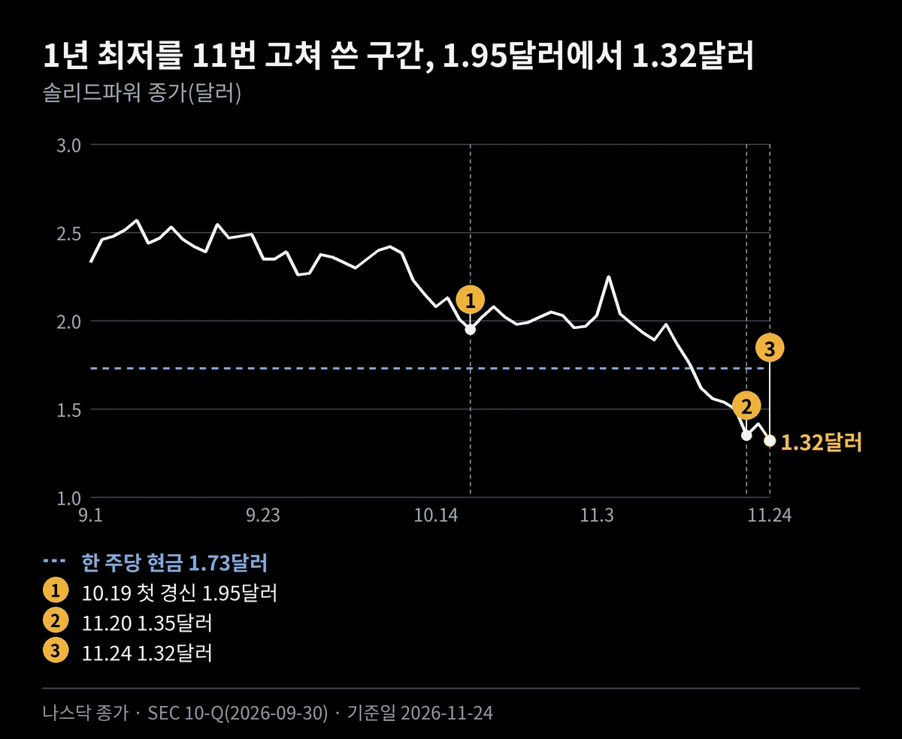
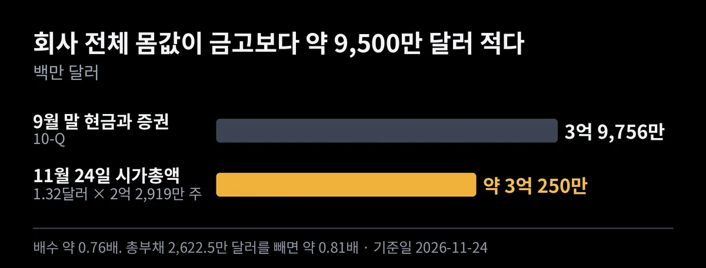
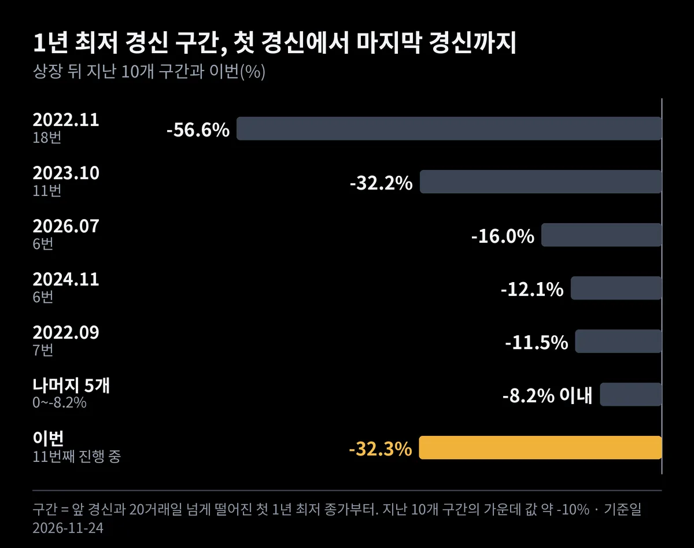
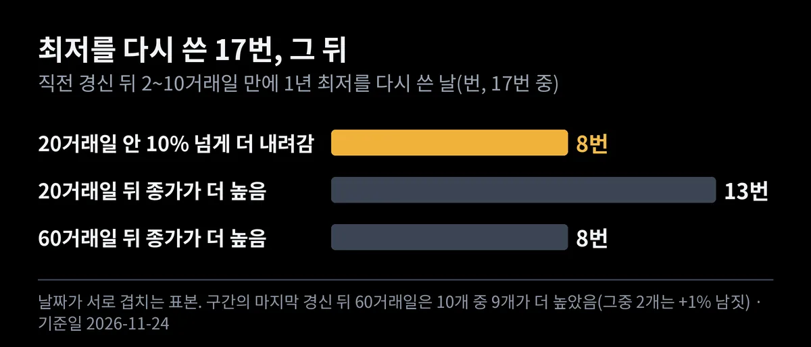
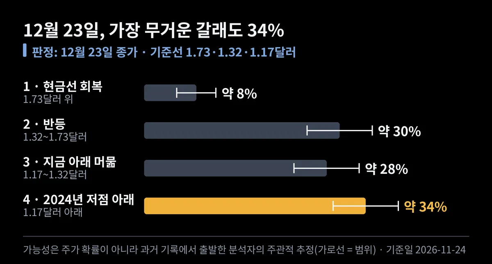
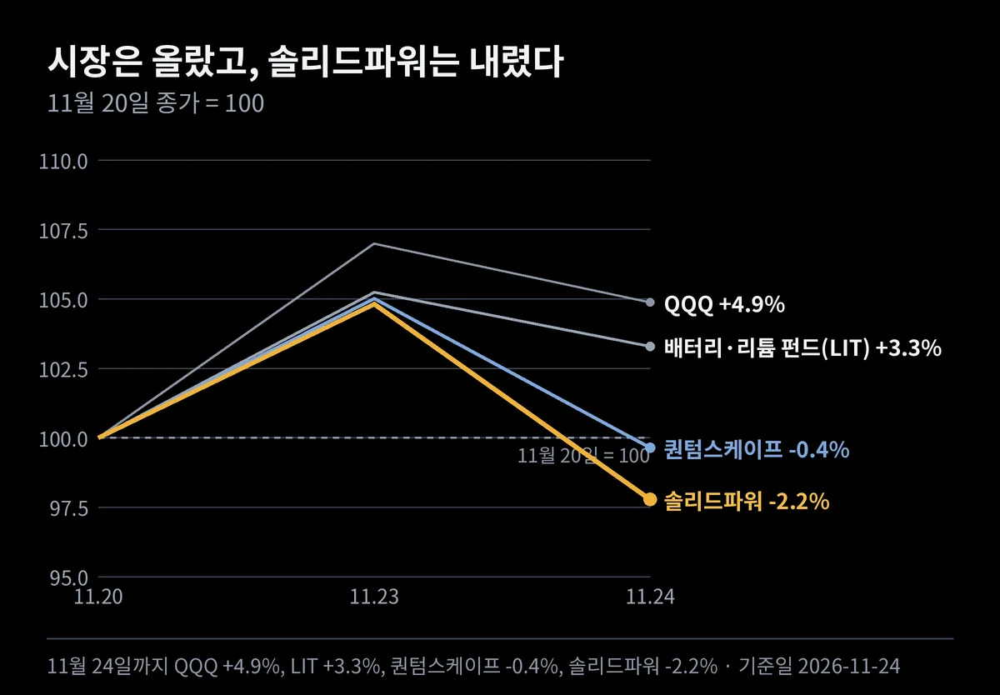

솔리드파워 물타기 해도 될까? 11월 24일 주가는 6.7% 내려 1.32달러로 마감했습니다. 지난 금요일인 11월 20일에 쓴 1년 최저 종가 1.35달러를, 2거래일 만에 다시 고쳐 쓴 숫자입니다. 그런데 이 회사 금고에는 한 주에 약 1.73달러어치 현금과 증권이 있습니다. 주가가 그 돈의 약 0.76배까지 내려온 셈입니다.

내린 값에 더 사서 평균 산 값을 낮추는 것을 물타기라고 합니다. 이 주식을 들고 있는 사람이라면 질문은 하나입니다. 지금 평균 단가를 낮출까, 더 기다릴까? 이 글은 사라, 팔라를 말하지 않습니다. 대신 이 질문에 답하는 데 필요한 기록을 끝까지 세어 보겠습니다.

> **유의사항** 저자는 금융·투자 자문가가 아닙니다. 이 글은 공개 공시와 시세를 정리한 교육용 분석이며 특정 종목의 매수·매도를 권하지 않습니다. 과거 기록이 그대로 반복된다는 보장은 없고, 솔리드파워는 하루 5% 넘게 움직이는 날이 잦은 종목입니다. 실제 투자 전에는 최신 가격과 공시를 직접 확인하세요.

이 글은 [11월 20일 기준 리포트](/r/sldp-2026-11-4/)의 후속편입니다. 그 리포트는 '지금 사도 될까?'를 물었고, 예측을 채점하는 날(판정일)인 12월 21일의 종가를 네 칸으로 나눴습니다. 칸의 경계는 1.73달러, 1.35달러, 1.17달러입니다. 그중 1.17~1.35달러 칸을 약 32%로 가장 무겁게 봤습니다.

판정일이 오지 않아 지난 예측 성적은 적중 0, 빗나감 0, 진행 중 7입니다. 일곱 개는 네 칸과 확인 항목 셋이고, 부록 채점표에 모두 있습니다. 지금 1.32달러는 가장 무겁게 본 칸 안에 있습니다. 다만 채점은 12월 21일 종가로 하니, 그때까지는 맞았다고 말하지 않겠습니다.

솔리드파워(Solid Power)는 미국 콜로라도주의 회사입니다. 전고체 배터리에 들어가는 고체 전해질을 만듭니다. 전고체 배터리는 액체 대신 고체 재료로 전기를 옮기는 차세대 배터리입니다. 돈을 버는 방식은 이 재료를 배터리 회사에 팔고, 셀 설계 기술을 빌려주는 것입니다.

아직 매출은 작습니다. 3분기 매출은 24만 3,000달러로 1년 전보다 93% 줄었습니다. 대신 금고는 큽니다. 9월 말 현금과 증권은 3억 9,756만 달러였고, 부채는 그 약 6.6%에 그쳤습니다.

11월 2일 주식 수 2억 2,919만 주로 나누면 한 주당 약 1.73달러입니다. 11월 24일 종가로 잰 시가총액은 약 3억 250만 달러입니다. 금고보다 약 9,500만 달러 적고, 배수로는 약 0.76배입니다. 부채를 모두 빼고 계산해도 약 0.81배입니다.

지난 리포트 뒤 2거래일을 차례로 보겠습니다. 11월 20일 종가는 1.35달러였습니다. 23일에는 나스닥 대형주 100개를 따르는 펀드(QQQ)가 7.0% 오른 날, 4.8% 올랐습니다. 24일에는 QQQ가 2.0% 내린 날 6.7% 내려 1.32달러로 마감했습니다.

같은 기간 회사가 미국 증권거래위원회(SEC)에 낸 서류는 없었습니다. 11월 4일 분기 보고서 뒤로 새 서류도, 새 보도자료도 없었습니다. 1.32달러는 2025년 5월 21일 1.31달러 뒤로 가장 낮은 종가입니다. 상장 뒤 가장 낮은 종가는 2025년 4월 7일 0.9269달러였습니다.

그럼 이 2거래일의 움직임은 시장에 비해 얼마나 컸을까요? 평소 민감도로 재 봤습니다. 시장이 1% 움직일 때 이 종목이 평균 몇 % 움직였는지를 말합니다. 솔리드파워는 QQQ 기준 약 1.6배였습니다.

11월 20일부터 24일까지 QQQ는 4.9% 올랐습니다. 그대로라면 예상은 +7.6%였는데, 실제는 -2.2%였습니다. 차이는 -9.8%포인트로 평소 2거래일 흔들림(±4.7%포인트)의 두 배 밖입니다. 회사 서류가 없었으니, 이 차이는 아래에서 업종과 나란히 놓고 다시 보겠습니다.

이제 물타기 질문으로 들어가겠습니다. 1년 최저 종가는 한 번으로 끝나지 않고 몰려서 나옵니다. 그래서 앞 경신과 20거래일 넘게 떨어진 첫 경신부터를 하나의 구간으로 셌습니다. 2021년 상장 뒤, 이번을 빼고 이런 구간이 10개 있었습니다. 이번 구간은 10월 19일 1.95달러에서 시작해 11월 24일까지 11번 최저를 고쳐 썼습니다.

여기서 이상한 점이 하나 나옵니다. 지난 10개 구간에서 마지막 최저 종가가 나온 날부터 석 달쯤 뒤를 보면, 거의 모두 더 높았습니다. 이것만 보면 최저 근처에서 더 사는 것이 늘 통한 것처럼 보입니다. 그러나 그날이 마지막 최저였다는 사실은 지나고 나서야 알 수 있었습니다.

2022년 11월 18일에 시작한 구간은 최저를 18번 고쳐 썼습니다. 첫 경신일 4.63달러에서 2023년 1월 6일 2.01달러까지, 56.6%를 더 내려갔습니다. 그 사이 어느 날 평균 단가를 낮췄다면, 그 뒤로도 한참 더 내려간 셈입니다. 그렇다면 이번 1.32달러는 몇 번째 최저에 가까울까요?

첫 번째 단서는 구간의 깊이입니다. 지난 10개 구간에서 첫 경신부터 마지막 경신까지 더 내려간 폭의 가운데 값(중앙값)은 약 10%였습니다. 이번 구간은 이미 첫 경신일보다 32.3% 아래에 있습니다. 10개 중 이만큼 깊어진 것은 2023년 10월(-32.2%)과 2022년 11월(-56.6%) 두 번뿐입니다.

두 구간의 끝은 달랐습니다. 2023년 10월 구간은 11번째 경신인 10월 30일 1.24달러에서 멈췄고, 60거래일 뒤에는 그보다 17.7% 높았습니다. 2022년 11월 구간은 18번까지 이어졌습니다. 이미 깊다는 것은 멈출 때가 가까웠다는 뜻일 수도, 긴 구간 한가운데라는 뜻일 수도 있습니다.

두 번째 단서는 최저를 며칠 만에 다시 고쳐 쓴 날의 기록입니다. 이번처럼 며칠 만에 다시 1년 최저를 쓴 날은, 결과를 볼 수 있는 것만 17번이었습니다. 그 가운데 절반 가까운 8번은 한 달 안에 10% 넘게 더 내려갔습니다. 한 달 뒤 종가는 대부분 더 높았지만, 석 달 뒤에는 반반에 가까웠습니다. 횟수는 부록 표에 있습니다.

이 17번은 날짜가 서로 겹치는 기록이라 무게를 작게 둡니다. 그래도 중간에 더 깊이 빠지는 일은 흔했다는 뜻입니다. 지난 리포트에서 본 기록도 같은 쪽을 가리킵니다. 현금선의 0.8배 아래로 처음 내려간 세 번 모두, 1년 안에 40% 넘게 더 낮은 바닥을 지났습니다.

이 두 기록으로 이번에는 12월 23일 종가에 새 예측을 걸었습니다. 11월 24일 종가 뒤 20거래일째 되는 날입니다. 기준선은 현금선 1.73달러, 지금 가격 1.32달러, 2024년 1월 저점 1.17달러입니다.

출발점은 주가가 지금처럼 현금선보다 싸게 거래되던 204일의 20거래일 뒤 자리입니다. 네 칸이 고르게 나뉘었고, 가장 큰 칸도 32%였습니다. 칸별 숫자는 부록 표에 있습니다. 여기에 두 가지를 더했습니다.

하나는 현금선을 처음 깬 다섯 번 모두 20거래일째에 현금선 아래였다는 기록입니다. 그래서 1번 칸을 약 8%로 낮췄습니다. 다른 하나는 판정선 아래로 내려간다는 쪽 예측이 김박사 월드 장부에서 4번 모두 맞았다는 기록입니다. 그래서 1.17달러 아래를 약 34%로 올려 가장 무겁게 봤습니다. 이 숫자는 주가가 오를 확률이 아니라, 과거 빈도에서 출발한 분석자의 주관적 추정입니다.

평균 단가를 낮출 쪽 근거는 셋입니다. 첫째는 몸값입니다. 회사 전체가 금고 속 현금과 증권보다 약 24% 싸게 거래되고 있습니다. 둘째는 돈을 쓰는 속도입니다. 회사는 올해 현금 사용 전망을 7,500만~8,500만 달러로 낮췄습니다. 올해 9월까지 시장에서 새 주식을 판 기록은 0주였고, 10-Q에는 앞으로 최소 12개월은 충분하다고 적혀 있습니다.

지난 구간의 끝도 이쪽 근거입니다. 10개 구간 가운데 9개는 마지막 최저 뒤 60거래일째에 더 높은 자리에 있었습니다. 2025년 4월 구간은 그 뒤 165.4% 높았습니다. 다만 9개 중 2개는 1% 남짓이었습니다.

기다릴 쪽 근거도 셋입니다. 첫째, 구간이 끝났다는 신호가 아직 없습니다. 11번째 최저는 이미 깊은 쪽이지만, 2022년 구간은 18번까지 갔습니다. 둘째, 매출입니다. 3분기 매출은 1년 전보다 93% 줄었고, 올해도 금고에서 7,500만 달러 넘게 쓰일 전망입니다.

업종도 기다릴 쪽입니다. 김박사 월드 장부에는 소형주가 업종이 내릴 때는 같이 내리고, 오를 때는 덜 따라간다는 기록이 있습니다. 11월 23일 QQQ가 7.0% 오른 날, 솔리드파워는 4.8%에 그쳤습니다.

그럼 이번 하락은 시장 탓일까요, 회사 탓일까요? 11월 20일부터 24일까지 QQQ는 4.9%, 배터리·리튬 펀드(LIT)는 3.3% 올랐습니다. 같은 전고체 무리인 [퀀텀스케이프](/r/qs-2026-11/)는 0.4% 내려 거의 제자리였습니다. 솔리드파워는 2.2% 내렸고, 회사 서류는 하나도 없었습니다.

그래서 이번 하락은 시장 탓도, 새 회사 소식 탓도 아닙니다. 업종 반등을 따라가지 못한 소형주의 모양에 가깝습니다. 장부에는 이런 종목이 업종이 다시 내린 날 판정선을 깬 기록이 2번 중 2번 있습니다.

같은 날 1년 최저를 고쳐 쓴 핵심 종목은 하나 더 있습니다. [플러그 파워](/r/plug-2026-11-5/)도 11월 24일 1년 최저에 마감했습니다. 그 리포트에서도 1년 최저를 새로 쓴 뒤 한 달 안에 10% 넘게 더 내려간 경우가 흔했습니다. 김박사 월드 장부에서 판정선 이탈 쪽 예측은 4번 모두 맞았고, '지킨다' 쪽은 4번 모두 빗나갔습니다.

판단을 바꿀 신호는 셋입니다. 첫째, 1.32달러 아래 종가가 다시 나오는지입니다. 최저 경신이 멈추는지를 보는 가장 쉬운 방법입니다. 둘째, 서류입니다. 시장에서 새 주식을 판 기록이나, 금액이 붙은 한국 합작법인 계약 공시가 나오는지 봅니다.

날짜로는 12월 9일 연준 금리 회의(FOMC), 현금선을 처음 깬 지 20거래일째인 12월 15일, 그리고 12월 23일 종가입니다. 그날 종가가 1.32달러 위면 평균 단가를 낮출 쪽 근거가 강해집니다. 반대로 1.17달러 아래면 기다릴 쪽 근거가 강해집니다.

지금 솔리드파워는 금고보다 싸게 거래되지만, 1년 최저 경신 구간이 아직 진행 중인 회사입니다. 과거 기록으로 보면 마지막 최저 뒤에는 대부분 반등했지만, 그 마지막을 미리 알 수는 없었습니다. 결정은 각자의 몫이며, 이 영상과 리포트는 판단 근거를 정리한 교육용 자료입니다.

## 숫자로 다시 보기

### 11월 20일부터 24일까지

| 날짜 · 장면 | 솔리드파워 종가 | 하루 등락 |
| --- | --- | --- |
| 11.20 1년 최저(지난 리포트 기준) | 1.35달러 | -10.0% |
| 11.23 QQQ +7.0% 날 | 1.415달러 | +4.8% |
| **11.24 1년 최저 다시 QQQ -2.0% 날** | **1.32달러** | **-6.7%** |

11월 24일 종가는 1년 고점(2026년 1월 14일 5.79달러)보다 77.2% 낮고, 11월 4일 2.25달러보다 41.3% 낮습니다.

### 1년 최저 경신 구간(2021~2026)

| 구간 시작 · 경신 횟수 | 첫 경신 → 마지막 경신 | 마지막 경신 뒤 60거래일 |
| --- | --- | --- |
| 2022.06.28 · 3번 | 5.75 → 5.38달러 -6.4% | +0.9% |
| 2022.09.29 · 7번 | 5.29 → 4.68달러 -11.5% | -49.6% |
| 2022.11.18 · 18번 | 4.63 → 2.01달러 -56.6% | +42.8% |
| 2023.05.03 · 4번 | 2.01 → 1.86달러 -7.5% | +28.5% |
| 2023.10.03 · 11번 | 1.83 → 1.24달러 -32.2% | +17.7% |
| 2023.12.12 · 1번 | 1.24달러 0.0% | +17.7% |
| 2024.01.16 · 4번 | 1.19 → 1.17달러 -1.7% | +35.9% |
| 2024.11.01 · 6번 | 1.16 → 1.02달러 -12.1% | +45.1% |
| 2025.04.03 · 3번 | 1.01 → 0.9269달러 -8.2% | +165.4% |
| 2026.07.08 · 6번 | 2.38 → 2.00달러 -16.0% | +1.0% |
| **2026.10.19 11번째·진행 중** | **1.95 → 1.32달러** **-32.3%** | **아직 모름** |

구간은 앞 경신과 20거래일 넘게 떨어진 첫 1년 최저 종가부터 셉니다.

**한눈에:** 깊이 중앙값 **약 -10%** · 이만큼 깊은 구간 **2/10** · 60거래일 뒤 더 높음 **9/10**.

### 최저를 2~10거래일 만에 다시 쓴 날(17번, 날짜 겹침)

| 그 뒤 | 횟수 |
| --- | --- |
| 20거래일 안 10% 넘게 더 내려감 | 8번 |
| 20거래일 뒤 종가가 더 높음 | 13번 |
| 60거래일 뒤 종가가 더 높음 | 8번 |

20거래일 뒤 변화율의 가운데 값은 +2.8%, 60거래일 뒤는 -0.9%입니다.

### 현금선의 0.70~0.85배였던 204일, 20거래일 뒤(1.32달러 기준)

| 칸 | 날 수 |
| --- | --- |
| 1.73달러 위 | 22일(11%) |
| 1.32~1.73달러 | 65일(32%) |
| 1.17~1.32달러 | 58일(28%) |
| 1.17달러 아래 | 59일(29%) |

날짜가 겹치는 기록이고, 2022~2026년 자료입니다.

### 평균 단가를 낮출 쪽과 기다릴 쪽 근거

| 쪽 · 근거 | 숫자와 출처 |
| --- | --- |
| **낮출 쪽** 현금보다 싼 몸값 | 시가총액 약 3억 250만 달러 vs 현금과 증권 3억 9,756만 달러 약 0.76배(10-Q) |
| **낮출 쪽** 느려진 현금 사용 | 2026년 전망 7,500만~8,500만 달러(이전 8,500만~1억) 1~9월 시장 매각 0주 |
| **낮출 쪽** 지난 구간의 끝 | 마지막 경신 뒤 60거래일 더 높음 9/10 2개는 +1% 남짓 |
| **기다릴 쪽** 구간 진행 중 | 11번째 경신, 첫 경신 대비 -32.3% 2022년 구간은 18번·-56.6% |
| **기다릴 쪽** 작은 매출 | 3분기 매출 24만 3,000달러 1년 전보다 -93% |
| **기다릴 쪽** 업종 반등을 덜 따라감 | 11월 20일 → 24일 QQQ +4.9%, LIT +3.3%, 솔리드파워 -2.2% 평소 민감도 예상과 차이 -9.8%포인트 |

### 시장·거시·정책 배경

| 항목 | 값 · 기준 |
| --- | --- |
| QQQ(11월 20일 → 24일) | **+4.9%** 11월 24일 하루 -2.0% |
| 평소 민감도(QQQ 기준) | **약 1.6배** 앞선 250거래일 하루 수익률 회귀 |
| 솔리드파워 예상 vs 실제 | **약 +7.6% vs -2.2%** 차이 -9.8%포인트, 평소 2거래일 흔들림 ±4.7%포인트 밖 |
| 배터리·리튬 펀드(LIT) | **+3.3%** 업종 민감도 약 1.0배, 차이 -5.5%포인트 |
| 미 국채 10년 금리 | **4.91%** 11월 24일, 5거래일 전보다 0.19%포인트 낮음 |
| VIX(변동성 지수) | **26.36** 11월 24일 |
| 다음 거시 일정 | **12월 9일 FOMC · 12월 23일 PCE 물가** 연준·미 상무부 공식 일정 |

연말(11월 24일 → 12월 31일) 솔리드파워 주가는 2021~2025년 다섯 해 가운데 2번 오르고 3번 내렸습니다. 해마다 폭이 -44.3%에서 +71.8%까지 갈려, 계절만으로는 방향을 말하기 어렵습니다.

같은 날 시장을 함께 맞은 핵심 종목 이야기는 [플러그 파워](/r/plug-2026-11-5/) 리포트에 있습니다. 김박사 월드 장부에서 판정선 이탈 쪽 예측은 4번 모두 맞았고, '지킨다' 쪽은 4번 모두 빗나갔습니다.

정책: 직접 연결 확인 안 됨(11월에 회사 사업과 직접 이어지는 새 정책 발표를 찾지 못함).

### 판단 전에 확인할 것(들고 있는 경우)

| 순서 · 확인할 것 | 볼 곳 |
| --- | --- |
| **1** 처음 산 이유(연속 전해질 설비 시운전, 한국 합작법인)가 아직 살아 있나 | 회사 보도자료·8-K |
| **2** 판정선 1.17달러(2024년 1월 저점)를 적어 두었나 | 나스닥 종가 |
| **3** 시장 매각 한도(9월 말 약 5,879만 달러)가 쓰이기 시작하나 | 다음 분기 보고서·SEC 제출 목록 |
| **4** 12월 9일 FOMC 뒤 시장이 오를 때 따라가나 | 솔리드파워·QQQ 종가 |
| **5** 한 종목에 너무 많은 돈이 몰려 있지 않은가 | 스스로 확인 |

### 지금의 크기(11월 24일 기준)

| 항목 | 값 · 근거 |
| --- | --- |
| 종가 | **1.32달러** 1년 최저, 2025년 5월 21일 뒤 가장 낮음 |
| 시가총액 | **약 3억 250만 달러** 1.32달러 × 11월 2일 2억 2,919만 주 |
| 9월 말 현금과 증권 | **3억 9,756만 달러** 총부채 2,622.5만 달러 |
| 한 주당 현금과 증권 | **약 1.73달러** 부채를 빼면 약 1.62달러 |
| 남은 시장 매각 한도 | **약 5,879만 달러** 2026년 1~9월 판매 0주 |

### 지난 예측 채점표

| 지난 점검 항목 · 당시 기준 | 판정과 지금 자리(11월 24일) |
| --- | --- |
| **12월 21일 1.73달러 위(약 8%)** 11월 20일 리포트 | **[진행 중]** 지금 23.7% 아래 |
| **12월 21일 1.35~1.73달러(약 30%)** | **[진행 중]** 지금 2.2% 아래 |
| **12월 21일 1.17~1.35달러(약 32%)** 가장 무거운 갈래 | **[진행 중]** 지금 이 칸 |
| **12월 21일 1.17달러 아래(약 30%)** | **[진행 중]** 지금 12.8% 위 |
| **12월 15일 종가가 1.73달러 위인가** | **[진행 중]** 지금 23.7% 아래 |
| **12월 21일 종가가 1.73달러 위인가, 1.17달러 아래인가** | **[진행 중]** 지금 둘 다 아님 |
| **시장 매각·공모·합작법인 계약 공시가 나오는가** | **[진행 중]** 11월 24일까지 0건 |

지난 예측 성적은 적중 0 · 빗나감 0 · 진행 중 7입니다.

### 앞으로 일어날 수 있는 일

현금선의 0.70~0.85배에 있던 204일의 20거래일 뒤 자리에서 출발했습니다. 아래 가능성은 그 기록에서 출발해 분석자가 주관적으로 매긴 추정이며, 주가가 오를 확률이 아닙니다. 네 갈래는 겹치지 않아 더하면 100%입니다.

| 갈래(판정 12월 23일) | 판정 조건 | 가능성(추정) |
| --- | --- | --- |
| 1 · 현금선 회복 | 12월 23일 종가 1.73달러 위 | 낮음 약 8% (5~11%) |
| 2 · 반등 | 12월 23일 종가 1.32~1.73달러 | 낮음 약 30% (25~35%) |
| 3 · 지금 아래 머묾 | 12월 23일 종가 1.17~1.32달러 | 낮음 약 28% (23~33%) |
| **4 · 2024년 저점 아래** | 12월 23일 종가 1.17달러 아래 | 중간 약 34% (29~39%) |

가장 무거운 4번 갈래가 틀린다면 이유는 이렇습니다. 최저를 다시 쓴 날들 가운데 다수가 한 달 뒤 2번 칸 자리에 있었습니다. 또 1.32달러가 이번 구간의 마지막 최저라면, 지난 10개 구간 기록은 2번 칸 쪽을 가리킵니다.

### 핵심 확인 세 가지

| 확인 | 날짜 · 기준 |
| --- | --- |
| 1.32달러 아래 종가가 다시 나오는가 | 매일 종가 |
| 시장 매각·한국 합작법인 계약 공시 | SEC 제출 목록 |
| 12월 23일 종가가 1.32달러 위인가, 1.17달러 아래인가 | 12월 23일 종가 |

## 함께 읽기

- [솔리드파워 지금 사도 될까?(11월 20일 기준)](/r/sldp-2026-11-4/)
- [플러그 파워 어디까지 떨어질 수 있을까?(11월 24일 기준)](/r/plug-2026-11-5/)
- [퀀텀스케이프 리포트](/r/qs-2026-11/)
