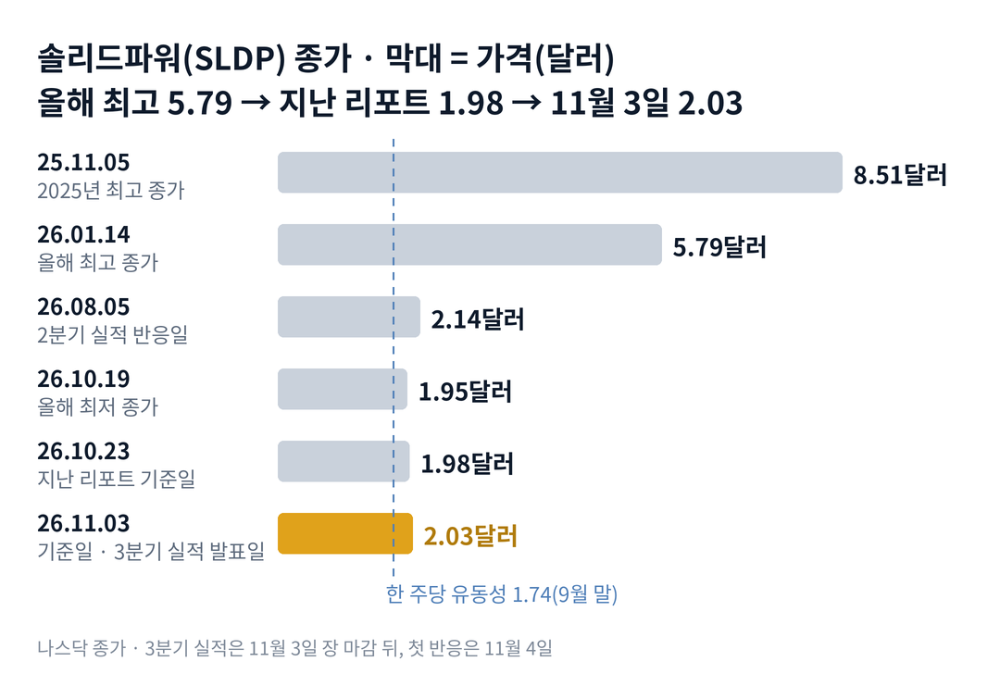

## 짧은 답

> **핵심:** 3분기는 매출을 늘린 분기가 아니라 현금을 아낀 분기였고, 주가는 여전히 회사가 가진 현금 가치 바로 위에 머물러 있습니다.

근거는 세 가지입니다. 매출은 에스케이온(SK On, SK그룹의 배터리 회사)과의 개발 계약이 끝나 가며 크게 줄었습니다. 대신 회사는 올해 쓸 현금 계획을 줄였고, 석 달 동안 새 주식도 거의 늘지 않았습니다. 그래서 주가를 받치는 것은 사업 기대보다 통장에 있는 현금이라는 구도가 이어졌습니다.

> **국면 정의(솔리드파워 시리즈 공통):** 국면 A · 기대 확산 — 업종이 한 달에 20% 넘게 오르고 파트너 소식이 이어지는 때. 국면 B · 실망과 희석 — 새 주식 발행이나 시장 매각이 나오고 좋은 소식에도 다음 날 내리는 때. 국면 C · 현금 바닥 다지기 — 시가총액이 유동성의 1.5배 안에 머물고 자금 조달 없이 좁은 범위에서 움직이는 때.

**11월 3일 진단: 국면 C(현금 바닥 다지기)가 실적 발표 날까지 이어졌습니다.** 이렇게 현금값 가까이에서 실적을 맞은 해의 그 뒤 20거래일은 3부 '현금값 근처에서 맞은 실적 10번' 표에 있습니다.

> **유의사항** 저자는 금융·투자 자문가가 아닙니다. 이 글은 공개 공시와 시세를 정리한 교육용 분석이며 특정 매매를 권하지 않습니다. 과거의 주가 반응이 미래에 반복된다는 보장은 없고, 솔리드파워는 실적 다음 날 50% 넘게 움직인 적이 있는 변동성이 큰 종목입니다. 실제 투자 전에는 최신 가격과 공시를 직접 확인하세요.

## 지난 리포트 이후

[지난 리포트](/r/sldp-2026-10-3/)는 10월 23일 종가 1.98달러를 기준으로 나왔습니다. 지금을 국면 C(현금 바닥 다지기)로 진단했고, 실적을 앞두고 네 가지 시나리오를 적었습니다. 지난 예측 성적은 5개 중 적중 2 · 빗나감 0 · 진행 중 3입니다.

| 지난 점검 항목 · 당시 기준 | 판정 및 실제 결과(11월 3일) |
| --- | --- |
| **진단: 국면 C 지속** 유동성 1.5배 안, 자금 조달 없음 | **[적중]** 11월 3일까지 종가 1.96~2.05달러, 조달 공시 없음 |
| **시나리오 2: 9월 말 유동성** 3억 9,000만 달러 이상 | **[적중]** 3억 9,756만 달러 |
| **시나리오 3: 한국 합작법인** 11월 20일까지 발표 | **[진행 중]** 회사는 '논의를 진전시켰다'고만 밝힘 |
| **시나리오 1: 실적 뒤 20일 약세** 11월 20일 판정 | **[진행 중]** 첫 반응은 11월 4일 |
| **시나리오 4: 1.84달러 아래 마감** 11월 20일까지 | **[진행 중]** 11월 3일까지 최저 종가 1.96달러 |

맞은 두 줄은 같은 이야기입니다. 회사는 현금을 예상보다 덜 썼고, 주가는 그 현금 가치 위에서 좁게 움직였습니다.

## 1부. 솔리드파워는 어떤 회사인가

> **핵심:** 전고체 배터리에 들어가는 황화물 고체 전해질을 만들어 배터리 회사에 파는 회사로, 아직 매출보다 손실이 훨씬 크고 상장 때 모은 현금으로 버티고 있습니다.

솔리드파워는 미국 콜로라도주 루이빌에 본사를 둔 회사입니다. 배터리를 직접 대량으로 만들기보다, 핵심 재료인 고체 전해질을 팔고 셀 설계를 빌려주는 사업 모델을 택했습니다. 3분기에는 삼성SDI(삼성 계열 배터리 회사)와 SK온에 전해질을 공급했다고 밝혔습니다.

11월 3일 장 마감 뒤 나온 3분기 실적의 줄기는 이렇습니다. 매출은 24만 3,000달러로 1년 전보다 크게 줄었습니다. 미국 에너지부(DOE) 보조금 수입을 더해도 122만 달러입니다. 영업비용은 2분기보다 조금 늘었고, 순손실은 2,440만 달러였습니다.

대신 회사는 올해 현금 투입(영업과 설비에 쓰는 돈) 전망을 직전 계획보다 낮춰 7,500만~8,500만 달러로 잡았습니다. 9개월 동안 쓴 돈은 5,660만 달러입니다. 새 연속 생산 라인 모비우스(MOBIUS)는 연말까지 시운전을 마칠 예정이고, 완성되면 연간 전해질 생산 능력이 75톤으로 늘어납니다.

### 숫자로 본 지금의 크기(11월 3일 기준)

| 항목 | 값 · 근거 |
| --- | --- |
| 종가 | **2.03달러** 11월 3일, 실적 발표 전 장 마감 |
| 9월 말 유동성 | **3억 9,756만 달러** 현금 2,328만 + 증권 3억 7,428만, 부채 0 |
| 한 주당 유동성 | **약 1.74달러** 3분기 가중평균 주식 2억 2,820만 주 기준 |
| 사업값(한 주당) | **약 29센트** 종가에서 한 주당 유동성을 뺀 값 |
| 3분기 현금 투입 | **2,150만 달러** 연간 전망 7,500만~8,500만 달러 |
| 미행사 워런트 | **4,561만 개** 행사가 7.25달러(2분기 10-Q) |

이 말은 곧 지금 주가의 대부분이 회사가 가진 현금으로 설명된다는 뜻입니다. 남은 계획을 4분기에 다 쓰면 연말 유동성은 약 3억 7,000만 달러 안팎이 됩니다. 한 주당으로는 약 1.62~1.66달러입니다.

위 그림처럼 2025년 11월 5일 8.51달러가 꼭대기였고, 올해는 1월 14일 5.79달러가 가장 높았습니다. 10월 19일 1.95달러로 올해 가장 낮은 종가를 찍은 뒤 2달러 안팎에 머물러 있습니다. 그렇다면 실적을 앞둔 2주 동안 주가는 어떻게 움직였을까요?

## 2부. 실적 앞 2주, 현금값 위의 좁은 길

> **핵심:** 10월 23일부터 11월 3일까지 회사 공시는 한 건도 없었고, 주가는 1.96~2.05달러 사이에서 업종 대표와 비슷한 폭으로 움직였습니다.

10월 26일 장 전에 회사는 모비우스 라인의 시운전을 시작했다고 발표했습니다. 그날 종가는 1.99달러로 거의 움직이지 않았습니다. 다음 날부터 3거래일 동안은 2.02~2.05달러로 조금 올랐다가, 10월 30일 1.96달러로 다시 내려왔습니다.

같은 기간 업종 대표 퀀텀스케이프는 10월 23일 4.03달러에서 11월 3일 4.12달러로 2.2% 올랐습니다. 솔리드파워는 1.98달러에서 2.03달러로 2.5% 올랐습니다. 업종과 거의 같은 방향, 같은 크기였습니다.

거래량도 조용했습니다. 11월 3일 거래량은 약 278만 주로, 직전 2주의 하루 거래량 범위 안이었습니다. 실적을 앞두고 미리 사거나 파는 큰 움직임은 보이지 않았습니다.

이 말은 곧 시장이 실적 전까지 이 회사를 '현금이 많은 회사'로만 값을 매겼다는 뜻입니다. 그렇다면 이렇게 현금값 가까이에서 실적을 맞은 과거에는 그 뒤 무슨 일이 있었을까요?

## 3부. 현금값 근처에서 맞은 실적 10번

> **핵심:** 주가가 한 주당 현금의 1.5배 안이었던 실적 10번 가운데, 첫 반응일에 오른 것은 4번, 20거래일 뒤 실적 전보다 높았던 것은 3번이었습니다.

지난 리포트에서 상장 뒤 실적 19번을 모두 모았습니다. 이번에는 그중 발표 전 주가가 한 주당 현금(유동성)의 1.5배 안이었던 10번만 골랐습니다. 지금이 1.17배이기 때문입니다. 실적은 모두 장 마감 뒤 발표라 다음 거래일을 첫 반응일로 잡았고, '20거래일 뒤'는 발표일 종가와 비교했습니다.

### 현금값 근처에서 맞은 실적 10번

| 이벤트일 · 핵심 내용 | 당일 | 20거래일 뒤 |
| --- | --- | --- |
| **2023.05.09** 주가/현금 0.79배 | -7.2% | +6.7% |
| **2023.08.09** 주가/현금 0.95배 | +6.8% | -15.7% |
| **2023.11.08** 주가/현금 0.58배 | +6.2% | -2.1% |
| **2024.02.28** 주가/현금 0.73배 | -3.5% | -2.9% |
| **2024.05.08** 주가/현금 0.78배 | -2.8% | -4.5% |
| **2024.08.07** 주가/현금 0.74배 | -19.2% | -16.7% |
| **2024.11.08** 주가/현금 0.59배 | -1.7% | -6.8% |
| **2025.02.28** 주가/현금 0.63배 | +0.8% | -9.0% |
| **2025.05.07** 주가/현금 0.63배 | +6.2% | +28.3% |
| **2026.08.05** 주가/현금 1.19배 | -7.0% | +1.3% |

이 말은 곧 현금값 근처라는 사실만으로는 실적 뒤 주가를 받쳐 주지 못했다는 뜻입니다. 10번 중 7번은 한 달 뒤 실적 전보다 낮았습니다. 반대로 크게 오른 2025년 5월은 그 뒤 업종 전체가 강하게 오른 시기였습니다.

가장 비슷한 사례는 바로 직전인 2026년 8월입니다. 그때도 주가가 현금의 1.19배였고, 첫날 7.0% 내렸다가 20거래일 뒤에는 실적 전 수준으로 돌아왔습니다. 그렇다면 같은 조건에서 결과를 가른 것은 무엇이었을까요?

## 4부. 되풀이된 이야기

> **핵심:** 현금값 근처의 실적에서 주가를 움직인 것은 실적 숫자 자체보다 새 주식 발행 여부와 업종 분위기였습니다.

과거 10번에서 이번 실적에 쓸 수 있는 시사점은 세 가지입니다.

첫째, 현금값은 바닥이 아니라 출발선이었습니다. 주가가 현금보다 쌌던 2023~2025년에도 실적 뒤 한 달 동안 더 내려간 경우가 많았습니다. 그래서 11월 4일 반응이 약해도, 1.74달러라는 숫자가 저절로 하락을 멈춰 주지는 않습니다.

둘째, 오른 경우에는 회사 밖의 바람이 있었습니다. 2025년 5월 뒤의 큰 상승은 전고체 배터리 업종 전체의 기대가 커진 시기와 겹쳤습니다. 지금 업종 대표의 2주 흐름이 조용하다는 점은 이번에 그런 바람이 아직 없다는 뜻입니다.

셋째, 이번에는 현금 계획을 줄였다는 새 재료가 있습니다. 현금을 덜 쓰면 연말 한 주당 유동성의 하락 폭이 작아집니다. 이것이 과거와 다른 결과를 낼지는 시장 매각 재개 여부와 한국 합작법인 소식에 달려 있습니다. 그렇다면 지금은 어느 단계이고, 실적 뒤 갈림길은 몇 갈래일까요?

## 5부. 지금 어느 단계이고, 무엇을 볼까

> **핵심:** 국면 C(현금 바닥 다지기)가 실적 날까지 이어졌고, 12월 3일까지 새 주식 공급이 없는지와 한국 합작법인이 발표되는지가 다음 국면을 가릅니다.

**2026년 11월 3일 진단: 국면 C(현금 바닥 다지기) 지속.** 근거는 세 가지입니다. 시가총액이 유동성의 1.17배로 1.5배 안입니다. 석 달 넘게 새 주식 발행이나 시장 매각 공시가 없습니다. 2주 동안 종가가 1.96~2.05달러의 좁은 범위에 머물렀습니다. 국면 A(기대 확산)로 넘어가는 신호는 금액이 붙은 합작법인 계약과 업종 대표의 한 달 20% 넘는 상승입니다.

### 앞으로 일어날 수 있는 일

**확인된 사실:** 9월 말 유동성은 1부 표와 같고 부채는 없으며, 올해 현금 투입 전망을 낮췄고, 분기 가중평균 주식 수는 2분기 말과 거의 같습니다. **과거 기록:** 현금값 근처에서 맞은 실적 10번 중 7번은 20거래일 뒤 실적 전보다 낮았습니다. **추정:** 아래 표의 가능성은 '회사 쪽 사건이 이렇게 나올' 확률을 위 사실과 기록을 보고 분석자가 주관적으로 매긴 값입니다. 통계로 계산한 값이 아니고, 주가가 오를 확률도 아닙니다.

| 시나리오 · 예상 반응(판정 12월 3일) | 무증자·합작 | 가능성(추정) |
| --- | --- | --- |
| 1 · 현금 지키며 합작 발표 사업값이 커질 수 있지만 금액이 관건 | ○ / ○ | 낮음 (15~25%) |
| **2 · 현금 지키며 소식 없음** 회사 숫자는 안정, 주가 방향은 과거 7번이 아래 | ○ / × | 높음 (40~50%) |
| 3 · 합작 발표와 함께 주식 발행 합작 자금 조달로 희석 | × / ○ | 낮음 (5~10%) |
| 4 · 시장 매각 재개, 합작 없음 한 주당 유동성 아래로 | × / × | 중간 (15~25%) |

표의 '무증자'는 12월 3일까지 시장 매각·공모 같은 새 주식 공급 공시가 없는 경우입니다. '합작'은 같은 날까지 한국 전해질 합작법인 계약이 발표되는 경우입니다. 12월 3일은 첫 반응일(11월 4일)을 첫날로 센 20번째 거래일입니다.

시나리오 2를 가장 높게 본 이유는 회사가 현금 계획을 줄이며 아끼는 쪽을 택했고, 합작법인은 목표가 '연말'이라 12월 3일 안에 나올 여지가 작기 때문입니다. 여기서 둘을 나눠 봐야 합니다. 회사 숫자가 안정적일 가능성은 높게 봤지만, 그것이 곧 주가 상승을 뜻하지는 않습니다.

시나리오 4를 중간으로 둔 근거는 2분기 말 남아 있던 시장 매각 한도 약 5,880만 달러입니다. 3분기에는 쓰지 않았지만, 주가가 현금값에 가까울 때는 매각할수록 희석이 커져 회사도 신중할 수 있습니다.

## 6부. 조심할 점과 체크리스트

> **핵심:** 현금값 근처의 실적 기록은 10번뿐인 작은 표본이고, 주식 수는 3분기 가중평균을 썼으므로 곧 나올 3분기 보고서로 다시 확인해야 합니다.

3부 표는 '현금값 근처에서는 반드시 내린다'는 규칙이 아닙니다. 10번은 작은 표본이고, 해마다 업종 분위기와 회사 사정이 달랐습니다. 한 주당 유동성은 3분기 가중평균 주식 수로 계산했고, 실제 발행 주식 수는 3분기 보고서(10-Q)에서 확인할 수 있습니다.

회사 자체의 위험도 세 가지를 짚습니다. 첫째, 매출의 대부분이던 SK온 개발 계약이 줄면서 매출이 1년 전의 10분의 1 아래로 내려왔습니다. 둘째, 한국 합작법인은 아직 '논의'이고 상대 회사와 금액이 공개되지 않았습니다. 셋째, 행사가 7.25달러 워런트 4,561만 개가 남아 있어, 주가가 크게 오르면 새 주식 공급이 될 수 있습니다.

11월 3일 장 마감 뒤 시간외 반응은 이 글에 반영하지 않았습니다. 첫 반응은 11월 4일 종가로 다음 업데이트에서 채점합니다.

이 체크리스트는 5부의 국면 진단과 함께 써야 합니다.

- ☐ 11월 4일 첫 반응이 과거 10번의 범위(-19.2% ~ +6.8%) 안인가
- ☐ 11월 중 분기 보고서의 주식 수가 약 2억 2,820만 주이고 시장 매각이 없었는가
- ☐ 12월 3일까지 시장 매각·공모 공시가 0건인가
- ☐ 12월 3일까지 한국 합작법인 계약과 금액이 발표되는가
- ☐ 12월 3일 종가가 한 주당 유동성 1.74달러 위인가
- ☐ 12월 3일까지 업종 대표 퀀텀스케이프가 20% 넘게 오르는가

다음 갱신은 11월 4일 첫 반응과 3분기 10-Q를 본 뒤에 합니다.
