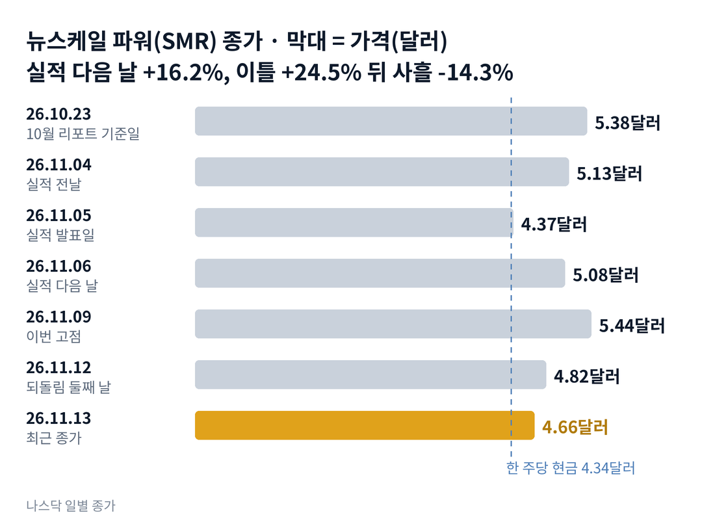

뉴스케일 파워 주가는 3분기 실적이 나온 다음 날인 11월 6일 16.2% 올랐습니다. 다음 거래일인 11월 9일에도 더 올라, 실적 날 종가 4.37달러에서 5.44달러가 됐습니다. 그런데 같은 기간 오클로는 11월 5일 종가 대비 39.8% 올랐습니다. 실적을 낸 회사가 오히려 원전주 가운데 가장 덜 오른 셈입니다. 그리고 11월 13일 종가는 11월 9일 종가 대비 14.3% 낮은 4.66달러였습니다. 이 반등은 실적이 만든 것이었을까요, 업종 바람이 잠깐 실어 준 것이었을까요?

> **유의사항** 저자는 금융·투자 자문가가 아닙니다. 이 글은 공개 공시와 시세를 정리한 교육용 분석이며 특정 종목의 매수·매도를 권하지 않습니다. 과거 패턴은 미래 수익을 보장하지 않고, 이 종목은 하루 10% 넘게 움직이는 날이 잦습니다. 실제 투자 전에는 최신 공시를 직접 확인하세요.

이 글은 [11월 5일 리포트](/r/smr-2026-11/)를 잇는 실적 뒤 후속편입니다. 그 리포트는 실적 날 주가가 한 주당 현금 수준까지 내려온 장면을 다뤘습니다. 그리고 다음 날 첫 반응과 12월 4일 종가로 네 갈래를 나눴습니다. 그 뒤 6거래일을 채점한 지난 예측 성적은 적중 하나, 빗나감 하나, 진행 중 셋입니다. 먼저 숫자 하나를 고쳐 둡니다. 지난 리포트는 11월 5일 종가를 4.41달러로 적었는데, 나스닥의 공식 종가는 4.37달러였습니다. 이 글은 4.37달러를 씁니다.

가장 크게 빗나간 것은 무게를 둔 방향이었습니다. 지난 리포트는 네 갈래 가운데 '첫날 하락 뒤 한 달 내내 실망'을 약 35%로 가장 무겁게 봤습니다. 최근 실적 다섯 번 중 네 번이 한 달 뒤 16% 넘게 낮았기 때문입니다. 실제 첫날은 큰 상승이었고, 그 갈래는 첫날에 바로 지워졌습니다. 맞은 것도 있습니다. 첫 반응이 과거 실적 17번의 범위, 곧 -32.9%에서 +21.6% 사이에 들 것이라는 점검은 맞았습니다. 남은 세 갈래는 12월 4일 종가와 계약 소식을 봐야 판정됩니다.

뉴스케일이 무엇으로 돈을 벌려는 회사인지 짧게 짚겠습니다. 이 회사는 공장에서 만들어 옮길 수 있는 작은 원자로, 곧 소형 모듈 원자로를 설계합니다. 발전소를 지으려는 고객이 원자로 모듈을 주문하면, 설계와 모듈을 공급하고 엔지니어링 대가를 받는 방식으로 돈을 법니다. 문제는 아직 확정 주문이 없다는 점입니다. 그래서 3분기 매출은 28만 1,000달러에 그쳤습니다. 루마니아 사업 설계 일이 있던 1년 전 같은 분기 824만 달러보다 훨씬 작습니다.

대신 현금은 많습니다. 9월 말 현금과 투자 자산은 18억 6,410만 달러이고, 차입금은 없습니다. 이를 주식 수로 나누면 한 주당 약 4.34달러입니다. 11월 13일 종가 4.66달러는 그보다 7% 남짓 높습니다. 시가총액은 약 20억 달러이고, 현금과 투자 자산을 빼면 약 1억 3,700만 달러가 남습니다. 시장이 원자로 설계와 앞으로의 사업에 얹어 준 값이 그 정도라는 계산입니다. 11월 5일 종가로 셈하면 이 값은 약 1,200만 달러까지 줄어 있었습니다.

사건은 11월 5일부터 시작됩니다. 그날 나스닥 100 지수를 따르는 펀드(QQQ)가 하루 6.5% 내렸습니다. 원전 개발사들은 더 크게 빠졌습니다. 뉴스케일은 14.8% 내려 4.37달러, 오클로는 13.2%, 나노 뉴클리어는 12.0% 내렸습니다. 뉴스케일은 2024년 3월 이후 가장 낮은 종가에서 장을 마쳤고, 그날 장이 끝난 뒤 실적을 냈습니다.

실적의 첫 줄은 손실이었습니다. 3분기 순손실은 4,571만 달러로, 1년 전보다 91% 줄었습니다. 1년 전 같은 분기에는 엔트라1과 관련된 일반관리비가 크게 잡혀 있었기 때문입니다.

주당 순손실은 0.11달러였습니다. 보도에 따르면 시장 예상은 0.26달러 손실이었으니, 손실이 예상보다 작았습니다. 현금에서 나온 이자도 도왔습니다. 투자 수익이 1년 전보다 1,340만 달러 늘었습니다.

매출은 반대였습니다. 보도된 시장 예상 매출은 약 1,010만 달러였는데, 실제는 28만 1,000달러였습니다. 손실은 예상보다 작았지만 일감은 예상보다 훨씬 적었다는 뜻입니다. 회사가 내세운 소식은 '개발에서 실제 생산으로 넘어갔다'는 문장이었습니다. 10월 29일 두산에너빌리티와 원자로 모듈의 핵심 부품인 상부 냉각 계통 제작 계약을 맺은 일을 가리킵니다. 다만 이것은 회사가 돈을 쓰는 계약이지, 매출이 들어오는 주문은 아닙니다.

가장 기다리는 소식은 이번에도 나오지 않았습니다. 뉴스케일의 상업 파트너 엔트라1은 미국 공기업 테네시강유역개발공사(TVA)와 대규모 원전 보급을 협의하고 있습니다. 회사는 이 협의를 '미국 역사상 가장 큰 상업 원전 보급 계획'이라고 부릅니다. 하지만 아직 구속력 있는 계약이 아닙니다. 보도에 따르면 확정 계약이 2027년까지 늦어질 수 있다는 증권사 분석도 나왔습니다.

다음 날인 11월 6일, 원전주가 한꺼번에 튀어 올랐습니다. 뉴스케일은 앞서 본 대로 5.08달러가 됐습니다. 같은 날 장 전에 실적을 낸 오클로는 22.7%, 센트러스 에너지는 17.5% 올랐습니다. QQQ는 1.4% 오르는 데 그쳤습니다. 시장 전체가 아니라 원전 업종에 돈이 다시 들어온 날이었고, 뉴스케일은 그 가운데 중간쯤이었습니다.

그림에서 보듯 반등은 2거래일이었습니다. 11월 9일에도 업종이 함께 올라 뉴스케일은 5.44달러까지 갔습니다. 10월 23일 종가 5.38달러를 잠깐 넘은 값입니다. 하지만 그날 오클로는 14.0% 더 올랐고, 뉴스케일은 7.1%였습니다. 그 뒤 3거래일 동안 원전주는 다시 함께 내렸습니다. 오클로는 10.9%, 뉴스케일은 14.3% 내렸습니다. 오를 때는 덜 오르고, 내릴 때는 더 내린 셈입니다.

11월 5일 종가에서 11월 13일 종가까지 한 줄로 보면 차이가 더 분명합니다. 뉴스케일은 6.6% 올랐습니다. 같은 기간 오클로는 24.6%, 센트러스 에너지는 16.6%, 나노 뉴클리어는 15.3% 올랐습니다. 업종 바람은 같았는데, 뉴스케일만 그 바람을 덜 탔습니다.

그 차이를 만든 것은 세 가지로 보입니다. 첫째는 매출입니다. 손실이 작았던 이유의 일부가 현금 이자와 1년 전 비용의 기저 효과라서, 사업이 커졌다는 증거로 읽히기 어려웠습니다. 둘째는 TVA 협의의 시간표입니다. 확정 계약이 2027년으로 밀릴 수 있다는 말이 나오면서, 반등을 오래 끌고 갈 새 재료가 없었습니다.

셋째는 남아 있는 주식 판매 계약입니다. 회사는 8월에 7억 5,000만 달러 규모의 시장 판매 계약을 맺었습니다. 시장 판매 계약은 회사가 시장에서 새 주식을 조금씩 찍어 파는 방식입니다. 3분기에는 이 계약으로 한 주도 팔지 않았습니다. 그러나 주가가 오르면 그만큼 적은 주식으로 돈을 마련할 수 있으니, 반등 때마다 판매가 다시 시작될 수 있다는 걱정이 남습니다. 올해 1~9월에는 약 8,970만 주를 평균 11.14달러에 팔았습니다.

현금이 줄어드는 속도도 같이 봐야 합니다. 1~9월 영업에서 나간 현금은 4억 140만 달러였습니다. 그중 2억 5,990만 달러는 엔트라1에 한 번 지급한 돈입니다. 이를 빼면 분기마다 약 4,700만 달러, 한 주당 약 0.11달러씩 현금이 줄어드는 셈입니다. 한 주당 현금 4.34달러는 9월 말 숫자라서, 시간이 갈수록 조금씩 낮아지는 기준선입니다.

그 사이 공시는 하나뿐이었습니다. 11월 13일 운용사 반에크가 9월 말 기준 뉴스케일 주식 6.8%를 갖고 있다고 신고했습니다. 원전 관련 펀드를 운용하는 회사라, 새로운 매수 신호라기보다 정기 보고로 보는 것이 맞습니다. 결국 6거래일 동안 회사 쪽에서 새로 나온 큰 소식은 없었고, 주가는 업종을 따라 움직이되 업종보다 약했습니다.

이런 '급등 뒤 되돌림'은 뉴스케일에서 처음이 아닙니다. 그래서 같은 모양을 과거에서 찾아봤습니다. 기준은 세 가지입니다. 하루에 15% 넘게 오른 날이어야 하고, 5거래일째 종가가 그 상승분의 절반 넘게 되돌려 있어야 합니다. 앞 급등과 5거래일 안으로 겹치는 날은 하나로 셌습니다. 이번 11월 6일은 하루 급등 뒤 5거래일째 상승분 가운데 59%를 되돌려, 이 기준에 들어갑니다.

2024년 이후 이 기준에 맞는 경우는 12번이었습니다. 급등 전날 종가에서 20거래일째 종가를 비교하면, 더 높았던 것이 6번, 낮았던 것이 6번입니다. 절반씩이라 이것만으로는 방향을 말하기 어렵습니다. 그런데 5거래일째 종가가 급등 전날 종가 위에 있었는지로 나누면 그림이 갈립니다.

5거래일째에도 급등 전날 종가 위에 남아 있던 경우는 3번이었습니다. 3번 모두 20거래일째에 급등 전날보다 19% 넘게 높았습니다.

반대로 5거래일째에 급등 전날 종가 아래로 내려간 9번 가운데 20거래일째 더 높았던 것은 3번뿐이었습니다. 그 9번의 가운데 값(중앙값)은 -20.8%였습니다. 반등이 되돌려지더라도 출발점 위에 버티는지가 한 달 뒤를 가른 셈입니다.

지금과 가장 닮은 예는 2025년 1월 3일입니다. 그날 뉴스케일은 17.7% 올라 20.85달러가 됐고, 5거래일째에는 18.80달러까지 내려왔습니다. 그래도 급등 전날 17.71달러보다 6.2% 높았습니다.

20거래일째 종가는 23.85달러로, 급등 전날보다 34.7% 높았습니다. 이번에는 5거래일째인 11월 13일 4.66달러가 급등 전날 4.37달러보다 6.6% 높습니다.

다만 이 기록을 그대로 믿기는 어렵습니다. 출발점 위에 버틴 3번은 모두 2024년 10월부터 2025년 4월 사이, 원전주 전체가 크게 오르던 때였습니다. 올해 들어 같은 기준에 든 2월, 4월, 9월의 세 번은 모두 20거래일째 급등 전날보다 13% 넘게 낮았습니다. 그 세 번은 모두 5거래일째에 이미 출발점 아래였습니다. 지금은 출발점 위라는 점에서 올해의 세 번과 다르지만, 업종 분위기는 2024년과 다릅니다. 표본 3번은 결론이 아니라 방향을 가늠하는 단서입니다.

그래서 지금 위치는 이렇습니다. 주가는 실적 날 바닥에서 6.6% 위, 한 주당 현금보다 7% 남짓 위에 있습니다. 업종을 따라 움직이되 업종보다 약하다는 점은 지난 6거래일이 보여 줬습니다. 앞으로 판정할 날은 12월 4일입니다. 급등 전날인 11월 5일에서 20거래일째 되는 날이고, 지난 리포트가 정한 판정일과도 같습니다.

갈 길은 두 가지 질문으로 나눴습니다. 하나는 12월 4일 종가가 4.37달러 위인가이고, 다른 하나는 11월 5일 뒤 수익률이 오클로보다 나은가입니다. 첫 질문은 급등 기록이 갈린 기준이고, 둘째 질문은 회사 쪽 힘이 생겼는지를 보는 기준입니다. 이렇게 네 갈래가 나옵니다. 출발점 위에서 오클로까지 따라잡는 '회사 쪽 회복', 출발점 위지만 오클로에는 못 미치는 '업종 바람에 실린 버팀'이 있습니다. 출발점 아래지만 오클로보다는 덜 빠진 '덜 빠진 하락', 출발점 아래에 오클로보다도 약한 '혼자 약한 되돌림'도 있습니다.

가장 무겁게 본 것은 '업종 바람에 실린 버팀'으로, 약 40%입니다. 출발점 위에 버틴 3번이 모두 한 달 뒤 높았다는 기록이 이쪽을 받칩니다. 그다음은 '혼자 약한 되돌림'으로 약 35%입니다. 올해 같은 모양 세 번이 모두 내렸고, 주식 판매 계약이 남아 있기 때문입니다. 오클로를 따라잡으려면 지금 18%포인트 차이를 메워야 해서, '회사 쪽 회복'은 약 10%로 낮게 봤습니다. 이 숫자들은 주가가 오를 확률이 아니라, 과거 빈도와 지금 신호를 보고 분석자가 주관적으로 매긴 추정입니다.

위험은 네 갈래로 봅니다. 먼저 분석의 한계입니다. 급등 기록은 12번, 그중 핵심 비교는 3번뿐이고, 그 사이 주가 수준이 45달러대에서 4달러대로 바뀌었습니다. 다음은 사업 실행입니다. TVA 협의가 구속력 있는 계약으로 이어지지 않으면 매출의 출발점이 계속 밀립니다. 두산과의 부품 계약처럼 준비가 진행돼도, 그 자체로는 매출이 되지 않습니다.

세 번째는 자금 조달입니다. 시장 판매 계약으로 판매가 다시 시작되면 주식 수가 늘어, 기존 주주 한 주가 회사에서 차지하는 비율이 작아집니다. 주가가 4달러대라면 1억 달러를 마련하는 데 2,000만 주 넘게 필요합니다. 판매 여부는 분기 보고서가 나와야 확인되는 경우가 많아, 12월 4일까지 모를 수도 있습니다. 마지막은 외부 환경입니다. 11월 5일처럼 기술주 전체가 6% 넘게 빠지는 날에는 회사 소식과 상관없이 함께 내립니다.

결국 11월 6일의 16.2%는 실적보다 업종 반등의 힘이 컸습니다. 같은 날 실적을 낸 오클로가 더 올랐고, 손실이 작았던 이유의 일부는 현금 이자였으며, 기다리던 확정 주문은 없었기 때문입니다. 그래도 3거래일의 되돌림 뒤 주가는 아직 급등 전날 종가 위에 있고, 과거에 그 자리에서 버틴 세 번은 한 달 뒤 모두 더 높았습니다. 다음 갱신은 12월 4일 종가를 본 뒤에 하고, 그 전에 TVA 계약이나 주식 판매 소식이 나오면 앞당깁니다.

## 숫자로 다시 보기

### 원전 개발사 네 곳 비교 표

| 종목 · 하는 일 | 11월 6일 · 11월 9일 | 11월 5일~13일 |
| --- | --- | --- |
| **뉴스케일 파워** 소형 원자로 설계 | **+16.2% · +7.1%** | **+6.6%** |
| 오클로 소형 원자로 개발 | +22.7% · +14.0% | +24.6% |
| 센트러스 에너지 원전 연료 | +17.5% · +12.2% | +16.6% |
| 나노 뉴클리어 초소형 원자로 개발 | +15.3% · +12.3% | +15.3% |
| QQQ(나스닥 100 펀드) 비교 기준 | +1.4% · +3.5% | +5.1% |

11월 5일 하루 변화는 뉴스케일 -14.8%, 오클로 -13.2%, 나노 뉴클리어 -12.0%, QQQ -6.5%였습니다.

### 3분기 실적 표

| 항목 | 3분기 실제 | 비교 대상 |
| --- | --- | --- |
| 매출 | **28만 1,000달러** | 1년 전 824만 달러 보도된 예상 약 1,010만 달러 |
| 주당 순손실 | **0.11달러** | 보도된 예상 0.26달러 |
| 순손실 | **4,571만 달러** | 1년 전보다 91% 적음 |
| 현금과 투자 자산 | **18억 6,410만 달러** | 한 주당 약 4.34달러, 차입금 없음 |
| 3분기 새 주식 판매 | **0주** | 1~9월 약 8,970만 주, 평균 11.14달러 |

### 급등 뒤 되돌림 12번 기록표

하루 15% 넘게 오른 뒤 5거래일째 그 상승분의 절반 넘게 되돌린 경우입니다. 두 열은 모두 급등 전날 종가와 비교했고, 20거래일째는 급등 전날에서 센 날입니다.

| 급등일 · 하루 상승 | 5거래일째 | 20거래일째 |
| --- | --- | --- |
| 2024.03.18 +28.7% | -48.2% | -38.2% |
| 2024.07.12 +17.5% | -13.5% | -34.2% |
| **2024.10.28 +19.5%** | **+0.3%** | **+64.1%** |
| **2025.01.03 +17.7%** | **+6.2%** | **+34.7%** |
| 2025.01.21 +16.6% | -4.6% | +0.3% |
| **2025.04.09 +15.5%** | **+4.2%** | **+19.4%** |
| 2025.06.24 +18.5% | -1.0% | +21.8% |
| 2025.09.19 +22.7% | -0.3% | +25.0% |
| 2025.10.15 +16.7% | -24.2% | -41.6% |
| 2026.02.06 +18.1% | -3.6% | -21.4% |
| 2026.04.22 +16.3% | -3.0% | -13.8% |
| 2026.09.08 +15.3% | -13.1% | -20.8% |
| **이번 2026.11.06 +16.2%** | **+6.6%** | 12월 4일 판정 |

굵게 쓴 세 줄이 5거래일째에도 급등 전날 종가 위에 있던 경우입니다.

### 지난 예측 채점표

| 지난 점검 항목 · 당시 기준 | 판정과 실제 결과(11월 13일) |
| --- | --- |
| **첫 반응이 실적 17번 범위 안** -32.9%~+21.6% | **[적중]** 11월 6일 +16.2% |
| **첫날 하락 뒤 실망 지속** 가장 무겁게 본 갈래, 약 35% | **[빗나감]** 첫날 상승으로 지워짐 |
| **첫날 상승 갈래 둘** 12월 4일 4.41달러 위인가 | **[진행 중]** 지금 4.66달러 |
| **TVA 구속력 있는 계약** 12월 4일까지 | **[진행 중]** 발표 없음 |
| **10월 리포트 업종 반등 갈래** 11월 20일 5.38달러 위인가 | **[진행 중]** 지금 4.66달러 |

### 앞으로 일어날 수 있는 일

아래 가능성은 분석자가 과거 빈도와 지금 신호를 보고 주관적으로 매긴 추정이며, 주가가 오를 확률이 아닙니다. 네 갈래는 겹치지 않아 더하면 100%입니다.

| 갈래(판정 12월 4일) | 판정 조건 | 가능성(추정) |
| --- | --- | --- |
| 1 · 회사 쪽 회복 | 위 · 오클로보다 나음 | 낮음 약 10% (5~15%) |
| **2 · 업종 바람에 실린 버팀** | 위 · 오클로보다 못함 | 높음 약 40% (35~45%) |
| 3 · 덜 빠진 하락 | 아래 · 오클로보다 나음 | 낮음 약 15% (10~20%) |
| 4 · 혼자 약한 되돌림 | 아래 · 오클로보다 못함 | 높음 약 35% (30~40%) |

'오클로 대비'는 11월 5일 종가에서 12월 4일 종가까지의 수익률을 비교합니다. 11월 13일 기준 차이는 뉴스케일 +6.6%, 오클로 +24.6%입니다.

### 핵심 확인 세 가지

| 순위 · 확인할 것 | 판정 날짜 |
| --- | --- |
| **1순위** 종가가 급등 전날 4.37달러 위인가 | 12월 4일 |
| **2순위** 엔트라1과 TVA의 구속력 있는 계약 발표 | 12월 4일까지 |
| **3순위** 종가가 10월 23일 5.38달러 위인가(10월 리포트 갈래) | 11월 20일 |
