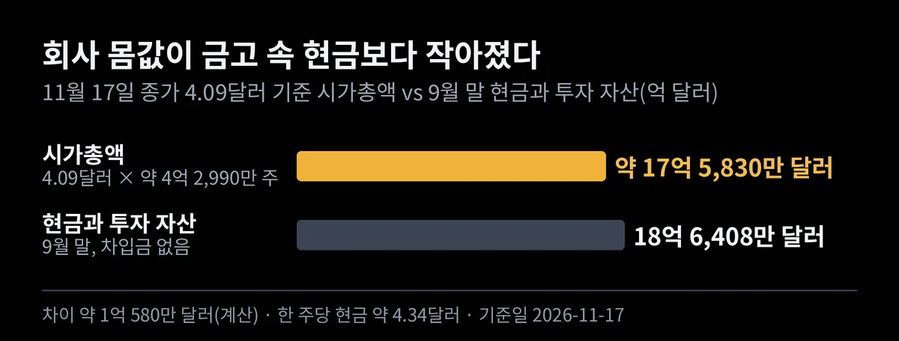
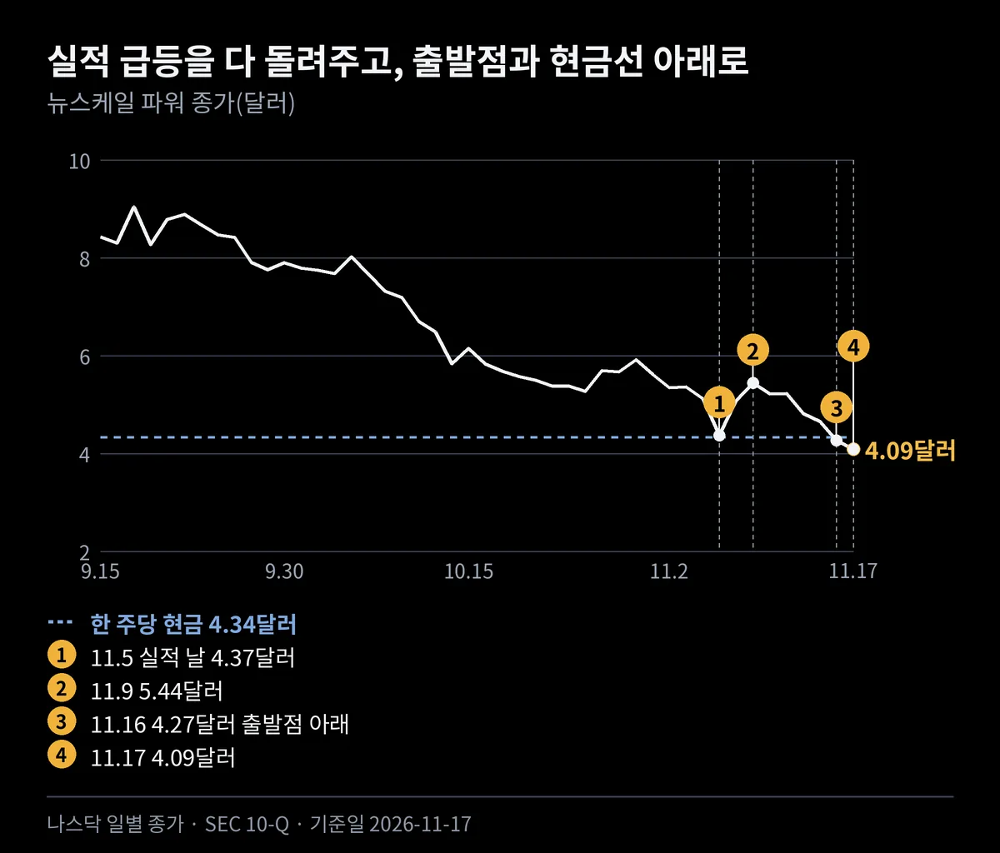
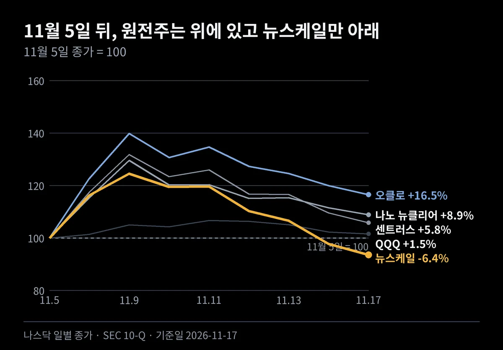
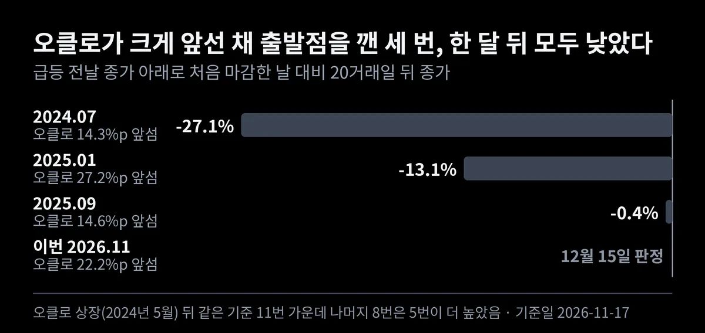
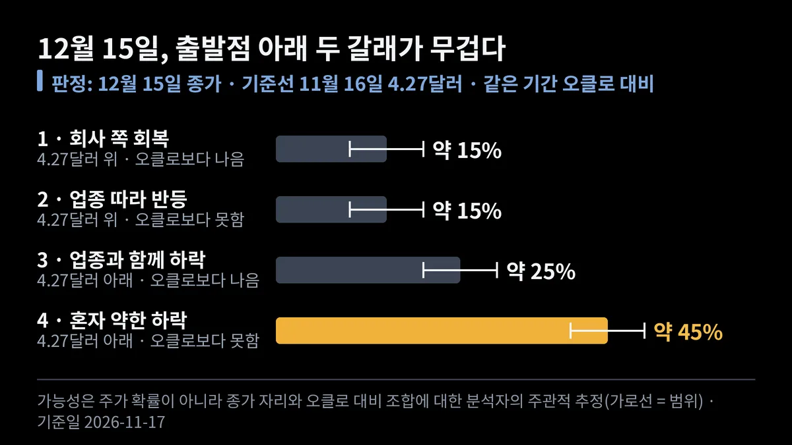

회사 하나를 통째로 산다고 해 보겠습니다. 11월 17일 종가 4.09달러로 계산한 뉴스케일 파워의 값은 약 17억 5,830만 달러입니다. 그런데 이 회사 금고에는 9월 말 현금과 투자 자산 18억 6,408만 달러가 있고, 빌린 돈은 없습니다. 장부상으로는 산 값보다 약 1억 580만 달러 많은 돈이 따라오는 셈입니다. 다만 9월 말 숫자라서, 그 뒤 쓴 현금만큼 줄어 있습니다. 같은 기간 원전주 오클로는 16.5% 올랐는데, 시장은 왜 뉴스케일의 원자로 설계를 0보다 낮게 매겼을까요?

> **유의사항** 저자는 금융·투자 자문가가 아닙니다. 이 글은 공개 공시와 시세를 정리한 교육용 분석이며 특정 종목의 매수·매도를 권하지 않습니다. 과거 패턴은 미래 수익을 보장하지 않고, 뉴스케일 파워는 회사 소식 없이도 하루 5% 넘게 움직이는 날이 잦은 종목입니다. 실제 투자 전에는 최신 공시를 직접 확인하세요.

이 글은 [11월 15일 리포트](/r/smr-2026-11-2/)의 후속편입니다. 그 리포트는 실적 다음 날 16.2% 오른 반등이 업종 바람에 실린 것이었다고 봤습니다. 그리고 12월 4일 종가가 급등 전날 종가 4.37달러 위인지, 그사이 오클로보다 나은지로 네 갈래를 나눴습니다. 가장 무겁게 본 것은 '4.37달러 위에서 버티되 오클로보다 못한' 갈래로, 약 40%였습니다. 그런데 다음 두 거래일 만에 주가는 4.37달러 아래로 내려갔습니다.

지난 예측 성적은 적중 없음, 빗나감 없음, 진행 중 셋입니다. 네 갈래는 12월 4일 종가로 채점하고, TVA 계약 여부도 그날까지 봅니다. 10월 리포트의 '11월 20일 종가 5.38달러 위' 점검도 아직 판정 전입니다. 다만 지금 자리는 지난 리포트가 가장 무겁게 본 갈래가 아니라, 그 리포트가 약 35%로 둘째로 무겁게 본 '혼자 약한 되돌림' 쪽입니다. 이 글이 새로 나누는 네 갈래는 판정 날짜와 기준선이 달라 뒤에서 따로 셉니다. 출발점 위에 버틴 과거 세 번에 기대어 '버팀'에 무게를 둔 것이 지금까지는 어긋나 있습니다.

뉴스케일이 어떤 회사인지 짧게 짚겠습니다. 이 회사는 공장에서 만들어 옮길 수 있는 작은 원자로, 곧 소형 모듈 원자로를 설계합니다. 돈을 버는 방식은 발전소를 지으려는 고객에게 원자로 설계와 모듈을 공급하고 엔지니어링 대가를 받는 것입니다. 아직 확정 주문이 없어서 3분기 매출은 28만 1,000달러에 그쳤습니다. 그 대신 그동안 주식을 팔아 모은 현금이 많습니다.

그 현금이 이번 이야기의 기준선입니다. 9월 말 현금과 투자 자산은 18억 6,408만 달러로, 빌린 돈은 없습니다. 이를 A주와 B주를 합친 주식 수로 나누면 한 주당 약 4.34달러입니다. 11월 17일 종가 4.09달러는 그 약 0.94배입니다. 항목별 금액은 리포트 끝 현금과 몸값 표에 있습니다.

사건을 순서대로 보겠습니다. 11월 5일 장이 끝난 뒤 3분기 실적이 나왔고, 그날 종가가 4.37달러였습니다. 다음 날 16.2% 오르고, 11월 9일에는 5.44달러까지 갔습니다.

그 뒤 여섯 거래일 가운데 다섯 날을 내렸습니다. 11월 13일 4.66달러에서 16일 8.4% 내려 4.27달러, 17일 4.2% 더 내려 4.09달러가 됐습니다. 11월 9일 종가에서 17일까지 24.8% 빠졌습니다.

11월 16일이 갈림길이었습니다. 그날 종가 4.27달러는 급등 전날 종가 4.37달러보다 낮았습니다. 실적 뒤 상승분을 모두 돌려주고 출발점 아래로 내려간 첫날입니다. 같은 날 한 주당 현금 4.34달러 아래로도 처음 내려갔습니다. 9월 말 현금 숫자가 나온 11월 5일 뒤로 처음입니다. 17일 종가 4.09달러는 2024년 3월 25일 4.07달러 뒤 가장 낮은 종가입니다.

그사이 회사가 직접 낸 공시는 없었습니다. 11월 5일 분기 보고서 뒤 SEC에 올라온 서류는 두 건인데, 둘 다 운용사의 보유 신고입니다. 13일 반에크가 6.8%, 16일 글로벌 X가 5.61%를 갖고 있다고 신고했습니다. 둘 다 9월 30일 기준이라, 그 뒤 사고판 것은 이 서류로 알 수 없습니다. 두 회사는 원전 관련 펀드를 운용합니다. 회사가 직접 낸 공시는 이 기간 한 건도 없었습니다.

그러면 업종이 다 같이 빠진 걸까요? 비교에는 원전주 셋과, 나스닥 100 지수를 따르는 펀드(QQQ)를 함께 썼습니다. 11월 13일부터 17일까지 두 거래일만 보면 원전주는 함께 내렸습니다. 뉴스케일 -12.2%, 센트러스 -9.2%, 오클로 -6.5%, 나노 뉴클리어 -5.6%입니다. 그런데 실적 날부터 재면 그림이 달라집니다. 11월 5일 종가 대비 17일 종가는 오클로 +16.5%, 나노 뉴클리어 +8.9%, 센트러스 +5.8%입니다. 뉴스케일만 -6.4%입니다.

그림처럼 다섯 선은 11월 9일까지 함께 오르고 그 뒤 함께 내려왔습니다. 차이는 내려온 깊이입니다. 업종은 실적 날보다 높은 자리에서 멈췄고, 뉴스케일만 그 아래까지 내려갔습니다. 같은 바람을 맞고도 혼자 더 약했다는 뜻입니다.

혼자 약한 이유를 공시가 직접 말해 주지는 않습니다. 숫자로 보면 걸리는 곳은 있습니다. 매출부터 보면, 보도된 예상은 약 1,010만 달러였는데 실제는 28만 1,000달러였습니다. 기다리던 계약도 아직입니다. 뉴스케일의 상업 파트너 엔트라1이 미국 공기업 테네시강유역개발공사와 대규모 원전 보급을 협의 중이지만, 아직 구속력 있는 계약이 아닙니다.

그리고 회사에는 주식 판매 계약이 남아 있습니다. 시장 판매 계약은 회사가 시장에서 새 주식을 조금씩 찍어 파는 방식입니다. 회사는 8월에 최대 7억 5,000만 달러어치를 팔 수 있는 계약을 맺었고, 3분기에는 한 주도 팔지 않았습니다. 그런데 이 한도를 4.09달러에 다 채우려면 약 1억 8,340만 주가 필요합니다. 지금 주식 수의 약 43%입니다.

회사가 새 주식을 팔면 현금은 늘지만 주식 수도 늘어, 한 주에 돌아가는 현금은 크게 늘지 않습니다. 현금도 줄고 있습니다. 올해 엔트라1에 한 번 지급한 2억 5,990만 달러를 빼면, 사업 운영에 쓰는 현금이 분기마다 약 4,700만 달러입니다. 한 주당 현금 4.34달러는 9월 말 숫자라서, 시간이 갈수록 조금씩 낮아지는 기준선입니다.

이런 '급등 뒤 출발점 아래로'는 뉴스케일에서 처음이 아닙니다. 그래서 과거에서 같은 모양을 찾아봤습니다. 기준은 두 가지입니다. 하루에 15% 넘게 오른 날이어야 하고, 그 뒤 10거래일 안에 급등 전날 종가 아래로 마감한 날이 있어야 합니다. 급등 전날 종가 아래로 처음 마감한 그날을 '이탈일'로 두고, 20거래일 뒤 종가를 이탈일 종가와 비교했습니다.

비교 상대로 오클로를 쓰려면 오클로가 상장한 2024년 5월 뒤만 볼 수 있습니다. 그 뒤로 이 기준에 맞는 경우는 이번을 빼고 11번이었습니다. 11번 가운데 20거래일 뒤 더 높았던 것은 5번입니다. 이것만 보면 동전 던지기와 비슷합니다. 그런데 급등 전날부터 이탈일까지 오클로와의 차이로 나누면 결과가 갈립니다.

그 기간 오클로 수익률이 뉴스케일보다 10%포인트 넘게 높았던 경우는 세 번이었습니다. 2024년 7월, 2025년 1월, 2025년 9월입니다. 3번 중 3번이 20거래일 뒤 이탈일보다 낮았습니다. 나머지 8번 중 5번은 더 높았습니다. 업종이 함께 흔들려 출발점을 깬 경우는 회복이 잦았고, 업종은 버티는데 혼자 깬 세 번은 모두 회복하지 못했습니다.

지금과 가장 닮은 예는 2025년 1월입니다. 뉴스케일은 1월 21일 16.6% 올랐고, 1월 27일 20.27달러로 급등 전날 21.97달러 아래에서 마감했습니다. 그사이 오클로는 19.4% 올랐고 뉴스케일은 7.7% 내려, 차이가 27.2%포인트였습니다. 20거래일 뒤 2월 25일 종가는 17.61달러로, 이탈일보다 13.1% 낮았습니다.

이번에는 급등 전날부터 이탈일인 11월 16일까지 오클로가 19.9% 오르고 뉴스케일이 2.3% 내렸습니다. 차이는 22.2%포인트로, 세 번과 같은 쪽에 듭니다. 다만 이 기록을 그대로 믿기는 어렵습니다. 세 번은 표본이 작고, 10%포인트라는 경계도 이번 분석에서 정한 것입니다. 경계 바로 아래인 2026년 2월은 차이 8.6%포인트였고, 20거래일 뒤 15.7% 낮았습니다.

지금 주가는 출발점 4.37달러와 한 주당 현금 4.34달러 아래에 있고, 업종 대표 오클로와의 차이는 지난 리포트 때보다 더 벌어졌습니다. 이 글은 이탈일 11월 16일에서 20거래일째 되는 12월 15일 종가로 결과를 채점합니다. 질문은 두 가지입니다. 하나는 12월 15일 종가가 이탈일 종가 4.27달러 위인가입니다. 다른 하나는 11월 16일부터 12월 15일까지 수익률이 오클로보다 나은가입니다.

아래쪽 두 갈래를 합쳐 약 70%로 본 것은 11번 전체로는 6번이 더 낮았고, 오클로가 크게 앞선 세 번은 모두 낮았기 때문입니다. 그 가운데 '혼자 약한 하락'을 약 45%로 더 크게 나눈 것은 세 번이 모두 그쪽이었고 판매 계약이 남아 있어서입니다. 다만 근거가 세 번뿐입니다. '업종과 함께 하락'은 원전주 전체가 11월 9일 뒤 계속 내려온 흐름을 반영해 약 25%로 봤습니다. 위로 돌아오는 두 갈래는 각각 약 15%입니다. 이 숫자들은 주가가 오를 확률이 아니라, 과거 빈도와 지금 신호를 보고 분석자가 주관적으로 매긴 추정입니다. 근거 표본이 세 번이라, 숫자보다 높고 낮음의 순서로 읽는 편이 맞습니다.

이 판단이 틀릴 수 있는 곳도 있습니다. 핵심 비교는 세 번뿐이고, 그 사이 주가 수준이 45달러대에서 4달러대로 바뀌었습니다. 사업 쪽에서는 TVA 협의가 구속력 있는 계약으로 이어지지 않으면 매출의 출발점이 계속 밀립니다. 반대로 계약 소식이 나오면 이 기록과 상관없이 크게 움직일 수 있습니다.

가장 직접적인 위험은 자금 조달입니다. 판매 계약으로 주식 판매가 다시 시작되면 기존 주주 한 주가 회사에서 차지하는 비율이 작아집니다. 판매 여부는 분기 보고서가 나와야 확인되는 경우가 많아, 12월 15일까지 모를 수도 있습니다. 시장 전체도 변수입니다. QQQ가 하루 6.5% 빠진 11월 5일처럼, 회사 소식과 상관없이 함께 내리는 날이 있습니다.

뉴스케일의 시가총액이 현금보다 작아진 것은 회사에 새 악재가 나와서가 아니라, 업종이 실적 날보다 높은 자리에서 버티는 동안 혼자 그 아래로 내려갔기 때문으로 봅니다. 매출은 거의 없고, 기다리던 TVA 계약은 미정이며, 현금이 분기마다 줄고 주식 판매 한도가 남아 있다는 점이 그 값을 눌렀습니다. 과거 세 번이 가리키는 방향은 아래쪽이지만 표본이 작습니다. 다음 갱신은 12월 4일 종가를 본 뒤에 하고, 그 전에 TVA 계약이나 주식 판매 소식이 나오면 앞당깁니다.

## 숫자로 다시 보기

### 원전 개발사 비교 표

| 종목 · 하는 일 | 11월 13일~17일 | 11월 5일~17일 |
| --- | --- | --- |
| **뉴스케일 파워** 소형 원자로 설계 | **-12.2%** | **-6.4%** |
| 오클로 소형 원자로 개발 | -6.5% | +16.5% |
| 센트러스 에너지 원전 연료 | -9.2% | +5.8% |
| 나노 뉴클리어 초소형 원자로 개발 | -5.6% | +8.9% |
| QQQ(나스닥 100 펀드) 비교 기준 | -3.4% | +1.5% |

11월 5일 하루 변화는 뉴스케일 -14.8%, QQQ -6.5%였습니다. 뉴스케일 종가는 11월 5일 4.37달러, 9일 5.44달러, 13일 4.66달러, 16일 4.27달러, 17일 4.09달러입니다.

한 주당 현금 4.34달러와 견주면 9일 +25.3%, 13일 +7.4%, 16일 -1.6%, 17일 -5.8%입니다.

### 현금과 몸값 표

| 항목 | 금액 | 메모 |
| --- | --- | --- |
| 현금 | 5억 1,336만 달러 | 9월 말 |
| 투자 자산(1년 안 만기) | 4억 2,003만 달러 | 9월 말 |
| 투자 자산(1년 넘는 만기) | 9억 3,068만 달러 | 9월 말 |
| **현금과 투자 자산 합계** | **18억 6,408만 달러** | 차입금 없음 |
| 주식 수 | 약 4억 2,990만 주 | 10월 30일, A주와 B주 합계 |
| 한 주당 현금 | 약 4.34달러 | 계산 |
| **시가총액** | **약 17억 5,830만 달러** | 11월 17일 종가 4.09달러(계산) |
| 현금보다 적은 금액 | 약 1억 580만 달러 | 계산 |
| 남은 주식 판매 한도 | 7억 5,000만 달러 | 4.09달러면 약 1억 8,340만 주(계산) |

세 항목의 합은 반올림 때문에 1만 달러 다를 수 있습니다.

### 급등 뒤 출발점 이탈 11번 기록표

하루 15% 넘게 오른 뒤 10거래일 안에 급등 전날 종가 아래로 마감한 경우입니다(오클로 상장 2024년 5월 뒤). 가운데 열은 급등 전날부터 이탈일까지 오클로가 뉴스케일보다 더 오른 폭이고, 오른쪽 열은 이탈일 종가 대비 20거래일 뒤 종가입니다.

| 급등일 · 하루 상승 | 이탈일 · 오클로와의 차이 | 20거래일 뒤 |
| --- | --- | --- |
| 2024.05.14 +15.2% | 2024.05.16 3.2%p | +34.5% |
| **2024.07.12 +17.5%** | **2024.07.18 14.3%p** | **-27.1%** |
| **2025.01.21 +16.6%** | **2025.01.27 27.2%p** | **-13.1%** |
| 2025.03.14 +15.1% | 2025.03.28 -4.9%p | +13.3% |
| 2025.04.09 +15.5% | 2025.04.21 2.7%p | +79.8% |
| 2025.06.24 +18.5% | 2025.07.01 -5.1%p | +39.8% |
| **2025.09.19 +22.7%** | **2025.09.25 14.6%p** | **-0.4%** |
| 2025.10.15 +16.7% | 2025.10.17 -2.8%p | -49.3% |
| 2026.02.06 +18.1% | 2026.02.12 8.6%p | -15.7% |
| 2026.04.22 +16.3% | 2026.04.29 6.8%p | +7.7% |
| 2026.09.08 +15.3% | 2026.09.11 -1.0%p | -16.4% |
| **이번 2026.11.06 +16.2%** | **2026.11.16 22.2%p** | 12월 15일 판정 |

굵게 쓴 세 줄이 오클로가 10%포인트 넘게 앞선 채 출발점을 깬 경우입니다. 세 줄 모두 20거래일 뒤 더 낮았고, 나머지 8번은 5번이 더 높았습니다.

### 지난 예측 채점표

| 지난 점검 항목 · 당시 기준 | 판정과 지금 자리(11월 17일) |
| --- | --- |
| **네 갈래(가장 무겁게 본 2번 '버팀' 약 40%)** 12월 4일 4.37달러 위인가 × 오클로 대비 | **[진행 중]** 4.09달러, 오클로보다 못함 = 4번 '혼자 약한 되돌림' 자리 |
| **TVA 구속력 있는 계약** 12월 4일까지 | **[진행 중]** 발표 없음 |
| **10월 리포트 업종 반등 갈래** 11월 20일 5.38달러 위인가 | **[진행 중]** 4.09달러 |

### 앞으로 일어날 수 있는 일

과거 빈도는 오클로가 10%포인트 넘게 앞선 채 출발점을 깬 3번 중 3번이 20거래일 뒤 더 낮았고, 나머지 8번 중 5번은 더 높았습니다. 아래 가능성은 분석자가 이 빈도와 지금 신호를 보고 주관적으로 매긴 추정이며, 주가가 오를 확률이 아닙니다. 네 갈래는 겹치지 않아 더하면 100%입니다.

| 갈래(판정 12월 15일) | 판정 조건 | 가능성(추정) |
| --- | --- | --- |
| 1 · 회사 쪽 회복 | 4.27달러 위 · 오클로보다 나음 | 낮음 약 15% (10~20%) |
| 2 · 업종 따라 반등 | 4.27달러 위 · 오클로보다 못함 | 낮음 약 15% (10~20%) |
| 3 · 업종과 함께 하락 | 4.27달러 아래 · 오클로보다 나음 | 중간 약 25% (20~30%) |
| **4 · 혼자 약한 하락** | 4.27달러 아래 · 오클로보다 못함 | 높음 약 45% (40~50%) |

'오클로보다 나음'은 11월 16일 종가에서 12월 15일 종가까지의 수익률을 비교합니다. 11월 16일 오클로 종가는 23.03달러입니다.

### 핵심 확인 세 가지

| 순위 · 확인할 것 | 판정 날짜 |
| --- | --- |
| **1순위** 종가가 이탈일 11월 16일 4.27달러 위인가, 오클로보다 나은가 | 12월 15일 |
| **2순위** 종가가 급등 전날 4.37달러 위인가(지난 리포트 갈래) | 12월 4일 |
| **3순위** 엔트라1과 TVA의 구속력 있는 계약, 주식 판매 재개 공시 | 12월 15일까지 |
