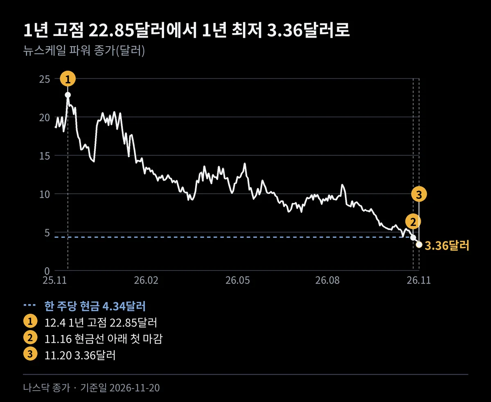
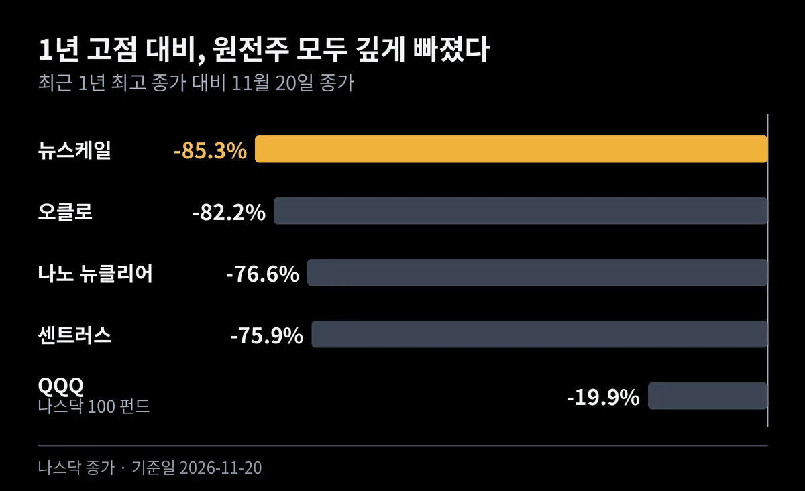
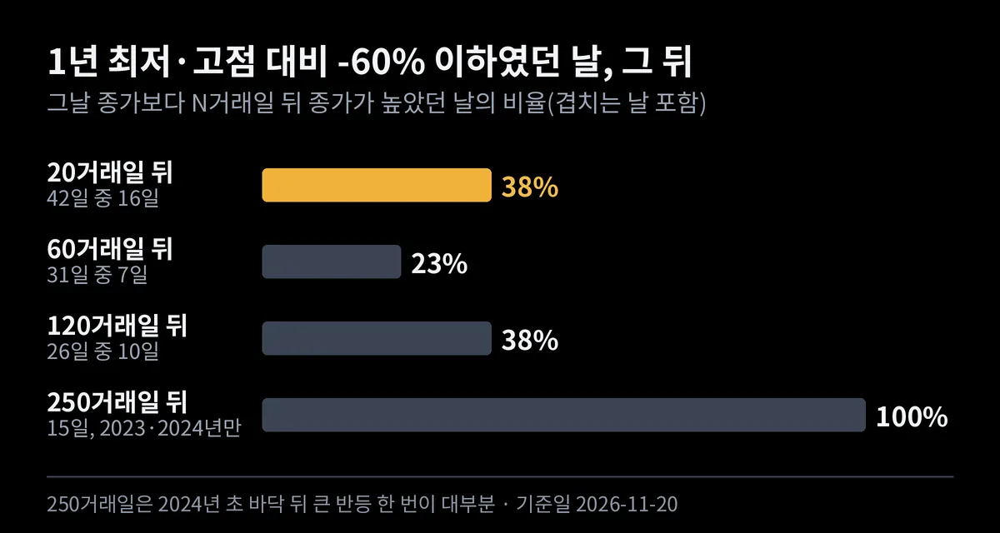
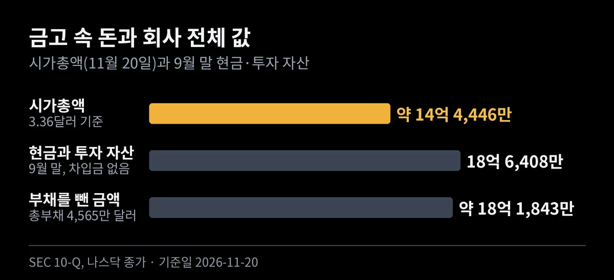
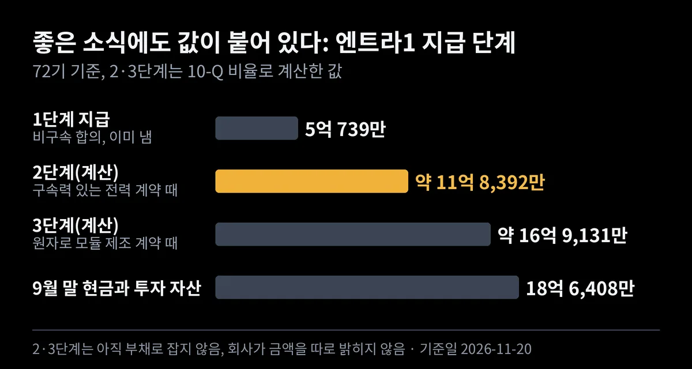
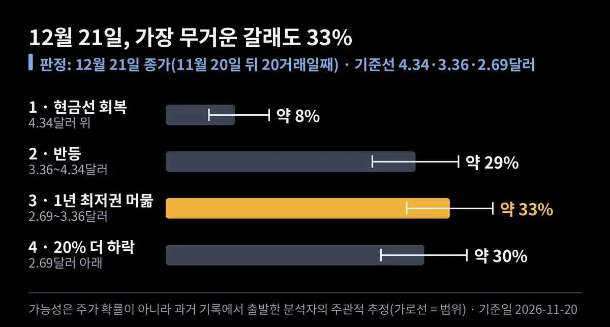

뉴스케일 파워 지금 사도 될까? 이 종목 영상 댓글에 요즘 가장 자주 붙는 질문입니다. 11월 20일 종가는 3.36달러였습니다. 1년 사이 가장 낮은 종가로, 지난해 12월 고점 22.85달러보다 85.3% 아래입니다. 그런데 이 회사 금고에는 한 주에 약 4.34달러어치 현금과 투자 자산이 있습니다. 주가가 그 돈의 약 0.77배까지 내려온 셈입니다. 이 글은 사라, 팔라를 말하지 않습니다. 대신 이 질문에 답하는 데 필요한 근거를 끝까지 꺼내 보겠습니다.

> **유의사항** 저자는 금융·투자 자문가가 아닙니다. 이 글은 공개 공시와 시세를 정리한 교육용 분석이며 특정 종목의 매수·매도를 권하지 않습니다. 과거 패턴은 미래 수익을 보장하지 않고, 뉴스케일 파워는 최근 20거래일 가운데 8일이 하루 5% 넘게 움직인 종목입니다. 실제 투자 전에는 최신 공시를 직접 확인하세요.

이 글은 [11월 17일 기준 리포트](/r/smr-2026-11-3/)의 후속편입니다. 그 리포트는 시가총액이 현금보다 작아진 장면을 다뤘습니다. 그 뒤 3거래일 동안 4.09달러에서 3.36달러로 17.8%가 더 빠졌습니다. 마지막 날인 20일 하루에만 11.8%가 내렸습니다. 회사가 미국 증권거래위원회(SEC)에 낸 새 서류는 11월 5일 분기 보고서 뒤로 없었습니다.

그날은 업종 전체가 무너진 날이었습니다. 원전 연료 회사 센트러스는 9.2%, 초소형 원자로 개발사 나노 뉴클리어는 8.7%, 오클로는 4.8% 내렸습니다. 나스닥 대형 기술주 100개를 따라가는 펀드(QQQ)도 5.7% 내렸습니다. 1년 고점과 견주면 오클로도 82.2%, 나노 뉴클리어도 76.6%, 센트러스도 75.9% 아래에 있습니다. 뉴스케일 혼자의 사고가 아니라, 원전주 전체가 깊게 빠진 자리입니다.

김박사 월드는 리포트마다 정해 둔 날의 종가와 공시로 지난 예측을 채점합니다. 11월 17일 리포트의 예측 일곱 개는 12월 판정이라 아직 진행 중입니다. 지난 예측 성적은 적중 0, 빗나감 0, 진행 중 7입니다. 그 대신 11월 20일에는 10월 23일 리포트의 세 항목이 판정됐습니다. 낮게 본 '업종 따라 반등'(약 30%)과 '구속력 있는 전력 계약'(약 10%)은 둘 다 일어나지 않았습니다. 확인 항목인 '5.38달러 위'도 아니었습니다. 11월 17일 리포트가 가장 무겁게 본 '혼자 약한 하락'(약 45%) 쪽에 지금 주가가 있습니다.

먼저 회사부터 짧게 보겠습니다. 뉴스케일은 공장에서 만들어 옮길 수 있는 작은 원자로, 곧 소형 모듈 원자로를 설계합니다. 돈을 버는 방식은 발전소를 지으려는 고객에게 원자로 모듈과 설계를 공급하는 것입니다. 하지만 아직 확정 주문이 없습니다. 3분기 매출은 28만 1,000달러로, 1년 전 824만 2,000달러보다 크게 줄었습니다. 같은 분기 순손실은 4,571만 달러였습니다.

이 질문의 첫 번째 열쇠는 '지금 가격이 과거 비슷한 순간에서 어디쯤인가'입니다. 기준은 이렇게 잡았습니다. 그날 종가가 1년 사이 가장 낮고, 동시에 1년 고점보다 60% 넘게 아래인 날입니다. 2022년 상장 뒤 그런 날은 이번 주를 빼고도 2023년, 2024년 초, 2026년에 몰려 있었습니다. 20거래일 뒤 결과를 알 수 있는 날은 42일이었습니다.

그 42일의 뒤는 기간에 따라 달랐습니다. 20거래일 뒤 더 높았던 날은 16일, 38%였습니다. 60거래일 뒤로 늘리면 31일 중 7일, 23%로 더 낮아졌습니다. 그런데 250거래일 뒤를 알 수 있는 15일은 모두 더 높았습니다. 이 15일은 전부 2023년과 2024년 초의 날입니다. 2024년 1월 1.92달러 바닥 뒤 큰 반등 한 번이 이 숫자를 거의 다 만들었습니다.

그래서 지금 자리는 이렇게 읽힙니다. 몇 주에서 몇 달 안에는 더 낮았던 경우가 많았습니다. 1년 넘게는 한 번의 큰 반등이 기록을 뒤집었습니다. 같은 가격이라도 얼마나 기다릴 사람인지에 따라 과거 기록이 다른 답을 냅니다. 이제 사는 쪽 근거와 사지 않는 쪽 근거를 셋씩 나란히 놓겠습니다.

사는 쪽 근거 첫째는 현금보다 싼 몸값입니다. 9월 말 현금과 투자 자산은 18억 6,408만 달러입니다. 11월 20일 종가로 계산한 시가총액은 약 14억 4,446만 달러입니다. 회사를 통째로 사도 금고 속 돈보다 약 4억 1,961만 달러 적게 내는 셈입니다. 빌린 돈은 없고, 갚아야 할 모든 의무를 합친 부채도 4,565만 달러입니다. 부채를 다 빼도 한 주에 약 4.23달러가 남습니다.

주주 구성도 달라졌습니다. 큰 매도 주체가 사라졌습니다. 특수관계사였던 건설사 플루어는 9월 30일까지 뉴스케일 A주를 모두 정리했습니다. 회사는 10-Q에서 플루어가 더는 특수관계자가 아니라고 적었습니다. 회사 자신도 3분기에는 새 주식을 한 주도 팔지 않았습니다. 그 사이 쌓아 둔 투자 자산에서 3분기에만 1,911만 달러의 이익이 났습니다.

사는 쪽 마지막 근거는 2024년 초의 기록입니다. 2024년 1월 17일, 뉴스케일은 2.04달러로 1년 최저를 새로 썼습니다. 20거래일 뒤에는 그날보다 37.3%, 250거래일 뒤에는 920.6% 높았습니다. 그 뒤 2025년 10월 15일에는 상장 뒤 가장 높은 종가 53.43달러까지 갔습니다. 원전 업종이 다시 주목받을 때 이 종목이 얼마나 빨리 움직였는지 보여 주는 기록입니다.

이번엔 사지 않는 쪽 근거입니다. 첫째는 방금 본 짧은 기록입니다. 1년 최저 자리 42일 가운데 20거래일 뒤 더 높았던 날은 38%였고, 60거래일 뒤는 23%였습니다. 2026년에만 1년 최저 묶음이 2월, 7월, 10월에 세 번 시작됐고, 10월 묶음이 지금까지 이어집니다. 10월 8일 묶음은 20거래일 뒤 40.3% 더 낮았습니다. 싸다는 사실이 곧 바닥이라는 뜻은 아니었습니다.

좋은 소식에도 값이 붙어 있다는 점이 두 번째입니다. 뉴스케일은 상업 파트너 엔트라1과 협약을 맺었습니다. 엔트라1의 계약이 한 단계씩 진전될 때마다 뉴스케일이 돈을 내는 구조입니다. 첫 단계는 72기 원자로 모듈을 둔 비구속 합의였고, 5억 739만 달러를 이미 나눠 냈습니다.

10-Q에 따르면 그 첫 단계가 전체의 15%입니다. 다음은 엔트라1이 구속력 있는 전력 계약을 맺을 때로, 전체의 35%입니다. 같은 72기 기준으로 비율대로 계산하면 약 11억 8,392만 달러입니다. 9월 말 현금의 약 64%입니다. 마지막 제조 계약 단계는 그보다 더 큽니다. 회사는 조건이 아직 충족되지 않아 이 돈을 부채로 잡지 않았습니다. 시장이 기다리는 TVA 계약은 매출의 출발점이지만, 동시에 큰 지급의 방아쇠이기도 합니다.

마지막은 아직 거의 없는 매출과 남은 주식 판매 한도입니다. 회사는 올해 상반기 새 주식 8,973만 주를 평균 11.14달러에 팔아 10억 달러를 모았습니다. 8월에는 7억 5,000만 달러를 더 팔 수 있는 계약을 새로 맺었습니다. 이 한도를 3.36달러에 다 채우려면 약 2억 2,321만 주가 필요합니다. 지금 주식 수의 약 52%입니다. 한도는 쓸 수 있는 금액일 뿐 실제로 판 양은 아니지만, 현금선보다 낮은 값에 팔게 되면 한 주당 현금이 줄어듭니다.

같은 모양은 다른 종목에서도 나왔습니다. 배터리 회사 솔리드파워도 11월 20일 1년 최저 1.35달러, 한 주당 현금의 약 0.78배에 있습니다. 같은 질문을 [11월 20일 기준 리포트](/r/sldp-2026-11-4/)에서 다뤘습니다. 김박사 월드가 11월 핵심 종목에 그어 둔 기준선 기록에서는, 현금선이나 지지선을 지킨다는 쪽이 네 번 모두 빗나갔습니다. 다만 네 번뿐이라 일반화하기는 이릅니다.

그럼 무엇을 보면 판단이 바뀔까요? 신호와 날짜를 정해 두겠습니다. 첫째는 12월 21일 종가로, 11월 20일 뒤 20번째 거래일입니다. 이날 한 주당 현금 4.34달러 위로 돌아와 있으면 사는 쪽 근거가 강해집니다. 11월 20일보다 20% 낮은 2.69달러 아래로 내려가 있으면 사지 않는 쪽 근거가 강해집니다. 지난 리포트의 판정일인 12월 4일과 15일 종가도 함께 봅니다.

공시도 신호입니다. 새 주식 판매를 알리는 공시가 나오면 사지 않는 쪽 근거가 강해집니다. 엔트라1과 TVA의 구속력 있는 계약은 양쪽에 다 걸립니다. 매출의 길이 열린다는 점에서는 사는 쪽이지만, 같은 날 2단계 지급 조건이 생깁니다. 그래서 계약 소식이 나오면 지급 금액과 방식부터 확인해야 합니다. 4분기 실적과 연간 보고서는 지난해 일정으로 보면 2월 말 무렵입니다.

사려는 사람이 먼저 볼 것은 두 가지입니다. 최신 분기 보고서의 현금과 주식 수로 한 주당 현금을 직접 계산해 보는 것, 그리고 엔트라1 지급 조건이 그 현금을 얼마나 줄일 수 있는지 함께 계산해 보는 것입니다. 하루 10% 넘게 움직이는 날을 견딜 수 있는지, 판정 날짜까지 다섯 가지 확인표는 글 끝 부록에 있습니다.

마지막으로 12월 21일 종가를 네 갈래로 나눴습니다. 출발점은 1년 최저 자리 42일의 20거래일 뒤 기록입니다. 그 기록에서는 42번 중 14번이 20% 넘게 더 빠진 칸이라, 이 칸이 33%로 가장 많았습니다. 가격 수준이 이어진 기록이 많아 지금 자리 근처 칸을 조금 늘렸습니다. 2.69달러는 현금의 약 0.62배이고 빌린 돈이 없어 맨 아래 칸은 조금 줄였습니다.

2.69~3.36달러, 1년 최저권에 머무는 갈래를 약 33%로 가장 무겁게 봤습니다. 20% 넘게 더 빠지는 갈래는 약 30%, 반등하는 갈래는 약 29%입니다. 현금선 위로 돌아오는 갈래는 약 8%만 남겼습니다. 이 숫자는 주가가 오를 확률이 아니라, 과거 빈도에서 출발한 분석자의 주관적 추정입니다.

하루 5% 넘게 움직이는 날이 잦아, 칸 하나쯤은 한두 번의 큰 날로 비껴갈 수 있습니다. 2024년 1월처럼 20거래일 뒤 37.3% 높았던 반등도 있었습니다. 반대로 10월 8일 묶음처럼 40% 넘게 더 내려간 적도 있습니다. 42일은 서로 겹치는 날이라 실제로는 몇 번의 흐름이고, 2023년과 지금은 회사 현금의 크기가 다릅니다.

지금 뉴스케일은 회사 금고 속 돈보다 싼 값에 거래되지만, 매출은 아직 거의 없는 회사입니다. 기다리던 좋은 소식에도 큰 지급 조건이 붙어 있습니다. 과거 같은 자리의 기록은 몇 주와 몇 달 안에는 불리했고, 1년 넘게는 한 번의 큰 반등이 있었습니다. 12월 21일 종가가 4.34달러 위로 돌아오고 주식 판매 공시가 없다면 사는 쪽 근거가 강해집니다. 2.69달러 아래이거나 판매 공시가 나오면 사지 않는 쪽 근거가 강해집니다. 결정은 각자의 몫이며, 이 영상과 리포트는 판단 근거를 정리한 교육용 자료입니다.

## 숫자로 다시 보기

### 지난 리포트 뒤 하루씩

| 날짜 · 종가 | 하루 변화 | 현금선 4.34달러 대비 |
| --- | --- | --- |
| **11월 17일** 4.09달러 | -4.2% | -5.8% |
| **11월 18일** 3.91달러 | -4.4% | -9.9% |
| **11월 19일** 3.81달러 | -2.6% | -12.2% |
| **11월 20일** 3.36달러 | -11.8% | -22.6% |

11월 20일 3.36달러는 2024년 2월 29일 3.10달러 뒤 가장 낮은 종가입니다. 같은 날 원전주와 QQQ의 하루 변화는 본문 첫머리에 있습니다.

### 사는 쪽 근거와 사지 않는 쪽 근거

| 사는 쪽 · 숫자 | 사지 않는 쪽 · 숫자 |
| --- | --- |
| **현금보다 싼 몸값** 시가총액 약 14억 4,446만 < 현금과 투자 자산 18억 6,408만 달러 | **짧은 기록** 1년 최저 자리 42일 중 20거래일 뒤 더 높음 38%, 60거래일 뒤 23% |
| **큰 매도 주체가 사라짐** 플루어 A주 전량 정리, 3분기 새 주식 판매 0주 | **좋은 소식의 값** 엔트라1 2단계 약 11억 8,392만 달러(계산) |
| **바닥 뒤 긴 기록** 2024년 1월 17일 2.04달러, 250거래일 뒤 +920.6% | **매출과 판매 한도** 3분기 매출 28만 1,000달러, 판매 한도 7억 5,000만 달러 |

### 1년 최저 묶음의 첫날, 그 뒤

**한눈에:** 1년 최저이면서 고점 대비 -60% 아래였던 날 **42일** · 20거래일 뒤 더 높음 **16일(38%)** · 60거래일 뒤 더 높음 **31일 중 7일(23%)**

| 묶음 첫날 · 종가 | 20거래일 뒤 | 250거래일 뒤 |
| --- | --- | --- |
| **2023.05.03** 7.83달러 | -3.1% | -26.8% |
| **2023.08.21** 6.53달러 | -13.2% | +44.3% |
| **2024.01.17** 2.04달러 | +37.3% | +920.6% |
| **2026.02.23** 12.60달러 | -7.1% | - |
| **2026.07.07** 8.96달러 | +5.9% | - |
| **2026.10.08** 7.32달러 | -40.3% | - |
| **이번 2026.11.20** 3.36달러 | 12월 21일 판정 | - |

묶음은 1년 최저 종가가 20거래일 넘게 끊겼다가 다시 나온 날로 나눴습니다. 2023년 5월 묶음은 고점 대비 -60% 기준에 들기 전이라 42일에는 들지 않습니다.

| 1년 최저 자리 · 기다린 기간 | 더 높았던 비율 |
| --- | --- |
| **20거래일 뒤** | 38%(42일 중 16일) |
| **60거래일 뒤** | 23%(31일 중 7일) |
| **120거래일 뒤** | 38%(26일 중 10일) |
| **250거래일 뒤** | 100%(15일) 2023·2024년 날만 |

겹치는 날을 모두 센 값입니다.

### 지금의 크기(11월 20일 기준)

| 항목 | 값 · 근거 |
| --- | --- |
| 9월 말 현금과 투자 자산 | **18억 6,408만 달러** 현금 5억 1,336만 · 1년 안 만기 4억 2,003만 · 1년 넘는 만기 9억 3,068만 |
| 9월 말 총부채 | **4,565만 달러** 차입금 없음 |
| 주식 수 | **4억 2,990만 주** 10월 30일, A주 4억 1,057만 · B주 1,933만 |
| 부채를 뺀 현금과 투자 자산 | **약 18억 1,843만 달러** 18억 6,408만 − 4,565만 |
| 한 주당 현금(현금선) | **약 4.34달러** 부채를 빼면 약 4.23달러 |
| 시가총액 | **약 14억 4,446만 달러** 3.36달러 기준, 약 0.77배 |
| 현금보다 적은 금액 | **약 4억 1,961만 달러** 계산 |
| 엔트라1 1단계 | **5억 739만 달러** 전체의 15%, 2025년과 2026년 1~9월에 나눠 지급 |
| 엔트라1 2단계·3단계(계산) | **약 11억 8,392만 · 약 16억 9,131만 달러** 같은 72기 기준 35% · 50%, 부채로 잡지 않음 |
| 남은 주식 판매 한도 | **7억 5,000만 달러** 3.36달러면 약 2억 2,321만 주(계산) |

### 사기 전에 확인할 것

| 확인할 것 | 어디서 · 언제 |
| --- | --- |
| **한 주당 현금 다시 계산** 9월 말 약 4.34달러 | 분기 보고서 · 2월 말 무렵 |
| **엔트라1 지급 조건** 2단계 약 11억 8,392만 달러(계산) | 계약 공시 · 수시 |
| **새 주식 판매 공시** 남은 한도 7억 5,000만 달러 | SEC 제출 목록 · 수시 |
| **하루 10% 넘는 날을 견딜 수 있나** 11월 20일 -11.8% | 스스로 · 사기 전 |
| **판정 날짜 메모** 현금선 4.34 · 2.69달러 | 12월 4일 · 15일 · 21일 |

### 지난 예측 채점표

| 지난 점검 항목 · 당시 기준 | 판정과 실제 결과(11월 20일) |
| --- | --- |
| **10월 23일 리포트: 업종 따라 반등** 약 30% | **[안 일어남]** 3.36달러 < 5.38달러 |
| **10월 23일 리포트: 구속력 있는 전력 계약** 약 10% | **[안 일어남]** 11월 20일까지 공시 없음 |
| **11월 15일 리포트: 11월 20일 5.38달러 위인가** 확인 항목 | **[아님]** 3.36달러 |
| **11월 17일 리포트 예측 7개(시나리오 1~4 포함)** 12월 4일·15일 판정 | **[진행 중]** 4.27달러 아래, 11월 16일 뒤 오클로 -13.8%보다 못한 -21.3% |

### 앞으로 일어날 수 있는 일

과거 빈도: 1년 최저이면서 고점 대비 -60% 아래였던 42번 중 20거래일 뒤 4.34달러 위에 해당한 것은 4번, 2.69달러 아래는 14번이었습니다.

현금선이나 지지선을 지킨다는 쪽은 장부에서 네 번 모두 빗나갔습니다. 아래 가능성은 주가 상승·하락 확률이 아니라, 12월 21일 종가의 자리에 대한 분석자의 주관적 추정입니다. 네 갈래는 겹치지 않아 더하면 100%이고, 괄호 안 범위는 더하지 않습니다.

| 시나리오(판정 12월 21일) | 종가 | 가능성(추정) |
| --- | --- | --- |
| 1 · 현금선 회복 | 4.34달러 위 | 낮음 약 8% (5~12%) |
| 2 · 반등 | 3.36~4.34달러 | 중간 약 29% (24~34%) |
| **3 · 1년 최저권 머묾** | 2.69~3.36달러 | 중간 약 33% (28~38%) |
| 4 · 20% 더 하락 | 2.69달러 아래 | 중간 약 30% (25~35%) |

### 핵심 확인 세 가지

| 순위 · 확인할 것 | 판정 날짜 |
| --- | --- |
| **1순위** 12월 21일 종가가 4.34달러 위인가, 2.69달러 아래인가 | 12월 21일 |
| **2순위** 엔트라1과 TVA의 구속력 있는 계약, 그 지급 금액과 방식 | 12월 21일까지 |
| **3순위** 새 주식 판매 공시가 나오는가 | 12월 21일까지 |

공시는 [뉴스케일 파워 SEC 공시 목록](https://www.sec.gov/cgi-bin/browse-edgar?action=getcompany&CIK=0001822966&type=&dateb=&owner=include&count=40)에서 직접 확인할 수 있습니다.

## 함께 읽기

- [뉴스케일 현금선 리포트](/r/smr-2026-11-3/) · [영상](https://youtu.be/CpGayNCaSHU): 시가총액이 현금보다 작아진 장면(11월 17일 기준).
- [솔리드파워 지금 사도 될까 리포트](/r/sldp-2026-11-4/) · [영상](https://youtu.be/JusnxXSiIVQ): 같은 질문, 현금의 0.78배에 있는 배터리 회사(11월 20일 기준).
- [뉴스케일 실적 리포트](/r/smr-2026-11-2/) · [영상](https://youtu.be/Yt_TFd7kj_s): 실적 다음 날 +16% 뒤 되돌림(11월 13일 기준).
