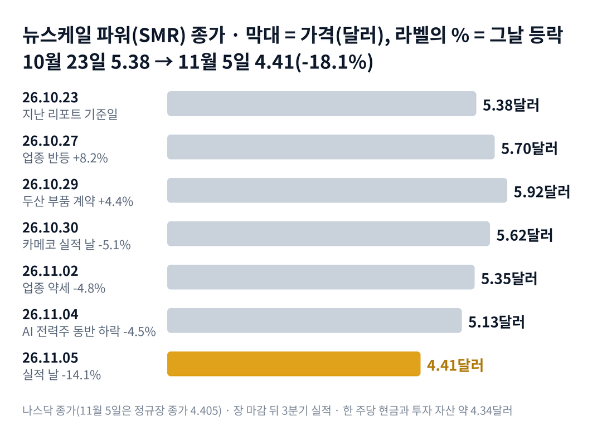

## 짧은 답

> **핵심:** 뉴스케일 주가는 실적 날 한 주당 현금과 투자 자산(4.34달러) 수준까지 내려왔습니다. 과거 실적 17번 가운데 20거래일 뒤 발표 날보다 높았던 것은 7번이었습니다.

원자로 설계를 미국 규제 당국에서 승인받은 회사의 주가가, 회사 금고에 든 현금과 거의 같은 값이 됐습니다. 시장은 왜 기술에 값을 거의 매기지 않게 됐을까요?

뉴스케일 주가는 10월 23일 종가 5.38달러에서 11월 5일 종가까지 18.1% 내렸습니다. 11월 5일 하루에만 14.1% 내렸고, 2024년 3월 이후 가장 낮은 종가입니다. 같은 날 오클로와 나노 뉴클리어도 12% 넘게 내렸습니다.

장 마감 뒤 나온 3분기 실적에서 9월 말 현금과 투자 자산은 18억 6,410만 달러였습니다. 이를 A주와 B주를 합친 주식 수로 나누면 한 주당 약 4.34달러입니다. 시장이 원자로 사업에 얹어 준 값이 거의 남지 않은 셈입니다.

그렇다고 이 현금이 주가의 바닥을 보장하지는 않습니다. 회사는 매 분기 연구비와 인건비로 현금을 쓰고, 확정 주문이 나오기 전까지 그 금고는 조금씩 줄어듭니다. 그렇다면 과거에도 실적을 막 받아 든 날 뒤에 주가가 반등했을까요? 반등했다면 그 상승은 한 달 뒤에도 남아 있었을까요?

이 글은 뉴스케일의 지난 실적 17번을 '다음 날'과 '20거래일 뒤'로 나란히 놓습니다. 첫날의 반응과 한 달 뒤의 자리가 어떻게 달랐는지 보고, 12월 4일까지 무엇으로 판정할지 정리합니다.

> **유의사항** 저자는 금융·투자 자문가가 아닙니다. 이 글은 공개 공시와 시세를 정리한 교육용 분석이며 특정 매매를 권하지 않습니다. 과거의 주가 반응이 미래에 반복된다는 보장은 없고, 뉴스케일 파워는 매출이 적고 하루 10% 넘게 움직이는 날이 잦은 종목입니다. 이 글은 실적 발표 뒤 첫 거래일 전에 썼고, 시간 외 거래는 숫자에 넣지 않았습니다. 실제 투자 전에는 최신 가격과 공시를 직접 확인하세요.

## 지난 리포트 이후

[지난 리포트](/r/smr-2026-10-2/)(10월 23일 종가 5.38달러 기준)의 예측 성적은 적중 3 · 빗나감 2 · 진행 중 1입니다. 가장 가능성이 높다고 봤던 3분기 주식 판매는 실제로 거의 일어나지 않았습니다. 그런데도 주가는 더 내려왔습니다. 그렇다면 이번 하락은 무엇이 끌어내린 것일까요? 항목별 채점표는 6부 끝에 있습니다.

## 1부. 뉴스케일은 어떤 회사이고, 무엇으로 돈을 버는가

> **핵심:** 뉴스케일은 작은 원자로를 설계해 그 설계와 핵심 부품을 파는 회사입니다. 확정 주문이 아직 없어 매출은 거의 없고, 지금 몸값은 가진 현금과 거의 같습니다.

뉴스케일 파워는 미국 오리건주에 본사를 둔 소형 모듈 원자로 회사입니다. 소형 모듈 원자로(SMR)는 공장에서 만든 작은 원자로를 여러 대 묶어 발전소를 짓는 방식입니다. 뉴스케일의 77메가와트 설계는 미국 원자력규제위원회의 승인을 받았습니다. 설계 승인은 기술과 규제의 관문 하나를 통과했다는 뜻입니다. 하지만 발전소를 실제로 지으려는 고객이 확정 주문을 내고 사업이 실행 단계에 들어가야 매출이 본격적으로 생깁니다.

돈을 버는 방식은 아직 미래형입니다. 발전소를 지으려는 고객이 원자로 모듈을 주문하면, 뉴스케일이 설계와 모듈을 공급하고 엔지니어링 대가를 받습니다. 그런데 아직 확정 주문이 없어서, 3분기 매출은 28만 1,000달러에 그쳤습니다. 지난해 같은 분기에는 루마니아 사업 설계 일로 824만 달러를 벌었습니다.

확정 고객 소식이 중요한 이유는 그것이 매출의 출발점이기 때문입니다. 협력사 엔트라1(ENTRA1)이 미국 테네시강유역개발공사(TVA)와 대형 발전소 계획을 협의하고 있지만, 구속력 있는 계약은 아직 없습니다. 10월 29일 두산에너빌리티와 맺은 계약은 첫 원자로 부품 제작 계약이고, 고객 주문은 아닙니다. 주문이 늦어질수록 시장은 매출이 들어오는 날을 뒤로 미뤄 계산합니다.

지금 몸값은 회사가 가진 현금과 거의 같습니다. 9월 말 현금과 투자 자산은 18억 6,410만 달러이고, 11월 5일 종가로 셈한 시가총액은 약 18억 9,360만 달러입니다. 시가총액에서 현금과 투자 자산을 뺀 단순 차감값은 약 2,950만 달러입니다. 시장이 원자로 설계와 사업에 얹어 준 값이 그만큼이라는 계산입니다. 다만 이 비교가 주가의 하한선은 아닙니다. 현금은 쓰는 만큼 줄어들기 때문입니다.

### 숫자로 본 지금의 크기(11월 5일 기준)

| 항목 | 값 · 계산 근거 |
| --- | --- |
| 11월 5일 종가 | **4.41달러** 정규장 종가 4.405달러, 하루 -14.1% |
| 시가총액 | **약 18억 9,360만 달러** 4.405달러 × 4억 2,987만 주(A주 + B주, 9월 30일) |
| 현금과 투자 자산 | **18억 6,410만 달러** 현금 5억 1,340만 + 단기 4억 2,000만 + 장기 9억 3,070만 |
| 한 주당 현금과 투자 자산 | **약 4.34달러** 18억 6,410만 달러 ÷ 4억 2,987만 주 |
| 3분기 매출 · 순손실 | **28만 1,000달러 · 4,571만 달러** 지난해 같은 분기 매출 824만 달러 |

위 표의 차이는 부채 등을 따로 반영한 기업가치(EV) 계산이 아니라 시가총액에서 현금과 투자 자산을 뺀 단순 차감값입니다. 9월 말 부채 총액은 약 4,565만 달러로 작아 결론이 크게 바뀌지는 않습니다.

위 그림처럼 하락은 하루에 몰리지 않았습니다. 10월 29일 두산 계약 소식에 하루 올랐다가, 그 뒤 다섯 거래일 가운데 네 번 내렸습니다. 그렇다면 그사이 값을 끌어내린 것은 정확히 무엇이었을까요?

## 2부. 2주 동안 겹친 세 가지 사건

> **핵심:** 이번 하락에는 성격이 다른 세 가지 사건이 겹쳤습니다. 증권사의 눈높이 조정, 원전 업종 전체의 매도, 그리고 실적 날의 동반 급락입니다.

첫 번째는 증권사의 눈높이 조정입니다. 목표가 하향은 투자자가 '이 정도면 적당하다'고 보는 가격 자체를 끌어내리는 사건입니다. 10월 28일 B. Riley가 목표가를 15달러에서 10달러로 낮췄습니다. 11월 3일에는 웨드부시가 뉴스케일을 처음 분석하면서 '시장 수익률 하회'(Underperform) 의견을 냈습니다.

두 번째는 원전 업종 전체의 매도입니다. 이것은 회사의 숫자와 상관없이, 같은 업종에 대한 투자 심리가 한꺼번에 식는 사건입니다. 10월 30일 카메코가 실적 발표 뒤 7.9% 내렸고, 그날 뉴스케일은 5.1% 내렸습니다. 11월 4일에는 선거 결과 보도 뒤 인공지능 전력 관련주가 함께 흔들렸습니다. 그날 뉴스케일은 4.5% 내려 5.13달러로 마감했습니다.

세 번째는 실적 날의 동반 급락입니다. 11월 5일 뉴스케일은 실적 발표 전 정규장에서 14.1% 내렸습니다. 같은 날 오클로는 12.3%, 나노 뉴클리어는 12.0% 내렸습니다. 뉴스케일만의 직접적인 이유는 확인하지 못했습니다. 그래서 이 사건은 원인보다 결과, 곧 업종 매도가 실적 날 가장 크게 몰린 날로 읽는 것이 맞습니다.

### 11월 5일, 뉴스케일과 같은 업종

| 종목 · 하는 일 | **11월 5일** | 10월 23일 대비 |
| --- | --- | --- |
| **뉴스케일 파워** 소형 원자로 설계 | **-14.1%** | **-18.1%** |
| 오클로 소형 원자로 개발 | -12.3% | -26.4% |
| 나노 뉴클리어 초소형 원자로 개발 | -12.0% | -20.8% |
| 센트러스 에너지 원전 연료 | -3.7% | -13.0% |
| 카메코 우라늄 채굴 | -4.4% | -12.8% |

10월 23일 종가부터 11월 5일 종가까지로 보면 뉴스케일은 오클로(-26.4%)나 나노 뉴클리어(-20.8%)보다 덜 내렸습니다. 아직 원자로를 팔지 못한 개발사들이 크게 내렸고, 이미 매출이 있는 연료·우라늄 회사는 덜 내렸습니다. 시장이 '언제 돈을 버는가'가 불확실한 회사부터 덜어 냈다는 흔적입니다.

세 사건을 나란히 놓으면 공통점이 하나 보입니다. 모두 뉴스케일의 새로운 계약 취소나 숫자 악화에서 비롯된 것은 아니라는 점입니다. 결국 이번 하락은 아직 매출이 없는 원자로 개발사들이 업종 전체의 매도 속에서 더 큰 압력을 받은 결과로 볼 수 있습니다. 그렇다면 이렇게 낮아진 가격에서 실적 발표를 맞았을 때, 과거 주가는 어떤 반응을 보였을까요?

## 3부. 과거 실적 17번, 다음 날과 20거래일 뒤

> **핵심:** 2022년 8월 이후 실적 17번 가운데 다음 날 오른 것은 10번이지만, 20거래일 뒤 발표 날보다 높았던 것은 7번뿐입니다. 최근 5번은 한 번을 빼고 모두 한 달 뒤 16% 넘게 낮았습니다.

이 기록을 보는 이유는 지금이 '실적을 막 받아 든 때'이기 때문입니다. 과거 실적 발표 뒤 첫날과 한 달 뒤가 어떻게 달랐는지 보면, 이번 실적을 읽을 출발점이 생깁니다.

고른 기준은 하나입니다. 상장 뒤 뉴스케일이 분기 실적을 낸 날 17번 전부입니다. 한 번(2022년 11월)을 빼면 모두 장 마감 뒤에 나왔습니다. 그래서 발표 날 종가를 기준점으로 삼고, 장전 발표였던 한 번은 전 거래일 종가를 기준으로 했습니다.

표의 세 숫자는 각각 다른 질문에 답합니다. '발표 전 5거래일'은 실적을 앞두고 주가가 얼마나 움직였는가, '다음 날'은 실적을 확인한 투자자들이 첫날 어떻게 반응했는가, '20거래일 뒤'는 그 반응이 한 달 동안 유지됐는가입니다.

'다음 날'은 발표 다음 거래일 종가를, '20거래일 뒤'는 다음 날을 첫날로 센 20번째 거래일 종가를 발표 날 종가와 비교했습니다.

예를 들어 2026년 2월 26일 실적은 기준 종가 13.33달러, 다음 날 12.85달러로 -3.6%, 20번째 거래일인 3월 26일 10.99달러로 -17.6%입니다.

### 뉴스케일 실적 17번, 다음 날과 그 뒤

| 발표일 · 발표 전 5거래일 | 다음 날 | 20거래일 뒤 |
| --- | --- | --- |
| 2022.08.10 2분기 발표 전 -3.8% | +4.3% | +1.6% |
| 2022.11.14 3분기(장전) 발표 전 +0.4% | +3.2% | -6.9% |
| 2023.03.15 4분기 발표 전 -11.1% | -2.2% | -0.4% |
| 2023.05.09 1분기 발표 전 -0.2% | -1.2% | +2.5% |
| 2023.08.09 2분기 발표 전 -4.8% | +2.2% | -14.5% |
| 2023.11.08 3분기 발표 전 -0.3% | -32.9% | +1.3% |
| 2024.03.14 4분기 발표 전 +62.3% | +8.4% | -27.2% |
| 2024.05.09 1분기 발표 전 -2.8% | +7.2% | +37.9% |
| 2024.08.08 2분기 발표 전 -5.7% | +7.9% | -18.7% |
| 2024.11.07 3분기 발표 전 +13.2% | +13.0% | +18.6% |
| 2025.03.03 4분기 발표 전 -16.3% | +11.5% | -8.3% |
| 2025.05.12 1분기 발표 전 +4.0% | +21.6% | +94.2% |
| **2025.08.07** 2분기 발표 전 -11.0% | **-11.9%** | **-22.7%** |
| **2025.11.06** 3분기 발표 전 -23.2% | **-6.5%** | **-34.1%** |
| **2026.02.26** 4분기 발표 전 -8.9% | **-3.6%** | **-17.6%** |
| **2026.05.07** 1분기 발표 전 +1.0% | **-0.2%** | **-16.5%** |
| **2026.08.05** 2분기 발표 전 +23.6% | **+1.0%** | **+1.9%** |

굵게 쓴 다섯 줄이 최근 1년 남짓의 실적입니다. 분기 이름은 뉴스케일의 회계연도(1월 시작) 기준입니다.

앞서 짧은 답에서 본 -18.1%는 지난 리포트 기준일(10월 23일)과 비교한 수치입니다. 아래 상자의 -25.6%는 실적 직전 5거래일의 움직임을 보려고 10월 29일 종가를 기준으로 계산한 수치입니다.

> **이번(미확정):** 2026.11.05 3분기 · 발표 전 -25.6%(11월 5일 종가 4.41달러를 10월 29일 종가 5.92달러와 비교) · 다음 날은 11월 6일, 20거래일 뒤는 12월 4일 판정

여기서 기억할 사실은 두 가지입니다. 하나는 17번 전체의 장기 기록이고, 다른 하나는 최근 시장 환경을 보여 주는 최근 5번입니다. 다음 날만 보면 17번 가운데 10번 올랐습니다. 하지만 20거래일 뒤 발표 날보다 높았던 것은 7번이고, 가운데 값(중앙값)은 -6.9%였습니다.

최근 다섯 번은 더 뚜렷합니다. 다음 날 움직임은 -11.9%에서 +1.0%로 점점 작아졌습니다. 그런데 한 달 뒤에는 다섯 번 중 네 번이 발표 날보다 16% 넘게 낮았습니다.

기록이 보여 주는 것은 여기까지입니다. 첫날 반응은 갈수록 조용해졌지만, 한 달 뒤의 방향은 대체로 아래였습니다. 그렇다면 왜 첫날과 한 달 뒤가 이렇게 달랐을까요?

## 4부. 다음 날과 한 달 뒤가 달랐던 이유

> **핵심:** 다음 날은 '숫자가 걱정보다 나은가'에 반응했고, 한 달 뒤는 실적 뒤 몇 주 동안 나온 소식, 특히 새 주식 판매와 확정 고객 소식이 방향을 정했습니다.

두 시점은 묻는 질문이 다릅니다. 다음 날의 질문은 '이번 분기 숫자가 걱정보다 나은가'입니다. 뉴스케일은 매출이 아주 작은 회사라, 분기 숫자보다 경영진이 말하는 계약 일정이 첫날을 움직였습니다. 한 달 뒤의 질문은 '확정 고객이 생겼는가, 그동안 주식을 얼마나 더 팔았는가'입니다.

첫날이 조용해진 것은 기대가 이미 낮아졌기 때문입니다. 2025년 5월 실적 다음 날은 21.6% 올랐습니다. 그때는 첫 고객 계약이 곧 나온다는 기대가 컸습니다. 그 뒤 계약 소식이 미뤄지면서 실적 날의 놀라움도 작아졌습니다.

한 달 뒤를 가른 것은 새 주식 판매였습니다. 뉴스케일은 시장 판매 계약(ATM: 회사가 시장에서 새 주식을 조금씩 찍어 파는 방식)으로 돈을 마련해 왔습니다. 2026년 상반기에만 약 8,970만 주를 팔았습니다. 실적 보고서에서 판매 물량이 확인된 뒤 몇 주 동안은 주가가 그 물량을 소화하느라 눌린 적이 많았습니다.

이번에는 출발점도 다릅니다. 3분기에는 새 주식을 거의 팔지 않았습니다. A주 수가 6월 말 4억 1,037만 주에서 9월 말 4억 1,054만 주로 거의 그대로였습니다. 그동안 한 달 뒤를 눌러 온 판매 물량이 이번 분기에는 없었다는 뜻입니다. 대신 주가는 이미 한 주당 현금과 투자 자산 근처까지 내려와 있습니다.

과거 기록이 알려 주는 것은 분명합니다. 첫날 반응은 갈수록 작아졌지만, 한 달 뒤 방향은 실적 뒤의 주식 판매와 확정 고객 소식이 정했습니다. 결국 앞으로 확인할 것은 두 가지입니다. 하나는 11월 6일 첫 반응이 오르는가, 다른 하나는 12월 4일 종가가 11월 5일 종가 4.41달러 위에 있는가입니다. 이 두 조건으로 다음 한 달을 나누면 어떤 갈림길이 나올까요?

## 5부. 실적 뒤 한 달, 네 가지 시나리오

> **핵심:** 지금은 반등이 짧고 하락이 이어지는 단계이고, 11월 6일 첫 반응과 12월 4일의 자리가 다음 단계를 가릅니다.

> **국면 정의(뉴스케일 시리즈 공통):** 국면 A(기대 확장) — 계약 기대와 업종 랠리로 크게 오르는 때. 국면 B(실망 누적) — 확정 주문이 늦어지고 반등이 짧아 고점이 계속 낮아지는 때. 국면 C(바닥 다지기) — 최저가 근처에서 더 내려가지 않고 업종이 오를 때 함께 오르는 때.

**2026년 11월 5일 진단: 국면 B(반등이 짧고 하락이 이어지는 단계) 유지(지난 리포트 진단 유지).** 10월 29일 반등은 하루로 끝났고, 최저 종가는 5.38달러에서 4.41달러로 다시 내려왔습니다. 국면 C의 '최저가 근처 지지' 신호는 아직 나오지 않았습니다. 다만 주가가 한 주당 현금과 투자 자산 수준에 닿은 것은 지난 리포트 때 없던 새 조건입니다.

**판정 기준 두 가지:** 첫째, 11월 6일 첫 반응입니다. 11월 6일 종가가 11월 5일 종가 4.41달러보다 높으면 '상승'으로 봅니다. 둘째, 12월 4일의 자리입니다. 실적 다음 날을 첫날로 센 20번째 거래일인 12월 4일 종가가 4.41달러보다 높은지를 봅니다.

### 앞으로 일어날 수 있는 일

과거 실적은 17번 중 10번 다음 날 올랐지만, 20거래일 뒤 발표 날보다 높았던 것은 17번 중 7번입니다.

**확인된 사실:** 11월 5일 종가는 2024년 3월 이후 최저입니다. **과거 기록:** 최근 다섯 번 가운데 네 번이 한 달 뒤 16% 넘게 낮았습니다(3부). **추정:** 아래 가능성은 분석자가 주관적으로 매긴 값이며, 주가가 오를 확률이 아닙니다. 네 경우는 겹치지 않아 '약 N%'를 더해서 100%가 되게 맞췄고, 괄호 안 구간은 흔들림의 폭이라 서로 더하지 않습니다.

| 시나리오(판정 11월 6일·12월 4일) | 첫날·20일째 | 가능성(추정) |
| --- | --- | --- |
| 1 · 현금 바닥에서 반등 지속 | 상승 · 4.41달러 위 | 낮음 약 25% (20~30%) |
| 2 · 첫날만 반등 | 상승 · 4.41달러 아래 | 낮음 약 25% (20~30%) |
| 3 · 첫날 하락 뒤 회복 | 하락 · 4.41달러 위 | 낮음 약 15% (10~20%) |
| **4 · 실망이 이어진 하락** | 하락 · 4.41달러 아래 | 중간 약 35% (30~40%) |

첫날과 한 달 뒤는 따로 읽어야 합니다. 첫날 오르는 경우는 1과 2를 더한 약 50%로 봤습니다. 그러나 12월 4일에 4.41달러 위에 있는 경우는 1과 3을 더한 약 40%입니다. 첫날 반등과 한 달 뒤 회복은 다른 질문이라는 뜻입니다.

4부에서 본 차이가 시나리오를 가르는 축입니다. 과거 패턴만 따르면 시나리오 4가 가장 무겁습니다. 앞서 본 한 달 뒤 기록이 그렇고, 이번 실적에도 확정 주문 소식은 없었습니다. 이 값은 과거 빈도와 지금 신호에서 나온 추정이지, 주가가 더 내릴 것이라는 판단이 아닙니다.

반대로 이번 분기만의 차이는 시나리오 1 쪽으로 기웁니다. 주가가 이미 한 주당 현금 수준이고, 한 달 뒤를 눌러 온 새 주식 판매도 없었습니다. 하지만 같은 무게로 반대쪽 요인도 있습니다. 이번 분기에도 순손실이 4,571만 달러였고 손실이 이어지는 동안 현금은 줄어들며, 확정 고객 계약은 여전히 없습니다. 현금 수준이라는 조건은 시간이 갈수록 낮아지는 기준선이라, 주문 소식 없이 버티기만으로는 시나리오 1이 되기 어렵습니다. 그렇다면 이 진단을 가장 빨리 뒤집을 수 있는 위험은 무엇일까요?

## 6부. 세 갈래 위험과 체크리스트

> **핵심:** 위험은 사업 실행, 자금 조달, 외부 환경 세 갈래입니다. 이 가운데 가장 빨리 판을 바꿀 수 있는 것은 쉬고 있던 주식 판매가 다시 시작되는 경우입니다.

먼저 이 분석의 한계입니다. 3부 표는 '실적 뒤에는 내린다'는 규칙이 아닙니다. 17번은 작은 표본이고, 그 사이 회사의 규모와 주가 수준이 크게 바뀌었습니다. 한 주당 현금 4.34달러는 9월 30일 기준이라, 그 뒤 쓴 현금은 들어 있지 않습니다.

첫째 갈래는 사업 실행입니다. 엔트라1과 테네시강유역개발공사의 협의가 구속력 있는 계약으로 이어지지 않으면 매출의 출발점이 계속 밀립니다. 두산에너빌리티와의 부품 계약처럼 준비는 진행되지만, 그 자체로 매출이 되지는 않습니다.

둘째 갈래는 자금 조달, 곧 판매가 다시 시작될 때의 위험입니다. 회사에는 8월에 맺은 7억 5,000만 달러 규모의 시장 판매 계약이 남아 있습니다. 판매가 재개되면 희석이 생깁니다. 희석은 주식 수가 늘어 기존 주주 한 주가 회사에서 차지하는 비율이 작아지는 것입니다. 주가가 4달러대라면 같은 1억 달러를 구하는 데 2천만 주 넘게 필요해, 상반기보다 희석의 폭이 커집니다. 또 판매 공시가 나오면 5부의 시나리오 1과 3을 받치던 '판매 없음'이라는 조건이 사라집니다.

셋째 갈래는 외부 환경입니다. 금리, 선거 결과에 따른 에너지 정책, 오클로 같은 동종 회사의 실적이 함께 주가를 움직였습니다. 11월 5일처럼 업종 전체가 12% 넘게 빠지는 날에는 회사 소식과 상관없이 함께 내렸습니다.

증권사 의견과 업종 하락의 배경은 회사 공시가 아니라 보도로 확인했습니다. 실적 발표 뒤 시간 외 거래와 전화 회의 내용은 이 글의 숫자에 넣지 않았습니다.

**핵심 확인 세 가지:**

- ☐ 11월 6일 주가가 4.41달러 위에서 마감하는가
- ☐ 12월 4일까지 엔트라1·테네시강유역개발공사의 구속력 있는 계약이 발표되는가
- ☐ 12월 4일까지 7억 5,000만 달러 시장 판매 계약으로 새 주식 판매가 재개되는가

**보조 확인:**

- ☐ 11월 6일 첫 반응이 실적 17번의 범위(-32.9~+21.6%) 안인가
- ☐ 12월 4일 종가가 11월 5일 종가 4.41달러보다 높은가(이번 시나리오 판정)

**지난 리포트 점검(따로 판정):**

- ☐ 11월 20일 종가가 10월 23일 종가 5.38달러보다 높은가(지난 리포트 시나리오 3)

**기억할 판단 기준 세 가지:** 첫째, 이번 하락은 회사의 새 악재보다 업종 전체의 매도와 증권사 눈높이 조정에서 나왔습니다. 둘째, 주가가 한 주당 현금 수준에 닿은 것은 처음 보는 조건이지만, 현금은 매 분기 줄어듭니다. 셋째, 과거 실적 뒤 한 달은 대체로 아래였고, 그 방향을 바꿀 가장 빠른 신호는 확정 주문 소식입니다.

다음 갱신은 11월 6일 첫 반응과 12월 4일 20번째 거래일을 본 뒤에 합니다.

### 지난 예측 채점표

10월 25일 리포트의 진단과 시나리오를 11월 5일 기준으로 채점한 결과입니다.

| 지난 점검 항목 · 당시 기준 | 판정 및 실제 결과(11월 5일) |
| --- | --- |
| **진단: 국면 B 유지** 반등이 짧고 하락이 이어지는 단계 | **[적중]** 10월 29일 반등 뒤 다시 최저 종가 갱신 |
| **시나리오 4: 증권사 하향 연쇄** 가능성 약 35% | **[적중]** B. Riley 15→10달러, 웨드부시 신규 매도 의견 |
| **시나리오 2: 3분기 주식 판매 확인** 가능성 약 55% | **[빗나감]** A주 수 거의 그대로, 판매 없음 |
| **점검: 5.20달러 지지** 10월 23일 장중 저가 | **[빗나감]** 11월 4일 종가 5.13달러로 깨짐 |
| **시나리오 1: 전력 구매 계약** 가능성 약 10%로 낮게 봄 | **[적중]** 낮게 본 대로 발표 없음 |
| **시나리오 3: 업종 반등** 11월 20일 판정 | **[진행 중]** 지금 5.38달러보다 18.1% 낮음 |
