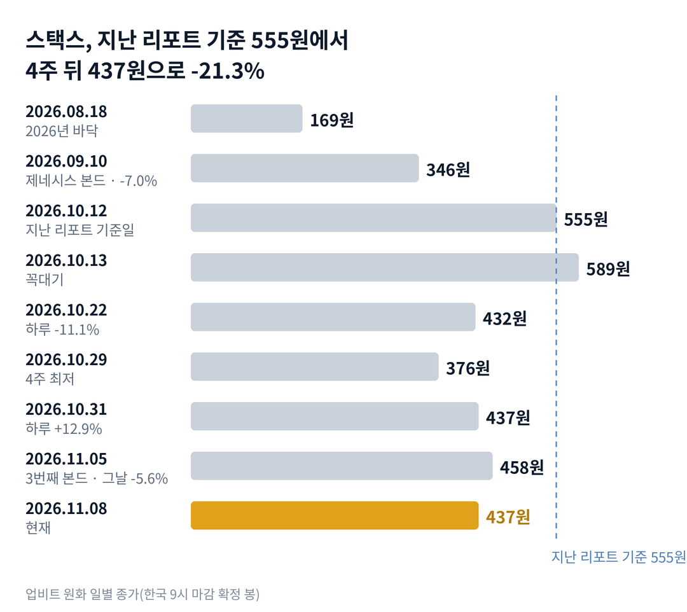

## 짧은 답

> **핵심:** 본드는 커졌지만, 이번 4주 가격의 방향은 비트코인과 새 공급이 정했습니다.

세 번째 본드는 두 번째의 두 배로 커졌습니다. 그런데 스택스 가격은 왜 오히려 내려갔을까요? 지난주와 달라진 점은 기관 소식이 나와도 가격이 비트코인을 따라 내렸다는 것입니다.

먼저 상품은 실제로 커졌습니다. 미국 상장사 불리시가 회사 비트코인을 처음 맡겼고, 수탁 회사 비트고도 길을 열었습니다. 그러나 본드가 새로 묶는 스택스는 한 해 새로 풀리는 양에 비하면 작습니다. 그렇다고 본드가 가격의 바닥을 받쳐 준다는 뜻도 아닙니다. 본드 이자는 스택스 가격에 기대고 있어, 가격이 내리면 이자도 함께 줄어드는 구조이기 때문입니다.

과거에도 스택스의 새 상품이 켜진 날이 일곱 번 있었습니다. 그 가운데 다섯 번은 20거래일 뒤 가격이 더 낮았습니다. 그렇다면 이번처럼 발표 전부터 이미 내려 있던 경우는 어땠을까요? 답은 3부 '새 상품이 켜진 날 7번, 20거래일 뒤는?' 표에 있습니다.

## 지난 리포트 이후

[10월 12일 기준 리포트](/r/stx-2026-10/)는 지금을 '바닥 반등에서 기대가 앞서는 단계로 넘어가는 길목'으로 봤습니다. 기대가 앞서는 단계의 신호(출시 소식에 떨어진다, 맡겨진 비트코인은 늘지 않는다)는 실제로 나왔습니다. 하지만 비트코인보다 훨씬 더 떨어지는 긴 하락 단계의 신호도 함께 켜졌습니다. 지난 예측 성적은 6개 가운데 적중 0 · 부분 적중 3 · 빗나감 1 · 진행 중 2이고, 항목별 채점표는 6부 끝에 있습니다. 이번 리포트가 새로 답할 질문은 '새 상품이 켜진 뒤 한 달은 무엇이 정했나'입니다.

## 1부. 스택스는 무엇이고, 본드는 가격과 어떻게 이어지는가

> **핵심:** 본드는 커졌지만, 새로 묶는 스택스는 한 해 새 공급의 약 7%에 그칩니다.

스택스(Stacks)는 비트코인 위에서 스마트 계약(자동으로 실행되는 거래 규칙)을 돌리는 네트워크이고, STX는 그 네트워크의 코인입니다. 국내에서는 업비트가 가장 큰 거래처입니다. 이 글의 가격은 업비트 원화 종가를 기본으로 하고, 크라켄 달러 가격을 함께 적습니다.

스택스는 회사가 아니라 매출이 없습니다. 대신 네트워크가 돈을 버는 방식은 스택스를 묶어 둔 사람에게 채굴자의 비트코인이 보상으로 돌아가는 구조이고, 그래서 가치는 '묶이는 수요'에서 나옵니다. 2026년 7월 30일 새 규칙(PoX-5)이 켜진 뒤, 기관은 비트코인 스테이킹 본드에 비트코인(BTC)을 일정 기간 묶어 두고 비트코인으로 이자를 받습니다. 이때 비트코인 옆에 스택스를 함께 묶어야 합니다. 지금 기준은 맡기는 비트코인 가치의 5%입니다.

이 구조가 중요한 이유는 수요와 공급이 한곳에서 만나기 때문입니다. 본드 이자는 스택스를 받으려고 비트코인을 쓰는 채굴자에게서 나옵니다. 그래서 본드가 커지면 스택스를 사서 묶으려는 수요가 늘어납니다. 반대로 채굴 보상과 생태계 기금으로 스택스는 매일 새로 풀립니다.

지금 몸값은 이 두 힘의 차이로 설명됩니다. 세 번째 본드가 새로 묶는 스택스는 약 1,100만 개로 추정됩니다. 지난 리포트에서 계산한 한 해 새 공급 약 1억 5,000만 개의 약 7%이고, 날수로는 약 27일치입니다. 본드가 두 배로 커져도 새 공급을 따라잡기에는 아직 작다는 계산입니다. 다만 이 계산이 가격의 하한선이나 상한선을 뜻하지는 않습니다.

### 숫자로 본 지금의 크기(11월 8일 기준)

| 항목 | 값 · 계산 근거 |
| --- | --- |
| 업비트 종가 | **437원** 크라켄 0.3181달러, 지난 기준일 555원 대비 -21.3% |
| 본드 누적 | **1,740 BTC** 230 + 505 + 세 번째 약 1,005(빼서 계산) |
| 세 번째 본드의 짝 스택스 | **약 1,100만 개** 자체 추정: 약 1,005 BTC × 비트코인 가치의 5% ÷ 스택스 가격 |
| 한 해 새 공급 | **약 1억 5,000만 개** 지난 리포트 자체 추정(채굴 보상 + 생태계 기금) |
| 스태킹 | **약 5억 1,391만 개** 주기 147, 유통량 18억 8,127만 개의 27.3%(10월 약 4억 9,340만 개) |
| sBTC | **약 2,481 BTC** 10월 12일 2,486 BTC에서 거의 그대로 |

표의 짝 스택스는 공식 숫자가 아니라 5% 기준과 11월 5일 전후 가격으로 낸 자체 추정입니다. 그렇다면 이 4주 동안 가격은 어떤 사건을 거쳐 내려왔을까요?

## 2부. 4주 동안 가격을 움직인 세 가지

> **핵심:** 비트코인 약세, 원인을 모르는 하루 급등, 완판 날의 하락이 겹쳤고, 한국만의 과열은 없었습니다.

첫 번째는 비트코인을 따라간 하락입니다. 지난 리포트 다음 날인 10월 13일 스택스는 589원으로 꼭대기를 찍었습니다. 그 뒤 10월 29일 376원까지 36.2% 내렸고, 같은 기간 비트코인은 6.4% 내렸습니다. 스택스처럼 작은 코인은 비트코인이 흔들리면 더 크게 흔들립니다. 그래서 비트코인의 작은 하락이 스택스에는 큰 하락이 됐습니다.

### 같은 4주, 스택스와 비트코인

| 구간 · 성격 | 스택스 | 비트코인 |
| --- | --- | --- |
| **10.12 → 11.08** 지난 기준일부터 | **-21.3%** | -7.6% |
| **10.13 → 10.29** 꼭대기에서 최저까지 | **-36.2%** | -6.4% |
| **10.22 하루** 가장 큰 하루 하락 | **-11.1%** | -2.7% |
| **10.31 하루** 원인 미확인 급등 | **+12.9%** | +0.3% |
| **11.04 하루** 비트고 발표 다음 날 | **+10.0%** | +3.8% |
| **11.05 하루** 세 번째 본드 완판 | **-5.6%** | -4.7% |

두 번째는 원인을 모르는 하루 급등입니다. 10월 31일 비트코인은 거의 움직이지 않았는데 스택스는 위 표처럼 크게 올랐습니다. 한국 시간 밤 9시 한 시간에만 업비트에서 57억 원어치가 거래됐습니다. 그날 거래대금 175억 원은 직전 5거래일 평균의 약 6.3배였습니다. 그러나 스택스 공식 블로그에는 10월 30일 뒤 11월 3일까지 새 글이 없었고, 원인을 밝힌 보도는 확인하지 못했습니다.

세 번째는 완판 날의 하락입니다. 11월 3일 비트고가 고객 비트코인을 계좌에서 바로 본드에 넣는 길을 열었습니다. 다음 날 스택스는 10.0% 올랐지만 그날 비트코인도 3.8% 올랐습니다. 11월 5일 세 번째 본드 완판이 발표됐고, 불리시(비트코인 약 2만 2,000개 보유)가 첫 참여 회사로 이름을 올렸습니다. 그런데 그날 비트코인이 4.7% 내리자 스택스도 5.6% 내렸습니다.

한국만의 일이 아니었다는 점도 짚어 둡니다. 업비트 가격과 크라켄 가격을 같은 환율로 바꿔 비교하면, 4주 내내 차이가 -0.6%에서 +0.4% 사이였습니다. 한국만 따로 뜨거워지거나 따로 투매한 흔적은 없습니다.

세 가지를 나란히 놓으면 공통점이 하나 보입니다. 스택스 자신의 나쁜 소식은 없었다는 점입니다. 결국 이번 하락은 비트코인 약세 위에, 오른 만큼 되돌리는 매도가 얹힌 결과였습니다. 그렇다면 과거 새 상품이 켜진 날 뒤에도 같은 일이 있었을까요?

## 3부. 새 상품이 켜진 날 7번, 20거래일 뒤는?

> **핵심:** 7번 가운데 20거래일 뒤 더 낮았던 것은 5번이었고, 더 높았던 2번은 비트코인도 함께 오른 때였습니다.

이 기록을 보는 이유는 11월 5일이 '새 상품이 실제로 켜지거나 다 찬 날'이기 때문입니다. 업그레이드 적용, sBTC 출시와 한도 확대, 본드 개시와 완판처럼 기다리던 일이 현실이 된 날만 골랐습니다. 공급을 늘리는 결정이나 사람 소식은 성격이 달라 뺐습니다.

표의 세 칸은 세 가지 질문에 답합니다. 첫 칸은 발표 전에 얼마나 움직였나, 둘째 칸은 그날 어떻게 반응했나, 셋째 칸은 한 달 동안 유지됐나입니다.

코인은 매일 거래되므로 20거래일은 20일과 같습니다. '그날'은 그날 종가를 전날 종가와, '20거래일 뒤'는 20번째 일봉 종가를 그날 종가와 비교했습니다. 예를 들어 10월 12일 두 번째 본드 완판 날 종가는 555원이었고, 20번째 일봉인 11월 1일 종가는 440원으로 -20.7%였습니다.

**한눈에:** 그날 상승 4번 · 20거래일 뒤 상승 2번 · 20거래일 뒤 가운데 값(중앙값) -19.6%. 그날의 방향은 반반이었지만, 한 달 뒤까지 남은 경우는 적었습니다.

### 새 상품이 켜진 날 7번, 20거래일 뒤는?

| 이벤트일 · 그날 나온 것 | 그날 | 20거래일 뒤 |
| --- | --- | --- |
| **2024.10.29** 나카모토 업그레이드 *(발표 전 20일 +16.3%)* | +6.5% | **+4.5%** |
| 2024.12.17 sBTC 출시 *(발표 전 20일 +7.7%)* | -4.9% | -19.6% |
| 2025.02.25 sBTC 2차 한도 확대 *(발표 전 20일 -24.7%)* | +1.5% | -20.0% |
| 2025.05.23 sBTC 3차 한도 확대 *(발표 전 20일 +13.7%)* | -9.1% | -29.2% |
| 2026.07.30 PoX-5 규칙 적용 *(발표 전 20일 -22.6%)* | +3.1% | -11.1% |
| **2026.09.10** 제네시스 본드 개시 *(발표 전 20일 +32.6%)* | -7.0% | **+45.4%** |
| 2026.10.12 두 번째 본드 완판 *(발표 전 20일 +23.3%)* | +2.8% | -20.7% |

굵게 쓴 두 줄이 20거래일 뒤 그날보다 높았던 경우입니다. 7번 사이 간격은 모두 30일이 넘어 20거래일 측정 기간이 서로 겹치지는 않습니다. 다만 2024년과 지금은 가격 수준이 여섯 배 넘게 다르고, 본드라는 상품도 그때는 없었습니다. 그래서 이 표는 정밀한 확률이 아니라 과거 움직임의 참고 자료로 보는 편이 맞습니다.

> **이번(미확정):** 2026.11.05 · 세 번째 본드 완판 · 발표 전 20일 -13.9% · 그날 -5.6% · 종가 458원 · 20거래일 뒤는 11월 25일 판정

같은 본드 소식이 정반대로 끝난 쌍도 있습니다. 9월 10일 제네시스 본드 날은 그날 7.0% 내렸지만 20거래일 뒤 45.4% 높았습니다. 10월 12일 두 번째 본드 완판 날은 그날 2.8% 올랐지만 20거래일 뒤 20.7% 낮았습니다.

여기서 기억할 사실은 하나입니다. 기다리던 상품이 켜진 뒤 한 달은 대체로 가격이 아래였다는 점입니다. 그렇다고 이 기록이 하락을 예고하는 규칙은 아닙니다. 그렇다면 두 번의 예외는 무엇이 달랐을까요?

## 4부. 그날과 한 달 뒤를 가른 것

> **핵심:** 그날의 반응은 기대가 얼마나 앞서 있었는지가, 한 달 뒤의 방향은 비트코인이 정했습니다.

두 시점은 묻는 질문이 다릅니다. 그날의 질문은 '기다리던 사람들이 이미 얼마나 사 두었나'입니다. 발표 전 20일 동안 크게 오른 날일수록 그날은 파는 날이 되기 쉬웠습니다. 9월 10일은 발표 전 20일 동안 32.6% 오른 뒤 그날 7.0% 내렸습니다.

한 달 뒤의 질문은 '비트코인이 같은 방향으로 가 주는가'입니다. 20거래일 뒤 높았던 두 번은, 그날 종가 대비 20번째 일봉 종가로 잰 비트코인도 25.5%, 8.6% 오른 때였습니다. 반대로 스택스가 더 낮았던 다섯 번 가운데 네 번은 비트코인이 2.7%에서 5.4% 사이로 내린 때였습니다. 남은 한 번(7월 30일)은 비트코인이 4.1% 올랐지만, 묶여 있던 스택스가 모두 풀린 직후였습니다.

이 흔적이 뜻하는 것은 단순합니다. 본드나 업그레이드는 스택스만의 이야기지만, 그 뒤 한 달의 방향은 비트코인 시장이 정했습니다. 상품이 커져도 비트코인이 약하면 가격은 상품을 따라가지 않았습니다.

이번에는 출발점이 다릅니다. 11월 5일은 발표 전 20일 동안 이미 13.9% 내려 있었습니다. 기다리던 사람들이 미리 사 둔 것이 적었다는 뜻입니다. 대신 비트코인은 11월 8일까지 약세였고, 바이낸스 경고 표시도 그대로입니다.

결국 앞으로 확인할 것은 두 가지입니다. 하나는 12월 3일 전후 열릴 네 번째 본드가 다 차는가, 다른 하나는 비트코인이 11월 5일 수준 위로 돌아오는가입니다. 이 두 조건으로 다음 한 달을 나누면 어떤 갈림길이 나올까요?

## 5부. 다음 본드까지, 네 가지 시나리오

> **핵심:** 지금은 공급이 이기는 단계의 초입이고, 비트코인 회복 여부가 본드 크기보다 먼저 방향을 가릅니다.

> **국면 정의(스택스 시리즈 공통):** 국면 A 바닥 반등 — 악재가 지나가고 새 이유가 생기는 때. 국면 B 기대가 앞서는 때 — 출시를 기다리며 미리 오르는 때. 국면 C 공급이 이기는 때 — 새 공급과 비트코인 약세 속의 긴 하락.

**2026년 11월 8일 진단: 국면 C(공급이 이기는 때)의 초입.** 기관 소식에 오른 가격이 1거래일 만에 꺾였고(11월 4일 종가 +10.0% → 11월 5일 종가 -5.6%), 비트코인이 약할 때 스택스가 세 배 가까이 더 떨어졌습니다. 반면 업비트와 해외 가격 차이가 작아 한국만의 과열 신호는 없고, 10월 29일 바닥에서는 16.2% 올라와 있습니다.

**판정 기준 두 가지:** 첫째, 12월 4일까지 네 번째 본드가 다 찼다는 발표가 나오는가입니다. 둘째, 12월 4일 업비트 비트코인 종가가 11월 5일 종가 1억 325만 7,000원보다 높은가입니다.

### 앞으로 일어날 수 있는 일

과거 본드는 세 번 모두 다 찼고(3번 중 3번), 새 상품이 켜진 뒤 20거래일 동안 비트코인이 오른 것은 7번 중 3번이었습니다.

**확인된 사실:** 세 번째 본드는 약 1,005 BTC로 완판됐고, 다음 본드는 12월 3일 전후 열립니다. **과거 기록:** 한 달 뒤 스택스가 높았던 때는 비트코인도 오른 때뿐이었습니다(4부). **추정:** 아래 가능성은 분석자가 주관적으로 매긴 값이며, 가격이 오를 확률이 아닙니다. 네 경우는 겹치지 않아 '약 N%'를 더해서 100%가 되게 맞췄고, 괄호 안 구간은 흔들림의 폭이라 서로 더하지 않습니다.

| 시나리오(판정 12월 4일) | 본드·비트코인 | 가능성(추정) |
| --- | --- | --- |
| 1 · 본드와 비트코인 함께 | 완판 · 회복 | 중간 약 25% (20~30%) |
| **2 · 본드만 커짐** | 완판 · 약세 | 높음 약 40% (35~45%) |
| 3 · 비트코인만 회복 | 미달 · 회복 | 낮음 약 15% (10~20%) |
| 4 · 둘 다 약함 | 미달 · 약세 | 낮음 약 20% (10~20%) |

**한눈에:** 네 번째 본드 완판 약 65%(1+2) · 비트코인 회복 약 40%(1+3). 분석자의 주관적 추정을 더한 값이며, 실제 확률이나 통계 예측값은 아닙니다. 본드와 비트코인은 따로 읽어야 합니다.

4부에서 본 차이가 시나리오를 가르는 축입니다. 시나리오 2를 가장 높게 본 이유는 두 가지입니다. 본드는 세 번 모두 다 찼고, 비트코인은 11월 8일까지 약세였습니다. 과거 기록에 따르면 이 경우 가격은 본드보다 비트코인을 따랐습니다.

시나리오 1을 받치는 근거는 기관 참여의 확대와 발표 전에 이미 빠진 가격입니다. 하지만 같은 무게로 반대쪽 요인도 있습니다. 본드가 묶는 스택스는 아직 새 공급의 약 7%이고, 바이낸스 경고 표시도 풀리지 않았습니다. 그렇다면 이 진단을 가장 빨리 뒤집을 수 있는 위험은 무엇일까요?

## 6부. 세 갈래 위험과 체크리스트

> **핵심:** 위험은 사업 실행, 자금 조달, 외부 환경 세 갈래이고, 가장 빨리 판을 바꿀 수 있는 것은 비트코인과 거래소 조치입니다.

먼저 이 분석의 한계입니다. 3부 표는 '새 상품이 켜지면 한 달 뒤 내린다'는 규칙이 아닙니다. 7번은 작은 표본이고, 본드라는 상품은 생긴 지 석 달이 안 됐습니다. 세 번째 본드 크기와 짝 스택스는 공식 숫자를 빼고 곱해 낸 추정입니다.

첫째 갈래는 사업 실행, 곧 본드 상품의 운영입니다. 본드의 크기·이자·참여자는 아직 생태계 기금이 정하고, 참여자도 승인된 곳으로 제한됩니다. 누구나 경매로 참여하는 다음 규칙(PoX-6)은 2027년을 목표로 한 연구 단계이고 확정되지 않았습니다. 일정이 밀리면 '스택스를 사서 묶는 수요'가 커지는 속도도 늦어집니다.

둘째 갈래는 자금 조달과 새 공급입니다. 생태계 기금은 운영 자금을 스택스로 마련합니다. 채굴 보상과 생태계 기금으로 한 해 약 8%가 새로 풀립니다(지난 리포트 자체 추정). 발행 상한이 없어, 본드가 이 속도를 따라잡지 못하면 가격에는 계속 부담이 됩니다. 본드 이자도 스택스 가격에 기대고 있어, 가격이 내리면 이자와 기관의 관심이 함께 약해질 수 있습니다.

셋째 갈래는 외부 환경입니다. 이번 4주처럼 비트코인이 내리면 스택스는 몇 배로 더 내렸습니다. 7월 24일 붙은 바이낸스 모니터링 태그(상장 유지 여부를 지켜보는 경고 표시)는 11월 8일까지 해제 공지가 없었습니다. 업비트가 가장 큰 거래처라 국내 거래소의 조치도 유동성에 크게 영향을 줍니다.

10월 31일 급등의 원인과, 네 번째 본드의 크기·이자는 아직 확인하지 못했습니다.

**핵심 확인 세 가지:**

- ☐ 11월 25일 종가가 11월 5일 종가 458원보다 높은가(3부 20거래일 판정)
- ☐ 12월 4일까지 네 번째 본드가 세 번째(약 1,005 BTC)보다 크게 다 차는가
- ☐ 12월 4일 업비트 비트코인 종가가 1억 325만 7,000원보다 높은가

**보조 확인:**

- ☐ 12월 4일까지 비트코인이 3% 넘게 내린 날 스택스 하락폭이 비트코인의 2배 아래로 줄었나
- ☐ 12월 4일까지 업비트와 해외 가격 차이가 +3%를 넘는 날이 나왔나

**지난 리포트 점검(따로 판정):**

- ☐ 12월 4일까지 바이낸스 모니터링 태그 해제 공지가 나왔나
- ☐ 12월 4일까지 수수료·발행량·소각처럼 숫자가 있는 스택스 가치 장치 발표가 나왔나

**기억할 판단 기준 세 가지:** 첫째, 이번 하락은 스택스의 새 악재가 아니라 비트코인 약세와 오른 만큼의 되돌림에서 나왔습니다. 둘째, 본드가 커져도 새로 묶는 스택스는 아직 새 공급의 일부라, 상품 크기만으로 가격을 읽기는 어렵습니다. 셋째, 과거 한 달 뒤 반등이 남은 때는 비트코인이 함께 오른 때였습니다.

다음 갱신은 11월 25일 판정과 12월 초 네 번째 본드를 본 뒤에 합니다.

### 지난 예측 채점표

10월 12일 리포트의 진단과 시나리오를 11월 8일 기준으로 채점한 결과입니다. 지난 리포트에는 시나리오별 가능성 숫자가 없었습니다.

| 지난 점검 항목 · 당시 기준 | 판정 및 실제 결과(11월 8일) |
| --- | --- |
| **진단: 바닥 반등에서 기대 단계로 가는 길목** 출시 소식에 오르지 않거나 떨어진다 | **[부분 적중]** 완판 날 -5.6%로 맞았지만, 비트코인보다 훨씬 더 떨어지는 긴 하락의 신호도 켜짐 |
| **시나리오 1: 본드의 확장** 11월 세 번째 본드에 새 기관과 수탁 회사 참여 | **[부분 적중]** 불리시 첫 참여, 수탁은 앵커리지가 아니라 비트고. 가격은 -21.3% |
| **시나리오 2: 가치 구조의 발표** 수수료·발행량·소각 같은 숫자 | **[진행 중]** 11월 4일 PoX-6 연구 글뿐, 숫자 있는 장치 없음(12월 4일 재점검) |
| **시나리오 3: 고리가 거꾸로 도는 길** 비트코인 급락 또는 상장 폐지 | **[부분 적중]** 가격은 내렸지만 비트코인 -7.6%로 급락은 아니고 상장 폐지도 없음 |
| **시나리오 4: 한국의 뒤늦은 과열** 업비트가 해외보다 크게 비싸짐 | **[빗나감]** 4주 내내 차이 -0.6% ~ +0.4% |
| **점검: 바이낸스 모니터링 태그** 해제 여부 | **[진행 중]** 11월 8일까지 해제 공지 없음(12월 4일 재점검) |
