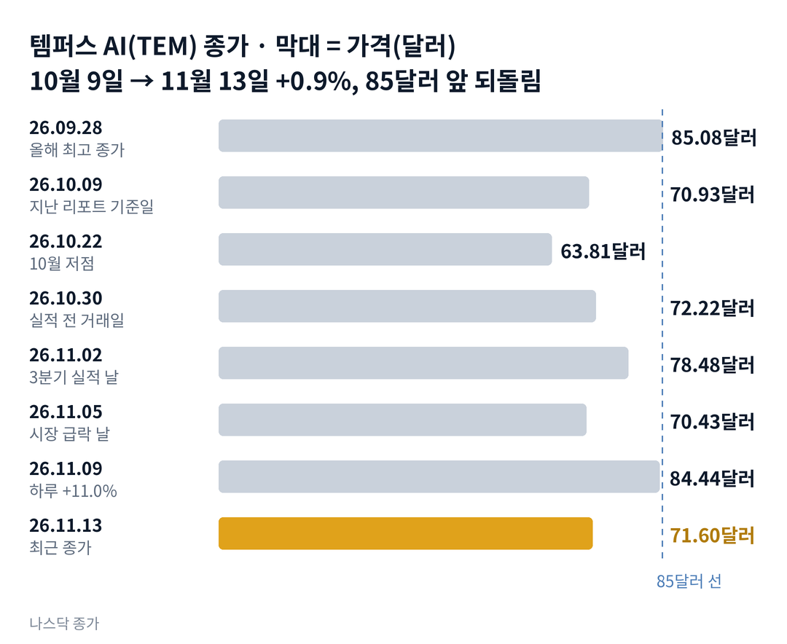

## 짧은 답

> **핵심:** 실적은 지난 리포트가 꼽은 조건을 채웠지만, 주가는 올해 세 번째로 85달러 앞에서 돌아섰습니다. 앞선 두 번은 10거래일 뒤 모두 20% 넘게 낮았습니다.

실적도 좋고 목표가도 올랐는데, 주가는 왜 한 달 전 그 자리일까요? 템퍼스 AI는 11월 2일 3분기 매출 4억 1,154만 달러를 냈습니다. 1년 전보다 23% 늘었습니다. 조정 EBITDA(이자·세금·감가상각 등을 빼기 전 영업이익을 회사 기준으로 조정한 값)는 2,557만 달러로 상장 뒤 가장 컸습니다.

주가는 11월 9일 하루 11.0% 올라 84.44달러가 됐습니다. 장중에는 85.75달러까지 갔습니다. 그런데 11월 13일 종가는 71.60달러로, 네 거래일 만에 15.2% 내렸습니다. 같은 기간 나스닥100 지수를 따르는 상장지수펀드(ETF) QQQ(인베스코 QQQ 트러스트)는 0.1% 올랐고, 회사의 수시 공시는 없었습니다.

**2026.11.13 진단: 지난 리포트의 '과열 뒤 되돌림'(두 달 안에 크게 오른 뒤 좋은 소식에도 오르지 않는 단계) 국면이 실적으로 끝나지 않고, 70~85달러의 넓은 범위 안에서 위쪽 벽을 확인한 단계입니다 — 근거는 5부.** 앞선 두 번의 물결(장중 85달러를 넘은 날이 이어진 구간) 뒤 10거래일은 3부 '85달러를 넘은 날 일곱 번' 기록표에 있습니다.

> **유의사항** 저자는 금융·투자 자문가가 아닙니다. 이 글은 공개 공시와 시세를 정리한 교육용 분석이며 특정 종목의 매수·매도를 권하지 않습니다. 과거 패턴은 미래 수익을 보장하지 않고, 이 종목은 하루 10% 넘게 움직인 적이 여러 번 있습니다. 실제 투자 전에는 최신 공시를 직접 확인하세요.

이 리포트는 시청자 반응이 컸던 종목의 업데이트입니다.

## 지난 리포트 이후

[10월 11일 리포트](/r/tem-2026-10/)는 주가가 '과열 뒤 되돌림' 국면에 있고, 11월 초 3분기 실적이 다음 방향을 정할 것이라고 봤습니다. 지난 예측 성적은 다섯 개 가운데 적중 2, 부분 적중 1, 빗나감 2입니다. 이익 도약 조건과 85달러 근처 시험대는 맞았고, 실적과 계약에 대한 반응의 크기는 빗나갔습니다. 항목별 채점은 6부 끝 채점표에 있습니다.

기준일 종가는 10월 9일 70.93달러에서 11월 13일 71.60달러로 0.9% 올랐습니다. 지난 리포트는 실적 날짜를 '11월 3일 전후 장 마감 뒤'로 추정했는데, 실제 발표는 11월 2일 장 시작 전이었습니다.

## 1부. 한 달 사이 회사에 생긴 일

> **핵심:** 3분기 실적은 매출·이익 모두 상장 뒤 최고였고, 10월에는 대형 제약사 BMS와 5년짜리 데이터 계약을 맺었습니다.

템퍼스는 미국 시카고에 본사를 둔 의료 기술 회사입니다. 창업자이자 대표는 그루폰을 함께 세운 에릭 레프코프스키입니다. 회사는 인공지능으로 정밀 의료를 하겠다는 이야기를 내걸고 2024년 6월 나스닥에 상장했습니다.

돈을 버는 방식은 두 가지입니다. 암 환자의 유전자 검사를 하고 검사비를 받습니다. 그 과정에서 쌓인 익명 의료 데이터를 제약사에 빌려주고 사용료를 받습니다. 3분기 매출 가운데 검사(진단) 매출이 3억 350만 달러로 약 74%였습니다.

그래서 주가를 움직이는 변수는 검사 건수와 데이터 계약입니다. 검사는 매출의 몸통이고, 데이터는 남는 돈이 더 많은 사업입니다. 3분기 매출총이익률은 데이터·앱 71.5%, 진단 62.4%였습니다.

지금 몸값은 11월 13일 시가총액 약 130억 6,000만 달러입니다. 베타(시장이 1% 움직일 때 이 주식이 움직이는 정도)가 3.61이라, 시장보다 훨씬 크게 흔들립니다.

### 3분기 숫자(1년 전 대비, 회사 발표)

| 항목 | 2026년 3분기 |
| --- | --- |
| 매출 | **4억 1,154만 달러** +23% |
| 조정 EBITDA | **2,557만 달러** 1년 전 148만 달러 |
| 암 검사 건수 | **+32%** 재발 감시 검사(MRD) 약 1만 2,000건, +300% |
| 순손실 | **1,485만 달러** 평가 이익 4,280만 달러 포함 |
| 현금·유가증권 | **8억 5,440만 달러** 9월 30일 |

실적은 11월 2일 장 시작 전에 나왔습니다. 그날 주가는 장중 15.5%까지 올랐다가 8.7% 오른 78.48달러로 마쳤습니다. 거래량은 1,703만 주로 평소의 세 배 안팎이었습니다.

연 매출 전망은 16억~16억 500만 달러로 바뀌었습니다. 범위의 아래쪽만 500만 달러 올린 것입니다.

10월 23일에는 BMS(브리스톨 마이어스 스퀴브)와의 계약을 공시했습니다. 암 데이터 1억 3,750만 달러와 치매 등 신경 질환 데이터 5,500만 달러를 합쳐 5년간 1억 9,250만 달러입니다. 회사는 올해 데이터 계약액이 5억 5,000만 달러를 넘었다고 밝혔습니다. 그날 주가는 6.0% 올랐습니다. 숫자도 계약도 좋았는데, 주가는 왜 한 달 전 그 자리로 돌아왔을까요?

## 2부. 약속은 지켰는데 주가는 왜 제자리인가

> **핵심:** 매출은 시장 예상과 거의 같았고, 연 이익 목표를 지키려면 4분기에 3분기보다 약 34% 많은 이익을 내야 합니다.

첫 번째 이유는 기대와의 거리입니다. 시장 예상 매출은 출처마다 4억 930만~4억 1,134만 달러였습니다. 실제 4억 1,154만 달러는 그 위쪽 끝과 거의 같습니다. 실적 전 일주일(10월 22일 63.81달러 → 10월 29일 77.84달러) 주가가 22.0% 오른 뒤라, 예상과 비슷한 숫자로는 놀랄 거리가 적었습니다.

순손실 1,485만 달러도 한 겹 벗겨 볼 필요가 있습니다. 여기에는 보유한 다른 회사 주식의 평가 이익 4,280만 달러가 들어 있습니다. 이것을 빼면 손실은 약 5,765만 달러(단순 차감 계산, 세금 등은 반영하지 않음)입니다. 영업손실도 5,686만 달러였습니다. 검사와 데이터 영업만으로는 아직 적자라는 뜻입니다.

더 무거운 것은 남은 한 분기의 숙제입니다. 회사는 올해 조정 EBITDA 약 6,500만 달러 목표를 그대로 뒀습니다. 1~3분기 합은 약 3,080만 달러(계산)입니다.

**4분기에 필요한 숫자(회사 연간 전망 기준, 계산)**

| 항목 | 4분기 필요 |
| --- | --- |
| 매출 | **4억 5,790만~4억 6,290만 달러** 2025년 4분기 3억 6,720만 달러보다 24.7~26.1% 많음 |
| 조정 EBITDA | **약 3,420만 달러** 상장 뒤 최고인 3분기 2,557만 달러보다 약 34% 많음 |

매출 쪽은 3분기 성장률 23%보다 조금 빨라지면 됩니다. 이익 쪽은 한 분기 만에 사상 최고 기록을 3분의 1 넘게 다시 넘어야 합니다. 2025년에는 연초 이익 약속(약 500만 달러)을 지키지 못하고 마이너스 740만 달러로 끝났습니다(지난 리포트 5.5). 세 가지를 나란히 놓으면 공통점이 하나 보입니다. 모두 3분기 숫자 자체보다 4분기 이익 목표를 더 무겁게 만든다는 점입니다. 주가가 85달러 근처에서 멈춘 일은 이번이 처음이었을까요?

## 3부. 85달러를 넘은 날 일곱 번

> **핵심:** 올해 장중 85달러를 넘은 날은 7일이었지만 종가 최고는 85.08달러였고, 앞선 두 물결은 고점 종가 10거래일 뒤 20.1%, 23.0% 낮았습니다.

기준은 이렇습니다. 2026년 1월부터 11월 13일까지 나스닥 일별 시세에서 장중 고가가 85달러 이상인 날을 하나도 빼지 않았습니다. 붙어 있는 날은 한 물결로 묶었고, 물결마다 가장 높은 종가 날에서 10거래일 뒤 종가를 비교했습니다. 이번 하락이 바로 85달러 근처에서 시작됐기 때문에 이 기준을 골랐습니다.

예를 들어 첫 물결은 9월 28일 종가 85.08달러를 10거래일 뒤 10월 12일 종가 67.99달러와 비교해 -20.1%입니다.

**한눈에:** **7일** 장중 85달러 이상 · **2일** 종가 85달러 이상(9월 25일 85.01, 28일 85.08달러) · **2/2** 앞선 물결이 10거래일 뒤 20% 넘게 낮음.

### 장중 85달러를 넘은 물결과 10거래일 뒤

| 물결 · 장중 최고 | 고점 종가 | 10거래일 뒤 종가 |
| --- | --- | --- |
| 9월 25일~30일 89.09달러(9월 29일) | 85.08달러 (9월 28일) | 67.99달러 (10월 12일, -20.1%) |
| 10월 5일~6일 87.99달러(10월 6일) | 83.55달러 (10월 5일) | 64.34달러 (10월 19일, -23.0%) |
| 11월 9일~11일 85.75달러(11월 9일) | 84.44달러 (11월 9일) | 11월 23일 판정 (4거래일 뒤 -15.2%) |

두 번째 물결은 하루 안에 벽을 보여 줬습니다. 10월 6일 주가는 84.97달러에 출발해 장중 87.99달러까지 갔습니다. 그날 종가는 71.98달러, 하루 13.8% 하락이었습니다. 지난 리포트는 이날을 '회사 소식 없는 급락'으로 기록했습니다.

이번 물결도 회사 소식이 없었습니다. 11월 9일부터 13일까지 템퍼스는 15.2% 내렸습니다. 같은 기간 QQQ는 0.1% 올랐고, 같은 암 검사 업종의 나테라(NTRA)는 0.4%, 가던트 헬스(GH)는 4.5% 내렸습니다. 이 4거래일 동안은 비교한 종목들보다 훨씬 크게 내렸습니다.

> **이번 사례(10거래일 결과 미확정):** 2026.11.09 고점 종가 84.44달러 · 11월 23일(10거래일째) 종가가 앞선 두 번처럼 68달러 아래인지 확인

이 기록의 한계도 분명합니다. 앞선 물결은 두 번뿐이고, 85달러라는 선은 차트에서 고른 기준입니다. 같은 기간 실적과 시장 급락 같은 다른 재료도 겹쳤습니다. 참고로 2026년 하루 10% 넘게 오른 6일(11월 9일 제외) 가운데 20거래일 뒤 그날보다 높았던 날은 2일(8월 7일, 8월 19일)이었습니다. 이번 한 달 동안 시장과 대표의 매도는 어떻게 움직였을까요?

## 4부. 시장 급락과 대표의 매도

> **핵심:** 한 달 동안 QQQ가 9.5% 내릴 때 템퍼스는 0.9% 올라 버텼지만, 오르는 날마다 위에서 파는 물량도 있었습니다.

한 달 전체로 보면 템퍼스는 시장보다 잘 버텼습니다. 아래 표는 지난 리포트 기준일 10월 9일 종가와 11월 13일 종가를 비교한 것입니다.

### 10월 9일 → 11월 13일 종가 변화(나스닥 시세, 계산)

| 종목 | 변화 |
| --- | --- |
| 템퍼스(TEM) | **+0.9%** 70.93 → 71.60달러 |
| 나스닥100 ETF(QQQ) | **-9.5%** 751.27 → 679.89달러 |
| 나테라(NTRA) | **-20.4%** 400.71 → 319.09달러 |
| 가던트 헬스(GH) | **-9.4%** 167.47 → 151.70달러 |

큰 날은 시장과 함께 움직였습니다. 11월 5일 QQQ가 하루 6.5% 빠진 날 템퍼스는 6.9% 내려 70.43달러가 됐습니다. 다음 두 거래일에는 19.9% 올랐습니다. 11월 6일 나테라가 하루 14.6% 내린 날, 템퍼스는 8.0% 올랐습니다.

대표 쪽 매도도 있었습니다. 10월 27일 레프코프스키 대표와 관련 법인들은 25만 주를 팔았습니다. 가중평균 가격은 67.36~72.31달러였고, 합계 약 1,759만 달러(계산)입니다. 2026년 3월 8일 미리 정해 둔 매도 계획(10b5-1, 내부자가 미리 정한 일정대로 주식을 파는 제도)에 따른 거래였습니다. 그날 주가는 7.4% 올랐습니다.

증권사들은 다르게 봅니다. 평균 목표가는 지난 리포트 때 약 71달러에서 지금 89.56달러(20명)로 올랐습니다. 공매도는 유통 주식의 19.52%입니다. 주가는 50일 평균 72.84달러 바로 아래, 200일 평균 57.45달러 위에 있습니다.

과거 기록이 알려 주는 것은 85달러 근처의 벽까지입니다. 그래서 앞으로 확인할 조건은 두 가지입니다. 하나는 12월 14일 종가가 71.60달러를 지키는가, 다른 하나는 그 사이 85.08달러 위 마감이 나오는가입니다. 이 두 조건으로 나누면 어떤 갈림길이 나올까요?

## 5부. 국면 진단과 네 가지 시나리오

> **핵심:** 지금은 70~85달러 범위의 위쪽 벽을 세 번째로 확인한 단계이고, 12월 14일 종가와 그 사이 85.08달러 돌파 여부가 시나리오를 가릅니다.

> **국면 정의(템퍼스 시리즈 공통, 10월 11일 리포트 5.1):** 국면 A(이야기 상승, 큰 이름 소식과 함께 50일·200일 평균 위에서 오르는 단계). 국면 B(실적 검증 하락, 성장 둔화나 약속 미달로 200일 평균 아래로 내려가는 단계). 국면 C(과열 뒤 되돌림, 두 달 안에 크게 오른 뒤 좋은 소식에도 오르지 않는 단계).

**2026년 11월 13일 진단: 국면 C(과열 뒤 되돌림)가 이어지는 중.** 실적 날 장중 15.5% 상승이 종가 8.7%로 줄었고, 11월 9일 급등도 네 거래일 만에 되돌려졌습니다. 국면 B 신호인 성장 둔화와 약속 미달은 아직 없습니다. 주가는 200일 평균 위에 있습니다.

**판정 기준 두 가지:** 하나는 12월 14일(11월 13일부터 20번째 거래일) 종가가 11월 13일 종가 71.60달러보다 높은가입니다. 다른 하나는 그때까지 올해 최고 종가 85.08달러보다 높게 마감한 날이 하루라도 있는가입니다.

### 앞으로 일어날 수 있는 일

**확인된 사실:** 3분기 조정 EBITDA는 2,557만 달러였고, 4분기에는 약 3,420만 달러가 필요합니다. 11월 30일 퍼스널리스 주주총회가 인수안을 표결합니다. 퍼스널리스 주주는 한 주에 16.25달러어치 템퍼스 주식을 받기로 돼 있습니다(지난 리포트 5.5).

**과거 기록:** 3부 표에서 앞선 두 물결은 10거래일 뒤 모두 20% 넘게 낮았습니다. 2026년 하루 10% 넘게 오른 6일 가운데 20거래일 뒤 그날보다 높았던 날은 2일이었습니다.

**추정:** 출발점은 앞선 물결 2번 중 2번이 10거래일 뒤 20% 넘게 낮았다는 기록입니다. 아래 가능성은 주가가 오를 확률이 아니라, 12월 14일에 두 판정 기준이 어느 칸에 들어갈지에 대한 분석자의 주관적 추정입니다. 네 경우는 겹치지 않아 '약 N%'를 더하면 100%이고, 괄호 안 구간은 흔들림의 폭이라 서로 더하지 않습니다.

| 시나리오(판정 2026년 12월 14일) | 종가 · 돌파 | 가능성(추정) |
| --- | --- | --- |
| **1 · 벽 앞 되돌림** | 71.60 아래 · 없음 | 높음 약 40% (35~45%) |
| 2 · 넓은 범위 유지 | 71.60 위 · 없음 | 높음 약 35% (30~40%) |
| 3 · 벽 돌파 | 71.60 위 · 있음 | 낮음 약 20% (15~25%) |
| 4 · 돌파 뒤 급락 | 71.60 아래 · 있음 | 낮음 약 5% (3~8%) |

시나리오 1이면 11월 23일 종가가 앞선 두 번처럼 68달러 아래로 가는지 먼저 봅니다. 시나리오 2면 50일 평균 72.84달러 위로 돌아오는지 봅니다. 시나리오 3이면 퍼스널리스 표결과 새 데이터 계약이 계기였는지 봅니다. 시나리오 4는 시장 급락이 다시 오는 경우입니다.

1번에 가장 큰 무게를 둔 것은 앞선 두 물결이 모두 그 방향이었고, 이번 물결도 이미 15.2% 내렸기 때문입니다. 다만 표본이 둘이라 2번과의 차이를 5%만 두었습니다. 3번은 증권사 평균 목표가 89.56달러와 4분기 이익 기대를 반영했습니다.

반대쪽 요인도 같은 무게로 있습니다. 한 달 동안 시장이 9.5% 내릴 때 템퍼스는 버텼고, 매출 성장률은 23%로 유지됐습니다. 이 진단을 가장 빨리 뒤집을 수 있는 위험은 무엇일까요?

## 6부. 위험과 체크리스트

> **핵심:** 판을 가장 빨리 바꿀 수 있는 것은 시장 전체의 급락이고, 그다음이 4분기 이익 약속과 퍼스널리스 인수로 늘어날 주식입니다.

먼저 이 분석의 한계입니다. 3부 표의 앞선 물결은 두 번뿐이고, 85달러는 차트에서 고른 선입니다. 10거래일이라는 기간도 고정된 규칙이 아니라 비교를 위해 정한 기준입니다.

사업 실행 쪽 위험이 가장 큽니다. 4분기에 조정 EBITDA 약 3,420만 달러를 내지 못하면, 2025년처럼 연간 이익 약속을 못 지키게 됩니다. 9개월 영업현금흐름은 마이너스 7,159만 달러였습니다.

자금 조달 쪽에서는 퍼스널리스 인수 대가가 있습니다. 템퍼스 주가가 낮을수록 줄 주식이 늘어나는 구조입니다(상한 있음, 지난 리포트 5.5). 회사는 5억 달러 규모의 시장 판매 계약(ATM, 회사가 시장에서 새 주식을 조금씩 나눠 파는 계약)도 갖고 있지만, 1~3분기에는 쓰지 않았습니다.

외부 환경 쪽에서는 시장 전체의 흔들림이 큽니다. 베타가 3.61이라 11월 5일처럼 시장이 하루 6.5% 빠지면 함께 크게 빠질 수 있습니다. 가던트 헬스의 특허 소송과 유전 정보 소송도 이어지고 있습니다.

**핵심 확인 세 가지:** 위에서부터 판정을 바꾸는 힘이 큰 순서입니다.

- ☐ 1순위 · 11월 23일(물결 10거래일째) 종가가 68달러 아래인가
- ☐ 2순위 · 12월 14일(20거래일째) 종가가 71.60달러보다 높은가
- ☐ 3순위 · 12월 14일까지 종가가 85.08달러를 넘은 날이 1일 이상 있었나

**보조 확인:** 11월 30일 퍼스널리스 표결 결과와, 템퍼스가 대가의 일부를 현금으로 바꾸는지 봅니다.

**기억할 판단 기준:** 이 종목은 올해 85달러 근처에서 세 번 멈췄습니다(결과가 나온 기록은 두 번, 참고용). 그래서 실적과 함께 가격 자리와 시장 방향도 봅니다.

### 지난 예측 채점표

10월 11일 리포트(10월 9일 기준)의 시나리오를 11월 13일 기준으로 채점한 결과입니다. 지난 리포트에는 시나리오별 가능성 숫자가 없었습니다.

| 지난 점검 항목 · 당시 기준 | 판정 및 실제 결과(11월 13일) |
| --- | --- |
| **시나리오 1 계기: 이익 도약** 매출 4억 1,000만·조정 EBITDA 2,000만 달러 초과 | **[적중]** 4억 1,154만·2,557만 달러 |
| **시나리오 1 예상: 2거래일 20% 상승** 실적 뒤 | **[빗나감]** 10월 30일 72.22달러 → 11월 3일 77.80달러, +7.7% |
| **시나리오 1: 85~89달러 첫 시험대** 9월 고점 | **[적중]** 11월 9일 장중 85.75달러 뒤 -15.2% |
| **시나리오 3: 새 큰 이름** 하루 10~25% 상승 | **[빗나감]** 10월 23일 BMS 계약 +6.0% |
| **시나리오 4: 넓은 범위 등락** 약 65~85달러 | **[부분 적중]** 종가 63.81~84.44달러, 계기는 달랐음 |

시나리오 2(약속 미달과 희석)는 켜지지 않았습니다. 가장 큰 빗나감은 반응의 크기였습니다. 계기는 맞았지만 주가는 예상보다 작게 반응했고, 대신 회사 소식이 없는 날에 크게 움직였습니다. 이번 리포트부터는 판정 기준을 가격 자리(85.08달러)에 직접 두었습니다.

같은 의료 AI 업종의 흐름은 [리커전 리포트](/r/rxrx-2026-11/)에서 함께 볼 수 있습니다. 다음 갱신은 12월 14일 20거래일째 반응이나 4분기 실적을 본 뒤에 합니다. 공시는 [템퍼스 투자자 관계 페이지](https://investors.tempus.com)와 [SEC 공시 목록](https://www.sec.gov/cgi-bin/browse-edgar?action=getcompany&CIK=0001717115)에서 확인할 수 있습니다.
