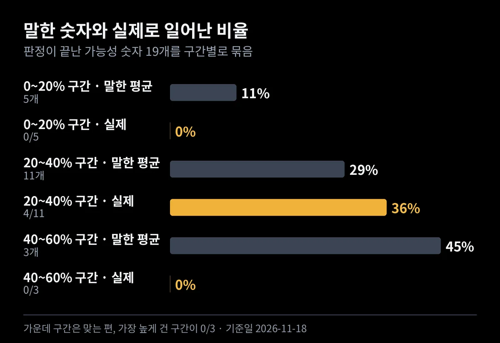
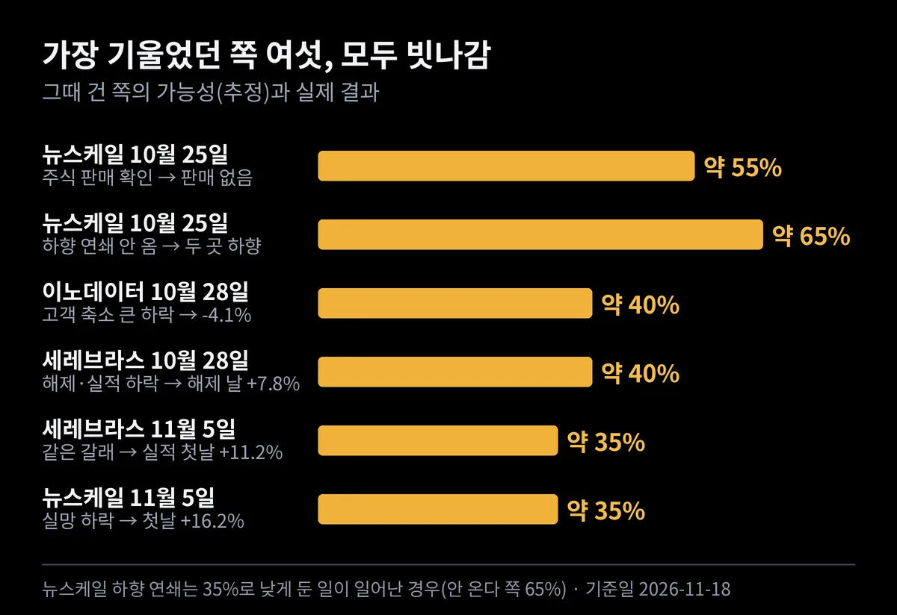
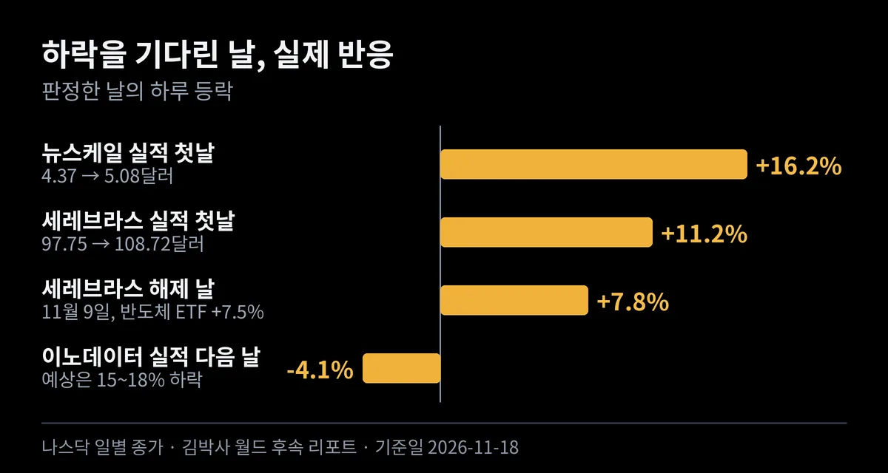
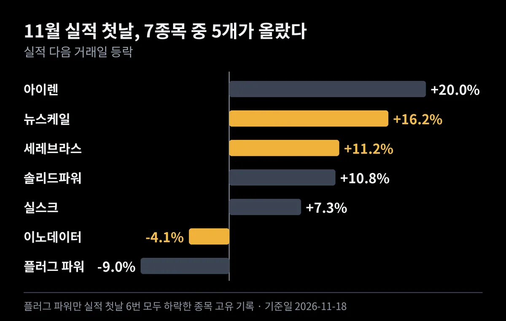
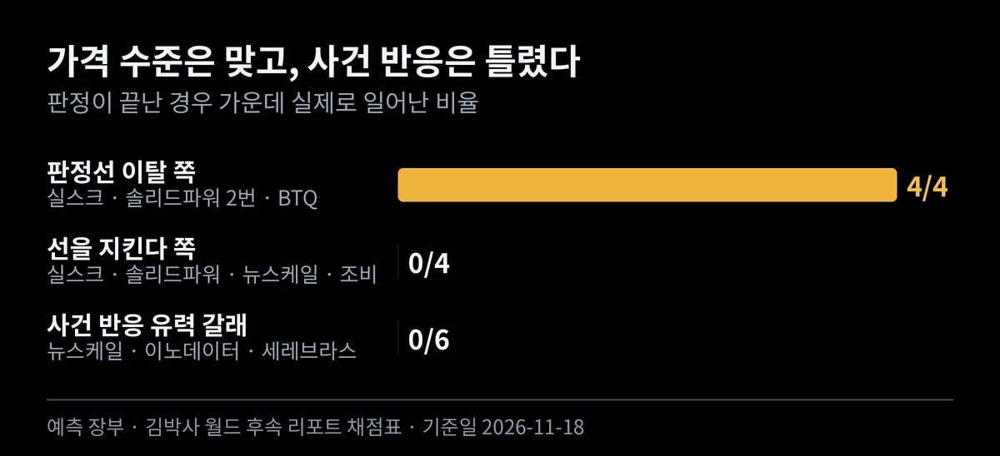

김박사 월드는 리포트마다 앞으로 갈 길을 몇 갈래로 나누고, 갈래마다 가능성 숫자를 붙여 왔습니다. 11월 18일까지 판정이 끝난 예측은 21개입니다. 숫자만 보면 나쁘지 않습니다. 가능성 숫자를 붙인 19개의 점수는 모든 질문에 반반이라고 답했을 때보다 낫습니다. 그런데 질문마다 우리가 가장 기울었던 쪽만 따로 세면 결과가 다릅니다. 여섯 번 걸었고, 여섯 번 모두 틀렸습니다.

> **유의사항** 저자는 금융·투자 자문가가 아닙니다. 이 글은 지난 리포트의 예측을 공개 자료로 다시 채점한 교육용 기록이며 특정 종목의 매수·매도를 권하지 않습니다. 이 글의 가능성 숫자는 모두 판정이 끝난 지난 예측이고, 앞으로의 주가에 대한 판단이 아닙니다. 과거 패턴은 미래 수익을 보장하지 않습니다.

이 글은 그 여섯 번을 하나씩 다시 채점하는 기록입니다. 먼저 왜 이런 글을 쓰는지부터 말씀드리겠습니다. 기억은 맞힌 것만 오래 남깁니다. 틀린 예측은 '그땐 운이 나빴다'로 지워지기 쉽습니다. 맞힌 것만 남으면 맞힌 비율이 실제보다 높아 보입니다. 그래서 장부 없이는 실력과 운을 가를 수 없습니다. 판정이 끝난 예측을 모두 모아 두어야 어디서 맞고 어디서 틀리는지가 보입니다.

복기의 두 번째 이유는 이름 붙이기입니다. 틀린 이유에 이름이 없으면 다음 종목에서 같은 실수를 또 합니다. 이번 여섯 오답에서 이름 붙인 원인 다섯이 오늘 바꾼 규칙으로 이어졌습니다. 세 번째 이유는 여러분 쪽에 있습니다. 공개 채점은 우리 말을 얼마나 믿어야 할지 재는 자입니다. 다른 분야에도 같은 원칙이 있습니다. 미국 교통안전위원회 규정은 사고 조사를 사실을 찾는 절차로 정하고, 누구의 책임을 가리려는 것이 아니라고 적어 두었습니다. 이 글도 누구를 탓하려는 것이 아니라, 무엇이 어긋났는지 사실로 정리하려고 씁니다.

성적표부터 보겠습니다. 장부에 적힌 예측은 303개이고, 판정이 끝난 것은 21개입니다. 그중 가능성 숫자가 붙은 19개로 브라이어 점수를 냈습니다. 브라이어 점수는 말한 숫자와 실제 결과의 차이를 제곱해 평균 낸 값이고, 낮을수록 좋습니다. 모든 질문에 50%라고 답하면 0.250이 나옵니다. 우리 점수는 0.176이었습니다.

구간으로 나눠 보면 장점과 약점이 함께 보입니다. 20~40%라고 말한 것들은 실제로도 그 안팎으로 일어나, 보정이 맞는 편이었습니다. 숫자는 부록 표에 있습니다. 문제는 40~60%라고 가장 높게 건 세 개입니다. 이 구간은 하나도 일어나지 않았습니다. 자신이 커질수록 빗나갔다는 뜻입니다.

여섯 오답을 하나씩 보겠습니다. 출발은 [뉴스케일 파워 10월 25일 리포트](/r/smr-2026-10-2/)입니다. 3분기 보고서에서 큰 주식 판매가 확인된다는 갈래를 약 55%로 가장 높게 봤습니다. 근거는 상반기 판매 기록과 7억 5,000만 달러 판매 한도였습니다. 판매 한도는 8월에 맺은 시장 판매 계약으로 팔 수 있는 최대 규모입니다. 실제로는 상장 보통주인 A주 수가 9월 말에도 6월 말과 거의 같아, 3분기에 판 주식이 거의 없었습니다. 놓친 것은 판매 '한도'와 실제 '판매'의 차이입니다.

같은 리포트에는 반대 방향의 오답도 있었습니다. 다른 증권사가 같은 이유로 목표가를 낮추는 '하향 연쇄'를 약 35%로 낮게 봤습니다. 안 온다는 쪽에 약 65%를 건 셈입니다. 그런데 10월 28일 B. Riley가 목표가를 15달러에서 10달러로 낮췄고, 11월 3일 웨드부시가 매도 의견을 냈습니다. 당시 후속 리포트는 이 갈래를 '적중'으로 적었습니다. 장부는 50% 아래로 둔 일이 일어나면 빗나감으로 셉니다. 이 글은 더 엄한 장부 쪽 채점을 따릅니다.

[이노데이터 10월 28일 리포트](/r/inod-2026-10-2/)의 오답은 크기에서 나왔습니다. 이노데이터는 인공지능 회사들이 모델을 가르치는 데 쓰는 데이터를 사람 손으로 만들어 돈을 버는 회사입니다. 리포트는 큰 고객 매출이 줄었다는 확인과 다음 날 15~18% 추가 하락을 한 갈래로 묶어 약 40%로 봤습니다. 큰 고객 프로그램 종료는 실제로 확인됐습니다. 그러나 다음 날 주가는 4.1% 내리는 데 그쳤고, 매출은 예상보다 높았습니다. 사건은 맞고 크기가 틀린 경우입니다. 실적 9일 전에 하루 25.3% 빠지며 나쁜 소식이 이미 값에 들어가 있었습니다.

세레브라스에서는 같은 오답이 두 번 나왔습니다. [10월 28일 리포트](/r/cbrs-2026-10-3/)는 락업 해제와 그 뒤 실적이 이어서 주가를 끌어내린다는 갈래를 가장 높게 봤습니다. 락업 해제는 상장 전 주주가 팔지 못하게 묶였던 주식이 풀리는 날입니다. [11월 5일 리포트](/r/cbrs-2026-11/)도 같은 갈래를 가장 무겁게 뒀습니다. 그런데 11월 9일 해제 날 주가는 7.8% 올랐습니다. 3분기 매출은 회사 전망보다 높았고, 실적 첫날 종가도 11.2% 올랐습니다.

마지막 오답은 다시 [뉴스케일 11월 5일 리포트](/r/smr-2026-11/)에서 나왔습니다. 실적 첫날 내리고 한 달 뒤에도 4.41달러 아래에 머문다는 갈래를 약 35%로 가장 무겁게 봤습니다. 최근 다섯 번 가운데 네 번이 한 달 뒤 16% 넘게 낮았다는 기록이 근거였습니다. 실적 다음 날 종가는 5.08달러로, 전날 4.37달러보다 16.2% 높았습니다. 첫날이 오르면서 이 갈래는 판정 날을 기다릴 필요도 없이 끝났습니다.

여섯을 나란히 놓으면 공통점이 다섯 보입니다. 가장 먼저 보이는 것은 이야기 쏠림입니다. 여섯 갈래 모두 '나쁜 일이 생기고 주가가 더 빠진다'는 이야기였습니다. 리포트가 '왜 빠졌나'라는 미스터리로 시작하니, 그 이야기를 그대로 늘린 갈래를 유력으로 골랐습니다. 다섯은 그 일이 안 일어났고, 하나는 일어났는데 우리가 낮게 둔 경우였습니다.

'할 수 있다'와 '했다'를 섞은 것도 공통점입니다. 판매 한도나 등록 서류가 있다는 것은 팔 수 있다는 뜻일 뿐입니다. 장부에서 3분기 보고서로 판매가 확인된 것은 일곱 종목 가운데 세 종목이었습니다. 셋째는 이미 알려진 악재입니다. 날짜가 미리 알려진 해제나 이미 보도된 고객 문제는 그날 반응이 작거나 반대로 나왔습니다. 세레브라스 해제 날에는 반도체 상장지수펀드도 7.5% 올랐습니다.

한 갈래에 두 조건을 묶은 것도 반복됐습니다. '사건이 일어난다'와 '반응이 크다'를 묶으면 두 확률을 곱해야 합니다. 그런데 우리는 한쪽 확률만큼 높게 줬습니다. 이노데이터 40%와 세레브라스 40%가 그런 경우입니다. 마지막은 실적 첫날 기저율을 보지 않은 것입니다. 기저율은 같은 종류의 일이 과거에 실제로 일어난 비율입니다.

11월 실적 첫날만 보면 일곱 종목 가운데 다섯이 올랐습니다. 아이렌은 20.0%, 뉴스케일은 16.2%, 세레브라스는 11.2% 올랐습니다. 솔리드파워는 10.8%, 실스크는 7.3%였습니다. 내린 곳은 플러그 파워 9.0%와 이노데이터 4.1% 둘입니다. 플러그 파워는 실적 첫날 여섯 번 모두 내린 종목 고유 기록이 있는 예외입니다. 이 기저율을 먼저 봤다면 '실망 하락'을 가장 무겁게 두지 않았을 가능성이 큽니다. 다만 일곱 종목은 작은 표본이라 참고로만 씁니다.

틀린 쪽만 있었던 것은 아닙니다. 같은 기간 가격 수준에 대한 예측은 맞았습니다. 판정선은 지난 리포트가 맞고 틀림을 가르려고 미리 정해 둔 가격입니다. 현금선은 회사가 가진 현금을 주식 수로 나눈 한 주당 값입니다. 판정선, 현금선, 새 최저를 깬다는 쪽은 네 번 모두 일어났습니다. [실스크](/r/laes-2026-11-4/)는 1.23달러 이탈을 가장 무겁게 봤고, 11월 16일 그 아래로 마감했습니다. [솔리드파워](/r/sldp-2026-11-3/)는 현금선 이탈이 같은 날 맞았고, 그 전에 1.84달러 아래 마감도 일어났습니다.

[BTQ(BTQ 테크놀로지스, 양자 보안 기술 회사)](/r/btq-2026-11-3/)는 업종이 다시 크게 빠지면 1.67달러 아래를 시험한다고 위험 갈래로 적었습니다. 11월 12일과 13일 모두 그 아래였습니다. 반대로 선을 지킨다는 쪽은 네 번 모두 안 일어났습니다. 뉴스케일 5.20달러 지지와 [조비](/r/joby-2026-11-2/) 4.80달러 지지도 깨졌습니다. 날짜와 종가는 부록 표에 있습니다.

두 결과를 겹치면 하나의 그림이 됩니다. 이번 네 번에서는 하락 추세인 종목의 가격 수준이 이어졌습니다. 하지만 실적이나 해제 같은 사건 하나에 대한 반응은 우리 이야기와 반대로 갔습니다. 같은 하락 이야기라도 '수준'과 '방향'은 다른 질문이었던 셈입니다. 맞힌 네 번 가운데 셋은 과거 이탈 기록을 근거로 적은 예측이었고, 틀린 여섯 번은 그 편의 이야기를 늘린 예측이었습니다.

그래서 예측 규칙을 여덟 가지로 고쳤습니다. 가장 큰 변화는 출발점입니다. 이제 갈래마다 장부의 기저율을 먼저 적고, 조정은 근거 한 줄과 함께 15%포인트 안에서만 합니다. 가장 무겁게 보는 갈래는 40% 이하가 기본입니다. 넘기려면 같은 종류의 과거 판정이 다섯 개 이상 받쳐야 하고, 발행 전 검사가 이를 막습니다.

나머지 규칙은 오답 하나하나에서 나왔습니다. 사건과 반응은 따로 적고, 묶은 갈래는 두 확률의 곱을 넘지 않게 합니다. 판매 한도만으로는 판매 갈래를 올리지 않습니다. 날짜가 알려진 악재에는 '그날 큰 하락'을 기저율 이하로 둡니다. 가격 수준은 장부 기록대로 무게를 주되, 사건 반응의 방향은 이야기 쪽으로 기울이지 않습니다. 가장 무거운 갈래마다 '이 갈래가 틀린다면 이유' 한 줄을 미리 씁니다.

이 기록에도 한계는 있습니다. 판정 끝 21개, 가능성 숫자 19개는 작은 표본입니다. 40~60% 구간의 0/3도 세 번뿐이라, 운이 나빴을 가능성을 지울 수 없습니다. 여섯 오답 가운데 뉴스케일과 세레브라스가 둘씩이라 종목이 겹친다는 점도 있습니다. 그래서 이 글은 고친 규칙이 낫다고 말하지 않습니다. 판정이 쌓인 뒤 숫자로 다시 재기로 한 약속만 적습니다.

여섯 번 모두 틀린 가장 큰 이유는 장부의 기록보다 그 편의 이야기를 더 믿었다는 데 있습니다. 판매 한도와 알려진 악재와 두 조건 묶음은 모두 '더 빠진다'는 이야기를 받쳐 준 근거였고, 실적 첫날 기저율은 그 이야기에 밀려 빠졌습니다. 이야기는 영상과 리포트를 끝까지 보게 하는 힘이지만, 가능성 숫자를 정하는 근거가 되면 안 됩니다. 그 차이를 알게 된 것도 틀린 예측을 지우지 않고 장부에 남겨 둔 덕분입니다. 12월 판정이 쌓여 판정 끝 예측이 50개를 넘으면, 오답노트 2편에서 고친 방식으로 쓴 예측을 고치기 전 21개와 나란히 채점합니다. 김박사 월드는 종목마다 따로 보지 않고, 이렇게 맞고 틀린 기록까지 모아 하나의 패턴 지식으로 쌓아 갑니다.

## 숫자로 다시 보기

### 성적 한눈에(11월 18일 기준)

| 항목 | 값 |
| --- | --- |
| 장부에 적힌 예측 | **303개** 시나리오 267 · 확인 항목 36 |
| 판정이 끝난 예측 | **21개** 가능성 숫자가 붙은 것 19개 |
| 브라이어 점수(19개) | **0.176** 모두 50%라고 했다면 0.250 |
| 질문마다 가장 기울었던 쪽 | **0/6** |

아래 숫자는 주가 상승·하락 가능성이 아니라, 각 갈래 조건이 일어날지에 대해 그때 적은 분석자의 주관적 추정과 실제 비율입니다.

| 말한 구간 · 개수 | 말한 평균 · 실제 |
| --- | --- |
| **0~20%** · 5개 | 11% · 0%(0/5) |
| **20~40%** · 11개 | 29% · 36%(4/11) |
| **40~60%** · 3개 | 45% · 0%(0/3) |

### 오답 여섯 기록표

표의 가능성은 주가 상승·하락 가능성이 아니라, 각 갈래 조건이 일어날지에 대해 그때 적은 분석자의 주관적 추정입니다. 모두 판정이 끝났습니다.

| 리포트 · 가장 기울었던 쪽 | 실제 결과와 놓친 것 |
| --- | --- |
| **뉴스케일 10월 25일** 3분기 주식 판매 확인 약 55% | **[빗나감]** A주 4억 1,037만 → 4억 1,054만 주 판매 한도 7억 5,000만 달러를 판매로 읽음 |
| **뉴스케일 10월 25일** 증권사 하향 연쇄 약 35%(안 온다 약 65%) | **[빗나감]** B. Riley 15→10달러, 웨드부시 매도 낮게 둔 나쁜 소식이 일어남 |
| **이노데이터 10월 28일** 고객 축소 + 다음 날 15~18% 하락 약 40% | **[빗나감]** 고객 프로그램 종료는 확인, 다음 날 -4.1% 사건과 반응 크기를 한 갈래에 묶음 |
| **세레브라스 10월 28일** 해제와 실적이 이어진 하락 약 40% | **[빗나감]** 11월 9일 해제 날 +7.8% 3분기 매출 2억 3,090만 달러로 전망 위 |
| **세레브라스 11월 5일** 같은 갈래 약 35% | **[빗나감]** 실적 첫날 97.75 → 108.72달러(+11.2%) 해제 날 반도체 ETF +7.5% |
| **뉴스케일 11월 5일** 실망이 이어진 하락 약 35% | **[빗나감]** 첫날 4.37 → 5.08달러(+16.2%) 실적 첫날 기저율(7종목 중 5개 상승)을 안 봄 |

### 공통 원인 다섯

| 원인 | 어디서 |
| --- | --- |
| **이야기 쏠림** | 여섯 갈래 모두 '나쁜 일 + 더 빠짐' |
| **할 수 있다 ≠ 했다** | 3분기 판매 확인 3/7종목, 뉴스케일 55% |
| **알려진 악재** | 세레브라스 해제 +7.8%, 이노데이터 -4.1% |
| **두 조건 묶음** | 이노데이터 40%, 세레브라스 40% |
| **실적 첫날 기저율 무시** | 11월 7종목 중 5개 상승, 뉴스케일 35% |

### 11월 실적 다음 거래일

| 종목 | 등락 |
| --- | --- |
| 아이렌 | **+20.0%** |
| 뉴스케일 | **+16.2%** |
| 세레브라스 | **+11.2%** |
| 솔리드파워 | **+10.8%** |
| 실스크 | **+7.3%** |
| 이노데이터 | **-4.1%** |
| 플러그 파워 | **-9.0%**(실적 첫날 6번 모두 하락) |

### 맞힌 쪽과 지킨다 쪽

여기 적은 가능성도 주가 상승·하락 가능성이 아니라, 선을 깨는지 지키는지에 대해 그때 적은 분석자의 주관적 추정입니다.

| 예측 · 당시 가능성 | 판정 |
| --- | --- |
| **실스크 1.23달러 이탈** 두 갈래 합 약 70% | **[일어남]** 11월 16일 1.145달러 |
| **솔리드파워 현금선 이탈** 두 갈래 합 약 65% | **[일어남]** 11월 16일 1.62달러 |
| **솔리드파워 1.84달러 아래 마감** 약 40% | **[일어남]** 11월 13일 1.76달러 |
| **BTQ 1.67달러 아래 시험** 위험 갈래 | **[일어남]** 11월 12일 1.515달러, 13일 1.43달러 |
| **지킨다 쪽 네 번** 실스크 · 솔리드파워 · 뉴스케일 5.20달러 · 조비 4.80달러 | **[0/4]** 뉴스케일 11월 4일 5.13달러, 조비 10월 21일 4.64달러 |

### 고친 예측 규칙 여덟

| 규칙 | 내용 |
| --- | --- |
| **1 · 기저율에서 출발** | 장부 기저율 먼저, 조정은 ±15%포인트 안 |
| **2 · 유력 갈래 상한** | 40% 이하가 기본, 넘으면 과거 판정 5개 이상 필요 |
| **3 · 사건과 반응 나누기** | 묶은 갈래는 두 확률의 곱 이하 |
| **4 · 한도는 판매가 아님** | 판매 갈래는 3분기 기저율(3/7) 이상으로 안 올림 |
| **5 · 알려진 악재** | 그날 큰 하락은 기저율 이하 |
| **6 · 수준과 방향 구분** | 이탈은 기록대로, 반응 방향은 이야기로 안 기울임 |
| **7 · 사전 부검** | 유력 갈래마다 '틀린다면 이유' 한 줄 |
| **8 · 이야기와 예측 분리** | 미스터리 서사는 두고, 숫자는 1~7을 따름 |

다음 채점: 12월 판정 뒤(판정 끝 예측 50개 이상) 오답노트 2편에서 고친 방식으로 쓴 예측과 고치기 전 21개를 나란히 비교합니다.

## 함께 읽기

- 뉴스케일 파워: [10월 25일 리포트](/r/smr-2026-10-2/) · [영상](https://youtu.be/1K7m0C-T-84), [11월 5일 리포트](/r/smr-2026-11/) · [영상](https://youtu.be/6sh1eCsdPgw), 최신 [11월 18일 리포트](/r/smr-2026-11-3/) · [영상](https://youtu.be/CpGayNCaSHU) — 실적 첫날 +16.2%
- 이노데이터: [10월 28일 리포트](/r/inod-2026-10-2/) · [영상](https://youtu.be/2TO5d4qvj8Y), 후속 [11월 8일 리포트](/r/inod-2026-11/) · [영상](https://youtu.be/dKJa4FE723E) — 실적 다음 날 -4.1%
- 세레브라스: [10월 28일 리포트](/r/cbrs-2026-10-3/) · [영상](https://youtu.be/bwNYWsN2VBI), [11월 5일 리포트](/r/cbrs-2026-11/) · [영상](https://youtu.be/TULwdVnuvNU), 후속 [11월 13일 리포트](/r/cbrs-2026-11-2/) · [영상](https://youtu.be/GFSoL3mAjAs) — 해제 날 +7.8%
- 맞힌 쪽: [실스크](/r/laes-2026-11-4/) · [영상](https://youtu.be/W3vcgET5izw) 1.145달러, [솔리드파워](/r/sldp-2026-11-3/) · [영상](https://youtu.be/K6zvU0sUeak) 1.62달러, [BTQ](/r/btq-2026-11-3/) · [영상](https://youtu.be/wY3PD2QW0Eo) 1.43달러
