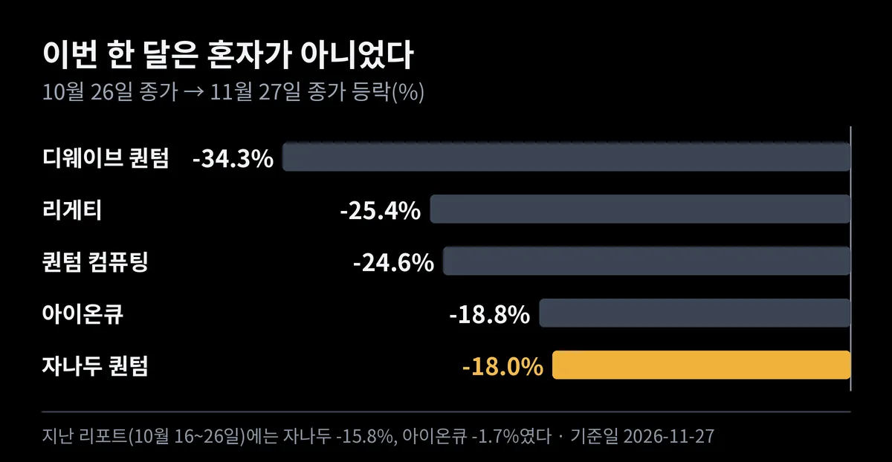
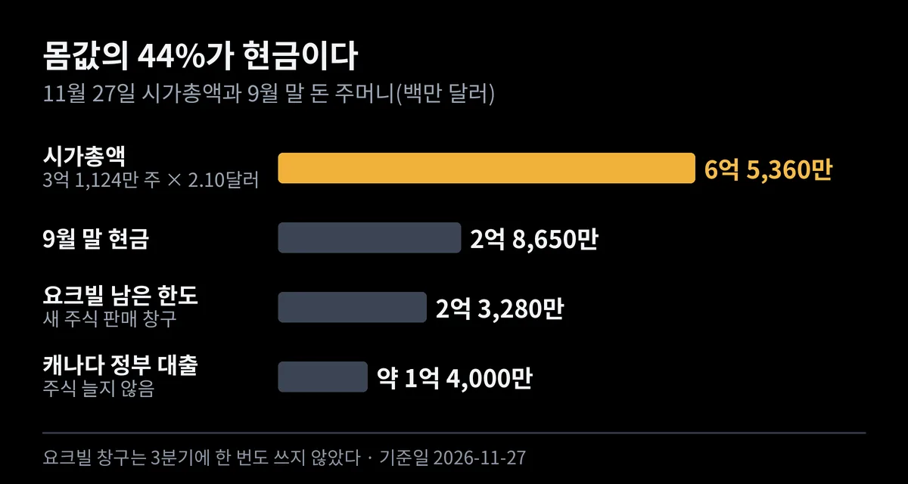
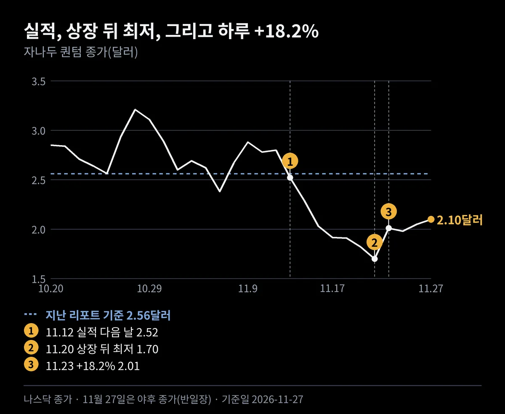
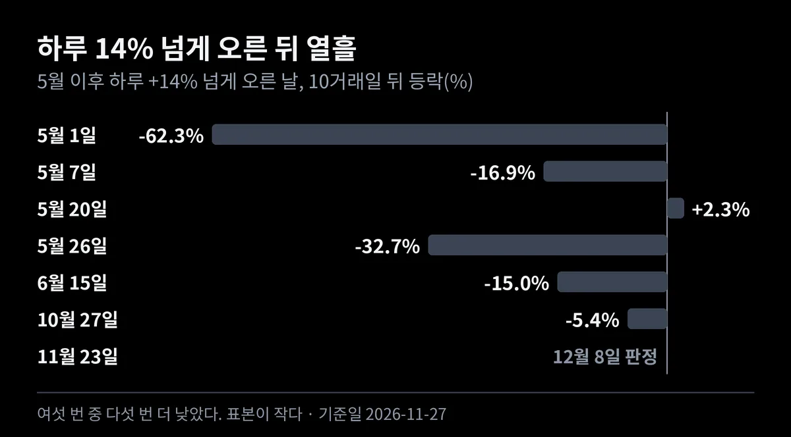
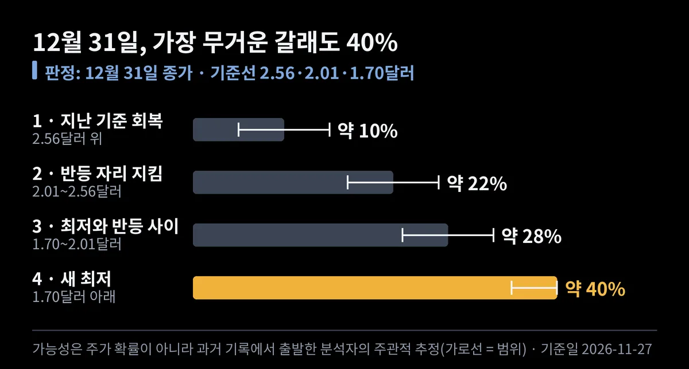

> **유의사항** 이 글은 공시와 시세 기록을 정리한 교육용 자료이며, 특정 종목의 매수·매도를 권하지 않습니다. 가능성 숫자는 과거 기록에 조건을 더한 주관적 추정입니다.

11월 20일, 자나두 퀀텀 주가는 1.70달러로 마감했습니다. 3월 26일 상장한 뒤 가장 낮은 종가입니다. 그런데 다음 거래일인 11월 23일에는 2.01달러로 하루 18.2% 올랐습니다. 그날 거래량은 약 993만 주였습니다. 지난 한 달 하루 평균의 약 1.8배입니다.

이상한 점은 따로 있습니다. 지난 리포트는 이 주식을 누르는 힘을 '새로 풀리는 주식'으로 봤습니다. 그런데 11월 11일 나온 3분기 실적을 보니, 회사는 7월부터 9월까지 요크빌 창구로 새 주식을 한 주도 팔지 않았습니다. 파는 물량이 줄었는데 주가는 왜 더 내려갔을까요?

이 글은 시청자 요청으로 썼습니다. 양자 보안 회사 BTQ(BTQ 테크놀로지스) 영상에 '자나두 해주세요'라는 댓글을 남겨 주셨고, 가장 궁금한 부분을 여쭸습니다. 이번 글은 많은 분이 가장 먼저 묻는 질문에서 시작합니다. 상장 뒤 최저가를 찍고 튀어 오른 지금, 여기가 바닥일까요?

[지난 리포트](/r/xndu-2026-10-3/)는 10월 26일 종가 2.56달러를 기준으로 네 갈래를 내다봤습니다. 지난 예측 성적은 적중 2, 빗나감 1, 확인 전 1입니다. 가장 높게 본 '3분기 요크빌 판매 증가'는 빗나갔습니다. 반면 '11월 말까지 기준선 아래 종가'와 '업종과 함께 하루 두 자릿수 상승'은 맞았습니다. 그때 매긴 가능성은 아래 부록 채점표에 있습니다.

자나두가 돈을 버는 방식부터 짚겠습니다. 자나두는 빛 알갱이(광자)로 계산하는 양자컴퓨터를 만드는 캐나다 토론토 회사입니다. 아직 컴퓨터를 팔아 버는 돈은 거의 없습니다. 3분기 매출 130만 달러는 대부분 미국 국방고등연구계획국(DARPA) 과제와 연구 협력에서 나왔습니다. 1년 전보다 32% 늘었지만, 같은 석 달 순손실은 3,220만 달러였습니다.

그래서 이 회사의 핵심은 쌓아 둔 현금입니다. 9월 말 현금은 2억 8,650만 달러였습니다. 석 달 전보다 약 2,628만 달러 줄었습니다. 연구개발비가 2,560만 달러로 1년 전보다 67% 늘었기 때문입니다. 회사는 엔지니어를 더 뽑고 칩 시제품을 더 자주 만든 결과라고 적었습니다.

이제 몸값과 견줘 보겠습니다. 9월 말 주식은 의결권이 다른 두 종류를 합해 약 3억 1,124만 주입니다. 여기에 11월 27일 종가를 곱하면 시가총액은 약 6억 5,360만 달러입니다. 현금이 그 약 44%이고, 한 주로 나누면 약 0.92달러입니다.

돈 주머니는 두 개가 더 있습니다. 하나는 요크빌 창구입니다. 투자회사 요크빌에 원할 때 새 주식을 팔 수 있는 최대 3억 달러 약정이고, 2분기에 순 6,720만 달러를 썼습니다. 9월 말 남은 한도는 2억 3,280만 달러입니다. 회사는 앞으로도 '기회가 될 때' 쓰겠다고 적었습니다.

다른 하나는 캐나다 정부입니다. 회사는 토론토 새 연구·생산 시설을 위해 약 1억 4,000만 달러의 정부 자금 계약을 확정했다고 밝혔습니다. 공시는 이 돈을 '희석 없는 대출'이라고 적었습니다. 새 주식을 찍지 않고 빌리는 돈이라는 뜻입니다. 연구비를 쓴 뒤 시간을 두고 돌려받는 방식입니다.

그 뒤 한 달을 날짜순으로 보겠습니다. 지난 리포트 다음 날인 10월 27일, 주가는 14.8% 오른 2.94달러였습니다. 같은 날 아이온큐도 7.1% 올랐습니다. 다음 날 3.21달러까지 갔지만 오래가지 못했고, 11월 5일에는 2.38달러로 지난 기준선 아래 새 최저를 썼습니다.

11월 11일 장 마감 뒤 3분기 실적이 나왔습니다. 다음 날 주가는 10.0% 내린 2.52달러였고, 그다음 날 9.1% 더 내렸습니다. 그런데 같은 11월 12일 아이온큐는 9.4%, 디웨이브는 7.6%, 리게티는 7.0% 내렸습니다. 실적 다음 날의 하락도 자나두만의 일이 아니었던 셈입니다.

11월 13일에는 큰 주주의 공시가 하나 나왔습니다. 캐나다 온타리오주 공무원 연기금(OMERS)이 B주 약 3,661만 주(B주의 18.7%)를 가지고 있고, 9월 22~23일에 약 313만 주를 팔았다는 내용입니다. 9월 22일은 상장 뒤 매도 제한이 풀린 날입니다. 9월 30일 뒤 거래는 이 서류에 없습니다.

그 뒤 11월 16일부터 20일까지 5거래일 연속 종가가 내려가 1.70달러에 닿았습니다. 11월 20일 하루에는 6.6% 내렸고, 같은 날 디웨이브 -10.8%, 리게티 -11.2%였습니다. 그리고 11월 23일, 자나두 +18.2%, 아이온큐 +12.6%, 리게티 +13.1%로 무리가 함께 뛰었습니다. 그날 회사 쪽 공시는 없었습니다.

여기서 지난 편과 이번 편의 차이가 보입니다. 지난 편의 6거래일에는 아이온큐가 1.7% 내리는 사이 자나두만 15.8% 빠졌습니다. 이번 10월 26일부터 11월 27일까지는 자나두 -18.0%, 아이온큐 -18.8%로 거의 같았습니다. 주가를 움직인 힘이 회사 물량에서 업종 바람으로 옮겨 간 것으로 보입니다.

시장 전체도 같이 봐야 합니다. 10월 26일부터 11월 25일까지 나스닥 100 펀드(QQQ)는 11.0% 내렸습니다. 자나두는 평소 이 펀드보다 약 2.1배 크게 움직이는 종목이라(평소 민감도), 시장만으로 예상되는 움직임은 -23.0%였습니다. 같은 기간 실제는 -19.9%로, 예상 범위 안이었습니다.

그렇다면 1.70달러에서 튀어 오른 지금이 바닥이라는 신호일까요. 과거 기록이 숨긴 답을 보겠습니다. 5월 이후 자나두가 하루 14% 넘게 오른 날은 이번 전까지 여섯 번이었습니다. 그 10거래일 뒤를 보면, 여섯 번 중 다섯 번은 급등한 날 종가보다 낮았습니다.

가장 가까운 예가 10월 27일입니다. 14.8% 오른 2.94달러에서 10거래일 뒤인 11월 10일에는 2.78달러로 5.4% 낮았습니다. 반대로 5월 20일 한 번만 10거래일 뒤 2.3% 높았습니다. 이번 11월 23일 2.01달러의 판정일은 10거래일 뒤인 12월 8일입니다. 여섯 번뿐이라 표본은 작습니다.

새 최저 기록도 볼 만합니다. 9월 18일부터 10월 26일까지 상장 뒤 최저 종가를 새로 쓴 날은 20번이었습니다. 그 20번 모두, 20거래일 뒤 종가가 그날보다 더 낮았습니다. 그때는 매도 제한이 풀리고 재판매 주식이 쏟아지던 때였습니다. 지금은 3분기 무판매로 그 조건 하나가 달라졌습니다.

이제 질문에 맞춰 양쪽 근거를 나눠 보겠습니다. 바닥이 아직이라는 쪽 근거는 셋입니다. 요크빌 남은 한도 2억 3,280만 달러는 지금 시가총액의 약 36%로, 언제든 새 주식이 될 수 있습니다. 5월 이후 급등 여섯 번 중 다섯 번은 10거래일 뒤 더 낮았습니다. 그리고 3분기 순손실이 1년 전 2,030만 달러에서 3,220만 달러로 커졌습니다.

바닥에 가깝다는 쪽 근거도 셋입니다. 첫째, 3분기에 요크빌 창구를 한 번도 쓰지 않았습니다. 둘째, 현금이 시가총액의 약 44%이고, 캐나다 정부 대출 약 1억 4,000만 달러는 주식을 늘리지 않는 돈입니다. 셋째, 이번 하락은 무리와 같은 폭이라, 업종 바람이 바뀌면 함께 움직일 수 있습니다.

판단을 바꿀 신호는 날짜로 정리할 수 있습니다. 12월 8일 종가가 반등일 종가 2.01달러 위인지가 첫째입니다. 12월 9일 FOMC(미국 연방공개시장위원회) 금리 결정과 12월 23일 PCE(개인소비지출 물가)도 있습니다. 회사 쪽으로는 요크빌 창구 사용이 담길 4분기 실적이 다음 확인 자리입니다. 날짜는 아직 발표되지 않았습니다.

12월 31일 종가로 네 갈래를 나눴습니다. 상장 뒤 모든 날을 23거래일 뒤와 비교하면, 지금의 1.70달러 아래에 해당하는 자리가 절반을 넘었습니다. 이 기록에서 출발해, 3분기 무판매와 업종 동반 반등을 보고 그 갈래를 약 40%로 낮췄습니다. 나머지 세 갈래의 숫자는 아래 부록 표에 적었습니다.

위험도 분명합니다. 이 계산은 표본이 작고, 요크빌 창구를 언제 다시 쓸지는 회사만 압니다. 업종 바람이 이번처럼 함께 불면, 회사 숫자와 상관없이 하루 10% 넘게 움직일 수 있습니다. 지난 편에서 가장 높게 본 갈래가 빗나갔다는 점도 함께 적어 둡니다.

정리하면 자나두는 아직 매출이 작은 회사이고, 몸값의 약 44%를 현금으로 가지고 있습니다. 이번 한 달의 하락은 새 주식 판매가 아니라 양자주 전체의 하락과 같은 폭이었습니다. 그래서 바닥 여부는 회사 공시보다 업종 흐름과 요크빌 창구 사용 여부가 먼저 가를 가능성이 큽니다. 결정은 각자의 몫이며, 이 영상과 리포트는 판단 근거를 정리한 교육용 자료입니다.

## 숫자로 다시 보기

### 지금 자리(11월 27일 종가)
| 항목 | 값 | 메모 |
|---|---|---|
| 종가 | 2.10달러 | 10월 26일 2.56달러 대비 -18.0% |
| 상장 뒤 최저 종가 | 1.70달러 | 11월 20일 |
| 최저 뒤 | +23.5% | 1.70달러 → 2.10달러 |
| 11월 23일 | +18.2% | 2.01달러, 거래량 약 993만 주 |
| 주식 수 | 약 3억 1,124만 주 | A주 1억 1,546만 + B주 1억 9,579만(9월 말) |
| 시가총액 | 약 6억 5,360만 달러 | 2.10달러 기준 |

### 3분기 실적(9월 말까지 석 달)
| 항목 | 값 | 메모 |
|---|---|---|
| 매출 | 130만 달러 | 1년 전보다 32% 증가 |
| 순손실 | 3,220만 달러 | 1년 전 2,030만 달러 |
| 연구개발비 | 2,560만 달러 | 1년 전보다 67% 증가 |
| 9월 말 현금 | 2억 8,650만 달러 | 6월 말 3억 1,278만 달러 |
| 요크빌 창구 사용 | 없음 | 남은 한도 2억 3,280만 달러 |
| 캐나다 정부 대출 | 약 1억 4,000만 달러 | 희석 없는 대출 계약 확정 |

### 양자주 다섯 곳(10월 26일 → 11월 27일)
| 종목 | 등락 | 11월 23일 하루 |
|---|---|---|
| 자나두 퀀텀 | -18.0% | +18.2% |
| 아이온큐 | -18.8% | +12.6% |
| 퀀텀 컴퓨팅 | -24.6% | +7.4% |
| 리게티 | -25.4% | +13.1% |
| 디웨이브 퀀텀 | -34.3% | +12.1% |

### 하루 14% 넘게 오른 날, 10거래일 뒤(5월 이후)
| 날짜 | 그날 | 10거래일 뒤 |
|---|---|---|
| 5월 1일 | +24.1% | -62.3% |
| 5월 7일 | +17.8% | -16.9% |
| 5월 20일 | +20.6% | +2.3% |
| 5월 26일 | +17.5% | -32.7% |
| 6월 15일 | +18.2% | -15.0% |
| 10월 27일 | +14.8% | -5.4% |
| **11월 23일** | +18.2% | 12월 8일 판정 |

- 여섯 번 중 다섯 번 더 낮았습니다. 9월 18일~10월 26일 새 최저 20번은 20거래일 뒤 모두 더 낮았습니다.

### 시장·거시·정책 배경
| 대상 | 10월 26일→11월 25일 | 메모 |
|---|---|---|
| 자나두 퀀텀 | -19.9% | 11월 27일까지는 -18.0% |
| 나스닥 100 펀드(QQQ) | -11.0% | 평소 민감도 약 2.1배 → 예상 -23.0% |
| 러셀 2000 소형주 펀드(IWM) | -2.9% | |
| S&P 500 펀드(SPY) | -6.4% | |

| 지표 | 값 | 메모 |
| --- | --- | --- |
| 미 국채 10년 | 4.85% | 11월 25일 |
| VIX(시장 변동성 지수) | 28.29 | 11월 25일, 20거래일 전보다 +11.38 |
| 평소 흔들림 | ±43.5%p | 실제와 예상 차이 +3.1%p는 이 안 |

- 다음 거시 일정: 12월 9일 FOMC · 12월 23일 PCE(개인소비지출 물가, 11월분). 소비자물가(CPI)·고용 일정은 확인 안 됨
- 정책: 직접 연결 확인 안 됨
- 통섭: 같은 22거래일 동안 핵심 종목 8개 가운데 8개는 평소 시장 민감도로 예상한 범위 안에서 움직였습니다([실스크](/r/laes-2026-11-7/) · [BTQ](/r/btq-2026-11-5/))

### 판단 전에 확인할 것

| 순서 · 확인할 것 | 볼 곳 |
| --- | --- |
| **1** 12월 8일 종가가 11월 23일 반등일 종가 2.01달러 위인가 | 나스닥 종가 |
| **2** 요크빌 창구(남은 2억 3,280만 달러)를 다시 썼다는 공시가 나오나 | SEC 6-K·424B |
| **3** 양자주 무리(아이온큐·리게티·디웨이브)와 같은 방향으로 움직이나 | 나스닥 종가 |
| **4** 4분기 실적 날짜와 현금 감소 폭 | 회사 보도자료·6-K |

### 지난 예측 채점표

지난 예측 성적: 적중 2 · 빗나감 1 · 확인 전 1

| 지난 시나리오 · 그때 추정 | 판정과 지금 자리(11월 27일) |
| --- | --- |
| **1 · 요크빌 판매 증가** 3분기 550만 주보다 크게 · 약 60% | **[빗나감]** 3분기 창구 사용 없음 |
| **2 · 2.56달러 아래 종가** 11월 30일까지 · 약 55% | **[적중]** 11월 5일 2.38달러, 11월 20일 1.70달러 |
| **3 · 업종과 함께 두 자릿수 상승** 11월 30일까지 · 약 35% | **[적중]** 10월 27일 +14.8%, 11월 23일 +18.2% |
| **4 · DARPA 3단계 선정** 12월 31일까지 · 약 10% | **[확인 전]** 11월 27일까지 발표 없음 |

### 앞으로 일어날 수 있는 일

상장 뒤 모든 날 148번을 23거래일 뒤와 비교한 기록에서 출발했습니다. 그 기록은 표 아래 첫 줄에 적었습니다. 아래 가능성은 분석자의 주관적 추정이며, 주가가 오를 확률이 아닙니다. 네 갈래는 겹치지 않아 합이 100입니다.

| 갈래(판정 12월 31일) | 판정 조건 | 가능성(추정) |
| --- | --- | --- |
| 1 · 지난 기준 회복 | 12월 31일 종가 2.56달러 위 | 낮음 약 10% (5~15%) |
| 2 · 반등 자리 지킴 | 12월 31일 종가 2.01~2.56달러 | 낮음 약 22% (17~27%) |
| 3 · 최저와 반등 사이 | 12월 31일 종가 1.70~2.01달러 | 중간 약 28% (23~33%) |
| **4 · 새 최저** | 12월 31일 종가 1.70달러 아래 | 높음 약 40% (35~40%) |

- 출발 기록(23거래일 뒤): 2.56달러 위 8% · 2.01~2.56달러 14% · 1.70~2.01달러 22% · 1.70달러 아래 55%
- 4번은 그 기록에서 3분기 무판매와 캐나다 무희석 대출을 보고 15%p 낮췄습니다.
- 틀린다면: 요크빌 창구를 다시 크게 쓰면 4번 갈래가 커지고, 양자주 무리가 함께 오르면 1·2번이 커집니다.

### 핵심 확인 세 가지
- 1순위: 12월 8일 종가 — 2.01달러 위인지
- 2순위: 요크빌 창구 사용 공시 — 12월 31일까지 나오는지
- 3순위: 12월 31일 종가 — 1.70달러 위인지

## 함께 읽기
- [자나두 퀀텀, 양자주가 멈춘 6거래일에 왜 혼자 15.8% 빠졌나(10월 26일 기준)](/r/xndu-2026-10-3/)
- [실스크 반등 신호일까?(11월 25일 기준)](/r/laes-2026-11-7/)
- [디웨이브 퀀텀 리포트](/r/qbts-2026-11/)
