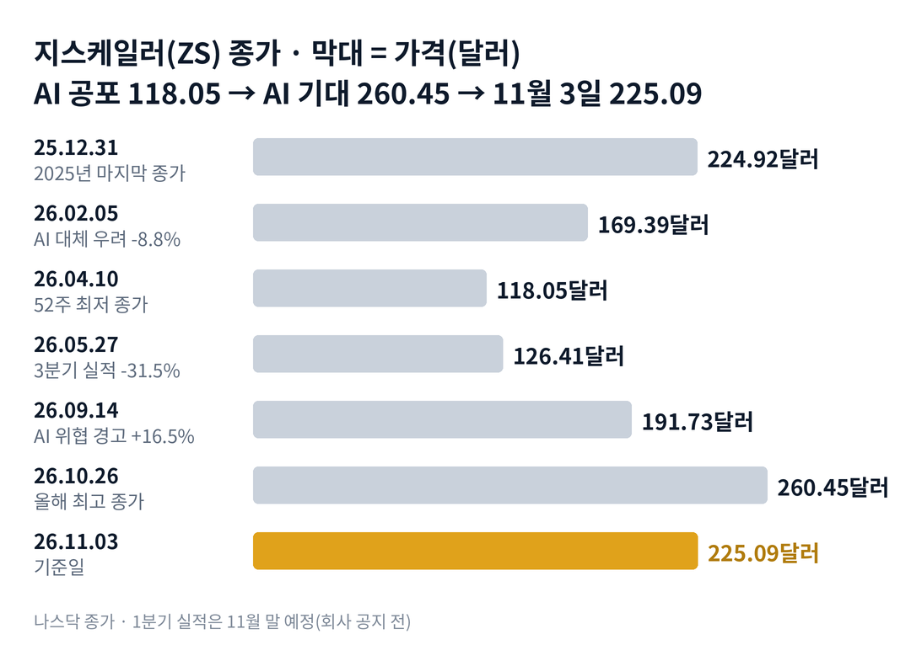

## 짧은 답

> **핵심:** 올해 지스케일러 주가를 움직인 것은 실적보다 'AI가 보안에 독이냐 약이냐'는 시장의 해석이었고, 그 해석이 한 바퀴 돈 끝에 주가는 연초 자리로 돌아왔습니다.

근거는 세 가지입니다. 상반기에는 새 AI 모델이 나올 때마다 보안 소프트웨어가 대체될 수 있다는 걱정에 크게 빠졌습니다. 가을에는 같은 AI가 공격을 늘려 보안 예산이 커진다는 기대에 업종이 함께 올랐습니다. 그리고 실적 발표 날에는 매출보다 다음 해 성장 전망이 주가를 정했습니다.

> **국면 정의(지스케일러 시리즈 공통):** 국면 A · AI 대체 공포 — 새 AI 모델이나 도구가 나올 때마다 보안 소프트웨어가 함께 빠지는 때. 국면 B · AI 위협 수혜 — AI 공격이 보안 예산을 늘린다는 기대로 업종이 함께 오르는 때. 국면 C · 실적 검증 — 테마보다 실적과 성장 전망이 주가를 정하는 때.

**11월 3일 진단: 국면 B(AI 위협 수혜)가 끝나고 국면 C(실적 검증)로 넘어가는 길목입니다.** 실적 전 한 달 동안 올라 있던 1분기 실적이 그 뒤 20거래일 동안 어땠는지는 3부 '1분기 실적 여덟 번' 표에 있습니다.

> **유의사항** 저자는 금융·투자 자문가가 아닙니다. 이 글은 공개 공시와 시세를 정리한 교육용 분석이며 특정 매매를 권하지 않습니다. 과거의 주가 반응이 미래에 반복된다는 보장은 없고, 지스케일러는 실적 다음 날 30% 넘게 움직인 적이 있는 변동성이 큰 종목입니다. 실제 투자 전에는 최신 가격과 공시를 직접 확인하세요.

이 리포트는 유튜브 시청자 요청으로 만들었습니다.

## 1부. 지스케일러는 어떤 회사인가

> **핵심:** 회사 안팎의 모든 접속을 자기 클라우드라는 검문소에 거치게 하는 보안 구독 회사로, 매출은 꾸준히 늘지만 성장 속도가 내려오는 단계입니다.

지스케일러는 미국 캘리포니아주 산호세에 본사를 둔 클라우드 보안 회사입니다. 직원과 기기, 그리고 AI 에이전트가 인터넷이나 사내 앱에 접속할 때 회사 네트워크에 바로 붙지 않고 지스케일러 클라우드를 거치게 합니다. 회사는 이를 제로 트러스트(아무도 기본으로 믿지 않는 보안 방식)라고 부릅니다. 7월 말 고객은 약 1만 1,000곳입니다.

7월에 끝난 2026 회계연도 매출은 1년 전보다 25% 늘었습니다. 다만 그중 일부는 2025년 8월 인수한 보안 관제 회사 레드 카나리에서 나왔습니다. 인수 효과를 빼면 성장률은 20%입니다. 회사가 9월에 내놓은 2027 회계연도 전망에서는 매출 성장률이 16.6~17.5%로 낮아집니다.

### 숫자로 본 지금의 크기(11월 3일 기준)

| 항목 | 값 · 근거 |
| --- | --- |
| 종가 | **225.09달러** 11월 3일 |
| 시가총액 | **약 367억 달러** 발행 주식 1억 6,305만 주(8월 27일) 기준 |
| 연간 반복 매출(ARR) | **37억 7,100만 달러** 7월 말, 1년 전보다 25% 증가 |
| 2027 회계연도 매출 전망 | **39억 800만~39억 3,800만 달러** 9월 3일 발표, 10월 6일 재확인 |
| 1분기 매출 전망 | **9억 3,500만~9억 3,900만 달러** 8~10월, 약 19% 증가 |
| 현금·투자 | **약 34억 7,400만 달러** 7월 말, 전환사채 원금 17억 2,500만 달러 |

이 말은 곧 회사는 여전히 빠르게 크지만, 시장이 익숙했던 20%대 중반 성장에서 10%대 후반으로 내려오는 첫해라는 뜻입니다. 연간 반복 매출(ARR)은 1년 동안 이어질 구독 매출을 연 단위로 환산한 값입니다.

위 그림처럼 올해 주가는 연초와 거의 같은 자리로 돌아왔지만, 그 사이에 절반으로 줄었다가 두 배 넘게 올랐습니다. 이렇게 크게 오르내리게 만든 날들은 언제였을까요?

## 2부. AI가 내리고, AI가 올린 한 해

> **핵심:** 올해의 큰 하락은 AI 대체 공포와 실망스러운 실적 전망에서, 큰 상승은 AI 위협이 보안 수요를 키운다는 기대에서 나왔습니다.

2월 5일 새 AI 모델들이 잇따라 나오자 좌석 수로 돈을 받는 소프트웨어가 AI 에이전트로 대체될 수 있다는 걱정이 커졌습니다. 그날 주가는 8.8% 내렸습니다. 2월 말 실적에서 연간 전망을 올렸는데도 다음 날 12.2% 더 빠졌습니다.

3월 말과 4월 초에는 공격 능력이 뛰어난 새 AI 모델 소식이 이어졌습니다. 4월 9일 11.3% 내린 뒤, 4월 10일 118.05달러로 52주 가장 낮은 종가를 찍었습니다. 연초보다 거의 절반 아래였습니다.

5월 27일에는 실적이 문제였습니다. 매출은 25% 늘었지만 다음 분기 전망과 현금 흐름 전망이 기대에 못 미쳤고, 영업 책임자 두 명이 떠났습니다. 그날 하루 31.5% 빠져 상장 뒤 가장 큰 하루 하락을 기록했습니다.

방향이 바뀐 것은 9월입니다. 9월 14일, AI 공격 위험을 경고한 글이 나오자 보안주가 함께 올랐고 지스케일러는 16.5% 올랐습니다. 10월 6일 투자자 행사에서 전망을 재확인하며 연간 반복 매출 100억 달러라는 장기 목표를 내놓았고, 10월 26일 260.45달러로 올해 가장 높은 종가를 찍었습니다.

### 올해 주가를 크게 움직인 날

| 날짜 · 사건 | 당일 | 그날 종가 |
| --- | --- | --- |
| **2026.02.05** AI 대체 우려 확산 | -8.8% | 169.39달러 |
| **2026.04.09** 공격형 AI 모델 공개 | -11.3% | 122.23달러 |
| **2026.05.27** 3분기 실적·전망 실망 | -31.5% | 126.41달러 |
| **2026.09.14** AI 위협 경고 글 | +16.5% | 191.73달러 |
| **2026.09.25** 영업 책임자 교체 | -10.1% | 193.05달러 |
| **2026.11.02** 테크주 매도 이어짐 | -5.9% | 223.79달러 |

이 말은 곧 같은 AI 소식이 상반기에는 악재로, 가을에는 호재로 읽혔다는 뜻입니다. 10월 29일부터 4거래일 동안은 다시 12.5% 내려 11월 3일 225.09달러가 됐습니다. 그렇다면 테마가 식은 뒤 맞는 실적에서는 무엇이 주가를 정했을까요?

## 3부. 1분기 실적 여덟 번의 기록

> **핵심:** 상장 뒤 1분기 실적 8번 가운데 첫 반응일에 오른 것은 3번, 20거래일 뒤 실적 전보다 높았던 것도 3번이었습니다.

지스케일러의 회계연도는 7월에 끝나서, 1분기(8~10월) 실적은 해마다 11월 말이나 12월 초에 나옵니다. 상장 뒤 1분기 실적 8번을 모두 모았습니다. 모두 장 마감 뒤 발표라 다음 거래일을 첫 반응일로 잡았고, '20거래일 뒤'는 발표일 종가와 비교했습니다.

### 1분기 실적 여덟 번, 그날 나온 내용과 20거래일 뒤

| 이벤트일 · 핵심 내용 | 당일 | 20거래일 뒤 |
| --- | --- | --- |
| **2018.12.04** 상장 첫해 1분기 *(실적 전 20일 -6.4%)* | +15.5% | +12.3% |
| **2019.12.03** 1분기 실적 발표 *(실적 전 20일 +19.0%)* | -5.6% | -10.4% |
| **2020.12.02** 매출 +52%, 전망 상향 *(실적 전 20일 +9.0%)* | +26.4% | +36.1% |
| **2021.11.30** 사상 최고가 직후 *(실적 전 20일 +8.9%)* | -8.3% | -6.9% |
| **2022.12.01** 1분기 실적 발표 *(실적 전 20일 +4.6%)* | -10.7% | -22.6% |
| **2023.11.27** 1분기 실적 발표 *(실적 전 20일 +24.3%)* | +1.0% | +17.0% |
| **2024.12.02** 청구액 증가율 +13% *(실적 전 20일 +14.2%)* | -4.7% | -13.5% |
| **2025.11.25** 매출 +26%, 전망 무난 *(실적 전 20일 -11.9%)* | -13.0% | -20.8% |

이 말은 곧 1분기 실적은 지스케일러에게 쉬운 날이 아니었다는 뜻입니다. 특히 최근 5번 가운데 4번은 첫날 내렸습니다. 지난해에는 매출이 26% 늘었는데도, 다음 분기 전망이 시장 예상 수준에 그쳤다는 이유로 13.0% 빠졌습니다.

지금처럼 실적 전 한 달 동안 올라 있던 해는 6번입니다. 이 6번 가운데 20거래일 뒤 실적 전보다 높았던 것은 2020년과 2023년 2번뿐이었습니다. 11월 3일 종가는 20거래일 전보다 6.0% 높습니다. 그렇다면 오른 두 번과 내린 네 번을 가른 것은 무엇이었을까요?

## 4부. 되풀이된 이야기

> **핵심:** 지스케일러의 실적 날 주가는 그 분기의 매출보다 '다음을 얼마나 자신하느냐', 곧 전망을 올리느냐에 반응해 왔습니다.

과거 기록에서 이번 실적에 쓸 수 있는 시사점은 세 가지입니다.

첫째, 매출 증가만으로는 부족했습니다. 2025년 11월에도, 2026년 5월에도 매출은 25% 넘게 늘었지만 다음 분기·다음 해 전망이 기대에 못 미치자 크게 빠졌습니다. 반대로 크게 오른 2020년 12월에는 연간 전망을 올렸습니다.

둘째, 영업 조직의 변화는 늘 실행 위험으로 읽혔습니다. 올해 5월과 9월에 영업 책임자가 바뀔 때마다 주가가 크게 내렸습니다. 새 영업 책임자 아래에서 맞는 첫 실적이 이번 1분기입니다.

셋째, 테마로 오른 상승분은 실적 앞에서 쉽게 되돌려졌습니다. 9월부터 10월 말까지의 상승은 업종 전체의 기대에서 나왔고, 실적 전에 이미 상당 부분 되돌려졌습니다. 그래서 이번에는 회사 숫자가 직접 주가를 받쳐야 합니다. 그렇다면 지금은 어느 단계이고, 실적 뒤 갈림길은 몇 갈래일까요?

## 5부. 지금 어느 단계이고, 무엇을 볼까

> **핵심:** 국면 B(AI 위협 수혜)의 열기가 식고 국면 C(실적 검증)로 넘어가는 길목이며, 1분기 매출이 전망 상단을 넘고 연간 전망을 올리는지가 다음 방향을 가릅니다.

**2026년 11월 3일 진단: 국면 C(실적 검증) 진입.** 근거는 세 가지입니다. 10월 26일 고점 뒤 4거래일 동안 업종 매도와 함께 12.5% 내렸습니다. 10월 6일 투자자 행사 뒤 회사의 새 숫자는 없었습니다. 다음 큰 사건은 1분기 실적입니다. 국면 A(AI 대체 공포)로 돌아가는 신호는 새 AI 모델 발표 날 업종이 함께 10% 가까이 빠지는 것입니다.

### 앞으로 일어날 수 있는 일

**과거 기록:** 1분기 실적 8번 중 3번만 첫날 올랐고, 실적 전 한 달 올라 있던 6번 중 2번만 20거래일 뒤 높았습니다. **확인된 사실:** 1분기 매출 전망은 1부 표와 같고, 연간 전망은 10월 6일 재확인됐으며, 실적 발표일은 아직 공지되지 않았습니다. **추정:** 아래 표의 가능성은 '회사 숫자가 이렇게 나올' 확률을 위 사실과 기록을 보고 분석자가 주관적으로 매긴 값입니다. 통계로 계산한 값이 아니고, 주가가 오를 확률도 아닙니다.

| 시나리오 · 예상 반응(판정 12월 23일) | 상단·상향 | 가능성(추정) |
| --- | --- | --- |
| 1 · 상단 넘고 연간 전망 상향 2020년 12월처럼 크게 반응할 수 있음 | ○ / ○ | 중간 (30~40%) |
| **2 · 상단 넘었지만 전망 유지** 회사 숫자는 안정, 주가 방향은 2025년 11월처럼 약할 수 있음 | ○ / × | 높음 (35~45%) |
| 3 · 상단 못 미쳤지만 전망 상향 드문 조합, 해석이 엇갈림 | × / ○ | 낮음 (5~10%) |
| 4 · 둘 다 못 미침 2026년 5월처럼 큰 하락 위험 | × / × | 낮음 (10~20%) |

표의 '상단'은 1분기 매출이 회사 전망 상단인 9억 3,900만 달러 이상인 경우입니다. '상향'은 실적 발표 때 2027 회계연도 매출 전망을 올리는 경우입니다. 12월 23일은 실적이 지난해처럼 11월 24일 장 마감 뒤 나온다고 가정한 20번째 거래일입니다. 발표일이 정해지면 판정일을 다시 적습니다.

시나리오 2를 가장 높게 본 이유는, 회사가 9월에 낮춘 전망을 10월에 다시 확인했을 뿐 올리지는 않았기 때문입니다. 연초에 전망을 높게 잡지 않는 회사라면 1분기에는 넘고 연간은 유지하는 경우가 흔합니다. 여기서 둘을 나눠 봐야 합니다. 회사 숫자가 안정적일 가능성은 높게 봤지만, 그것이 곧 주가 상승을 뜻하지는 않습니다.

시나리오 1을 중간으로 둔 근거는 연간 반복 매출이 네 분기 연속 25% 안팎으로 늘었다는 점입니다. 다만 그 안에는 레드 카나리 인수 효과가 들어 있어, 인수 효과를 뺀 성장이 얼마나 유지되는지가 관건입니다.

## 6부. 조심할 점과 체크리스트

> **핵심:** 1분기 실적 기록은 8번뿐인 작은 표본이고, 올해 주가는 회사 밖의 AI 소식에 크게 흔들려 왔다는 점을 함께 봐야 합니다.

3부 표는 '1분기 실적에는 반드시 내린다'는 규칙이 아닙니다. 8번은 작은 표본이고, 해마다 금리와 성장주 분위기가 달랐습니다. 2018~2022년 일부 실적은 그날 나온 내용을 원문으로 확인하지 못해 '1분기 실적 발표'로만 적었습니다.

회사 자체의 위험도 세 가지를 짚습니다. 첫째, 성장률이 20%대 중반에서 10%대 후반으로 내려오는 첫해입니다. 둘째, 주식 보상 비용이 매출의 약 4분의 1로 커서, 회계상 순이익은 아직 적자입니다. 셋째, 새 AI 모델 발표처럼 회사가 통제할 수 없는 소식이 업종 전체를 흔들 수 있습니다.

10월 말 테크주 매도와 9월 보안주 랠리의 배경은 언론 보도와 분석 사이트를 통해 확인한 것이며 회사 설명이 아닙니다. 실적 발표일은 회사 공지가 나오면 이 글에 반영합니다.

이 체크리스트는 5부의 국면 진단과 함께 써야 합니다.

- ☐ 11월 중 회사가 1분기 실적 발표일을 공지했는가
- ☐ 실적 날 1분기 매출이 9억 3,900만 달러 이상인가
- ☐ 실적 날 2027 회계연도 매출 전망이 39억 3,800만 달러보다 올라갔는가
- ☐ 실적 날 연간 반복 매출 증가율이 인수 효과를 빼고 7월 말의 20% 이상인가
- ☐ 실적 다음 날 반응이 과거 1분기 범위(-13.0% ~ +26.4%) 안인가
- ☐ 12월 23일까지 새 AI 모델 발표 날 보안주가 함께 10% 가까이 빠졌는가

다음 갱신은 1분기 실적과 첫 반응을 본 뒤에 합니다.
